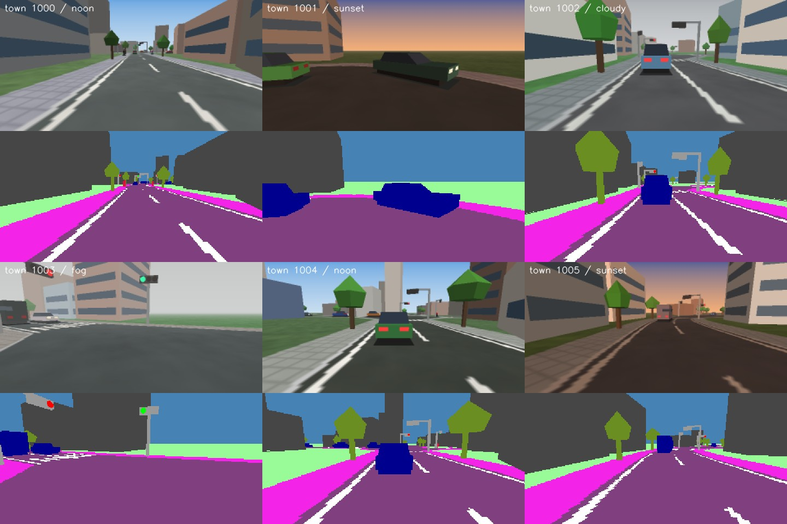
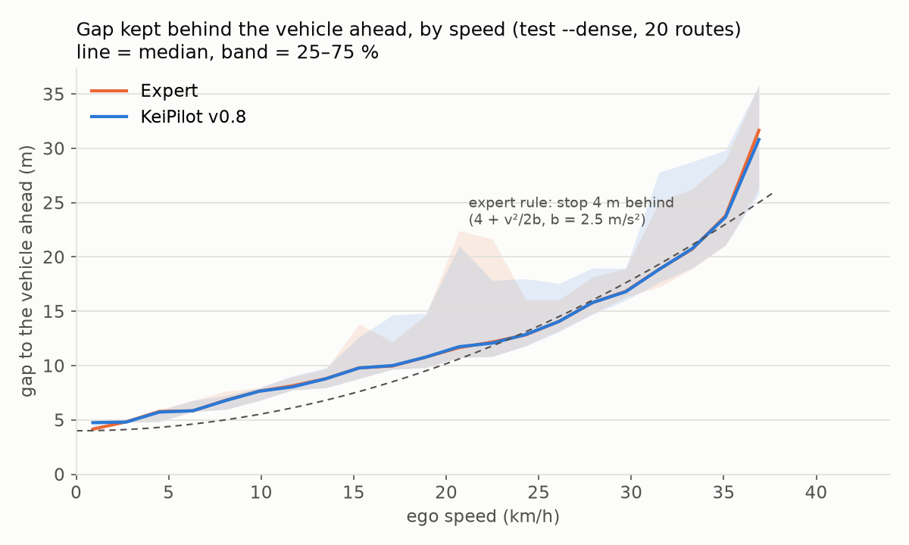
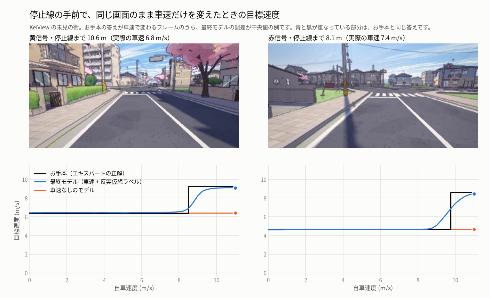
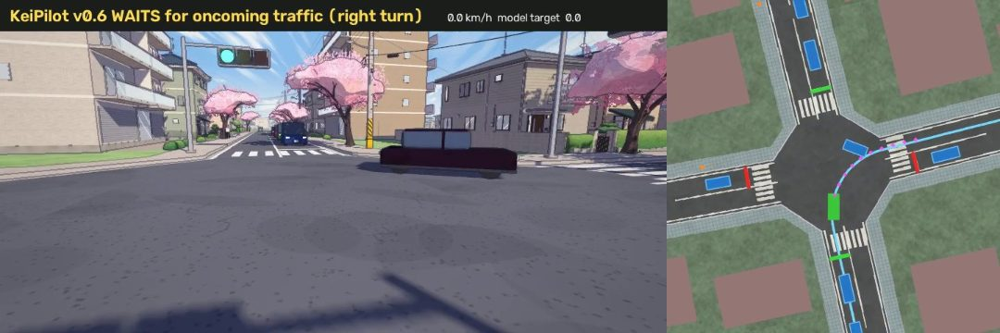
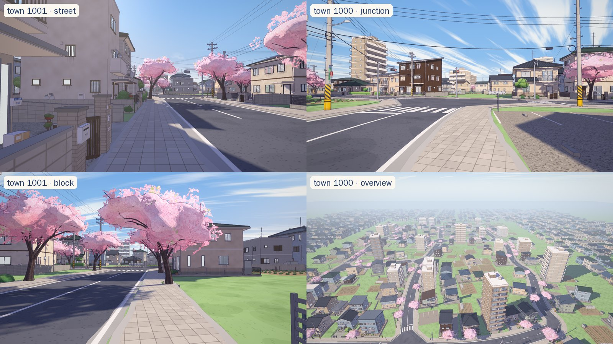
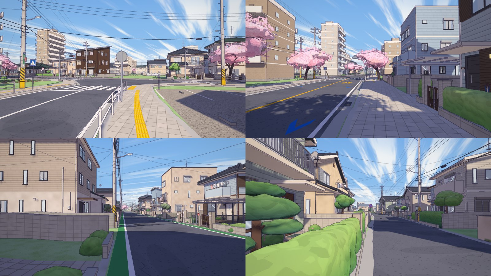
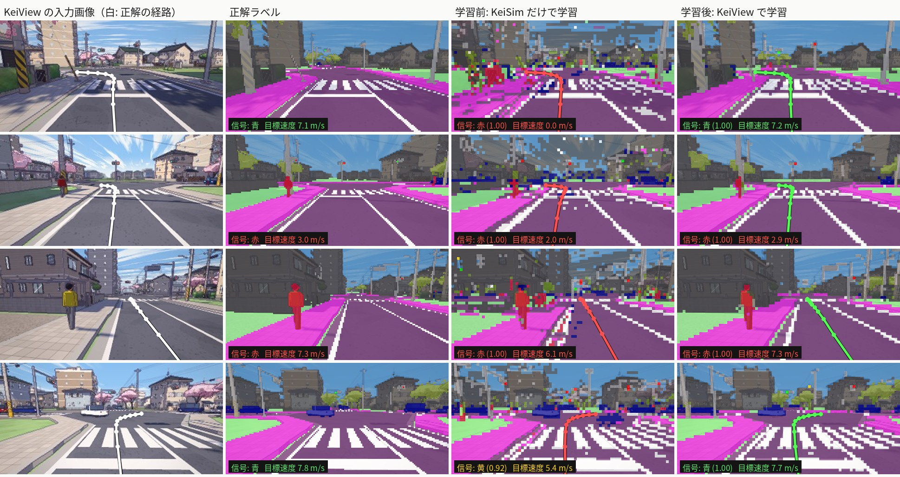

# KeiSim + KeiPilot — 軽量クローズドループ自動運転環境

**軽 (Kei) = light.** ゲームエンジンを使わず `numpy + OpenCV + PyTorch` だけで動く、
「**シミュレータ × 軽量 E2E モデル**」を最初から一体で設計したクローズドループ環境です。

> **English summary** — KeiSim is a procedurally generated, Japan-style (left-hand traffic) driving simulator
> written in plain numpy + OpenCV (no game engine, no GPU needed; ~30× real time without rendering).
> KeiPilot is a 15M-parameter end-to-end driving model (one camera frame + ego speed), trained inside KeiSim by
> imitating a privileged expert, plus DAgger. The expert's plan depends on the ego speed only at traffic lights, so
> recorded frames are relabelled for counterfactual speeds; this is what makes the model actually use its speed input.
> The same towns can also be rendered by KeiView, an anime cel-shaded three.js renderer in `web/`.
> KeiPilot drives real towns too: KeiSim builds a town from the roads and buildings of an OpenStreetMap box, and
> KeiPilot is trained by DAgger in three 1 km boxes of Sapporo next to a held-out one. Most junctions there have no
> signals, and the minor road gives way. The car that has priority comes from the side, mostly outside the camera's
> 100 deg until the last metres. v0.9 slowed to 10 km/h (徐行, as Japanese law asks) at such crossings but never
> stopped; v0.10 adds a stop line with 止まれ (STOP) at the minor road's entry, where the expert and the other cars
> come to a full stop. One frame cannot tell "about to stop" from "stopped, now go", so v0.10 also takes the distance
> driven since it last stood (capped at 10 m) as an input. On 60 held-out Sapporo routes with these stop lines,
> v0.10 stops fully at all of them (v0.9: 22 %), no longer stands still for good (KeiSim images: 0 routes, v0.9 9)
> and scores Driving Score 0.928 / 0.977 (KeiSim / KeiView images; v0.9 0.870 / 0.965). Its 8 collisions come after
> the stop: from there the 100 deg camera sees a car 30 m up the priority road 1 % of the time, so a wider view is
> needed to fix them.
> In the procedural towns v0.10 scores 1.000 / 1.000 / 0.985 / 1.000 on the 600 m suites in KeiSim and
> 1.000 / 1.000 / 0.963 in KeiView (unseen towns A / B / dense traffic). It drives Japan's two-phase signals, where
> right turns wait inside the junction for a gap in the oncoming traffic; on 320 fresh two-phase routes it has 13
> collisions (v0.9 15) and 4 red-light violations (v0.9 0): standing at the line, it creeps 0.1-0.3 m as the light
> turns red.
> It drives in the browser too, with no install and with
> surrounding traffic: <https://southern-star.github.io/keisim/?pilot=1> (onnxruntime-web on WebGPU, or WASM).
> Quick start: `bash setup.sh`, download `keipilot.pt` from Release v0.10.0, then
> `uv run scripts/demo.py --agent model --ckpt runs/keipilot.pt --show`.



**ブラウザで試す**: <https://southern-star.github.io/keisim/?pilot=1>
KeiPilot がブラウザの中で KeiView の街を運転します。インストールは不要で、推論は onnxruntime-web（WebGPU、なければ WASM）です。
次の交差点で曲がる方向は ← ↑ → で指定できます。周りの車も走ります（重いときは T キーで消せます。[web/README.md](web/README.md#ブラウザで-keipilot-を走らせるパイロットモード)）。
右上のメニューで、日本でふつうの二段階の信号の町（town 1015, 1018）も選べます。右折は交差点の中で対向車の切れ目を待ちます。

| | CARLA | MetaDrive + 既存モデル | **KeiSim + KeiPilot** |
|---|---|---|---|
| 依存 | UE4, GPU 必須, 数十 GB | Panda3D | numpy / OpenCV / PyTorch のみ |
| 起動 | 数十秒〜 | 数秒 | 街生成 0.14 s + テクスチャ 0.73 s |
| 速度 (1 プロセス, i5-10400F) | ≲ 実時間 | 高速 | 描画なし **24.6×** 実時間 / カメラ込み **10.8×** |
| 認識のドメインギャップ | 小 (ただし重い) | **大 (既存モデルが見えない)** | **ゼロ: 同じ世界で学習する** |
| クローズドループ評価 | ○ | ○ | ○ (DS/RC/IS, 違反ログ, 動画, 決定論的リプレイ) |

---

## 1. 何が問題で、どう解いたか

* CARLA は重い（UE4・GPU・巨大アセット・client/server 同期）。
* MetaDrive は軽いが、実データや CARLA で学習したモデルからすると
  **描画の分布が違う (ドメインギャップ)** ため、車も信号も「認識されない」。

→ **見た目をリアルに寄せる競争をやめ、シミュレータとモデルをセットで設計する。**

1. シミュレータは **特権情報付きエキスパート** と、ピクセル単位で正確な **セマンティックラベル** を標準装備する。
2. モデルはその世界のカメラ画像（と自車速度）を入力に、エキスパートを模倣して学習する（LBC / Roach と同じ系統）。
3. 閉ループでの誤差蓄積は、**ノイズ注入 (DART)**・**仮想カメラずらし**・**DAgger** で潰す。

手続き生成なので「学習に使っていない街」で汎化を測れます（学習: town 0–399、評価: town 1000–1009）。

## 2. 結果 (すべて `runs/eval/*.json`)

600 m ルート × 20 本のスイート。`(town_seed, episode_seed)` で地図・経路・交通・歩行者・信号位相・天候が完全に再現されます。
DS = Route Completion × 違反ペナルティ（車両 ×0.60、歩行者 ×0.50、静止物 ×0.65、信号無視 ×0.70。衝突時点で打ち切り）。

| エージェント | 未見の街 A | 未見の街 B | 既知の街・新ルート | 高密度交通 (未見 A) |
|---|---|---|---|---|
| 特権エキスパート (正解情報) | 1.000 | 1.000 | 1.000 | 1.000 |
| KeiPilot v0.1 · BC (カメラのみ) | 0.945 | 0.871 | 0.985 | 0.798 |
| KeiPilot v0.1 · DAgger (カメラのみ) | 0.970 | 0.955 | 0.970 | 0.921 |
| **KeiPilot v0.2** (カメラ + 自車速度) | **1.000** | **1.000** | **1.000** | **1.000** |
| **KeiPilot v0.5** (+ 安全層 BrakeHold / RedHold) | **1.000** | **1.000** | **1.000** | **1.000** |
| **KeiPilot v0.6** (+ 右折待ち、安全層つき) | **1.000** | **1.000** | **1.000** | **1.000** |
| **KeiPilot v0.7** (+ 右折の失敗を狙った学習、安全層つき) | **1.000** | **1.000** | **1.000** | **1.000** |
| **KeiPilot v0.8** (+ 画面の端の前の車への追従、安全層つき) | **1.000** | **1.000** | **1.000** | **1.000** |
| **KeiPilot v0.9** (+ 実在の町 (札幌) の学習、安全層つき) | **1.000** | **1.000** | 0.985 | **1.000** |
| **KeiPilot v0.10** (+ 止まれと、止まってからの距離の入力、安全層つき) | **1.000** | **1.000** | 0.985 | **1.000** |

* **KeiPilot v0.2**: 未見の街 80 ルート (48.7 km) で、**完走率 100%、違反 0 件**。
  - 内訳は、上の KeiSim の 40 ルートと、KeiView (6 章) の 40 ルートです。
  - 高密度交通でも違反 0 件です (KeiSim)。
* **KeiPilot v0.5**: KeiSim の 4 スイート 80 ルートはすべて完走し、違反は 0 件です。
  - KeiView で描いた同じスイートでは、未見の街 A が 1.000、未見の街 B が 0.953、高密度交通が 0.995 です。
  - 未見の街 B の 1 本 (街 1005) では、青信号で発進した直後に、交差点を横切る車に反応して止まり直しました。そのあと信号の判断が赤と青の間で揺れて、90 秒動けませんでした。同じルートをもう一度走らせると 2 秒後に発進したので、まれにしか起きない失敗です。
  - 高密度交通の 1 本は NPC の詰まりで、エキスパートも進めない状況でした。
  - v0.2 は 600 m の KeiView 40 本もすべて完走でした。v0.5 がはっきり良くなるのは、下の長距離スイートです。
* **KeiPilot v0.6**: KeiSim の 4 スイート 80 ルートはすべて完走し、違反は 0 件です。
  - KeiView で描いた同じスイートでは、未見の街 A と B が 1.000 (v0.5 の B の 1 本も完走)、高密度交通が 0.995 (NPC の詰まり 1 本) です。
* **KeiPilot v0.7**: KeiSim の 4 スイート 80 ルートはすべて完走し、違反は 0 件です。
  - KeiView では、未見の街 A が 0.980、B が 1.000、高密度交通が 0.995 (NPC の詰まり 1 本) です。A の 1 本は、信号待ちのあと青になっても発進せず、90 秒動けませんでした。
* **KeiPilot v0.8**: KeiSim の 4 スイート 80 ルートはすべて完走し、違反は 0 件です。
  - KeiView では、未見の街 A と B が 1.000、高密度交通が 0.996 (v0.7 と同じ NPC の詰まり 1 本) です。
  - 高密度交通は、600 m を走りきるのに 400 秒を超えるルートがあるので、v0.7 と同じく `--max_steps 6000` で評価しています。
* **KeiPilot v0.9**: KeiSim の 4 スイート 80 ルートのうち 79 本を完走し、違反は 0 件です。
  - 完走しなかった 1 本 (既知の街) は、道に立ち止まった歩行者の前で、エキスパートも進めない場面でした。
  - KeiView では、未見の街 A が 1.000、B が 0.884、高密度交通が 0.996 (v0.8 と同じ NPC の詰まり 1 本) です。
  - B の 2 本は、信号待ちのあと青になっても発進せず、90 秒動けませんでした。1 本は青を赤と読み違え、もう 1 本は青と読めているのに目標速度が 0 のままでした。
    止まったまま動かない失敗は、2 現示の街でも増えています (下の long3c〜long3f と開発ログ 9.)。B のもう 1 本は、歩行者の前の詰まりです。
* **KeiPilot v0.10**: KeiSim の 4 スイート 80 ルートのうち 79 本を完走し、違反は 0 件です。完走しなかった 1 本は、v0.9 と同じ歩行者の前の詰まりです。
  - KeiView では、未見の街 A と B が 1.000 (v0.9 が B で動けなかった 3 本も完走)、高密度交通が 0.963 です。
  - 高密度交通の 1 本は、右折して交差点を出たあと、止まりかけた前の車に向かって加速し直し、時速 9 km で追突したものです。
* KeiPilot v0.1 (DAgger) は、未見の街 40 ルートで完走率 100%、衝突 0 件でした。
  - 減点は信号無視 5 件 (0.21/km) です。
  - 高密度交通では 20 本中 19 本を完走しました (歩行者との接触 1 件)。
* 未見の街 6,000 フレームでのオフライン指標 (BC → DAgger → v0.2):
  - 経路 ADE: 0.100 → 0.090 → 0.079 m
  - 目標速度 MAE: 0.137 → 0.119 m/s (DAgger → v0.2)
  - 信号 4 クラス認識: 95.9 → 96.2 → 96.1 %
  - セグメンテーション mIoU: 0.819 → 0.829 → 0.814
  - v0.2 は KeiView 用と兼ねた 1 つのモデルなので、KeiSim の画像での mIoU は少し下がります。
* エキスパートは v0.2 で黄信号の判断を法令どおりに変えました (下の開発ログ 4.)。変更の前後とも全スイートで 1.000 です。

**長距離スイート** (`--suite long`)
600 m のスイートでは v0.2 が満点で、それ以上の差を測れなくなったので追加しました。
未見の街 1010〜1019 で、2.5 km のルートを 20 本走ります (約 50 km、信号つきの停止線を約 350 回通過)。

| 長距離スイート | エキスパート | v0.1 (カメラのみ, `keipilot_kv_dagger`) | **v0.2** |
|---|---|---|---|
| KeiSim: DS / 信号無視 | 1.000 / 0 | 0.853 / 11 | **0.985 / 1** |
| KeiView: DS / 信号無視 | — | 0.875 / 7 | **0.975 / 0** |

* 信号 1,000 回あたりの信号無視は、v0.1 が 25 件、v0.2 が 1.4 件です。
* v0.2 の信号無視 1 件は、次の流れで起きました。
  - 黄信号で止まり始めたものの、ブレーキがエキスパートより少し弱く、「安全に止まれる距離」を割り込みました。
  - そのため判断が「進む」に切り替わり、停止線を越える 0.25 秒前に赤になりました。
  - 黄信号の判断を毎フレームの状況だけで決めるルールの弱点です。
* KeiView で、両モデルとも同じ地点 (街 1010) で動けなくなったルートが 1 本あります (上の表の DS の減点)。
  - あとで入れた失敗の記録 (下記) でわかりました: 青信号を赤と見間違えて、発進していませんでした。

**長距離 × 高密度交通** (`--suite long --dense`)
車と歩行者が約 2 倍の条件です。シミュレータ側の NPC の詰まりや割り込みがあるので、エキスパートでも DS 0.956 です。
評価では、違反や打ち切りがあったルートについて、前後の判断を `runs/failures/` に自動で保存します。
「動けず」は、エキスパートが 3 秒以上続けて「進め」だったのに止まっていればモデルの誤り、そうでなければ交通の詰まり、と自動で分類します。

| モデルの誤りによる失敗<br>(長距離 + 長距離 × 高密度、KeiSim + KeiView の計 80 ルート、約 190 km、信号約 1,350 回) | v0.2 | v0.3 | **v0.5** | **v0.6** | v0.7 | v0.8 | v0.9 | **v0.10** |
|---|---|---|---|---|---|---|---|---|
| 信号無視 | 3 | 1 | **0** | 1 | 1 | **0** | **0** | **0** |
| 青信号を赤と見間違えて発進しない | 2 | 3 | **0** | **0** | **0** | **0** | **0** | **0** |
| 歩行者との接触 | 2 | 4 | 2 | **0** | 1 | 2 | 2 | **0** |
| 渋滞中の低速での追突 | 1 | 0 | 1 | **0** | 1 | **0** | 1 | **0** |

* v0.3 = v0.2 + 黄信号のラベルを「急ブレーキ (6 m/s²) で止まれるなら止まる」に変えて追加学習 (label version 4)。
  - 一度止まると決めたら、途中で「進む」に切り替わらなくなりました。
* v0.5 = v0.3 + 信号機の描画の修正 (下の開発ログ 5.) と、その描画での学習と DAgger。
  - 2 つの安全装置 (`evaluate.py --brake_hold --red_hold`) を付けて評価しています。
  - 学習していない未見の街の KeiView 画像での信号 4 クラス認識は 97.9 % です。描画の修正前は 93.6 % でした。
* v0.6 = v0.5 + 2 現示の信号の街のデータ (右折待ち) と DAgger (下の開発ログ 6.)。
  - 信号無視の 1 件は、黄で前の車について停止線の手前で止まったあと、黄のうちに発進し直して線を越えたものです (KeiView)。
  - 交通の詰まりでの打ち切りは、v0.5 と同じ 5 本でした。
* v0.7 = v0.6 + 右折の失敗を狙った学習 (下の開発ログ 7.)。この 80 ルートでのモデルの誤りは 3 件で、v0.6 より 2 件多くなりました。
  - 黄に変わったとき前の車について 3 m/s で動いていて停止線を越えた信号無視 (KeiView)、歩行者との接触、渋滞中の低速での追突が 1 件ずつです。
  - どれも 1 件ずつのまれな失敗で、評価のばらつきの範囲です。2 現示の街では、v0.7 の衝突は v0.6 よりはっきり減っています (下の long3 / long3b)。
* v0.8 = v0.7 + 前の車を画面の端に捉えた場面の DAgger (下の開発ログ 8.)。この 80 ルートでのモデルの誤りは、歩行者との接触 2 件 (どちらも KeiView) です。
* v0.9 = v0.8 + 実在の町 (札幌) の学習 (下の開発ログ 9.)。この 80 ルートでのモデルの誤りは 3 件です。
  - 歩行者との接触 2 件 (KeiSim の高密度と KeiView の通常で 1 件ずつ) と、渋滞中の低速での追突 1 件 (KeiView の高密度) です。
  - 追突は、出口の詰まった交差点に青で入り、前の車が止まったあとで、じわっと動き出したものです。
* v0.10 = v0.9 + 止まれと、止まってからの距離の入力 (下の開発ログ 10.)。この 80 ルートでのモデルの誤りは 0 件です。
  - 動けなくなった 3 本は、どれもエキスパートも進めない場面です (前の車の詰まり 2 本、道に立ち止まった歩行者 1 本)。
* 残る弱点
  - **歩行者**: 横断しそうな歩行者への反応が、エキスパートより 1 秒ほど遅れることがあります。
    - エキスパートは歩行者の 1〜2 秒後の位置を予測して止まりますが、1 枚の画像からは「これから渡る」が読み取りにくいためです。
  - **渋滞の至近距離**: 前の車との距離の見積もりが甘く、低速で軽く追突することがあります。
  - **交通の詰まり**: エキスパートでも動けない詰まりが、評価で最も多い減点です (v0.5 で 5 本)。シミュレータ側で直しました (下の long2)。

**長距離スイート 2** (`--suite long2`)
長距離・高密度での一番大きな減点は、モデルではなく NPC のどん詰まりでした。そこでシミュレータ側を直したスイートを足しました。今までのスイートと街は 1 ビットも変わっていません。
* **街**: 区画の長さを 70〜200 m で混ぜた「varied」の街です (`TownConfig.block_mode`)。今までの街は 70〜100 m で一定です。
  - エキスパートだけで調べると、街を大きくしても (交差点を 6〜8 列に) 詰まりは減りませんでした。区画を長くすると、どん詰まりが半分ほどに減りました。
* **交通の修正** (`TrafficConfig` の `box_rule`, `release_hidden`)
  - 交差点の中に別の方向の車がいるあいだは、青でも停止線で待ちます (NPC とエキスパート)。交差点の中で 2 台が互いの進路を塞いで永久に止まるのが、どん詰まりの正体でした。
  - NPC を停止線の直前に置きません (速度を持って置かれた車が止まれずに交差点に入っていた)。
  - 45 秒以上止まっている NPC のうち、自車のカメラに映らない車は別の場所へ移します。
  - 動けないと判定するまでの時間を 90 秒から 180 秒にしました。残る長い待ちは、出口の列がじわじわ進む渋滞で、信号を 3〜4 周期待つのは混んだ街では普通だからです。
* 車線が長いぶん NPC の上限を 2 倍にして、交通の密度を今までの街とそろえています。信号つきの停止線は 20 ルートで約 250 回です (今までの長距離スイートは約 340 回)。

| long2 (2.5 km × 20 ルート、約 50 km) | エキスパート | **v0.5** (安全層つき) | **v0.6** (安全層つき) | v0.7 (安全層つき) | v0.8 (安全層つき) | v0.9 (安全層つき) | **v0.10** (安全層つき) |
|---|---|---|---|---|---|---|---|
| KeiSim: 通常 / 高密度 | 1.000 / 1.000 | **1.000 / 1.000** | **1.000 / 1.000** | **1.000** / 0.960 | 0.976 / 0.933 | **1.000** / 0.960 | **1.000** / 0.996 |
| KeiView: 通常 / 高密度 | — | **1.000 / 1.000** | **1.000 / 1.000** | **1.000 / 1.000** | **1.000** / 0.956 | **1.000 / 1.000** | **1.000 / 1.000** |

* v0.5 は 80 ルート (約 200 km、信号約 1,000 回) をすべて完走し、違反は 0 件でした。シミュレータ由来の失敗もありませんでした。
* 長距離スイートで残っていた失敗 (歩行者 2 件、追突 1 件) は、この 200 km では起きませんでした。まれな失敗をこれ以上測るには、狙った場面を何百回も起こす評価が必要です。
* v0.7 の高密度 (KeiSim) の 1 本は、青を赤と読み違えて発進しなかったものです。
* v0.8 の 4 本は、どれも交通の詰まりでの打ち切りです。違反はありません。
* v0.9 の高密度 (KeiSim) の 1 本は、青を赤と読み違えて発進しなかったものです。違反はありません。
* v0.10 の高密度 (KeiSim) の 1 本は、ゴールの 200 m 手前で時間切れ (2,000 秒) になったものです。最後の 2 分は前の車の列で止まっていて、エキスパートも止まる場面でした。違反はありません。

**長距離スイート 3** (`--suite long3`): 日本のふつうの信号と右折待ち
long2 と同じ街の形で、信号を 2 現示にしました (`TownConfig.signal_mode = "two_phase"`、街のタイプ twophase)。
* 向かい合う方向が同時に青になります (4 差路は 2 本ずつ、3 差路は幹線と枝道)。青 12〜18 秒、黄 3 秒、全赤 2 秒です。
* 同じ青の中で進路が交わる動きは、直進 > 左折 > 右折 の順に優先します。右折は交差点に入った待ち位置で止まり、対向の直進・左折の車が 5 秒以内に来ないときだけ曲がります (NPC もエキスパートも同じ)。
  - 同じ向きの動きどうしが交わるとき (斜めの交差点の右折どうし) は、片方が待ちます (`Town._equal_gives_way`)。
    すでに相手の方向の車に道を譲っている側が待ちます。逆にすると、同じ車線に並んだ車どうしで待ち合いになります。
    そうでなければ細い道路の側 (道路の種類の街)、それも同じなら相手が左から来る側です (左方優先)。
    以前はどちらも譲らず、互いに相手の前で止まって動けなくなることがありました (40 の街の同じ向きの組 571 のうち 10 組がこの交差)。
    この規則は v0.7 の評価のあとで足しました。long3 / long3b の街で変わるのは、街 1011 の交差点 1 か所だけです。
  - 待ち位置は、待っている車が対向車の前方確認の範囲に入らない、いちばん奥の位置を幾何で求めます (`Lane.wait_s`)。
  - 対向車の到着時間は加速を考えて見積もります (止まっている NPC は反応 1 秒)。対向車線では、来られる先頭の車だけを数えます (前で右折待ちの車がいれば、その後ろの車は来られない)。
  - 黄・赤で対向車が止まるかどうかは、NPC 自身のルールとまったく同じ式で予測します。ずれていると、止まると思った車が進んで来て衝突しました。
* 信号の処理能力が上がり、高密度でエキスパートが前の車の後ろで止まっている時間は 1 km あたり 217 秒 (long2 の街) から 168 秒に減りました。
* エキスパートの黄・赤のルールを少し直しました (label version 5)。前の車について 1 m/s 未満でじわじわ進むとき、バンパーが停止線の直前でも止まります。以前は「線まで 0.3 m 以内なら止まれない」として前の車について線を越え、赤の瞬間に信号無視になることがありました。

* 停止線を越えてまだ動いている車 (黄の終わりに入った車) も、交差点の中の車として数えます。数えないと、その車が交差点を抜けきる前に交差方向が青で入って衝突しました。

| long3 (2.5 km × 20 ルート) | エキスパート | v0.5 (安全層つき) | v0.6 (安全層つき) | **v0.7** (安全層つき) | v0.8 (安全層つき) |
|---|---|---|---|---|---|
| KeiSim: 通常 / 高密度 | 1.000 / 1.000 ※ | 0.763 / 0.847 | 0.940 / 0.838 | 0.945 / **0.946** | **0.962** / 0.876 |
| KeiView: 通常 / 高密度 | — | 0.692 / 0.700 | 0.909 / 0.758 | **0.950** / 0.928 | 0.927 / **0.939** |

* v0.5 は右折待ちを知りません。80 ルートの失敗 35 件のうち、19 件はエキスパートなら待つ場面での右折の衝突です。9 件は、前の車について停止線をじわじわ越えた信号無視です (エキスパートの以前のルールと同じ)。
* v0.6 は右折待ちを学びました (下の開発ログ 6.)。80 ルートで、右折の衝突 6 件、そのほかの車との衝突 2 件、歩行者との接触 2 件、信号無視 1 件です。
  - 右折の場面で、待つ・曲がるの判断はエキスパートと 95.8 % 一致します。エキスパートが待つ場面の約 4 % で曲がってしまうのが、残る右折の衝突の元です。
  - 高密度では交通の詰まりやモデルの迷いでの打ち切りもあり、DS は v0.5 とほぼ同じです。
* ※ エキスパートの値は、同じ向きの曲がりどうしの譲り方 (上) を足したあとのものです (`runs/eval/expert_eqyield_*.json`)。
  足す前は 1.000 / 0.963 (long3) と 1.000 / 0.920 (long3b) で、高密度で完走できなかった 3 本はどれも小さな街 1011 の詰まりでした。
  原因は交通量ではなく、斜めの交差点で右折どうしの進路が交わり、どちらも譲らずに向かい合って止まることでした。足したあとは 3 本とも完走し、街 1011 以外のルートの結果は 1 本も変わりません。
  モデルの列は足す前に測った値です。

**long3b** (`--suite long3b`): long3 と同じ街で、エピソード (ルートと交通) だけを変えた 20 ルートです。
右折の衝突のようなまれな失敗は 80 ルートでは数件しか起きず、差がばらつきに埋もれるので、long3 と合わせた 160 ルートで比べます。

| long3b (2.5 km × 20 ルート) | エキスパート | v0.6 (安全層つき) | **v0.7** (安全層つき) | v0.8 (安全層つき) |
|---|---|---|---|---|
| KeiSim: 通常 / 高密度 | 1.000 / 1.000 ※ | 0.919 / 0.866 | 0.980 / **0.960** | **1.000** / 0.865 |
| KeiView: 通常 / 高密度 | — | 0.943 / **0.967** | 0.955 / 0.901 | **0.961** / 0.928 |

| long3 + long3b (160 ルート、約 380 km) | v0.6 | **v0.7** | v0.7 (同じコードで取り直し) | v0.8 |
|---|---|---|---|---|
| DS の平均 | 0.892 | 0.946 | **0.960** | 0.932 |
| 完走 | 133 | **143** | 142 | **143** |
| 右折の衝突 | 9 | 1 | **0** | 1 |
| 青になった直後、交差点に残っている車との衝突 | 2 | **0** | **0** | 1 |
| 歩行者との接触 | 3 | **0** | **0** | 1 |
| そのほかの車との衝突 | — | **0** | **0** | 1 |
| 信号無視 | 1 | 1 | 1 | 1 |
| 動けず: 交通の詰まり / モデルの迷い | 10 / 3 | 14 / 2 | 16 / 2 | 13 / **0** |

* v0.6 → v0.7 で、衝突は 14 件から 1 件になりました。増えたのは交通の詰まりでの打ち切りで、エキスパートでも進めない場面です。
  - あとで分かったことですが、v0.7 が動けなかった 16 本のうち 13 本は街 1011 で、上の※の交差点 (右折どうしが譲らずに止まる) によるものでした。
    同じ向きの曲がりどうしの譲り方を足したあとの街では、この詰まりは起きません。この表 (v0.8 と取り直しの列を含む) は足す前の値です。
  - Release の v0.7 の重み (fp16) で、街 1011 の 8 ルート (long3 / long3b、通常と高密度、KeiSim の画像) を足す前と足したあとで走らせました。
    完走は 2 本から 7 本に、DS の平均は 0.705 から 0.979 になりました (`runs/eval/town1011/`)。
    残る 1 本は高密度の詰まりで、エキスパートも待つ場面です。KeiView の画像では測っていません。
* ただし v0.7 は、何本か学習したモデルの中から、この 160 ルートの成績で選んだものです。同じルートで選んで同じルートで測ると、選んだときの当たりが乗って、実力より良く出ます。次の確認用スイートで比べ直しました。

**確認用スイート long3c / long3d** (`--suite long3c`, `--suite long3d`): long3 と同じ街で、どのモデルの選定にも使っていないエピソード (9400 番台と 9500 番台) の 40 ルートです。v0.8 からは、このスイートでモデルを比べます。
v0.7 と v0.8 の値は、同じ向きの曲がりどうしの譲り方を足す前のコードで測ったものです。v0.9 は足したあとのコードです。
違うのは街 1011 の交差点 1 か所だけなので、v0.8 と v0.9 は、街 1011 を除いた 144 ルートでも比べます (表の最後の行)。

| long3c + long3d (160 ルート、約 380 km) | v0.7 | v0.8 | **v0.9** | **v0.10** |
|---|---|---|---|---|
| DS の平均 | 0.909 | 0.920 | **0.960** | 0.958 |
| 完走 | 136 | 140 | 149 | **151** |
| 右折の衝突 | **0** | 2 | 2 | 1 |
| 青になった直後、交差点に残っている車との衝突 | 3 | 5 | **2** | **2** |
| 歩行者との接触 | 3 | **0** | **0** | 1 |
| そのほかの車との衝突 | 2 | **0** | **0** | **0** |
| 信号無視 | **0** | **0** | **0** | 3 |
| 動けず: 交通の詰まり / モデルの迷い | 14 / 2 | 12 / **1** | **2** / 5 | 3 / 2 |
| 街 1011 を除く 144 ルート: DS / 衝突 | 0.946 / 8 | **0.968** / 7 | 0.961 / **3** | 0.959 / **3** |

* v0.7 の衝突は、long3 + long3b の 0〜1 件に対して、ここでは 8 件でした。v0.8 は 7 件で、安全性は同じくらいです。
* 衝突の中身は少し違います。v0.8 は青になった直後に交差点へ入る衝突がやや多く、v0.7 は歩行者との接触が多めです。どちらも件数が少なく、はっきりした差ではありません。
* v0.8 の「交通の詰まり」12 本のうち 9 本は、街 1011 の交差点 (譲り方を足す前) で起きていました。
* v0.9 は、街 1011 を除いた 144 ルートで、衝突が v0.8 の 7 件から 3 件に減りました。
  そのかわり、モデルの迷いで動けなくなるルートが 0 本から 5 本に増えました。エキスパートは進みたいのに、目標速度が 0 のまま 180 秒過ぎるものです。
* v0.10 は、DS も衝突も v0.9 とほぼ同じです (街 1011 を除いて 0.959 / 3 件)。動けなくなるルートは 5 本から 2 本に減りましたが、信号無視が 3 件出ました (下の long3c〜long3f)。

**確認用スイート long3e / long3f** (`--suite long3e`, `--suite long3f`): 札幌の学習のモデルを比べるために、同じ作りのエピソード (9600 番台と 9700 番台) を足しました。
long3c / long3d だけでは、件数の差がばらつきに埋もれたためです。v0.8 では測っていません。

| long3c〜long3f (320 ルート、約 760 km) | 札幌の 1 回目 (v16) | 2 回目 (v17) | **v0.9** (3 回目) | **v0.10** (9 回目) |
|---|---|---|---|---|
| DS の平均 | **0.954** | 0.935 | 0.939 | 0.935 |
| 完走 | **296** | 294 | 290 | 293 |
| 右折の衝突 | 9 | 10 | 9 | **8** |
| 青になった直後、交差点に残っている車との衝突 | **0** | 3 | 3 | 4 |
| 歩行者との接触 | **1** | 4 | 3 | **1** |
| そのほかの車との衝突 | **0** | 1 | **0** | **0** |
| 信号無視 | 2 | 2 | **0** | 4 |
| 動けず: 交通の詰まり / モデルの迷い | 10 / **3** | **3** / 5 | 7 / 8 | 10 / 4 |

* 2 現示の街では、札幌の学習の 1 回目のモデルがいちばん安全でした (衝突 10 件、v0.9 は 15 件)。
  v0.9 は、札幌での成績 (下の「実在の町」) を優先して選びました。くわしくは開発ログ 9. です。
* v0.10 は、衝突が 13 件 (v0.9 は 15 件)、モデルの迷いで動けなくなるルートが 4 本 (v0.9 は 8 本) です。
  - かわりに信号無視が 4 件出ました (v0.9 は 0 件)。どれも、停止線で止まっているときに目標速度が 0.1〜0.3 秒だけ「進め」に跳ね、0.1〜0.3 m 出たところで赤に変わったものです。
  - そのときモデル自身は、信号を黄 (3 件) か赤 (1 件) と判断していました。RedHold は、モデルの目標が 1 m/s 未満のときだけブレーキを保つので (下の開発ログ 5.)、止めませんでした。
  - 止まれで覚えた「止まったら発進する」が、信号の停止線にも出たものと見ています。
    止まっていて赤か黄と判断しているあいだは短い「進め」を無視するように RedHold を強めれば、4 件とも止まる計算です。ただし、交差点の中で右折を待つあいだに信号が変わる場面への影響を測っていないので、v0.10 には入れていません。

**前の車への追従** (v0.8 の目的、`tools/follow_log.py` と `tools/follow_analyze.py`)
前の車の後ろを走る場面を、エキスパートと比べました。test と long3 の高密度で各 20 ルート、安全層つきです。

| test / long3 (高密度) | エキスパート | v0.7 | **v0.8** |
|---|---|---|---|
| 自車が動いているときの最小の車間 | 3.75 / 3.70 m | 2.82 / 3.61 m | **3.75 / 3.80 m** |
| 止まったときの車間 (短い方から 5 %) | 3.97 / 4.05 m | 4.08 / 4.06 m | 4.06 / 4.00 m |
| 車間時間の中央値 | 2.32 / 2.26 s | 2.37 / 2.28 s | 2.34 / 2.29 s |
| アクセルとブレーキの踏み替え (1 km あたり) | 56 / 82 | 82 / 101 | 82 / 105 |

* v0.7 は、急カーブで止まっている前の車に 2.82 m まで近づきました (test 高密度の 1002/9002)。前の車が画面の端で一部切れていた場面です。v0.8 は同じ場面で 3.82 m で止まります。
* 下の図は、速度ごとの車間です (test 高密度、線は中央値、帯は 25〜75 %)。v0.8 はエキスパートとほぼ重なります。



**実在の町: 札幌** (`evaluate.py --osm_town osm_sapporo`、v0.9 から)
OpenStreetMap の道路と建物から、KeiSim の街を作ります (`keisim/realworld.py`、`scripts/import_osm.py`)。地図データは © OpenStreetMap contributors (ODbL) です。
* 評価用の町は、札幌市東区の約 1 km 角 (北緯 43.088〜43.097°、東経 141.360〜141.372°) です。信号のある交差点が 11 か所、信号のない交差点が約 185 か所あります。
* 信号のない 3 本以上の腕の交差点は、優先道路の交差点にします (`Town._priority_groups`)。道路の種類が上の側、同じなら長い側が優先道路で、反対側の車は優先道路のすべての動きに譲ります。
* 生活道路は幅 6 m ほどで歩道がなく、人は路側帯を歩きます。交差点の半径は道幅から決めます (生活道路で 8 m)。
* 右折は、対向の左折とすれ違えないとき、左折を先に行かせます。周りの車は、狭い道に入れる大きさまでにしています。
* 優先道路の交差点の、反対側の入口には止まれがあります (v0.10 から。停止線、路面の「止まれ」、赤い逆三角の標識。評価用の町に 255 か所)。
  エキスパートと周りの車は、線の手前で一度完全に止まり、そのあと徐行して譲ります。
* 600 m のルートを 20 本ずつ、3 組 (エピソード 100〜、200〜、300〜) の 60 ルートで評価します。学習には、この町の北・東・南の 1 km 角 (`osm_sapporo_n` / `_e` / `_s`) だけを使います。
* 町は同梱しています。OpenStreetMap の抜き出し (Overpass API の答え) は `data/osm/` にあり、`import_osm.py` と `--osm_town` はネットなしで動きます。
  KeiView 用の書き出し `web/towns/town_osm_sapporo.json` も同梱で、ブラウザでも走れます: <https://southern-star.github.io/keisim/?pilot=1&town=osm_sapporo>
  (右上のメニューの「札幌」。周りの車も優先道路の規則で走ります。家が 1,500 軒あるので読み込みに 1 分ほどかかります)。
  `data/osm/` と `web/towns/town_osm_*.json` は ODbL です ([data/osm/README.md](data/osm/README.md))。

| 札幌 (60 ルート、約 35 km、止まれのある町、安全層つき) | エキスパート | v0.9 | **v0.10** |
|---|---|---|---|
| KeiSim: DS / 完走 / 衝突 | 1.000 / 60 / 0 | 0.870 / 47 / **3** | **0.928 / 54** / 6 |
| KeiView: DS / 完走 / 衝突 | — | 0.965 / **57 / 1** | **0.977 / 57** / 2 |
| モデルの迷いで動けず (KeiSim + KeiView) | — | 9 + 2 | **0 + 1** |
| 止まれで完全に止まる (エキスパートが止まる 137 か所、KeiSim / KeiView) | 100 % | 22 % / 22 % | **100 % / 100 %** |

* v0.10 は、止まれの線の手前で完全に止まり、そこから発進します。v0.9 は 8 割の止まれを、止まらずに通ります (`tools/stop_lines.py`)。
* v0.10 の衝突 8 件は、すべて譲る場面です。7 件は、止まれで止まったあとに出て、優先道路の車とぶつかったものです。
  止まった位置の 100° のカメラには、横から来る優先道路の車がほとんど映りません (開発ログ 10.)。
  v0.9 の衝突が少ないのは、止まれの多くを止まらずに通って交差点の中にいる時間が短いことと、KeiSim では 9 本が途中で動けなくなり、その先の交差点まで行かなかったためと考えられます。
* v0.9 の値は、止まれのある町で測り直したものです (`keipilot_v18ss`)。止まれのない町では、v0.9 は KeiSim 0.934 / 54 / 6、KeiView 0.927 / 52 / 6 でした (v0.8 は 0.927 / 52 / 5、0.519 / 14 / 1)。
  v0.8 は KeiView の画像で、歩道のない狭い道の家の壁や生け垣を車や人と見間違え、60 本中 40 本で動けなくなりました (開発ログ 9.)。
* エキスパートの値は、止まれを入れたあとのものです (`runs/eval/osm_sapporo/expert_ss*.json`)。

**実在の町: 東京 (品川区 西大井・二葉)、一方通行** (`import_osm.py --name osm_nishioi`)
東京の住宅地は一方通行だらけで、読み込み器が一方通行を落としていた間は道路網がばらばらになっていました。
* 一方通行の道路は、中心線の上に車線を 1 本だけ置きます (`RoadSpec.oneway`、生活道路で幅 4.5 m、中央線なし)。向きは道路の a → b で、交差点の腕には「入るだけ」「出るだけ」のものができます。
  道路のグラフは向きつきになり、行き止まりの刈り込み (入ってきた車が別の道で出られない辺を落とす) と最大強連結成分で、どこからでもどこへでも行ける町にします。
* 中央分離帯のある道路は、OpenStreetMap では上下線が別々の一方通行の way です。並んで走る逆向きの一方通行の対は 1 本の二車線道路に畳みます (`Graph.merge_carriageways`、合流点ごとに少しずつ)。
  片側 2 車線以上の一方通行 (幹線の上下線) はこれまでどおり落とします。
* 町は 西大井・二葉 の約 1.2 km 角 (北緯 35.612〜35.623°、東経 139.719〜139.732°、山手通りの南西側) で、道路 12.5 km (交差点の円を除く)、交差点 156 か所 (信号 1、止まれのある優先道路の交差点 107)、一方通行 25 本 1.4 km、家 3,400 軒。
  山手通り (片側 2〜3 車線) の向こう側は、山手通りを表現できないので入れていません。
* 町は同梱しています (`data/osm/osm_nishioi.json`、`web/towns/town_osm_nishioi.json`、ODbL)。ブラウザでも走れます: <https://southern-star.github.io/keisim/?pilot=1&town=osm_nishioi>
  (右上のメニューの「西大井」。家が 3,400 軒と札幌の 2 倍あるので、読み込みに 2 分ほどかかります)。
* 札幌の町は一方通行を入れる前のまま固定しています (`keisim.realworld.TWO_WAY_TOWNS`: 箱の中の 屯田通 は上下線が別の way で、入れると町と学習・評価の基準が変わるため)。
* 札幌と同じ手順で評価しました (600 m × 20 ルート × 3 組 = 60 ルート、安全層つき、`evaluate.py --osm_town osm_nishioi`。ゼロショット: 東京のデータは学習に使っていません)。

| 西大井 (60 ルート、約 32 km、止まれのある町、安全層つき、ゼロショット) | エキスパート | v0.9 | **v0.10** |
|---|---|---|---|
| KeiSim: DS / 完走 / 衝突 | 0.972 / 57 / 1 | **0.863 / 47 / 5** | 0.833 / 46 / 10 |
| KeiView: DS / 完走 / 衝突 | — | 0.742 / 38 / 7 | **0.786 / 40** / 10 |
| モデルの迷いで動けず (KeiSim + KeiView) | — | 6 + 13 | **0 + 8** |
| 止まれで完全に止まる (エキスパートが止まる 91 か所、KeiSim / KeiView) | 100 % | 25 % / 28 % | **100 % / 97 %** |

* 札幌 (v0.10: KeiSim 0.928、KeiView 0.977) より 1 割ほど低く、札幌で学んだ運転が東京の町にもある程度は移ることと、足りないものの両方が見えます。
  v0.10 の衝突 20 件は、ほぼすべて優先道路の交差点 (止まれで止まったあとに出て、優先道路の車とぶつかる。札幌と同じ弱点) で、信号 (4 回通過) と一方通行そのものの違反はありません。
  v0.9 の衝突が少ないのは札幌と同じ理由で、止まれの 7 割を止まらずに通り、迷って動けなくなる (KeiSim 6、KeiView 13) ことで交差点の中にいる時間が短いためです。
  KeiView の迷い (v0.10 で 8) は、中央線のない 4.5 m の一方通行や家の密度が学習に無い見え方だからで、東京の学習データを集めてからの比較が本番です。
* エキスパートの失敗 3 件 (60 ルート) はシミュレーターの弱点で、`docs/report/nishioi-town.md` に書きました。
  立ち往生 2 件は、交差点の口の 10 m に満たない短い路側帯を往復し続ける歩行者 (エキスパートは 5 m 手前で待ち続ける)。衝突 1 件は、右折する周りの車が対向直進のエゴに譲らなかったもので、
  譲る判定が今の車線と次の車線しか見ないため、手前の交差点の連結路にいる間は判定されず、9 m の短い道に入った時点では制動距離 (約 11 m) を切っています (札幌でエゴ側に入れた lookback の、周りの車側の抜け)。
  どちらも直すと札幌の評価も変わるので、学習が一巡してからにします。

### 見つけた弱点と対処（開発ログ）

1. **BC の信号無視**: 信号の認識自体は正しい (P(赤) ≈ 1.0) が、停止直前の 1〜2 m で距離を読み違えてオーバーシュートしていた。停止線が画面下端から消えると、学習データ上の「線を越えた＝進んでよい」と区別できず、再加速していた。
   → 停止目標を線の 2.5 m 手前に変更 (線が画面に残る)。停止直前の速度プロファイルを √ 型から「√ + 線形徐行」に変更 (距離誤差への感度を下げる)。「線を少し越えても赤なら止まる」ラベルを追加。旧データは同じ式で再ラベル (`keipilot/data.py: relabel_v1`)。DAgger も実施。
   → 未見の街の信号無視 14 → 5 件。
2. **v0.1 に残った弱点**: 次の 2 つです。v0.2 で解決しました (4.)。
   - 黄信号のジレンマ: エキスパートは黄の残り時間と自車速度で判断します。速度入力のない 1 フレームモデルでは、原理的に再現できません。
   - 遠方の信号を、隣の灯器と取り違えるケース。
3. **高密度時のグリッドロック** (シミュレータ側の問題): NPC が出口の詰まった交差点に進入して互いを塞いでいた → 「出口に空きがなければ停止線で待つ」ルールを NPC とエキスパートに追加。
4. **信号無視をゼロにした (v0.2)**
   - **自車速度を入力に足すだけでは効かない**: 50% の確率で速度を隠して学習しても、モデルは速度をほとんど使いませんでした。
     - 赤・黄信号の手前 1,096 フレームで、速度だけを 0 → 11 m/s と変えて測りました。目標速度の変化は 0.01 m/s で、エキスパートは 1.79 m/s です。
     - エキスパートの運転データでは速度が画面からほぼ決まるので、速度に新しい情報がないためです。
   - **反実仮想ラベル**: エキスパートの計画で速度に依存するのは、信号の判断だけです (止まれるか: d > v²/12 + 0.3 など)。
     - 判断の入力 (停止線までの距離・信号の状態・出口の詰まり) をデータに記録します。
     - 学習時は半分のフレームで速度をランダムに入れ替え、その速度でのエキスパートのラベルに付け直します (`keisim.expert.target_for_speed`)。
     - 結果、速度への反応は 1.77 m/s (エキスパート 1.79) になり、速度で答えが変わるフレームでの誤差は 3.5 → 0.37 m/s に下がりました。
   - **黄信号のルールを道路交通法どおりにした**: 残った信号無視 6 件は、すべて黄信号のジレンマでした。
     - 旧エキスパートは「黄の残り時間で渡りきれるなら進む」と判断しますが、残り時間は画面にも速度にもありません。
     - 法令の黄信号は「停止位置で止まる。ただし安全に止まれない場合を除く」です。そこで、3.5 m/s² で止まれるなら止まるように変えました (NPC と同じ基準、label version 3)。
     - これで、判断は距離と速度だけで決まるようになりました。
   - **DAgger を 1 回**: モデル自身が止まった位置からの信号の見え方を学ばせました (隣の灯器との取り違え対策)。
   - → 未見の街 80 ルート (KeiSim 40 + KeiView 40) で、信号無視 8 → 0 件、完走 79 → 80 本。
   - 下の図は、同じ画面で速度だけを変えたときの目標速度です。v0.1 は速度によらず同じ答えですが、v0.2 はエキスパートと同じ所で判断を切り替えます。

   
5. **厳しい条件で見つけた失敗と対処 (v0.3〜v0.5)**: 長距離スイートと、評価中の失敗の自動記録 (`runs/failures/`) で原因を一件ずつ追いました。
   - **黄信号で止まり始めてから「進む」に切り替わる**: 黄も赤と同じく「急ブレーキで止まれるなら止まる」に変更しました (v0.3)。
   - **歩行者を一瞬見失って再加速する**: 安全装置 BrakeHold を足しました (`keipilot/agent.py`)。
     - 強いブレーキの直後 1.5 秒は、目標速度をゆっくりしか上げません。
     - 高密度の KeiView で、歩行者との接触が 4 → 0 件になりました。
   - **数フレームの入力は効かなかった**: 0.4 秒前の画像 (そのまま / 差分) を足して学習しました (`--history`)。
     - 過去の画像を隠しても答えはほぼ変わらず (0.01 m/s 未満)、モデルはほとんど使いませんでした。
     - 正解のほとんどが今の画面と速度だけで当てられるためです。コードは残してあります。
   - **青で発進しない / 赤で発進する**: モデルの読み違いではなく、主に信号機の描画の問題でした。
     - 3 つ直しました。
       - KeiView の灯器を 2.2 倍にしました (1.6 倍では広い交差点の向こう側の灯火が 3 画素しかなく、読めずに「停止中なら赤」と推測していた)。
       - 灯火に向きを付けました (正面から 30° までは明るく、60° より横からは消灯と同じ。KeiSim と KeiView の両方)。それまでは、交差方向の灯器の青が横から見えて、赤で待っているときに自分の信号と取り違えていました。
       - KeiView の消灯中の灯火を、実物どおりほぼ黒にしました。
     - さらに安全装置 RedHold を足しました。モデル自身が「赤か黄」と強く判断し、ほぼ止まっていて、本人も徐行しか求めていないときは前に出ません。停止線ぎりぎりからのじわじわ前進を防ぎます。
6. **右折待ちを覚えた (v0.6)**: 2 現示の信号の街 (long3) では、v0.5 は対向車を待たずに右折して衝突しました。
   - 2 現示の街でエキスパートの運転を集め (KeiSim 120k、KeiView 100k フレーム)、v0.5 から追加学習しました。そのモデル自身の運転で DAgger を 1 回 (80k フレーム) 回しています。
   - long3 の 80 ルートで、右折の衝突は 19 件から 6 件、信号無視は 9 件から 1 件になり、DS の平均は 0.750 から 0.861 に上がりました。
   - **2 枚の画像を入れても変わりませんでした**: 右折の判断には対向車の速さが要るので、0.4 秒前の画像も入れたモデルを同じデータで学習して比べました。
     - DS の平均は 0.872 (1 枚は 0.861)、右折の衝突はどちらも 6 件です。
     - 右折の場面 3,366 フレームで、待つ・曲がるの判断がエキスパートと一致する割合は、どちらも 95.8 % でした。
     - 2 枚入力のモデルも前の画像をほとんど見ていません。隠しても目標速度は平均 0.014 m/s しか変わらず、判断が変わるのは 0.3 % です。
     - 対向車の速さは、位置と信号の状態からおおむね推測できるため、と考えています。動きを使わないと解けない学習の目標 (対向車の速さの予測など) が次の手です。
   - 公開しているのは 1 枚入力のモデルです (同じ性能で、ブラウザ版にもそのまま載ります)。
   - 動画: KeiView の画像だけで運転する v0.6 が、青で交差点に入り、対向車が通り過ぎるのを待ってから右折します。

     [](docs/clips/kv_right_turn_wait.mp4)
7. **右折の失敗を記録から掘って直した (v0.7)**: v0.6 に残った右折の衝突を、評価の失敗の記録 (`runs/failures/`) から一件ずつ調べました。
   - **まず試して効かなかったこと**
     - 「優先の対向車があと何秒で交差点に来るか」を当てる補助の出力を足しました (`train.py --aux_weight`)。予測は当たる (誤差約 0.5 秒) のに、待つ・曲がるの判断は変わりませんでした。
     - 0.4 秒前の画像を足したモデルは、今回も前の画像をほとんど見ていませんでした。
     - 「止まる確率が 30 % を超えたら止まる」という目標速度の読み方や、右折中の徐行 (10 km/h) も、衝突を減らしませんでした。
   - **本当の原因**: 右折の衝突は、ほとんどが同じ形でした。
     - モデルは対向車に気づいて減速します。ただ、路面に印のない待ち位置を 2〜5 m/s のまま通り過ぎます。待ち位置は対向車の進路のすぐ手前なので、1〜2 m 行き過ぎると進路に入ります。
     - しかも待ち位置を過ぎると、エキスパートの正解は「進む」に変わっていました。行き過ぎたあとに止まることを教えるラベルが、なかったのです。
     - もう 1 つの形は、青になった直後に、まだ交差点の中にいる車へ向かって発進するものでした。
   - **エキスパートの直し**: 待ち位置を過ぎても、対向車線の中心線まで 1 m 以上ある間は、動いている優先車が「自分が渡りきる時間 + 1 秒」より早く来るなら止まります (`keisim/expert.py` の `LATE_COMMIT`, `LATE_MARGIN`)。
     - 止まっている優先車は数えません。こちらを待っている車と、互いに譲り合って動けなくなるのを防ぐためです。
     - エキスパートが自分で待ち位置を過ぎるのは、曲がると決めたあとだけです。そのため、エキスパート自身の long3 / long3b の成績は変わりません。
   - **交差点の判断に絞った DAgger**: 中間のモデル (v0.6 + 右折待ちの手前のデータ 140k フレーム + 補助出力) に 2 現示の街を走らせ、DAgger のデータを 110k フレーム集めました (`collect.py --focus_yield 0.3`)。
     - 集めたのは、右折待ちの手前・交差点の詰まり待ち・モデルとエキスパートの目標速度が 1.5 m/s 以上違う場面が中心です。
     - これで追加学習すると、160 ルートの右折の衝突は 9 → 2 件になりました。
     - ところが、ふつうの街の回帰テスト 300 ルートで、歩行者との接触が 0 → 8 件に増えました。10 m/s で走っていて歩行者が渡り始めても、減速が遅れます。
     - 2 現示の街のデータの比重が 41 % から 53 % に上がり、ふつうの街で速度を出す場面が手薄になったためと考えています。
   - **歩行者でもう 1 回 DAgger**: そのモデルにふつうの街と varied の街を走らせ、歩行者と判断の食い違いの場面を 85k フレーム集めました (`--focus_reasons pedestrian`)。
     - 追加学習すると、歩行者との接触は 2 件に戻りました。代わりに、右折の衝突が 5 件に戻りました。
   - **全部のデータで、1 回で学習し直す**: 順番に追加学習すると、あとの学習が前の成果を上書きします。そこで中間のモデルから、すべてのデータを 1 回で学習しました (5 エポック)。これが v0.7 です。
     - 比重は、交差点の DAgger を 23 % (歩行者が崩れたときと同じ)、ふつうの街と varied の街を 59 % (歩行者が崩れる前と同じ。うち歩行者の DAgger 10 %) にしました。
     - long3 + long3b の 160 ルートで、衝突は 14 → 1 件 (右折 9 → 1、歩行者 3 → 0)、DS の平均は 0.892 → 0.946 になりました。
     - 回帰テストの 300 ルートでは 292 本が完走しました。v0.6 は 294 本で、ほぼ同じです。違反は車 1、歩行者 1、信号無視 1 の 3 件でした (v0.6 は信号無視 1 件)。
   - 学習データの読み込みも直しました。41 GB のデータを読むと、2 倍のメモリ (約 86 GB) を使っていました。読み込み先を先に確保して詰める方式にして、ピークが半分、読み込みが 14 分から 3 分になりました。
8. **画面の端の前の車への追従と、モデルの選び方の偏り (v0.8)**: 推論専用のクラウドのセッションが v0.7 の追従を分析したのが出発点です。
   - **見つかった失敗**: 急カーブで止まっている前の車に、v0.7 は 2.8 m まで近づきました (エキスパートは 3.75 m で止まる)。
     - 前の車は画面の左端で一部が切れていて、止まる判断が弱くなっていました。
     - 画角を広げても、近くの車にはあまり効かないことも測りました (`tools/fov_log.py`)。
   - **データ**: エキスパートの計画に、前の車の番号 (`lead_owner`) を足しました。エキスパートの運転は 1 ビットも変わりません。
     - 前の車の四隅をカメラに投影し、画角から一部はみ出すか、ルートがこの先 15 m で 30° 以上曲がる場面を、注目するフレームにしました (`collect.py --focus_lead_edge 12`)。
     - v0.7 に運転させて、DAgger のデータを 140k フレーム集めました。
   - **学習**: v0.7 から、全データで 3 エポック学習しました (新しいデータの比重 11.7 %)。これが v0.8 で、追従は直りました。
     - ところが long3 + long3b では、衝突が 1 件から 4 件に増えました。
   - **原因を切り分けた**
     - 比重を下げる (6.2 %、2 エポック)、2 現示の街の分を外す、学習率を 1/4 にする、のどれでも、衝突は減りませんでした (4、13、10 件)。比重を下げると、追従も直りません。
     - 新しいデータを入れずに、v0.7 を同じ設定で 3 エポック学習し直すだけでも、衝突は 5 件になりました。崩れの原因は新しいデータではなく、追加学習そのものでした。
     - v0.7 は、何本か学習したモデルの中から、まさに long3 + long3b の成績で選んだものでした。どのモデルの選定にも使っていない long3c + long3d では、v0.7 も 8 件衝突しました (v0.8 は 7 件)。long3 + long3b の 0〜1 件は、選んだときの当たりでした。
   - **赤の誤判定**: 信号のない所で前の車について止まっているとき、モデルが赤と判断することが 3〜4 % ありました。
     - 赤と判断したフレームを、テールランプを消して描き直して調べました (`tools/red_fp.py`)。
     - 赤と言うのは、45 m より先に自分の信号が見えているときだけでした。エキスパートは 45 m より先の信号をラベルにしないので、その外側を読んでいるだけです。long3 では、手前に並んだ車のテールランプも手がかりにしていました。
     - テールランプだけを赤信号と見間違えることは、ありませんでした。
   - **評価の上限**: test の高密度には、600 m を走りきるのに 400 秒を超えるルートがあります。v0.7 と同じく `--max_steps 6000` で評価します (既定の 4000 では時間切れになる)。
9. **実在の町で、優先道路に譲る (v0.9)**: OpenStreetMap から作った札幌の町 (2 章の「実在の町」) を、v0.8 はうまく走れませんでした。
   - **v0.8 のまま走らせると**: KeiSim の画像では、信号のない交差点で優先道路の車に譲らず、衝突しました。
     KeiView の画像では、歩道のない狭い生活道路の家の壁や生け垣を、車や人と見間違えて止まりました (60 本中 14 本しか完走しない)。
   - **1 回目 (`runs/keipilot_v16`)**: 評価用の町の北・東・南の 1 km 角 (`osm_sapporo_n` / `_e` / `_s`) で、v0.8 に運転させて DAgger のデータを 10 万フレーム集めました。
     v0.8 から全データで 3 エポック学習すると、KeiView の見間違いはほぼ直りました。譲る交差点の衝突は減りませんでした。
   - **原因**: エキスパートは時速 30 km のまま交差点に近づき、優先道路の車が 5 秒以内に来るときだけ、待つ位置の約 9 m 手前から急ブレーキをかけていました。
     - その車を消した画像と比べて、カメラに映っているかを数えました。ブレーキの始まりで映っているのは半分だけで、17 % は最後まで映りませんでした。
     - 横から来る車は、交差点の直前まで画角 (水平 100°) の外か、角の建物の陰にいます。映っていない車のための急ブレーキは、画像からは学べません。
   - **エキスパートを変えた**: 信号のない交差点で自分が譲る側のときは、車が来ていてもいなくても、待つ位置で時速 10 km になるように徐行します (道路交通法 36 条・42 条)。
     - 理由の名前は `crossing` です (`keisim/expert.py` の `CROSSING_V`)。学習では、譲る (`yield`) フレームを 3 倍、`crossing` のフレームを 2 倍の重みにしました。
     - エキスパートは札幌の 60 ルートをすべて完走し、遅くなったのは 3 % だけでした。ブレーキを始めるときの速さは、時速 30 km から 21 km に下がりました。
     - 手続き型の街には、信号のない 3 本以上の腕の交差点がありません。今までのスイートでのエキスパートの運転は 1 ビットも変わりません。
   - **2 回目 (`runs/keipilot_v17`)**: 新しいエキスパートで、1 回目のモデルに運転させてデータを 15 万フレーム集め直しました。
     古い札幌のデータは、交差点に近づくところのラベル (時速 30 km) が新しいルールと食い違うので外しました。
     - 譲る交差点での最低速度 (中央値) は、時速 15.7 km から 10.3 km になりました。札幌の 120 ルート (KeiSim と KeiView) の衝突は、16 件から 7 件に減りました。
     - ただ、2 現示の街の 320 ルート (long3c〜long3f) では、衝突が 10 件から 18 件に増えました。増えたのは、交差点に残った車と歩行者です。
   - **3 回目 (`runs/keipilot_v18` = v0.9)**: 古い札幌のデータのうち、譲る交差点に近づくところを除いた 5.6 万フレームを戻しました (`tools/filter_giveway.py`)。
     - 新しいエキスパートでは、`crossing` と `yield` のフレームはどれも `yield_tta` (優先の車の到着時間) を持っています。`yield_tta` のないフレームだけを残せば、ラベルは新しいルールと矛盾しません。
     - 札幌の衝突は 12 件、2 現示の街の 320 ルートの衝突は 15 件で、1 回目と 2 回目のあいだでした。
   - **残る弱点**: 札幌の衝突は、ほとんどが同じ形です (2 回目は 7 件中 6 件、3 回目は 12 件中 10 件)。
     - 徐行で時速 8〜12 km まで落としたあと、譲るべき車が来ていても止まらずに交差点へ入ります。モデルの目標速度は、譲る場面でも 8〜12 km のままです。
     - 止まるかどうかを決める車が映らないので、データや重みでは直りませんでした。次は一時停止 (止まれ) を試します。
   - **止まったまま動かない**: エキスパートは進みたいのに、モデルの目標速度が 0 のまま動けなくなる失敗が増えました。
     2 現示の街の 320 ルートで 1 回目 3 件、3 回目 8 件です。600 m の未見の街 B (KeiView) でも、v0.8 にはなかった 2 本が出ました (信号待ちのあと青で発進しない)。
   - **評価の注意**: v0.8 の long3c / long3d の結果は、同じ向きの曲がりどうしの譲り方を入れる前のコードで測ったものです。
     街 1011 の交差点 1 か所が違い、v0.8 の「交通の詰まり」12 本のうち 9 本はそこで起きていました。v0.8 と比べるときは、街 1011 を除いた 144 ルートで比べます。
10. **止まれで止まる (v0.10)**: v0.9 は、譲る交差点で時速 10 km まで落としても、優先道路の車が来ていても止まりませんでした (開発ログ 9.)。そこで、反対側の入口に止まれを入れ、止まってから走った距離をモデルの入力に足しました。
   - **止まれ** (`Lane.stop_sign_s`、コミット 48628ee と 06f60d2): 優先道路の交差点の反対側の入口で、レーンの端から 2 m 手前に停止線を引きます。その手前に路面の「止まれ」を描き、道の左端に赤い逆三角の標識を立てます (`keisim/glyphs.py`、`Town.stop_sign_posts`)。
     - エキスパートは、前のバンパーが線の 1 m 手前に来たところで完全に止まり (0.05 m/s 未満)、そのあとは徐行と譲るルールに戻ります。理由の名前は `stop_sign` です。周りの車も 1 度止まります。
     - 入口のレーンが短いときは、前の交差点の中を走る優先道路の車も「来る車」に数えます (`yield_lookback`)。区間が 25 m ほどだと、その車を見落として、止まれなくなっていました。
     - エキスパートは札幌の 200 ルートを違反なしで完走しました。手続き型の街は、町も乱数もエキスパートの運転も変わりません。
   - **止まると固まり、固まらないと転がる**: v0.9 に運転させた DAgger で学習すると (v19)、線の前で止まったあと、目標速度が 0 のまま動けなくなりました (札幌の 120 回のうち 108 回)。
     v19 が運転した DAgger を足すと (v20) 固まらなくなりましたが、完全に止まるのは 17〜33 % で、多くは時速 3 km ほどで通り過ぎました。止まれの見た目を足した v21 は、9 割で完全に止まるかわりに、また固まりました (42 回)。
     - 1 枚の画像と速度では、「これから止まる」と「止まったので発進する」を、速度がちょうど 0 かどうかでしか見分けられません。学習では速度を半分の確率で隠しています。DAgger はそのとき運転したモデルの状態だけを集めるので、2 つのあいだを行き来しました。
     - 線の手前の反実仮想 (速度 0 なら発進、動いていれば止まる。v22、コミット 9e738b2) でも、完全に止まるのは 4 割でした。線の 1 m 手前では、「止まり切らずに行き過ぎた車」と「止まったあとで発進した車」が、同じ画像と同じ速度になります。
   - **記憶の入力** (コミット da6ddb5): 最後に止まってから走った距離 `stand_m` (10 m で頭打ち) を、速度と同じく出力ゼロで始まる小さな MLP で条件に足します (`train.py --mem_input`、`keipilot/data.py` の `stand_update`)。
     - 止まれのない古いデータでは、ラベルが記憶によらないので、速度から 0 か 10 m を入れます。止まれのある古いデータでは「不明」とします。速度を隠したフレームでは、記憶も隠します。
     - v23 は、エキスパートが止まる 137 か所の止まれで、99〜100 % 完全に止まりました。
     - v23 に運転させた DAgger で学習した **v24 (v0.10)** は 100 % 止まり、KeiView で動けなくなる場所は 5 か所から 1 か所に減りました。
     - ブラウザ版 (`web/src/pilot.js`) も同じ式で数え、ONNX の 4 つ目の入力 `stand` に渡します。
   - **数え方の注意**: エキスパートの理由に `stop_sign` が出た交差点の通過を全部数えると、エキスパート自身も 87 % しか止まりません。交差点のすぐ先に次の停止線があると、その交差点の通過にも理由が入るためです。`tools/stop_lines.py` は、エキスパートが実際に止まった通過だけで数えます。
   - **残る弱点: 止まったあとの優先車**: v0.10 の札幌の衝突 8 件は、すべて譲る場面です。7 件は、止まれで止まったあとに徐行で出て、相手が見えてからのブレーキが間に合わなかったものです。
     - 止まった位置のカメラ (100°) に、横から来る優先道路の車が 30 m 先で映るのは 1 %、42 m 先 (時速 30 km で 5 秒) では 0 % です (札幌の止まれ 255 か所、建物の遮りを含む。`tools/sightline.py`)。150° なら 90 % と 60 %、180° なら 90 % と 79 % です。待つ位置まで出ると、見える範囲はさらに狭くなります。
     - エキスパートはすべての車を知っているので、同じ見た目に「出る」と「待つ」の両方のラベルが付きます。モデルはその間の動きを覚えます。
     - 譲るかどうかを、カメラに映っている車だけで決めるエキスパートも試しました (`EnvConfig.expert_yield_visible`、`collect.py` / `evaluate.py --yield_visible 1`)。
       このエキスパート自身が 60 本中 2 本でぶつかり (見えないまま出る)、そのラベルで学習したモデル (v25) の衝突は 10 件に増えました。
     - 直すには、横の見えるカメラ (150〜180°、または左右のカメラ) が要ります。
   - **残る弱点: 信号の停止線でじわっと出る**: 2 現示の街の 320 ルートで、信号無視が 4 件出ました (v0.9 は 0 件、2 章の long3c〜long3f)。
     止まれで覚えた「止まったら発進する」が、信号の停止線にも出たものと見ています。

## 3. 構成

```
pyproject.toml, uv.lock  依存関係 (uv)。setup.sh が GPU/CPU を判定して .venv を作る
keisim/                  シミュレータ (numpy + OpenCV)
  roadnet.py             手続き型の街: ジッタ格子 + カーブ道路 + 信号交差点 + 横断歩道 + 建物/街路樹
                         Town.from_graph: 道路のグラフから作る街 (信号のない交差点は優先道路の交差点)
  realworld.py           OpenStreetMap (Overpass API) の道路と建物 → Town.from_graph
  traffic.py             NPC 車両 (レーン追従 IDM, キャッシュ付き前方コリドー検索) / 歩行者 (歩道歩行 + 乱横断)
  vehicle.py, control.py 自車 (運動学的自転車モデル) / Pure Pursuit + 非対称ゲイン PI 速度制御
  expert.py              特権エキスパート (経路中心線 + 距離ベースの目標速度 → 1 フレームから学習可能なラベル)
  world.py, env.py       World / Gym 風 Env (違反判定, DS/RC/IS, env.vector_obs())
  render/                CPU レンダラ: 地面 = 厳密な平面ホモグラフィ (ミップ帯域), 物体 = ペインタ法
                         + ピクセル単位セマンティック + BEV 可視化
                         keiview.py: KeiView (web/) を headless Chrome で動かし、自車カメラとして使う
  viz.py                 ダッシュボード合成, H.264 動画書き出し
keipilot/                軽量 E2E モデル (ResNet-18 + 小型 Transformer デコーダ, 14.9M params, 6.9 ms/frame)
  model.py, data.py, agent.py
scripts/
  collect.py             データ収集 (expert: ノイズ注入 + 仮想カメラ / dagger: モデルが運転しエキスパートがラベル)
  train.py               学習 (bf16, 重み付きサンプリング, 補助セグメンテーション)
  evaluate.py            クローズドループ評価スイート (train / test / test2 / showcase / long / long2 / long3 / long3b、
                         確認用の long3c〜long3f、--dense, 安全層, 失敗の記録)、--osm_town で実在の町
  import_osm.py          OpenStreetMap の範囲を街にして、エキスパートで走らせ、KeiView 用に書き出す
  osm_report.py          実在の町の評価を、交差点の種類 (信号 / 優先道路 / 曲がり角) ごとにまとめる
  eval_perception.py     オフライン指標 (ADE, 信号認識, mIoU)
  demo.py                1 エピソード実行 + ダッシュボード動画 (--show でライブ表示)
  export_weights.py      推論用の fp16 重み (Release の keipilot.pt)
  export_onnx.py         ブラウザ版用の ONNX (Release の keipilot.onnx, web/models/)
  bench_speed.py         速度・決定論性の計測
  make_clips.py, build_report.py, summarize.py   レポート作成
tests/test_realworld.py  実在の町: 道路の種類の選別、小さな町 (一方通行の抜け道つき) を作ってエキスパートが走る、道幅からの
                         交差点の半径、重なった道路と一方通行の規則 (上下線の畳み込み、向きつきの刈り込み)、止まれ、
                         手続き型の街と同梱の札幌の書き出しが変わらないこと
tests/test_keisim.py     不変条件 (レーンが道路外に出ない, 信号の排他, 決定論的リプレイ, エキスパート完走, 描画形状,
                         反実仮想ラベルがエキスパートと一致, 黄信号のルール, 速度入力と履歴入力のゼロ初期化, 安全層,
                         エージェントの閉ループ, 右折待ちと待ち位置を過ぎたときの止まり方, データの読み込み)
scripts/export_town.py   街を JSON に書き出す (KeiView 用)
tools/                   評価の補助: follow_log.py / follow_analyze.py (前の車への追従とエキスパートの比較)、
                         fov_log.py / fov_analyze.py (前の車が画角に入っているか)、red_fp.py (信号のない所での赤の判断)
                         filter_giveway.py (譲る交差点に近づくところを除いたデータのコピー)
web/                     KeiView: 同じ街をアニメ調 (セル調) で歩ける three.js ビューア。KeiPilot の学習用カメラにもなる。
                         ?pilot=1 で KeiPilot がブラウザの中で運転する (6 章)
docs/                    ギャラリー画像, 上面図, ハイライト動画, 結果ページ (docs/report/index.html)
runs/eval/               評価結果 JSON (README の数値の出所)。学習済みモデルは GitHub Releases の keipilot.pt / keipilot.onnx (v0.10.0)
data/                    収集データ (リポジトリ外, 約 3 GB。scripts/collect.py で再生成できる)
```

### KeiSim の設計ポイント

* **日本仕様**: 左側通行、交差点奥の横型信号（青・黄・赤）、停止線 + 横断歩道、軽自動車サイズの車も混在。`TownConfig(left_hand_traffic=False)` で右側通行にも切り替え可能。
* **手続き生成の街**: ジッタ格子 (3〜5×3〜5)、S 字 / 円弧カーブ、T 字・十字・斜め交差、ベンド。シード = 街。
* **衝突しない信号制御**: 流入方向ごとのスプリット現示 (青→黄→全赤)。右折待ちのデッドロックが原理的に起きない。
* **信号の守り方は道路交通法どおり**: 黄は「停止位置で止まる。ただし安全に止まれないときは進んでよい」、赤は「止まれるなら必ず止まる」。
  - 自車のエキスパートは、黄も赤と同じく、急ブレーキ (6 m/s²) でも止まれないときだけ進みます (label version 4)。止まり始めてから判断が「進む」に変わりません。
  - NPC は、黄で 3.5 m/s² で止まれるなら止まります。
* **交通**: NPC は IDM + カーブ減速 + 信号遵守 + 前方コリドー (歩行者・自車も考慮) + 「出口が詰まっていたら交差点に入らない」。
  long2 では、さらに「交差点の中に別の方向の車がいたら入らない」と、カメラに映らない所で詰まった車の移動が加わります。
  前方コリドーの探索は格子で近くの車だけに絞るので、NPC 500 台の街でも実時間の 2.4 倍で動きます。
* **街のタイプ**: classic (区画 70〜100 m、今までのすべてのスイート)、varied (区画 70〜200 m を混ぜる、long2)、twophase (varied + 2 現示の信号と右折待ち、long3)、roadtypes (twophase + 道路の種類、下)。
  KeiView には `town_<seed>-<設定のハッシュ>.json` として別々に書き出します。
  歩行者は歩道を歩き、安全を確認してから乱横断する (自車の前方でも横断イベントが起きる)。密度はエピソードごとにランダム。
* **道路の種類** (roadtypes の街、`TownConfig.road_types = "mixed"`): 道路ごとに幅・歩道・制限速度・白線が違います (`config.ROAD_KINDS`)。
  - 幹線道路: 格子の内側の 1 行と 1 列で、まっすぐです。車線 3.5 m、歩道 3.5 m、40 km/h、黄色のセンターライン (はみ出し禁止)。沿道は背の高い建物が多めです。
  - 通常の道路: 今までの道路と同じです (36 km/h)。
  - 生活道路: 歩道がありません。車線 3.0 m、路側帯 0.75 m、30 km/h、センターラインなし。沿道は低い家が多めです。
    歩行者は路側帯を歩き、車はその横を 3 m/s (約 11 km/h) まで落として追い抜きます。
  - 路地: 歩道も白線もありません。車線 2.75 m (道幅 6 m)、20 km/h。トラックは入りません。
  - どの道路をどの種類にするかは別の乱数系列で決めるので、街の形 (格子・交差点の位置・道路のつながり) は同じシードの twophase の街と同じです。
  - 細い道のカーブは 1 台ずつ曲がります。外回り (右折) の車は、内回りの車が来ていたら、その車の通り道とカーブを出た直後から離れた、カーブの手前で待ちます。
  - 信号のある交差点で同じ向きの曲がりどうしが交差するときは、twophase の街と同じ決め方で片方が待ちます (2 章の長距離スイート 3)。
    道路の種類が違えば、細い道路の側 (幹線 > 通常 > 生活道路 > 路地) が待ちます。
  - エキスパートと NPC は道路ごとの制限速度を守り、遅い道に入る前に減速します。
  - エキスパート (渋滞対策 `--jam_fixes 1` の設定) は、開発に使っていない 30 ルートを roadtypes の街で 30/30、同じシードの twophase の街で 30/30 完走しました。
    開発中に失敗を調べた 90 ルートも、修正後はすべて完走します。
    1 ルートにかかる時間は twophase の街より約 9 % 長く、歩行者のための減速 (路側帯を歩く人の追い越し) は約 6.5 倍になります。
  - classic / varied / twophase の街は変わりません。街・地図テクスチャ・KeiView への書き出し・エキスパートのエピソードが、変更の前後で 1 ビットも変わらないことを確かめました。
* **レンダラ**: 地面は 1 枚の上面テクスチャを **厳密なホモグラフィ** で透視投影する（距離帯ごとにミップレベルを選択）。
  物体は低ポリゴンの凸パーツを、背面カリング + 近平面クリップ + ランバート陰影 + 距離フォグで描画する。
  ブレーキランプ・窓・信号灯はデカール。天候は晴れ / 曇り / 夕焼け / 霧 + ランダム化。
* **ラベルが全部タダ**: RGB と同じ幾何でセマンティック画像を描くので、ラベルはピクセル単位で一致する。
  エキスパートの経路・目標速度・関連信号の状態も毎フレーム出る。任意の姿勢から再描画できるので、仮想カメラ拡張もタダ。
* **決定論的**: `(town_seed, episode_seed)` で完全に再現できる (テストで検証済み)。

### KeiPilot（軽量モデル）

```
camera 320x160 ──ResNet-18──┬─ FPN ─→ セマンティックセグメンテーション (補助タスク / 可視化)
                            └─ 1/16,1/32 トークン ─┐
nav command + target point + 自車速度 ─→ 条件埋め込み ┤
                             12 learned queries ──→ Transformer decoder (3 層)
                                                     ├→ 経路 10 点 (2 m 間隔)
                                                     ├→ 目標速度 (two-hot 分布, 0..11 m/s)
                                                     └→ 関連信号の状態 (赤/黄/青/なし)
経路 + 目標速度 ─→ エキスパートと同一の Pure Pursuit / PI 制御 ─→ steer / throttle / brake
```

* 入力は **カメラ画像 1 枚 + ナビ指示 (次の交差点での左/直/右 + 目標点) + 自車速度** (速度は v0.2 から)。
  v0.10 からは、最後に止まってから走った距離 (10 m で頭打ち) も入れます。止まれの線の手前で、もう止まったかどうかは 1 枚の画像からは分からないためです (開発ログ 10.)。
  - 速度は小さな MLP で条件ベクトルに足します。
  - その出力層はゼロで初期化するので、カメラのみのモデルからそのまま追加学習できます。
* 推論時には、制御器の手前に 2 つの安全装置を付けられます (`KeiPilotAgent(brake_hold=True, red_hold=True)`、2 章の開発ログ 5.)。
* 慣性問題 (止まっていると止まり続ける) を避けるため、学習時は半分のサンプルで速度を隠します。
  - さらに反実仮想ラベル (2 章の開発ログ 4.) で、速度の正しい使い方を教えます。
* エキスパートの目標速度は、「見えるものまでの距離」と自車速度だけで決まるように設計しています。1 フレーム + 速度から、原理的に推定できます。
* 初期重みは torchvision の ImageNet 学習済み ResNet-34 の各ステージ先頭 2 ブロック (`~/.cache/torch/hub/checkpoints` にあれば流用、なければランダム初期化)。公開している keipilot.pt もこの重みから学習したものです。
* 学習 (v0.1): BC 12 エポック (160k フレーム, RTX 3060 で約 55 分) → DAgger 60k フレーム + 歩行者強化 30k フレームで 5 エポック追加学習。
* 学習 (v0.2): KeiView の画像 (6 章) で追加学習 → 速度入力 → 判断の入力つきデータ 220k フレームで反実仮想ラベル → DAgger 80k フレーム。
* 学習 (v0.6): 2 現示の信号の街のデータ 220k フレーム (右折待ち) と、そのモデル自身の DAgger 80k フレーム (5 章のコマンド)。
* 学習 (v0.7): 右折待ちの手前のデータ 140k フレーム → 交差点に絞った DAgger 110k フレーム → 歩行者の DAgger 85k フレーム。最後は中間のモデルから、全データ (2.07M フレーム) で 5 エポックを 1 回で学習 (5 章のコマンド、約 40 分)。
* 学習 (v0.8): 前の車を画面の端に捉えた場面の DAgger 140k フレームを足し、v0.7 から全データ (2.20M フレーム) で 3 エポック (5 章のコマンド、約 25 分)。
* 学習 (v0.9〜v0.10): 札幌の 3 つの 1 km 角で、前のモデルが運転する DAgger (1 回 10〜15 万フレーム) を v0.9 まで 3 回、v0.10 まで 6 回。どの回も v0.8 から 3 エポックです (v0.10 は 2.55M フレーム、約 25 分)。
* 学習 (v0.3〜v0.5): 黄信号のラベル v4 で追加学習 → 信号の描画を直した街のデータ 300k フレームと DAgger 80k フレーム →
  KeiView の新しい描画のデータ 150k フレームと DAgger 40k フレーム (5 章のコマンド)。
  - どの段も、前のモデルからの追加学習です (4〜8 エポック、1 段 25〜50 分)。

## 4. セットアップ (uv)

```bash
git clone https://github.com/southern-star/keisim.git && cd keisim
bash setup.sh
gh release download v0.10.0 -R southern-star/keisim -p keipilot.pt -D runs   # 学習済みモデル (30 MB)
```

`gh` がない場合は `curl -L --create-dirs -o runs/keipilot.pt https://github.com/southern-star/keisim/releases/download/v0.10.0/keipilot.pt` でも取得できます。
Release v0.10.0 には、ブラウザ版用の `keipilot.onnx` もあります。
以前のモデルは、v0.9 が Release v0.9.0 に、v0.8 が Release v0.8.0 に、v0.7 が Release v0.7.0 に、v0.6 が Release v0.6.0 に、v0.5 が Release v0.5.0 に、v0.2 が Release v0.2.0 に、v0.1 のカメラのみのモデル (`keipilot.pt`, `keipilot_kv.pt`) が Release v0.1.0 にあります。どれも今のコードでそのまま読み込めます。

`nvidia-smi` を見て PyTorch のビルドを自動で選び、`.venv` を作ります（このPCでは約 1.5 分）。

| 状況 | 選ばれる extra | 手動で指定する場合 |
|---|---|---|
| NVIDIA ドライバが CUDA 13.0 以上に対応 (R580〜) | `cu130` | `uv sync --extra cu130` |
| CUDA 12.8〜12.9 対応 | `cu128` | `uv sync --extra cu128` |
| CUDA 12.0〜12.7 対応 | `cu126` | `uv sync --extra cu126` |
| GPU なし・CI・macOS | `cpu` | `uv sync --extra cpu` |

* Python 3.12 (uv が自動で用意)、numpy・OpenCV・PyTorch・pytest、H.264 対応の ffmpeg (imageio-ffmpeg 同梱) まで入ります。システムの Python や ffmpeg は不要です。
* バージョンは `uv.lock` で固定しています (現在 torch 2.14 / OpenCV 5.0 / numpy 2.5)。
* 同じシードなら、ライブラリのバージョンが違っても同じ街・同じ走行になります（numpy 1.21 + OpenCV 4.5 と numpy 2.5 + OpenCV 5.0 で、街・ルート・6 秒後の自車位置が一致）。uv 環境でもベンチマーク結果が再現します（v0.1 のモデルで、未見の街 A の DS 0.970）。

## 5. 使い方

```bash
# 動作確認・速度計測 (作業ディレクトリ直下で実行)
uv run pytest
uv run scripts/bench_speed.py runs/keipilot.pt

# 学習済みモデルのデモ (動画保存, --show でウィンドウ表示。安全層つき、外すときは --no_safety)
uv run scripts/demo.py --agent model --ckpt runs/keipilot.pt --town 1001 --episode 3 --out runs/demo_model.mp4 --show
uv run scripts/demo.py --agent expert --town 1000 --episode 3 --out runs/demo_expert.mp4
uv run scripts/demo.py --agent model --ckpt runs/keipilot.pt --town_style twophase --town 1012 --episode 9200 --show   # 右折待ちのある街
uv run scripts/demo.py --agent expert --town_style roadtypes --town 1105 --episode 55 --show   # 幹線道路・生活道路・路地のある街

# ベンチマーク (v0.5 の数字は安全層つき: --brake_hold --red_hold)
uv run scripts/evaluate.py --agent model --ckpt runs/keipilot.pt --suite test --brake_hold --red_hold --videos 3
uv run scripts/evaluate.py --agent model --ckpt runs/keipilot.pt --suite test --dense --max_steps 6000 --brake_hold --red_hold
uv run scripts/evaluate.py --agent model --ckpt runs/keipilot.pt --suite long --dense --brake_hold --red_hold   # 2.5 km x 20 本
uv run scripts/evaluate.py --agent model --ckpt runs/keipilot.pt --suite long2 --dense --brake_hold --red_hold  # varied の街 + 交通の修正
uv run scripts/evaluate.py --agent model --ckpt runs/keipilot.pt --suite long3 --dense --brake_hold --red_hold  # 2 現示の信号と右折待ち
uv run scripts/evaluate.py --agent model --ckpt runs/keipilot.pt --suite long3b --dense --brake_hold --red_hold # 同じ街の別のルートと交通
uv run scripts/summarize.py

# 再現: データ収集 → BC → DAgger → 追加学習
uv run scripts/collect.py --out data/expert --frames 160000 --workers 10
uv run scripts/collect.py --out data/expert_ped --frames 30000 --workers 5 --ego_cross_rate 0.45 --ped_spacing 14 26
uv run scripts/train.py --data data/expert --out runs/keipilot_bc --epochs 12
uv run scripts/collect.py --mode dagger --ckpt runs/keipilot_bc/last.pt --out data/dagger1 --frames 60000 --workers 6 --ego_cross_rate 0.3
uv run scripts/train.py --data data/expert data/expert_ped data/dagger1 --init runs/keipilot_bc/last.pt --out runs/keipilot_dagger --epochs 5
uv run scripts/export_weights.py runs/keipilot_dagger/last.pt runs/keipilot.pt   # 推論用 fp16 (Release v0.1.0 の keipilot.pt)

# v0.2: 速度入力 → 判断の入力つきデータ → 反実仮想ラベル → DAgger (KeiView のデータ kv_* は 6 章の手順で作る)
# 開発時は途中で黄信号のルールを変えたので、反実仮想ラベルの学習は 2 段 (runs/keipilot_cf → runs/keipilot_law) でした
D="data/kv_expert data/kv_dagger1 data/expert data/expert_ped data/dagger1"
uv run scripts/train.py --data $D --init runs/keipilot_kv_dagger/last.pt --out runs/keipilot_spd --epochs 6 --samples_per_epoch 200000 \
    --kv_weight 2 --dagger_weight 2 --speed_input
uv run scripts/collect.py --out data/cf_expert --frames 80000 --workers 10 --seed 71 --ego_cross_rate 0.2
uv run scripts/collect.py --mode dagger --ckpt runs/keipilot_spd/last.pt --out data/cf_dagger --frames 40000 --workers 8 --seed 95 --ego_cross_rate 0.3
uv run scripts/collect.py --renderer keiview --episodes_per_town 3 --out data/cf_kv_expert --frames 60000 --workers 6 --seed 81 --ego_cross_rate 0.2
uv run scripts/collect.py --mode dagger --ckpt runs/keipilot_spd/last.pt --renderer keiview --episodes_per_town 3 --out data/cf_kv_dagger \
    --frames 40000 --workers 6 --seed 91 --ego_cross_rate 0.3
D="$D data/cf_expert data/cf_dagger data/cf_kv_expert data/cf_kv_dagger"
uv run scripts/train.py --data $D --init runs/keipilot_spd/last.pt --out runs/keipilot_law --epochs 6 --samples_per_epoch 200000 \
    --kv_weight 2 --dagger_weight 2 --speed_input --cf_prob 0.5 --cf_weight 1.5
uv run scripts/collect.py --mode dagger --ckpt runs/keipilot_law/last.pt --out data/law_dagger --frames 40000 --workers 8 --seed 111 --ego_cross_rate 0.3
uv run scripts/collect.py --mode dagger --ckpt runs/keipilot_law/last.pt --renderer keiview --episodes_per_town 3 --out data/law_kv_dagger \
    --frames 40000 --workers 6 --seed 121 --ego_cross_rate 0.3
uv run scripts/train.py --data $D data/law_dagger data/law_kv_dagger --init runs/keipilot_law/last.pt --out runs/keipilot_law_dagger --epochs 4 \
    --samples_per_epoch 200000 --kv_weight 2 --dagger_weight 2 --speed_input --cf_prob 0.5 --cf_weight 1.5
uv run scripts/export_weights.py runs/keipilot_law_dagger/last.pt runs/keipilot.pt   # Release v0.2.0 の keipilot.pt

# v0.3〜v0.5: 黄信号ラベル v4 で追加学習 → 信号の描画を直した街のデータ (dir_*, dir2_*) と DAgger
D="$D data/law_dagger data/law_kv_dagger"
T="--samples_per_epoch 200000 --kv_weight 2 --dagger_weight 2 --speed_input --speed_drop 0.5 --cf_prob 0.5 --cf_weight 1.5"
uv run scripts/train.py --data $D --init runs/keipilot_law_dagger/last.pt --out runs/keipilot_v3 --epochs 4 $T
uv run scripts/collect.py --out data/dir_expert --frames 150000 --workers 10 --seed 401 --ego_cross_rate 0.3
uv run scripts/collect.py --renderer keiview --episodes_per_town 3 --out data/dir_kv_expert --frames 150000 --workers 6 --seed 402 --ego_cross_rate 0.3
D4="data/dir_expert data/dir_kv_expert data/cf_expert data/cf_dagger data/cf_kv_expert data/cf_kv_dagger data/law_dagger data/law_kv_dagger data/kv_expert data/kv_dagger1"
uv run scripts/train.py --data $D4 --init runs/keipilot_v3/last.pt --out runs/keipilot_v4 --epochs 6 $T --dir_weight data/dir_expert=3 data/dir_kv_expert=3
uv run scripts/collect.py --mode dagger --ckpt runs/keipilot_v4/last.pt --out data/dir_dagger --frames 40000 --workers 8 --seed 403 --ego_cross_rate 0.3
uv run scripts/collect.py --mode dagger --ckpt runs/keipilot_v4/last.pt --renderer keiview --episodes_per_town 3 --out data/dir_kv_dagger \
    --frames 40000 --workers 6 --seed 404 --ego_cross_rate 0.3
D4="$D4 data/dir_dagger data/dir_kv_dagger"
uv run scripts/train.py --data $D4 --init runs/keipilot_v4/last.pt --out runs/keipilot_v4d --epochs 4 $T \
    --dir_weight data/dir_expert=3 data/dir_kv_expert=3 data/dir_dagger=3 data/dir_kv_dagger=3
uv run scripts/collect.py --renderer keiview --episodes_per_town 3 --out data/dir2_kv_expert --frames 150000 --workers 6 --seed 501 --ego_cross_rate 0.3
uv run scripts/collect.py --mode dagger --ckpt runs/keipilot_v4d/last.pt --renderer keiview --episodes_per_town 3 --out data/dir2_kv_dagger \
    --frames 40000 --workers 6 --seed 502 --ego_cross_rate 0.3
uv run scripts/train.py --data data/dir2_kv_expert data/dir2_kv_dagger $D4 --init runs/keipilot_v4d/last.pt --out runs/keipilot_v5 --epochs 4 $T \
    --dir_weight data/dir2_kv_expert=3 data/dir2_kv_dagger=3 data/dir_expert=3 data/dir_dagger=3
uv run scripts/export_weights.py runs/keipilot_v5/last.pt runs/keipilot.pt   # Release v0.5.0 の keipilot.pt
uv run --with onnx --with onnxruntime scripts/export_onnx.py runs/keipilot_v5/last.pt web/models/keipilot.onnx   # ブラウザ版 (Release v0.5.0 の keipilot.onnx)

# v0.6: 2 現示の信号の街 (右折待ち) のデータ → 追加学習 → そのモデルで DAgger → 追加学習
# hist_*: 0.4 秒前の画像つきのデータ (classic の街。複数フレーム入力の実験で集めたもの)
uv run scripts/collect.py --out data/hist_expert --frames 120000 --workers 10 --seed 301 --ego_cross_rate 0.3 --history 0.4
uv run scripts/collect.py --out data/hist_ped --frames 40000 --workers 10 --seed 302 --ego_cross_rate 0.45 --ped_spacing 14 26 --history 0.4
uv run scripts/collect.py --renderer keiview --episodes_per_town 3 --out data/hist_kv_expert --frames 100000 --workers 6 --seed 303 --ego_cross_rate 0.3 --history 0.4
uv run scripts/collect.py --renderer keiview --episodes_per_town 3 --out data/hist_kv_ped --frames 40000 --workers 6 --seed 304 \
    --ego_cross_rate 0.45 --ped_spacing 14 26 --history 0.4
TP="--town_style twophase --jam_fixes 1 --vehicle_spacing 24 45 --history 0.4"
uv run scripts/collect.py --out data/tp_expert --frames 120000 --workers 6 --seed 601 --ego_cross_rate 0.2 $TP
uv run scripts/collect.py --renderer keiview --episodes_per_town 3 --out data/tp_kv_expert --frames 100000 --workers 5 --seed 602 --ego_cross_rate 0.2 $TP
D6="data/dir2_kv_expert data/dir2_kv_dagger $D4 data/hist_expert data/hist_kv_expert data/hist_ped data/hist_kv_ped data/tp_expert data/tp_kv_expert"
uv run scripts/train.py --data $D6 --init runs/keipilot_v5/last.pt --out runs/keipilot_v6a --epochs 4 $T --dir_weight data/tp_expert=3 data/tp_kv_expert=3
uv run scripts/collect.py --mode dagger --ckpt runs/keipilot_v6a/last.pt --out data/tp_dagger_v6a --frames 40000 --workers 8 --seed 611 --ego_cross_rate 0.3 $TP
uv run scripts/collect.py --mode dagger --ckpt runs/keipilot_v6a/last.pt --renderer keiview --episodes_per_town 3 --out data/tp_kv_dagger_v6a \
    --frames 40000 --workers 5 --seed 612 --ego_cross_rate 0.3 $TP
uv run scripts/train.py --data $D6 data/tp_dagger_v6a data/tp_kv_dagger_v6a --init runs/keipilot_v6a/last.pt --out runs/keipilot_v6 --epochs 3 $T \
    --dir_weight data/tp_expert=3 data/tp_kv_expert=3 data/tp_dagger_v6a=3 data/tp_kv_dagger_v6a=3
uv run scripts/export_weights.py runs/keipilot_v6/last.pt runs/keipilot.pt   # Release v0.6.0 の keipilot.pt
uv run --with onnx --with onnxruntime scripts/export_onnx.py runs/keipilot_v6/last.pt web/models/keipilot.onnx   # Release v0.6.0 の keipilot.onnx
# 2 枚入力との比較は、上の 2 つの train.py に --history 0.4 を足したもの (runs/keipilot_v6ha, keipilot_v6h)
# tp_*_v6ha: その比較で runs/keipilot_v6ha が走って集めた DAgger (上の 2 つの DAgger の collect.py の --ckpt と --out を v6ha にしたもの)

# v0.7: 右折待ちの手前のデータ (補助出力つきで追加学習: keipilot_v7) → 交差点に絞った DAgger (keipilot_v8)
#       → 歩行者の DAgger → keipilot_v7 から全データで 1 回で学習 (keipilot_v10 = Release v0.7.0)
DG="data/tp_dagger_v6a data/tp_kv_dagger_v6a data/tp_dagger_v6ha data/tp_kv_dagger_v6ha"
TP2="--town_style twophase --jam_fixes 1 --vehicle_spacing 24 45 --ego_cross_rate 0.2 --history 0.4 --focus_yield 0.3"
uv run scripts/collect.py --out data/tp2_expert --frames 80000 --workers 6 --seed 701 $TP2
uv run scripts/collect.py --renderer keiview --episodes_per_town 3 --out data/tp2_kv_expert --frames 60000 --workers 5 --seed 702 $TP2
uv run scripts/train.py --data $D6 $DG data/tp2_expert data/tp2_kv_expert --init runs/keipilot_v6/last.pt --out runs/keipilot_v7 --epochs 3 $T \
    --aux_weight 0.5 --dir_weight data/tp2_expert=4 data/tp2_kv_expert=4 data/tp_expert=2 data/tp_kv_expert=2
TP3="--mode dagger --ckpt runs/keipilot_v7/last.pt --town_style twophase --jam_fixes 1 --vehicle_spacing 24 45 --ego_cross_rate 0.3 --focus_yield 0.3"
uv run scripts/collect.py $TP3 --out data/tp3_dagger_v7 --frames 60000 --workers 7 --seed 711
uv run scripts/collect.py $TP3 --renderer keiview --episodes_per_town 3 --out data/tp3_kv_dagger_v7 --frames 50000 --workers 5 --seed 712
uv run scripts/train.py --data $D6 $DG data/tp2_expert data/tp2_kv_expert data/tp3_dagger_v7 data/tp3_kv_dagger_v7 --init runs/keipilot_v7/last.pt \
    --out runs/keipilot_v8 --epochs 3 $T --aux_weight 0.5 \
    --dir_weight data/tp3_dagger_v7=4 data/tp3_kv_dagger_v7=4 data/tp2_expert=3 data/tp2_kv_expert=3 data/tp_expert=2 data/tp_kv_expert=2
PD="--mode dagger --ckpt runs/keipilot_v8/last.pt --ego_cross_rate 0.5 --focus_yield 0.3 --focus_reasons pedestrian"
uv run scripts/collect.py $PD --out data/ped_dagger_v8 --frames 25000 --workers 4 --seed 811
uv run scripts/collect.py $PD --town_style varied --jam_fixes 1 --out data/vped_dagger_v8 --frames 20000 --workers 3 --seed 812
uv run scripts/collect.py $PD --renderer keiview --episodes_per_town 3 --out data/ped_kv_dagger_v8 --frames 20000 --workers 3 --seed 813
uv run scripts/collect.py $PD --renderer keiview --episodes_per_town 3 --town_style varied --jam_fixes 1 --out data/vped_kv_dagger_v8 \
    --frames 20000 --workers 3 --seed 814
D7="$D6 $DG data/tp2_expert data/tp2_kv_expert data/tp3_dagger_v7 data/tp3_kv_dagger_v7 data/ped_dagger_v8 data/vped_dagger_v8 data/ped_kv_dagger_v8 data/vped_kv_dagger_v8"
uv run scripts/train.py --data $D7 --init runs/keipilot_v7/last.pt --out runs/keipilot_v10 --epochs 5 $T --aux_weight 0.5 \
    --dir_weight data/tp3_dagger_v7=4 data/tp3_kv_dagger_v7=4 data/ped_dagger_v8=2 data/vped_dagger_v8=2 data/ped_kv_dagger_v8=2 data/vped_kv_dagger_v8=2
uv run scripts/export_weights.py runs/keipilot_v10/last.pt runs/keipilot.pt   # Release v0.7.0 の keipilot.pt
uv run --with onnx --with onnxruntime scripts/export_onnx.py runs/keipilot_v10/last.pt web/models/keipilot.onnx   # Release v0.7.0 の keipilot.onnx

# v0.8: 前の車を画面の端に捉えた場面の DAgger (v0.7 が運転) → v0.7 から全データで 3 エポック (keipilot_v11 = Release v0.8.0)
#       各データの最後のシャードは、評価用に data/fl_heldout_v10/ へ移してから学習しました
FE="--mode dagger --ckpt runs/keipilot_v10/last.pt --vehicle_spacing 20 28 --ego_cross_rate 0.3 --focus_yield 0.15 --focus_lead_edge 12 --focus_reasons"
uv run scripts/collect.py $FE --out data/fl_dagger_v10 --frames 40000 --workers 8 --seed 901
uv run scripts/collect.py $FE --renderer keiview --episodes_per_town 3 --out data/fl_kv_dagger_v10 --frames 30000 --workers 5 --seed 902
uv run scripts/collect.py $FE --town_style twophase --jam_fixes 1 --out data/fl_tp_dagger_v10 --frames 30000 --workers 7 --seed 903
uv run scripts/collect.py $FE --town_style twophase --jam_fixes 1 --renderer keiview --episodes_per_town 3 --out data/fl_tp_kv_dagger_v10 \
    --frames 20000 --workers 5 --seed 904
uv run scripts/collect.py $FE --town_style varied --jam_fixes 1 --out data/fl_v_dagger_v10 --frames 20000 --workers 5 --seed 905
FL="data/fl_dagger_v10 data/fl_kv_dagger_v10 data/fl_tp_dagger_v10 data/fl_tp_kv_dagger_v10 data/fl_v_dagger_v10"
uv run scripts/train.py --data $D7 $FL --init runs/keipilot_v10/last.pt --out runs/keipilot_v11 --epochs 3 $T --aux_weight 0.5 \
    --dir_weight data/tp3_dagger_v7=4 data/tp3_kv_dagger_v7=4 data/ped_dagger_v8=2 data/vped_dagger_v8=2 data/ped_kv_dagger_v8=2 data/vped_kv_dagger_v8=2 \
                 data/fl_dagger_v10=2 data/fl_kv_dagger_v10=2 data/fl_tp_dagger_v10=2 data/fl_tp_kv_dagger_v10=2 data/fl_v_dagger_v10=2
uv run scripts/export_weights.py runs/keipilot_v11/last.pt runs/keipilot.pt   # Release v0.8.0 の keipilot.pt
uv run --with onnx --with onnxruntime scripts/export_onnx.py runs/keipilot_v11/last.pt web/models/keipilot.onnx   # Release v0.8.0 の keipilot.onnx

# v0.8 の評価 (安全層つき): 確認用スイート、追従、信号のない所での赤の判断
E="uv run scripts/evaluate.py --agent model --ckpt runs/keipilot_v11/last.pt --brake_hold --red_hold"
$E --suite long3c && $E --suite long3c --dense && $E --suite long3d --renderer keiview   # long3c / long3d × 通常・高密度 × KeiSim・KeiView
$E --suite test --dense --max_steps 6000
uv run tools/follow_log.py runs/keipilot_v11/last.pt runs/follow/v11_test.jsonl 6 --suite test   # 追従のログ (CKPT の代わりに expert でエキスパート)
uv run --with matplotlib python tools/follow_analyze.py runs/follow/v11_test.jsonl runs/follow/expert_test.jsonl runs/follow/test
uv run tools/red_fp.py runs/red_fp_long3.json 6 --ckpts runs/keipilot_v10/last.pt runs/keipilot_v11/last.pt --suite long3

# v0.9: 実在の町 (札幌、OpenStreetMap)。学習は評価用の町 (osm_sapporo) の北・東・南の 1 km 角だけで行う
#       (keisim/realworld.py の OSM_BOXES。Overpass API の答えは data/osm/<name>.json にキャッシュ)
uv run scripts/import_osm.py --bbox 43.088 141.360 43.097 141.372 --name osm_sapporo --routes 4   # 評価用の町をエキスパートで確かめ、KeiView 用に書き出す
OSM="--osm_towns osm_sapporo_n osm_sapporo_e osm_sapporo_s --jam_fixes 1 --ego_cross_rate 0.3"
W9="--dir_weight data/tp3_dagger_v7=5 data/tp3_kv_dagger_v7=5 data/ped_dagger_v8=2 data/vped_dagger_v8=2 data/ped_kv_dagger_v8=2 data/vped_kv_dagger_v8=2 \
    data/fl_dagger_v10=2 data/fl_kv_dagger_v10=2 data/fl_tp_dagger_v10=3 data/fl_tp_kv_dagger_v10=3 data/fl_v_dagger_v10=2"
# 1 回目: v0.8 (Release v0.8.0 の keipilot.pt) が運転。徐行を入れる前のエキスパート (コミット 586ba5d) → keipilot_v16
N1="--mode dagger --ckpt runs/keipilot_v08.pt $OSM --vehicle_spacing 24 45 --focus_yield 0.3 --focus_reasons yield junction_blocked pedestrian"
uv run scripts/collect.py $N1 --episodes_per_town 2 --out data/osm_dagger_v11 --frames 60000 --workers 8 --seed 1101
uv run scripts/collect.py $N1 --renderer keiview --episodes_per_town 5 --out data/osm_kv_dagger_v11 --frames 40000 --workers 3 --seed 1102
uv run scripts/train.py --data $D7 $FL data/osm_dagger_v11 data/osm_kv_dagger_v11 --init runs/keipilot_v11/last.pt --out runs/keipilot_v16 \
    --epochs 3 $T --aux_weight 0.5 $W9 data/osm_dagger_v11=2 data/osm_kv_dagger_v11=2
# 2 回目: 徐行のエキスパート (今のコード)、v16 が運転。交差する車が多い組 (osm_y_*) も集める
N2="--mode dagger --ckpt runs/keipilot_v16/last.pt $OSM --vehicle_spacing 24 45 --focus_yield 0.3 --focus_reasons yield crossing junction_blocked pedestrian"
Y2="--mode dagger --ckpt runs/keipilot_v16/last.pt $OSM --vehicle_spacing 20 28 --focus_yield 0.15 --focus_reasons yield crossing"
uv run scripts/collect.py $N2 --episodes_per_town 2 --out data/osm_dagger_v16 --frames 60000 --workers 8 --seed 1601
uv run scripts/collect.py $Y2 --episodes_per_town 2 --out data/osm_y_dagger_v16 --frames 30000 --workers 8 --seed 1602
uv run scripts/collect.py $N2 --renderer keiview --episodes_per_town 5 --out data/osm_kv_dagger_v16 --frames 40000 --workers 3 --seed 1603
uv run scripts/collect.py $Y2 --renderer keiview --episodes_per_town 5 --out data/osm_y_kv_dagger_v16 --frames 20000 --workers 3 --seed 1604
# 3 回目 (v0.9): 1 回目のデータから譲る交差点に近づくところを除いて足し、v0.8 から全データで 3 エポック (keipilot_v18 = Release v0.9.0)
uv run python tools/filter_giveway.py data/osm_dagger_v11 data/osm_dagger_v11_np
uv run python tools/filter_giveway.py data/osm_kv_dagger_v11 data/osm_kv_dagger_v11_np
OS="data/osm_dagger_v16 data/osm_y_dagger_v16 data/osm_kv_dagger_v16 data/osm_y_kv_dagger_v16 data/osm_dagger_v11_np data/osm_kv_dagger_v11_np"
uv run scripts/train.py --data $D7 $FL $OS --init runs/keipilot_v11/last.pt --out runs/keipilot_v18 --epochs 3 $T --aux_weight 0.5 $W9 \
    data/osm_dagger_v16=1.5 data/osm_y_dagger_v16=1.5 data/osm_kv_dagger_v16=1.5 data/osm_y_kv_dagger_v16=1.5 data/osm_dagger_v11_np=1.5 data/osm_kv_dagger_v11_np=1.5
uv run scripts/export_weights.py runs/keipilot_v18/last.pt runs/keipilot.pt   # Release v0.9.0 の keipilot.pt
uv run --with onnx --with onnxruntime scripts/export_onnx.py runs/keipilot_v18/last.pt web/models/keipilot.onnx   # Release v0.9.0 の keipilot.onnx

# v0.10: 止まれ (一時停止) と、止まってから走った距離の入力。札幌の学習は 4〜9 回目の 6 回 (開発ログ 10.)
#        どの回も、前の回のモデルが運転する DAgger を集め (KeiSim 6 万 + 交差する車が多い組 3 万、KeiView 4 万 + 2 万)、
#        v0.8 から、新しい組 (×1.5) + その前の回の組 (×1) + osm_*_v11_np (×1.5) で 3 エポック学習する。
#        各回のデータは、そのときのコードで集めた: 4〜5 回目は 48628ee (停止線)、6 回目は 06f60d2 (路面の「止まれ」と標識)、
#        7 回目は 9e738b2 (止まれの反実仮想)、8〜9 回目は今のコード (止まってからの距離)。
#        今のコードで集めると、どの組にも止まれの見た目、反実仮想の値、止まってからの距離が入る
NS="$OSM --vehicle_spacing 24 45 --focus_yield 0.3 --focus_reasons yield crossing stop_sign junction_blocked pedestrian"
YS="$OSM --vehicle_spacing 20 28 --focus_yield 0.15 --focus_reasons yield crossing stop_sign"
osm_dagger() {   # 運転するモデル, 組の名前 (vNN), シードの頭 2 桁 [, 4 組のフレーム数]
  local F="--mode dagger --ckpt $1"
  uv run scripts/collect.py $F $NS --episodes_per_town 2 --out data/osm_dagger_$2 --frames ${4:-60000} --workers 8 --seed ${3}01
  uv run scripts/collect.py $F $YS --episodes_per_town 2 --out data/osm_y_dagger_$2 --frames ${5:-30000} --workers 8 --seed ${3}02
  uv run scripts/collect.py $F $NS --renderer keiview --episodes_per_town 5 --out data/osm_kv_dagger_$2 --frames ${6:-40000} --workers 3 --seed ${3}03
  uv run scripts/collect.py $F $YS --renderer keiview --episodes_per_town 5 --out data/osm_y_kv_dagger_$2 --frames ${7:-20000} --workers 3 --seed ${3}04
}
osm_sets() { echo data/osm_dagger_$1 data/osm_y_dagger_$1 data/osm_kv_dagger_$1 data/osm_y_kv_dagger_$1; }
osm_w() { for d in $(osm_sets $1); do echo -n "$d=$2 "; done; }
NP="data/osm_dagger_v11_np data/osm_kv_dagger_v11_np"
osm_train() {    # 出力, 新しい組, その前の回の組 (なければ ""), [--mem_input]
  uv run scripts/train.py --data $D7 $FL $(osm_sets $2) ${3:+$(osm_sets $3)} $NP --init runs/keipilot_v11/last.pt --out $1 --epochs 3 \
      $T --aux_weight 0.5 ${4:-} $W9 $(osm_w $2 1.5) ${3:+$(osm_w $3 1)} data/osm_dagger_v11_np=1.5 data/osm_kv_dagger_v11_np=1.5
}
osm_dagger runs/keipilot_v18/last.pt v18 18 && osm_train runs/keipilot_v19 v18 ""     # 4 回目: 停止線で固まる
osm_dagger runs/keipilot_v19/last.pt v19 19 40000 20000 30000 15000 && osm_train runs/keipilot_v20 v19 v18   # 5 回目: 転がって通過する
osm_dagger runs/keipilot_v20/last.pt v20 20 && osm_train runs/keipilot_v21 v20 v19     # 6 回目: 止まるが、また固まる
osm_dagger runs/keipilot_v21/last.pt v21 21 && osm_train runs/keipilot_v22 v21 v20     # 7 回目: 3 割しか完全に止まらない
osm_dagger runs/keipilot_v22/last.pt v22 22 && osm_train runs/keipilot_v23 v22 v21 --mem_input   # 8 回目: 記憶の入力
osm_dagger runs/keipilot_v23/last.pt v23 23 && osm_train runs/keipilot_v24 v23 v22 --mem_input   # 9 回目 (v0.10 = keipilot_v24)
uv run scripts/export_weights.py runs/keipilot_v24/last.pt runs/keipilot.pt   # Release v0.10.0 の keipilot.pt
uv run --with onnx --with onnxruntime scripts/export_onnx.py runs/keipilot_v24/last.pt web/models/keipilot.onnx   # Release v0.10.0 の keipilot.onnx (入力 stand つき)

# 実在の町の評価 (安全層つき、20 ルートずつ。README はエピソード 100〜 / 200〜 / 300〜 の 60 ルート)
E="uv run scripts/evaluate.py --agent model --ckpt runs/keipilot.pt --brake_hold --red_hold --osm_town osm_sapporo --routes 20"
$E && $E --renderer keiview          # runs/eval/osm_sapporo/keipilot_hold_red[_keiview].json
$E --episode0 200 --out runs/eval/osm_sapporo/keipilot_hold_red_ep200.json
uv run scripts/osm_report.py runs/eval/osm_sapporo/keipilot_hold_red.json   # 交差点の種類ごとの表
# 西大井 (品川区): 町は data/osm/osm_nishioi.json から、箱は keisim.realworld.OSM_BOXES。v0.9 / v0.10 のゼロショットは runs/eval/osm_nishioi/
uv run scripts/import_osm.py --name osm_nishioi --out web/towns   # KeiView 用の書き出し (ブラウザ版の町)
N="uv run scripts/evaluate.py --osm_town osm_nishioi --routes 20 --brake_hold --red_hold"
$N --agent expert && $N --agent model --ckpt runs/keipilot.pt && $N --agent model --ckpt runs/keipilot.pt --renderer keiview
uv run python tools/stop_lines.py --dir runs/eval/osm_nishioi --expert expert keipilot_hold_red   # 止まれで止まった割合
```

学習データは全部メモリに読み込みます。v0.9 の全データ (2.40M フレーム) で約 40 GB (v0.8 は 2.20M フレームで約 38 GB)、2 枚入力のモデルは前の画像も読むので約 50 GB です。足りない分はスワップに入ります。
v0.10 は 2.55M フレームです (札幌のデータは標本の 24 %)。32 GB の RAM とスワップではこのあたりが上限なので、札幌の古い回の組は 2 回前のものから外しています。

開発時の `dir_*` は、信号の灯火に向きを付けた直後の描画で集めました。`dir2_*` は、KeiView の灯器を 2.2 倍にし、消灯中の灯火を黒くしたあとの描画です。
今のコードで集め直すと、`dir_kv_*` も新しい描画になります。

新しく集めるデータには、信号の判断の入力が自動で記録されます。どのデータでも反実仮想ラベル (`--cf_prob`) が使えます。

uv を使わない場合は、`pip install -e .` のあとに PyTorch を別途入れ、`python3 scripts/...` で同じように動きます。

Gym 風 API:

```python
from keisim.env import KeiEnv
env = KeiEnv()
obs = env.reset(town_seed=1000, episode_seed=0)      # obs: rgb, seg, speed, command, target_point, expert{path,target_speed,tl_state}
while True:
    obs, reward, done, info = env.step(env.expert_action())   # action = [steer, throttle, brake]
    if done:
        break
print(info)            # status, RC, IS, DS, infractions, ...
env.vector_obs()       # 物体レベルの観測 (PlanT 系プランナ向け)
```

自前のモデルを載せる場合は、`obs["rgb"]` (BGR uint8, 320×160) を入力にして `[steer, throttle, brake]` を返せば `env.step()` に入れられます。
経路 + 目標速度を出すモデルなら、`keisim.control.PlanFollower` がエキスパートと同じ制御器として使えます。

## 6. KeiView — 同じ街をアニメ調で歩く



`web/` は、KeiSim の街を [Sakuragaoka Station](https://github.com/Kenton-GMI/sakuragaoka-station) の
セル調レンダラと家の生成器で描く three.js ビューアです。道路・歩道・白線・信号は KeiSim のジオメトリそのもので、
信号の灯火も KeiSim と同じ現示で切り替わります。KeiSim の建物の箱は区画として扱い、
家（間取り・ベランダ・洗濯物・塀）やマンションになります。街路樹は桜、電柱と電線も生成します。

```bash
uv run scripts/export_town.py --town 1000     # web/towns/town_1000.json (1000〜1003 は同梱)
cd web && node tools/serve.mjs                # http://localhost:5174/?town=1000
```

詳しくは [web/README.md](web/README.md)。



**路面の作り込み** (`?roads=detail`、画面右上のメニュー「路面」) では、路面標示 (横断歩道の手前の◇、黄色の最高速度、自転車の青い矢羽根)、
交差点のカラー舗装、マンホール・消火栓・仕切弁のふた、グレーチング、舗装の補修跡、点字ブロック、ガードパイプ、カーブミラー、
道路標識 (最高速度・横断歩道・駐車禁止) が加わります。道路の形と KeiSim の動きはそのままです。
既定は今までの見た目 (`plain`) です。これまでの KeiView の学習データと評価 (kv3 など) はすべてこの見た目なので、学習済みモデルへの入力は変わりません。
学習や評価で使うときは `--renderer keiview --keiview_roads detail` を付けます (Python では `EnvConfig.keiview_roads = "detail"`)。

**道路の種類** (roadtypes の街、3 章) も KeiView で描けます。メニューの「town 1000 · 道路の種類」が見本です。
上の図はどれも路面の作り込みありで、左上が classic の街の交差点 (点字ブロック・ガードパイプ・標識)、右上が幹線道路 (黄色のセンターライン・青い矢羽根)、
左下が緑の路側帯のある生活道路、右下が路地です。

`?pilot=1` を付けると、KeiPilot がブラウザの中でこの街を運転します（公開版: <https://southern-star.github.io/keisim/?pilot=1>）。
KeiSim の閉ループ（モデルの入力の描画、制御器、車両モデル、安全層、ルートと目標点）を JavaScript に移したもので、
推論は onnxruntime-web です（WebGPU なら 1 回 20〜40 ms、WASM なら 0.2〜0.35 秒）。
周りの車は KeiSim の NPC を軽くしたもの（`web/src/traffic.js`）で、歩行者はいません。
カメラの近くの車は、軽トラや SUV など 8 車種の詳しい形で描きます（モデルの入力は学習のときと同じ簡易な形の車のままなので、再学習は要りません）。
二段階の信号の町（town 1015, 1018）では、周りの車も KeiSim と同じ右折待ちのルールで走ります。

### KeiView の画像で KeiPilot を学習する



KeiSim の画像だけで学習した KeiPilot を KeiView の画像で走らせると、**20 ルートすべてで発進できません**（DS 0.008）。
アニメ調の画像では青信号を赤と読み違え、いない歩行者や車まで見えてしまうためです（上の図の 1 段目）。
冒頭の「MetaDrive では既存のモデルが認識しない」と同じドメインギャップが、2 つのレンダラの間でも起きています。

対処は KeiSim のときと同じです。KeiView の画像にもエキスパートの操作とピクセル単位の正解ラベルを付けて学習し、最後に DAgger をかけます。

- `--renderer keiview` を付けると、カメラ画像だけを KeiView で描きます（headless Chrome を GPU で動かします）。
  - シミュレーション・エキスパート・ラベルは KeiSim のままなので、同じシードなら同じエピソードになります。
  - 仕組みは [web/README.md](web/README.md) の「エゴモード」の節にあります。
- 必要なもの: Node.js 18 以上、Chrome または Chromium、`cd web && npm install`。
  - GPU があると実用的な速度になります。RTX 3060 で 1 フレーム約 17 ms、6 並列の収集で約 90 fps です。
  - GPU がない環境では自動で SwiftShader（CPU 描画）に切り替わります。1 フレーム約 2 秒なので、デモ動画 1 本（約 80 分）くらいまでが現実的です。
  - 下の手順は RTX 3060 で合計約 2 時間です（収集 22 分 → 学習 50 分 → DAgger の収集 26 分 → 学習 20 分）。
- 学習は KeiSim の既存データと混ぜ、KeiSim で学習したモデルから追加学習します。
  - 1 バッチのうち 55〜60% が KeiView の画像です。
  - こうすると、KeiSim での性能を保ったまま、KeiView でも走れるようになります。

```bash
cd web && npm install && cd ..
uv run scripts/collect.py --renderer keiview --episodes_per_town 3 --out data/kv_expert --frames 120000 --workers 6 --seed 31 --ego_cross_rate 0.2
uv run scripts/train.py --data data/kv_expert data/expert data/expert_ped data/dagger1 --init runs/keipilot_dagger/last.pt \
    --out runs/keipilot_kv --epochs 8 --samples_per_epoch 200000 --kv_weight 3 --dagger_weight 2
uv run scripts/collect.py --mode dagger --ckpt runs/keipilot_kv/last.pt --renderer keiview --episodes_per_town 3 --out data/kv_dagger1 \
    --frames 60000 --workers 6 --seed 41 --ego_cross_rate 0.3
uv run scripts/train.py --data data/kv_expert data/kv_dagger1 data/expert data/expert_ped data/dagger1 --init runs/keipilot_kv/last.pt \
    --out runs/keipilot_kv_dagger --epochs 4 --samples_per_epoch 200000 --kv_weight 2 --dagger_weight 2
uv run scripts/evaluate.py --agent model --ckpt runs/keipilot_kv_dagger/last.pt --suite test --renderer keiview --videos 3
uv run scripts/demo.py --agent model --ckpt runs/keipilot_kv_dagger/last.pt --renderer keiview --town 1001 --episode 3 --out runs/demo_kv.mp4
```

学習済みの重み（fp16, 30 MB）は Release にあります。
v0.10 の `keipilot.pt` は、KeiSim と KeiView の両方で使える最新のモデルです。
この節の手順で作ったカメラのみのモデルは、v0.1.0 の `keipilot_kv.pt` です。

```bash
gh release download v0.10.0 -R southern-star/keisim -p keipilot.pt -D runs
uv run scripts/demo.py --agent model --ckpt runs/keipilot.pt --renderer keiview --town 1001 --episode 3 --out runs/demo_kv.mp4
```

結果はすべて未見の街でのものです。

- 学習前: KeiSim だけで学習した `keipilot.pt`
- 追加学習: `runs/keipilot_kv/last.pt`
- DAgger: `runs/keipilot_kv_dagger/last.pt`（最終モデル。Release の `keipilot_kv.pt` はこの fp16 版）

| | 学習前 | KeiView で追加学習 | + KeiView で DAgger | **v0.2** (+ 速度・反実仮想ラベル) | **v0.5** (+ 信号の描画の修正・安全層) | **v0.6** (+ 右折待ち) | **v0.7** (+ 右折の失敗を狙った学習) | **v0.8** (+ 画面の端の前の車への追従) |
|---|---|---|---|---|---|---|---|---|
| KeiView で走行・未見の街 A (DS) | 0.008（20 ルートとも発進できず） | 0.970 | 0.955 | **1.000** | **1.000** | **1.000** | 0.980 | **1.000** |
| KeiView で走行・未見の街 B (DS) | — | 0.922 | 0.974 | **1.000** | 0.953 | **1.000** | **1.000** | **1.000** |
| KeiView の 40 ルート: 完走 / 衝突 / 信号無視 | — | 39 / 0 / 7 | 39 / 0 / 4 | **40 / 0 / 0** | 39 / 0 / 0 | **40 / 0 / 0** | 39 / 0 / 0 | **40 / 0 / 0** |
| KeiView・高密度交通 (DS) | — | — | 0.970 | **0.995** | **0.995** | **0.995** | **0.995** | **0.996** |
| KeiSim で走行・未見の街 A (DS) | 0.970 | 0.985 | 0.970 | **1.000** | **1.000** | **1.000** | **1.000** | **1.000** |
| KeiView 画像 6,000 枚: 経路 ADE / 目標速度 MAE | 0.455 m / 2.08 m/s | 0.100 m / 0.16 m/s | 0.093 m / 0.14 m/s | 0.080 m / 0.11 m/s | 0.058 m / 0.10 m/s ※ | 0.057 m / 0.10 m/s ※ | 0.059 m / 0.10 m/s ※ | 0.058 m / 0.11 m/s ※ |
| KeiView 画像 6,000 枚: 信号 4 クラス / mIoU / 歩行者 IoU | 69.2 % / 0.373 / 0.04 | 91.9 % / 0.737 / 0.54 | 92.7 % / 0.743 / 0.55 | 93.6 % / 0.760 / 0.57 | 97.9 % / 0.794 / 0.63 ※ | 98.0 % / 0.795 / 0.63 ※ | 97.9 % / 0.796 / 0.63 ※ | 97.7 % / 0.795 / 0.63 ※ |
| KeiSim 画像 6,000 枚: 信号 4 クラス / mIoU | 96.2 % / 0.829 | 96.0 % / 0.809 | 96.0 % / 0.807 | 96.1 % / 0.814 | — | — | — | — |

※ v0.5〜v0.8 は、信号の描画を直したあとの KeiView で撮り直した未見の街の画像での値です (`runs/eval/perception_keipilot_v5_kv3.json`, `perception_keipilot_v6_kv3.json`, `perception_keipilot_v10_kv3.json`, `perception_keipilot_v11_kv3.json`)。ほかの列とは画像が違います。
v0.5 の未見の街 B の 1 本については、[2. 結果](#2-結果-すべて-runsevaljson) を見てください。

v0.2 の KeiView・高密度交通で完走できなかった 1 本は、NPC の詰まりで前の車が動かなくなったルートです。
エキスパートでも待つ場面で、モデルの誤りではありません。

走行動画（未見の街、最終モデル）:

- [赤信号で止まり、青になってから左折](docs/clips/kv_redlight_turn.mp4)
- [横断する歩行者の前で止まり、渡り終えてから進む](docs/clips/kv_pedestrian.mp4)
- [約 35 km/h で黄信号に変わり、停止線の手前で止まる](docs/clips/kv_yellow_stop.mp4)（v0.2）
- [2 現示の交差点で、対向車が通り過ぎるのを待ってから右折する](docs/clips/kv_right_turn_wait.mp4)（v0.6）

赤信号と歩行者の動画は、「+ KeiView で DAgger」のモデルで撮ったものです。

**カメラのみのモデルに残った弱点と、v0.2 での結果**

- **信号無視**: 「+ KeiView で DAgger」の前の 7 件を再現して調べました。
  - 4 件は、停止線の手前まで減速したのに、線の直前で「進む」に切り替わるものでした。今の速さで止まれるかがわからないためです。
  - 3 件は黄信号のジレンマでした。
  - v0.2 では、自車速度と反実仮想ラベル、法令どおりの黄信号のルールで、どちらも 0 件になりました（[2. 結果](#2-結果-すべて-runsevaljson) の開発ログ 4.）。
- **変則的な交差点**: 右に曲がれる道が 2 本ある交差点で、違う方に入ってルートを外れました（街 B の 1 ルート）。v0.2 は完走します。
- **信号の認識**: v0.2 の KeiView では 93.6 % で、KeiSim の 96 % より低いままでした。灯器が小さく、ブルームでにじむためです。
  - 遠くの信号を隣の灯器と取り違えると、青でも止まり続けることがありました。
  - v0.5 では、灯器の大きさ・灯火の向き・消灯中の色を直して学習し直し、97.9 % になりました (2 章の開発ログ 5.)。

## ライセンス

[MIT License](LICENSE)。学習済みモデル `keipilot.pt` のバックボーンは torchvision の ImageNet 学習済み ResNet-34 で初期化しています。
`web/vendor/sakuragaoka/` は Sakuragaoka Station（MIT, © 2026 Sakuragaoka Station contributors）のコードです（[NOTICE](web/vendor/sakuragaoka/NOTICE.md)）。
