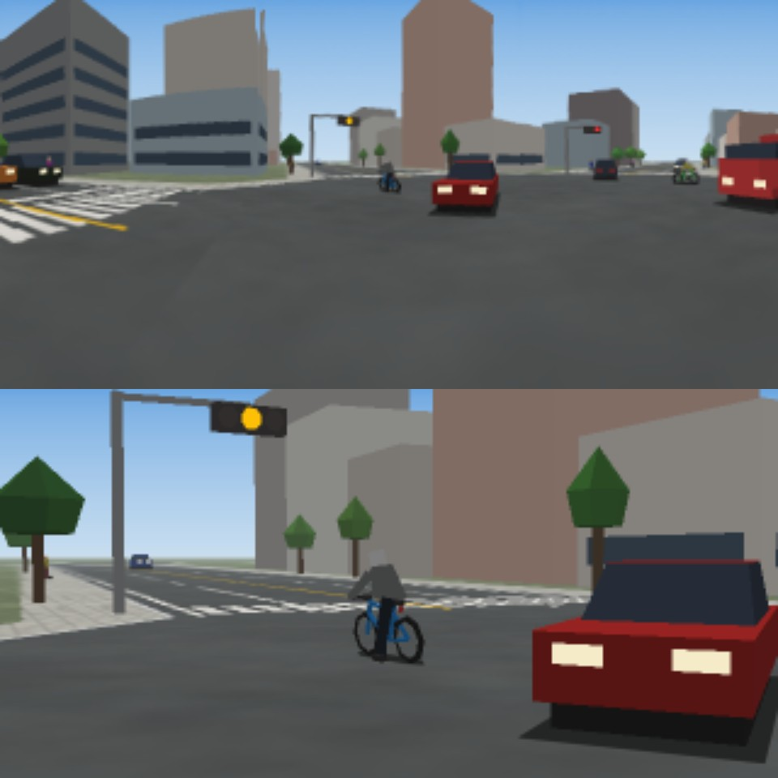

# 自転車の追い越しと二段階右折 (`TrafficConfig.bike_overtake`、`TrafficConfig.bike_two_stage`)

2026-11-26 に足した、シミュレーターの要素です ([roadmap.md](roadmap.md) の 3 章)。
車道の左端を走る自転車 ([bicycles](bicycles)、`TrafficConfig.bicycles`) に、2 つの動きを足します。

- **追い越し**: 周りの車とエキスパートが、自分の車線の中では間をあけて抜けない自転車を、中央線をはみ出して追い越します。
- **二段階右折**: 2 現示の信号のある交差点で、自転車が二段階で右折します。

どちらも既定はオフです。オフのとき、乱数の引き方も動きも今までと同じです。



上が Mc の円筒カメラ、下が望遠カメラです。自転車が交差点の向こうの左の角で止まり、曲がった先の道路の信号を待っています。

## 1. 追い越し (`--bike_overtake 1`)

- **どこで**: 片側 1 車線の対面通行の道路で、中央線が黄色 (はみ出し禁止) でない所です。追い越しは、車線の終わりの 25 m 手前までに済む場合だけです。
- **いつ**: 自転車が 25 m 以内の前にいて、車線の制限速度が自転車より時速 7 km 以上速く、車線の中では自転車との間を取れないときです。
  - 自分の車線の前に、追い越しが終わる所の 5 m 先まで車がいるときはしません (前の車に詰まって、はみ出したまま止まるため)。
- **対向車線の確かめ** (`Traffic.overtake_room`): 自車の後ろの端から自転車の 8 m 先までの区間に、追い越しにかかる時間 (と 2 秒の余裕) の間、対向車線の車 (周りの車と自車) が入ってこないときだけはみ出します。
  - 追い越しにかかる時間は、自転車との速度の差 (少なくとも秒速 1.5 m) で区間を走る時間に、はみ出す動きの 2.5 秒を足したものです。
- **周りの車**: 自転車の横に並ぶまでは毎回確かめ直し、並んだら抜き終わるまで続けます (`Traffic.bk_over`)。はみ出す動きは、路上駐車をよけるときと同じ速さです。
- **エキスパート** (`Expert.bike_scan`): 同じ `overtake_room` で、自転車の 25 m 手前から抜き終わるまで、中央線の向こうまで寄れます。
- はみ出せないときは、今までと同じです (車線の中で寄れるだけ寄って抜くか、後ろに付く)。

## 2. 二段階右折 (`--bike_two_stage W`)

- **どこで**: 2 現示の信号のある交差点です (スクランブルなど 3 現示以上の交差点ではしません)。`W` は、右折を選ぶ重みです (直進 1.5、左折 1 に対して)。
- **走り方** (`bicycles.two_stage_track`):
  1. 進入路の左端の直進の線 (直進の接続路 `c1`) を、交差点の向こうの左の角まで進みます。
  2. 角で止まり、自転車の向きを変えます。
  3. 曲がった先の道路の信号 (左から来る道路の進入路) が青になったら、その道路の直進の線 (接続路 `c2`) を進んで出ていきます。
  - 片側 2 車線の道路でも、左端の車線から入り、出る道路の左端の車線へ出ます。
- **周りの車からの見え方**: 1 段目は `c1` を直進する自転車、2 段目は `c2` を直進する自転車です。直進の自転車に譲る車は、この自転車にも譲ります。
  - 最初は右折の接続路の上にいる自転車として扱っていました。対向の右折車がこの自転車に譲らずに交差点に入り、車と自転車が互いを待って動けなくなりました (`crosswalks` 1013・9800、1016・9800 など)。直進の 2 本に分けて直しました。

## 3. エキスパートで測った結果

自転車は 1 km あたり 8 台 (各スイートの `_bk8`)、2.5 km × 20 ルートです。数字は完走したルートの数です。

| スイート | なし | 追い越し + 二段階右折 |
|---|---|---|
| `crosswalks_bk8` | 19 (時間切れ 1) | 18 (周りの車との衝突 1、時間切れ 1) |
| `crosswalks_sub_bk8` | 19 (行き詰まり 1) | 19 (時間切れ 1) |
| `bigjunction_bk8` | 19 (行き詰まり 1) | 20 |
| 合計 | 57 / 60 | 57 / 60 |

- 平均の速さは、時速 10.2・10.5・10.0 km から 10.6・10.7・10.1 km になりました。
- 周りの車の追い越しの回数 (300 秒、自転車 12 台/km、自車はエキスパート): `twophase` の街 1010 で 60 回、`suburban` の街 2000 で 18 回です。はみ出している車の 4 m 以内を対向車が通ったことはありません。
- **周りの車との衝突 1 件** (`crosswalks` 1013・9800): 右折する自車が、交差点の中で止まっている車の後ろの角に当たりました。
  - その車は自転車をよけて車線の中で 0.55 m 寄り、斜めに止まっていました。追い越しではなく、今までのよけ方です。
  - エキスパートは車を円の並びで見るので、斜めの車体の角が抜けます。追い越しだけ、二段階右折だけでは、このルートは完走します。
- 自転車との衝突は 0 件です。ただし、直す途中の評価で 1 件ありました (`crosswalks` 1011・9801)。
  - 左折の途中で歩行者のために止まった自車の後ろの角に、後ろから来た自転車が当たりました。
  - 自転車も自車を円の並びで見るためです (周りの車の角は `bike_hook` で見えますが、自車の角は見えません)。今までからある穴で、この要素とは関係ありません。

**途中で見つけて直したこと**

- **二段階右折の自転車を、右折の接続路の上にいるものとして見せていた**: 対向の右折車が譲らず、交差点の中で車と自転車が向かい合って止まりました。1 回目の評価では、3 スイートの完走が 57 から 45 に減りました。直進の接続路 2 本に分けて直しました (2 章)。
- **追い越しが停止線まで延びた**: 追い越しを始めた車が前の遅い車に詰まり、はみ出したまま赤信号で止まりました。交差点を曲がってくる車をふさいで、互いに待ち続けました (`crosswalks_sub` 2001・9851)。
  - 自分の車線の前に、追い越しが終わる所の 5 m 先 (`OVERTAKE_CLEAR`) まで車がいるときは、追い越しを始めません。
  - 自転車の横に並ぶまでは毎回確かめ直し、だめならやめます。
- **追い越しの印が残った**: 抜き終わった後も「追い越し中」(`Traffic.bk_over`) が残り、後で対向車線を確かめずにはみ出すおそれがありました。抜き終わったところで消します。

## 4. まだしていないこと

- 車の角が円の並びで抜ける件 (3 章の衝突 2 件) は、この要素では直していません。
- 二段階右折で増える行き詰まりや時間切れは、評価の乱数の違いと見分けがつく数ではありません。二段階右折を入れると自転車の行き先の引き方が変わるので、同じルートでも周りの流れが変わります。
- 追い越しの線は、路上駐車をよけるときと同じ寄り方です。対向車線へ完全に出る追い越しではありません (はみ出すのは、自転車との間を取るのに要る分だけです)。
- 二段階右折は、車道を走る自転車だけです。歩道を走る自転車 ([sidewalk_bikes.md](sidewalk_bikes.md)) は、横断歩道で渡ります。
- 角で待つ自転車の場所は、2 本の直進の線が交わる点です。待つ場所の印 (路面の標示) は描いていません。
- KeiView とブラウザ版では確かめていません。自転車の描き方は今までと同じです。
- KeiPilot Mc の学習には、まだ使っていません。

## 5. 使い方

```bash
uv run python scripts/evaluate.py --agent expert --suite crosswalks_bk8 --bike_two_stage 1 --bike_overtake 1
uv run python scripts/collect.py --bicycles 8 --bike_two_stage 1 --bike_overtake 1 ...
```

評価の結果の名前には `_ts1` と `_ot` が付きます。
