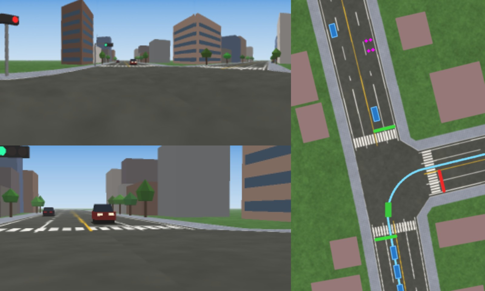

# 見えにくい右折 (`EnvConfig.expert_hidden_cars`)

2026-11-23 に足した、シミュレーターの要素です ([roadmap.md](roadmap.md) の 3 章)。
信号のある交差点で右折を待つとき、対向車線の一部が他の車の陰になって見えないことがあります。
その陰から直進車が出てくるのが、右直事故の典型です。

この選択肢をオンにすると、エキスパートは「見えない所には車がいるかもしれない」と考えて待ちます。
本当に車がいるかどうかは問いません。ラベルが、カメラに映るものから決まるようにするためです。

既定はオフです。オフのとき、今までの街、エピソード、ラベルは変わりません (下の 4 章)。



町 2005・エピソード 9971 (`hidden_right_sub`) の 40.7 秒目です。左上が Mc の円筒カメラ (180°)、左下が望遠 (50°)、右が真上からの図です。

- 自車 (緑) は、交差点の中の右折の待つ位置にいます。
- 対向の内側の車線 (中央線寄り) で、車が 1 台、青のまま停止線の手前に止まっています。
- その車の陰で、外側の車線の奥が自車から見えません。エキスパートは、そこ (紫の点) に軽自動車がいると考えます。
- その車が制限速度で走ってくれば 5 秒以内に交差点に着くので、エキスパートは待ちます。

止まった対向車が「どうぞ」と譲ったように見えても、その横の車線を車やバイクが走ってくる場面 (いわゆるサンキュー事故) です。

## 1. 何をするか

- **見えるかどうか** (`Traffic.visible_from(cars=True)`): 車の角のどれか 1 つに、カメラからの線がほかの車の外形を通らずに届けば、見えるとします。
  - 2 次元で判定します。背の高さは見ません。
  - オフのとき (今まで) は、車どうしが隠し合うことはありませんでした。建物は今までどおり隠します。
- **陰の場所** (`Traffic.hidden_spot`): 譲る相手の車線を、交差する点から 1 m ずつ手前へたどります。たどるのは、交差点の中の接続車線と、その手前の車線です。
  - 各点に軽自動車 (3.4 × 1.48 m) の箱を置き、カメラにどの角も見えなければ、そこを陰の場所とします。
  - 車が実際にいる点は、試しません。
  - たどるのは、制限速度で 5 秒 (`YIELD_GAP`) に走る距離に車 1 台分を足した所までです。
- **陰の車の扱い** (`Expert.with_hidden`): 見つけた陰の場所に、制限速度で走る車を 1 台足して、今までの譲る規則 (`Traffic.min_arrival`) にかけます。
  - 今までの規則がそのまま効きます。手前に、ほかの方向へ行くために止まっている車がいれば、陰の車はその後ろに並ぶので来ません。黄で止まれる距離なら止まります。
  - 赤のあいだは来ません。ずっと隠れていた車は、赤を走り抜けないとします。そうしないと、自車が赤で交差点から出られなくなります。
  - 交差点の中 (接続車線) の陰は、青のあいだだけ数えます。
- **どこで効くか**: 2 現示の信号で、右折が接続車線の待つ位置で待つ判断だけです。待つ位置を越えたあとの判断と、信号のない交差点は変えていません。
- **見るカメラ**: 組の最初のカメラです (Mc では円筒 180°、単眼では 100°)。`expert_yield_visible` と同じ取り方です。
  - `expert_yield_visible` と一緒に使うと、譲る規則に入れる実在の車も、車の陰を考えて選びます。
- **記録**: `plan["hidden"]` は、陰の車のためだけに待っている歩で真になります。

## 2. 評価のスイート

右折の場面だけを集めたスイートを 2 つ足しました。どのルートも、片側 2 車線以上の対向車線を横切る、信号のある右折の手前 (160 m 以内) から始まります (`route.right_turn_route`、`evaluate.py --via_right 1`)。

| スイート | 街 | ルート |
|---|---|---|
| `hidden_right` | 大きな交差点の街 (bigjunction、3000〜3009) | 600 m × 30 (エピソード 9970〜9972)、横断歩道 0.7 |
| `hidden_right_sub` | 片側 2 車線の街 (suburban、2000〜2009) | 600 m × 30 (同じエピソード) |

```bash
uv run python scripts/evaluate.py --agent expert --suite hidden_right_sub --hidden_cars 1
```

`collect.py --hidden_cars 1` で、学習データのラベルにも使えます。

## 3. エキスパートで測った結果

Mc の組 (`wide_narrow`) のカメラで判定しました。単眼 (100°) でも同じ結果でした。陰はすべて車によるもので、視野の外や建物の陰はありませんでした。

| スイート | 完走 (なし → あり) | 陰の車で待ったルート | 陰の車で待った時間 (止まっていた時間) | 走った時間の合計 |
|---|---|---|---|---|
| `hidden_right` | 27/30 → 27/30 | 13 | 34.9 秒 (15.1 秒) | 5886 → 5932 秒 (+0.8 %) |
| `hidden_right_sub` | 29/30 → 29/30 | 16 | 47.4 秒 (34.7 秒) | 5683 → 5916 秒 (+4.1 %) |

- 完走しなかったルートは、オンとオフで同じです (詰まり)。オンにしたことで行き詰まったルートはありません。
- 1 回の待ちは、長いもので 11 秒ほどです (上の絵の場面)。
- 2.5 km の `bigjunction` と `suburban` (各 20 ルート) でも走らせました。
  - `suburban` の完走は、オンとオフで同じです。
  - `bigjunction` では、オンのときに衝突が 1 件ありました (町 3009・エピソード 9800)。右折の接続車線で前の右折車の後ろに止まっていた自車に、左折してきた周りの車が当たったものです。自車は止まっていて、陰の車の判断も効いていません。走り方が変わってその場面に行き当たった、周りの車の側の問題と見ています (まだ直していません)。

## 4. 既定 (オフ) で変わらないこと

- `collect.py` で、main とこのブランチで同じ条件の学習データを集め、ファイルのハッシュが一致することを確かめました (大きな交差点の街、Mc の組、`--yield_visible 0` と `1`)。
- `geometry.rays_clear` は、新しい `rays_hit` を使う形に分けましたが、計算は同じです。

## 5. まだしていないこと

- KeiPilot Mc の学習には、まだ使っていません。
- 高さを見ていません。低い車の後ろの背の高い車は、絵では屋根が見えても「見えない」と数えます (待つ側に倒れます)。
- 待つ位置を越えたあとに陰から車が出てきたときの判断 (今までどおり、実在の車だけで決めます)。
- 周りの車は、今までどおり、見えない車も知っています。
