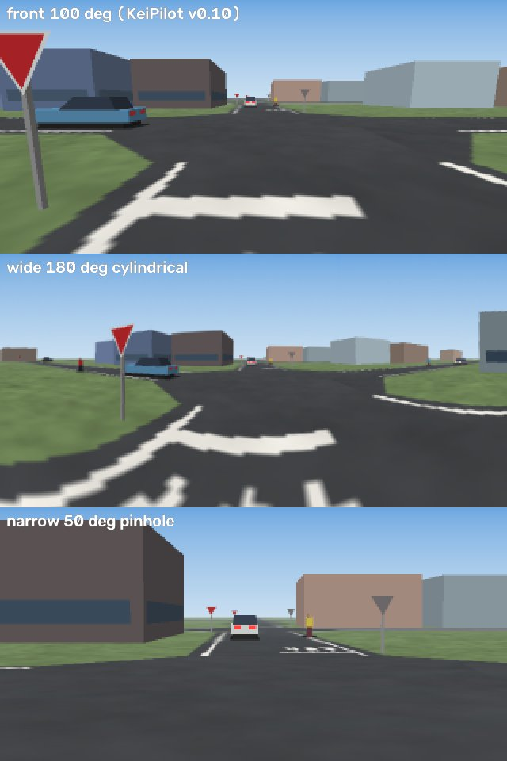

# KeiPilot Mc — 前向きの 2 台のカメラ (v0.11.0)

KeiPilot Mc は、1 台のカメラ (100°) の代わりに、前向きの 2 台のカメラで運転します。

* **広角**: 円筒 180°。止まれの線から、横の優先道路を来る車を見るためのカメラです。
* **望遠**: 50°。遠くの信号と車を、中央で 100° の 2.5 倍の大きさに映します。

どちらも 320×160 です。モデルは v0.10 と同じ大きさ (15.1M パラメータ) で、2 枚の画像を同じ幹に通します。
v0.10 から始めて、前の回のモデルが運転する DAgger を 11 回重ねました。v0.11.0 はその 11 回目のモデル (`keipilot_mc12`) です。

ブラウザで試す: <https://southern-star.github.io/keisim/?pilot=mc>

*札幌の評価区画で、止まれの線に止まったあと、横の車を待つ位置。上から v0.10 の 100°、広角 180°、望遠 50°。100° では左の優先道路の先が画面の外です。*

## 1. なぜカメラを増やしたか

v0.10 の札幌での衝突は、ほとんどが止まれの線で止まったあとに出ていました (README 2 章の開発ログ 10.)。
止まった位置から、横の優先道路を 30 m 先まで見えるかを、札幌の止まれ 255 か所で測りました (`tools/sightline.py`、建物の陰も入れる)。

| 横の優先道路の 30 m 先の車が映る割合 | 100° | 120° | 150° | 165° | 180° |
|---|---|---|---|---|---|
| 止まれの線で止まった位置 | 1 % | 13 % | 90 % | 90 % | 90 % |
| 譲るために待つ位置 | 0 % | — | 43 % | 85 % | 86 % |

そこで、openpilot と同じ「前向きの広角 + 望遠」の組にしました。広角は 180° の円筒カメラです (行が仰角なので、地平線がまっすぐのまま映ります)。

## 2. 作り

* **KeiSim** (`keisim/config.py` の `CAMERA_RIGS`、`set_camera_rig`、`keisim/render/rig.py`)
  * 円筒カメラは、60° のピンホールの面 3 枚を描いて `cv2.remap` で貼り合わせます。空は仰角で色を付けるので、継ぎ目は出ません。
  * 描画の時間は、組で 1 フレーム約 28 ms (100° 1 台は 4 ms)。
  * `front` の組は v0.10 までの 100° 1 台で、その画像は前とビット単位で同じです。
* **KeiView** (`web/src/ego.js`): 同じ面 3 枚を KeiView で描き、同じ貼り合わせの表で 1 枚にします。1 回の要求で組の全部のカメラを描きます。
* **モデル** (`keipilot/model.py` の `n_cams`): 2 枚の画像は同じ ResNet の幹と FPN を通ります。トークンにはカメラごとの位置の埋め込みを足し、デコーダーは 2 台ぶんのトークンをまとめて読みます。
  * セグメンテーションはカメラごとに出します。
  * v0.10 の重みから始めるときは、v0.10 の位置の埋め込みを両方のカメラにコピーします。
  * 出力は v0.10 と同じです。v0.10 から、譲る相手の到着までの時間 (`yield_tta`、補助の頭) も出します。
* **データ** (`collect.py --rig wide_narrow`): シャードの画像は `jpg` (広角) と `jpg_c1` (望遠)。`meta.json` に組の名前とカメラの設定が入ります。`train.py` はそれを読んで `n_cams` を決めます。
* **評価** (`evaluate.py`、`curve_test.py`): 組はチェックポイントの `rig` から決まります (`--rig` で変えられます)。
* **ブラウザ** (`web/src/rig.js`、`?pilot=mc`): 学習のときと同じように、KeiView で面 3 枚と望遠を描いて貼り合わせます。推論は WebGPU (なければ WASM) の worker で動きます。

### 安全層

v0.10 と同じ BrakeHold と RedHold に、譲りのための YieldHold を足しました (`keipilot/agent.py`)。
`evaluate.py --brake_hold --red_hold --yield_hold 4 1 3.5 4 0.5 0.5 10` が標準の設定です (デモとブラウザも同じ)。

* 遅いとき (3.5 m/s 未満) に、モデル自身の `yield_tta` が 4 秒未満なら、その車の到着 + 1 秒まで目標速度を 0 に保ちます。途中で車を見失っても保ちます。
* 保持を始めるのは、次の条件がそろうときだけです。
  * モデル自身が減速しているか止まっている。
  * 信号の頭が「信号なし」と見ている (確率 0.5 以上)。
  * 最後に止まってから 10 m 以内。
* 条件を付けない最初の版は、頭の幻の読み (壁を「3.7 秒先の車」と読む) で、札幌の 300 ルートのうち 131 本の停止を長くしました。
* いまの版は、mc8 の札幌 (KeiSim 300、KeiView 60 ルート) と格子の町 (KeiSim 320、KeiView 40 ルート) で、衝突と信号無視を 17 件から 9 件に減らしました (有意ではありません)。札幌での要らない停止は約 2 倍になります。

## 3. 学習の経過

どの回も、前の回のモデルが運転する DAgger を集め、前の回のモデルから 4 × 20 万サンプル学習しています (mc1 は v0.10 から 6 × 20 万、mc2 は 3 × 20 万)。
メモリーに収めるため、学習データは約 21 GB (約 90 万フレーム) に保ち、新しいデータを足すたびに古い組を半分にしています。

| 回 | モデル | 新しいデータと変えたこと | 結果 |
|---|---|---|---|
| 1 | mc1, mc2 | エキスパートのデータ 52.5 万フレーム (格子の町と札幌の学習区画、KeiSim)、mc1 の DAgger 17 万 | 札幌 300 ルートの衝突 22 → 13 (止まれのあと待つ位置 17 → 8)。格子の町は v0.10 より悪い (衝突か信号無視 3 対 13、p = 0.02) |
| 2 | mc3 | 格子の町の歩行者・追従と信号・右折、札幌、KeiView の組 (格子と札幌) の DAgger | KeiView の組の画像で初めて学習 |
| 3 | mc4 | 17.5 万 (札幌 KeiSim / KeiView、格子)。固まったらエキスパートに渡す (`--freeze_takeover`) | 札幌 300 ルートの衝突 22 → 5 (v0.10 比、p = 0.001)。KeiView で左折の途中に固まるのが消えた |
| 4 | mc5b | エキスパートのラベル 6: 止まれのあと待つ位置まで 10 km/h 以下 (徐行)。札幌の町の見た目の変種を増やす | 札幌 300 ルートで 294 本完走 |
| 5 | mc6 | シミュレーター: 止まったままの自車には、譲っていた NPC が待たない (`--ego_patience 3`) | KeiView の札幌 60 ルートの衝突 1 |
| 6 | mc7 | 優先の交差の手前で止めてから走らせる (`--stand_pert`、ラベルは「進む」) | KeiView の幻の停止が消えた (要らない停止 227 → 62 秒)。弱い手がかりでの早出が出た |
| 7 | mc8 | mc7 の早出の DAgger、2 現示の町の高密度の DAgger | KeiView の札幌 59/60 (衝突 1) |
| — | mc8 | 安全層 YieldHold (上) | 衝突と信号無視 17 → 9 |
| — | mc8 | 片側 2 車線の町・ランプ・車線変更 (README の 2 章) | 出発点: suburban 13/20、ramps 6/20、ramp_routes 27/30 |
| 8 | mc9 | 片側 2 車線の町の DAgger | suburban 17/20、ramps 12/20。ただし ramp_routes 2/30 (下) |
| 9 | mc10 | ランプの手前でエキスパートの車線変更の始まりと食い違うフレームを捨てる | ramp_routes 29/30 |
| 10 | mc11 | エキスパートのラベル 7 (信号の交差点で、曲がる待ち位置の先の横断も見る。止まり切れない遅い車は交差点の入口の手前で止まる) | KeiSim 740 ルートで完走 712 (mc10 693)、衝突と信号無視 21 (26) |
| 11 | mc12 | ガードレールの急カーブの事例 8 万フレーム (`collect.py --curve_scenes 1`、README 2 章の「カーブの試験コース」) | 弱点の試験コースで接触 2 → 0。町は mc11 と同じくらい |

**ラベルがカメラの見えないものに従うと、避けることを覚えます (8 回目)。**
エキスパートは、ランプの減速車線へ移るときに、減速車線が並んだ所から 40 m かけて車線を変えます。
その始まりはカメラからは見分けられません。そのため、モデルが早めに寄ったフレームには「ランプの外へ戻れ」のラベルが付き、mc9 はランプに入らなくなりました。
9 回目は、ルートのランプへの道筋より 0.5 m 以上ランプ側にいるフレームを捨て (`--ramp_early_drop 1`)、ランプの近くは全部残しました (`--focus_ramp 1`)。

各回の正確な手順は、実際に走らせたスクリプトを [multicam/rounds/](multicam/rounds/) に置いています (`round1.sh` 〜 `round11.sh`)。

## 4. 結果

[README の 2 章「KeiPilot Mc (v0.11.0)」](../README.md#keipilot-mc-v0110-前向きの-2-台のカメラ) にまとめています。
v0.10 と同じコード・同じルートで比べました。
* KeiSim の 740 ルート: 完走は 671 → 701、衝突は 43 → 22 です。符号検定で、完走しなかったルートは p = 0.002、衝突か信号無視のあったルートは p = 0.01 です。
* KeiView の 150 ルート: 完走は 135 → 137 です。
* カーブの試験コース: 接触はなくなりました。

## 5. 既知の弱点

11 回目の評価 (KeiSim 740 ルート、KeiView 150 ルート) で mc12 だけが失敗したルートは、どれも前の回から見ている型です。

* **青で発進したら、交差点の先が詰まっていた。** 格子の町でいちばん多い衝突です。エキスパートは出口の詰まりを知っていて止まりますが、モデルは青を見て出ます。
* **札幌の優先道路での譲りの遅れ。** 止まれのあとの徐行で、横の車に譲り始めるのが遅い、または早く出ます。KeiSim の札幌 300 ルートの衝突は、mc8 の 2 から mc12 の 7 まで、回ごとに少しずつ増えています (どの回の差も有意ではありません)。
* **歩行者へのブレーキが 1 秒ほど遅い。**
* **KeiView で、青を赤と読んで止まったまま。** 決まった町の決まった交差点 (town 1019 など) で出ます。
* **横や後ろからの割り込み。** 2 台とも前向きなので、真横より後ろは見えません。後ろのカメラはまだ足していません。
