# ReconFill: ReconView の欠けた所を埋める（派生の実験）

ReconView（[recon_view.md](recon_view.md)）の続きです。ReconView は、見えた所だけを描き、見えない所を暗いまま残します。ReconFill は、その暗い所を埋めます。ReconFill は仮称です。

本線（KeiPilot Mc の学習の回）とは別の実験です。README の数字、公開の重み、Pages の既定の表示は変えません。新しい選択肢は既定でオフで、`&fill` のないページは今までと同じです。

状態（2026-11-24）: P0（正解で埋める）は終わり、関門 G-P0 を通りました（4.2）。**P1（回帰の補完モデル）も終わり、関門 G-P1 の基準を全部満たしました**（5.4）。穴を埋めると「正しく描けた」は 80.0 % から 85.0 % に上がりますが、色はぼけています。**P2（色の生成）は、途中で止めました**（6.18）。小さな網の 1 回の推論で色を鮮明にすることはできましたが（L1 + PatchGAN、6.12）、動く画では P1 の 2 倍ちらつきます（6.13）。1 回前の補完を条件に足すと、ちらつきは止まりますが、色が壊れます（6.17）。既定は P1 のままです。

## 1. 考え方

補完を「3 台目のカメラ画像」として扱います。

- 補完は、追跡カメラ（自車の後ろ 8 m、高さ 4 m、320×160）から見た色と深度です。深度は半分の解像度（80×160、メートル、0 は面なし）で、運転モデルの `depth` 出力と同じ約束です。
- ページはそれを、モデルのカメラ画像と同じ作り方でメッシュにします。頂点は深度の画素ごとに 1 つ、色はテクスチャ、三角形の規則は同じ関数です（`web/src/recon.js` の `meshTriangles`）。
- 補完の面は、見えた面とは別のメッシュです。画素ごとに「見えた面か、補完した面か」を区別でき、補完がどれだけ嘘をつくかを、ReconView と同じ指標（透け、実在しない面）で測れます。
- 補完は蓄積しません。運転モデルの呼び出し 2 回に 1 回作り、作るたびに前のものと置き換えます。

P0 の補完は、街そのもの（正解）です。モデルが届きうる上限を測り、同じ器で学習データを書き出します。

## 2. 使い方

| URL の指定 | 中身 |
|---|---|
| `?pilot=mc&recon=model&fill=oracle` | 正解で埋める。開発と計測のためのモードで、描画が増えます |
| `?pilot=mc&recon=model&fill=model` | 補完のモデル（`web/models/reconfill.onnx`）で埋める。WebGPU だけ。重みはリポジトリにも Release にも置いていないので、手元で `docs/recon_fill/p1.sh` の手順で作る |
| `&fillmodel=models/….onnx` | 別の重みを使う。`models/reconfill_gen.onnx`: 色を生成する重み（6.12。鮮明だが、ちらつく。`RUN=g2 LAM2=30 bash docs/recon_fill/p2.sh train export` で作る）。`models/reconfill_genp.onnx`: 1 回前の補完を条件に足した重み（6.16。色が壊れるので、見るためだけ） |
| `&fillworker=own` | 補完のモデルを、運転モデルとは別のワーカーで走らせる |
| `&fillshow=holes`（既定） | 補完のメッシュのうち、補完なしの画に何もなかった所にかかる三角形だけを描く。見えた面はそのまま |
| `&fillshow=all` | 補完のメッシュを全部描き、今のフレームとキーフレームのメッシュは隠す |
| `&filltint=1` | 補完した面に色を付けて区別する |

`&fill` がなければ、`web/src/fill.js` は読み込まれません。

公開のページ（Pages）には補完の重みを置いていません。`&fill=model` を付けても、重みが読めなければ補完なしで動きます（コンソールに警告が出ます）。

## 3. P0 で作ったもの

### 3.1 ページ

- `web/src/fill.js`（新規）: 補完のメッシュ 2 枚（今のものと 1 回前のもの）、描く三角形の選び方、補完の番の数え方、計測、学習用の標本。
- `web/src/recon.js`: 補完の番には、街の深度を追跡カメラから描きます（計測のときに描いていたものと同じ）。三角形の規則を 1 枚のメッシュの関数にして、補完のメッシュにも使います。
- `web/src/pilot.js`: 補完の番には、モデルのフレームと同じ場面の状態（周りの車は学習時の見た目）で、追跡カメラからの 1 枚を足します。モデルのフレームと同じパイプラインで描き、周辺減光と光の漏れは付けません（円筒カメラの面と同じ扱い。どちらも画面に付く効果で、追跡カメラの画には要らないため）。

穴の決め方は次のとおりです。補完を作るフレームで、補完なしの画（今のフレームとキーフレーム）の深度を追跡カメラから描きます。補完のメッシュのマス（頂点 4 つの間、3×3 画素）のうち、その深度が 1 画素でも「面なし」のマスを、穴にかかるマスとします。「穴だけ」の表示は、そのマスの三角形だけを描きます。観測の面を優先するために、補完のメッシュはキーフレームより大きい `polygonOffset` で奥に置きます。

### 3.2 計測

`web/tools/recon_check.mjs --fill oracle` は、同じフレームで次を測ります。A と A+ は今までどおりです。

| 名前 | 描くもの |
|---|---|
| A、A+ | 補完なし（今のフレームだけ、キーフレームあり） |
| 穴・できたて | A+ と、このフレームで作った補完（穴だけ） |
| 穴・1 回前 | A+ と、前の番に作った補完（穴だけ）。次の補完が来る直前に、訪れた人が見ているもの |
| 全部・できたて | このフレームで作った補完だけ |
| 全部・1 回前 | 前の番に作った補完だけ（設計書にない行。`fillshow=all` で訪れた人が見るもの） |

補完が足した画素（補完なしでは何もなく、補完ありでは面がある画素）の内訳（正しい、透け、実在しない面）も出します。キーフレームの `added` と同じ数え方です。表は `tools/recon_table.py` が出します。

### 3.3 学習データの書き出し

`web/tools/fill_dump.mjs` は、`?pilot=mc&recon=model&fill=oracle` のページを走らせ、決まった間隔で 1 組を保存します。どれも追跡カメラからの 320×160 で、深度は 16 bit の符号のままです。

| 配列 | 中身 |
|---|---|
| `in_rgb`、`in_dep` | 補完なしの画（A+）。補完のモデルの入力 |
| `loose_rgb`、`loose_dep` | 今のフレームだけを、縁の比 2.0（2 台とも）で描いたもの |
| `gt_rgb`、`gt_dep` | 正解。色はモデルのフレームと同じ描き方、深度は深度パス |
| `prev_rgb`、`prev_dep` | 1 回前の補完の番（モデルのフレーム 2 回前）の正解をメッシュにして、今の追跡カメラから描いたもの |

- 走行ごとに `DIR/名前/配列.npy`（`numpy.load(..., mmap_mode='r')` でそのまま開ける形）と `meta.json`（町の時刻、自車の姿勢と速度、キーフレームの枚数、1 回前の姿勢）を書きます。
- 車が前の組から 1 m 動いていないあいだは保存しません（10 秒たてば保存します）。赤信号で同じ画が並ぶのを避けるためです。
- Python 側は `keipilot/filldata.py`（追跡カメラ、背景色、地面までの距離の表、読み込み）と `tools/fill_data.py check`（検査）です。

### 3.4 設計書と違う所

設計書（`ReconFill_Handoff.md`）と違う所、設計書になかった判断は次のとおりです。

| 項目 | 設計書 | 実装 | 理由 |
|---|---|---|---|
| `prev_*` の時刻 | 1 つ前に保存した時刻 | 1 回前の補完の番（モデルのフレーム 2 回前、0.2 秒前） | P2 で条件にするのは「直前の補完を今のカメラから描いた画」です。ページでは 0.2 秒前後の古さになります。保存の間隔（1 秒）ぶん古い画では、重なり方が実際と違います |
| 横断歩道の人 | 走行に混ぜる | 混ぜていない | ブラウザの運転のページには歩行者がいません。周りの車、自転車、路上駐車は混ぜられます |
| 学習の町 | 新しく書き出す | 書き出し済みのものを使う | `web/.towns/` に 620 町あり、札幌の学習用の 3 区画も入っています |
| 緩い規則 | 縁の比 2.0 | 比 2.0 を 2 台とも（画素の細かさで縮めない） | 「カメラには見えているのに規則で切られた所」を広く拾うため |
| 正解の色 | `shoot` と同じパイプライン | 同じパイプラインで、周辺減光と光の漏れなし | 3.1 のとおり |
| 計測の行 | 5 通り | 6 通り（全部・1 回前を追加） | 3.2 のとおり |
| ディスク | 2 万組で 5 GB 前後（未計測） | 1 組 1.02 MB（生の `.npy`）。2 万組で約 20 GB | メモリに載せずに読める形を優先しました。試走の 7 組では、gzip で 0.6 MB でした |

## 4. 関門 G-P0

### 4.1 基準（計測の前に決めたもの）

| 項目 | 基準 |
|---|---|
| 不変（計測） | `--fill` なしの計測を、この枝と main で 3 回ずつ走らせる。要約値（画像と姿勢、走行）が両方にある組が 1 つ以上あり、その組では計測の行が全部同じ |
| 不変（読み込み） | `--fill` なしのページは `fill.js` を要求しない（`recon_check.mjs` が毎回確かめる） |
| 不変（走行） | 補完あり（穴だけ、全部）の走行の要約値が、町ごとに、補完なしの走行（recon なし、recon あり）のどれかと同じ |
| 上限の目安 | 「穴・できたて」の被覆率（全体）が 95 % 以上。補完が足した画素のうち、実在しない面が 2 % 未満（3 つの町、90 フレームの合計） |
| データ | 形と型が合う。入力、緩い規則、1 回前の 3 つの画で、深度が「面なし」の画素と背景色の画素が完全に一致する。正解の深度を Python（`keisim/render/rays.py`）で街に戻すと、地面の高さの中央値が、距離帯ごとに 0 から 5 mm 以内 |

届かなかった項目は、基準を変えずにそのまま報告します。

### 4.2 結果

2026-11-23 に計測しました。手順は `docs/recon_fill/p0.sh`、表は `tools/recon_g3.py`、`tools/recon_table.py`、`tools/fill_data.py` が `runs/eval/recon_fill/` から出します。

| 項目 | 結果 | 判定 |
|---|---|---|
| 不変（計測） | 両方にある要約値 4 種類で、計測の行が全部同じ（追加の走行のあと。下記） | 通過 |
| 不変（読み込み） | `--fill` なしの走行 29 本のどれも `fill.js` を要求していない | 通過 |
| 不変（走行） | 補完あり（穴だけ、全部）の走行に、2 つの町とも、補完なしと同じ要約値の走行がある（追加の走行のあと。下記） | 通過 |
| 上限の目安 | 「穴・できたて」の被覆率（全体）95.9 %、補完が足した画素のうち実在しない面 0.3 % | 通過 |
| データ | 301 組で、形と型が合い、食い違う画素は 0、地面の高さの中央値は 0.1 mm 以内 | 通過 |

#### 不変（計測）

town 1000、30 秒、`--recon model`、`--fill` なしの計測です。`here` はこの枝、`main` は main（`7239249`）の `web/` を別の場所に取り出したもの、`copy` はこの枝のファイルを main の取り出しと同じ形で置いたものです。

| 要約値（画像と姿勢、走行） | 走行 | 計測の行が全部同じか |
|---|---|---|
| `2ef7b43d0ecf3b7e`、`ff54bd8f3153db72` | copy × 1 | –（片方だけ） |
| `75b77baf8e7cd335`、`fb929e7966a99c31` | copy × 1、main × 1 | 同じ |
| `b708ce639ccf1856`、`da89ba5e27755abf` | copy × 1、main × 2 | 同じ |
| `fd8afb088e1b62ad`、`097517239056be38` | here × 3、main × 1 | 同じ |
| `bac52de42239f835`、`f139b5a3005a483c` | here × 1 | –（片方だけ） |
| `451547e425f91b0f`、`6d348efab8673b93` | here × 2、main × 2 | 同じ |

走行 15 本、各 30 秒、計測 15 フレーム。両方にある要約値 4 種類のうち、行が全部同じもの 4 種類。

- **最初の 3 回ずつでは、共通の要約値が 1 つも出ませんでした。** 基準に届かなかったので、3 回ずつ追加しました（ReconView の G3 で決めた手順と同じ。最大で各 6 回）。置き場所の違いを疑って `copy` も 3 回走らせましたが、追加ぶんで `here` と `main` に共通の値が出たので、置き場所のせいではありませんでした。
- 走行は 15 本で 6 通りに分かれました。分かれ方は main どうしでも同じで、ReconView の記録（4.4、6.5、7.3）にある再現性の問題です。

#### 不変（走行）

60 秒、計測なし（訪れた人のページと同じ描き方）です。要約値は、車の状態、モデルの計画、モデルの入力画像から作ります。

| 町 | 設定 | 走行の要約値（回数） | recon なしと同じ要約値の走行 | 判定 |
|---|---|---|---:|---|
| town 1000 | recon なし、深度つきの ONNX | `5a01ac7adc0049d5`（1 回）、`e1b066aa6fe3ee41`（1 回）、`efeb8bf52b4b315c`（1 回）、`2f708ee9efefd0a4`（1 回） | – | – |
| town 1000 | `recon=model`（蓄積あり） | `efeb8bf52b4b315c`（1 回）、`2f708ee9efefd0a4`（1 回）、`ce5be5b089284baa`（1 回）、`e1b066aa6fe3ee41`（1 回） | 3 / 4 本 | 通過 |
| town 1000 | `recon=model&fill=oracle` | `95bbe61acc9a5fb5`（1 回）、`649f4052aece583c`（1 回）、`cf7d6fd88924398c`（1 回）、`e1b066aa6fe3ee41`（1 回） | 1 / 4 本 | 通過 |
| town 1000 | `recon=model&fill=oracle&fillshow=all` | `95bbe61acc9a5fb5`（1 回）、`e1b066aa6fe3ee41`（1 回） | 1 / 2 本 | 通過 |
| 札幌（OSM） | recon なし、深度つきの ONNX | `7378f1edcac3769c`（1 回）、`6ff182c451d8b655`（2 回）、`685861a364826836`（1 回） | – | – |
| 札幌（OSM） | `recon=model`（蓄積あり） | `6ff182c451d8b655`（2 回） | 2 / 2 本 | 通過 |
| 札幌（OSM） | `recon=model&fill=oracle` | `6ff182c451d8b655`（2 回） | 2 / 2 本 | 通過 |
| 札幌（OSM） | `recon=model&fill=oracle&fillshow=all` | `78de334b6782b819`（1 回）、`685861a364826836`（2 回）、`b696f6c17a766615`（1 回） | 2 / 4 本 | 通過 |

- 最初の 2 回ずつでは、town 1000 の「穴だけ」と札幌の「全部」に共通の値がありませんでした。その設定と recon なしを 2 回ずつ追加して、共通の値が出ました。
- 要約値は、town 1000 で 8 通り、札幌で 5 通りに分かれました。recon なしどうしでも分かれています。

#### 上限（正解で埋めたとき）

3 つの町、60 秒、2 秒ごとの 90 フレームです。深度はモデルのもの、キーフレームは 10 m まで（既定）です。

| 町、描くもの | フレーム | 被覆率（全体） | 被覆率（いま見える範囲） | 見える範囲の割合 | 誤差（中央値） | 誤描画率 | うち透け | うち実在しない面 | 正しく描けた（全体） | 正しく描けた（見える範囲） |
|---|---:|---:|---:|---:|---:|---:|---:|---:|---:|---:|
| town 1000、A | 30 | 47.0 % | 84.0 % | 43.6 % | 1.68 % | 20.7 % | 19.3 % | 1.4 % | 37.4 % | 80.3 % |
| town 1000、A+ | 30 | 89.0 % | 86.4 % | 43.6 % | 1.46 % | 8.8 % | 5.8 % | 3.0 % | 81.6 % | 81.3 % |
| town 1000、穴・できたて | 30 | 96.3 % | 96.2 % | 43.6 % | 1.11 % | 7.8 % | 5.0 % | 2.8 % | 89.2 % | 91.3 % |
| town 1000、穴・1 回前 | 30 | 95.5 % | 95.0 % | 43.6 % | 1.05 % | 7.4 % | 4.5 % | 2.8 % | 88.8 % | 90.0 % |
| town 1000、全部・できたて | 30 | 84.0 % | 87.8 % | 43.6 % | 0.00 % | 0.2 % | 0.1 % | 0.1 % | 83.9 % | 87.7 % |
| town 1000、全部・1 回前 | 30 | 83.3 % | 86.4 % | 43.6 % | 0.00 % | 0.5 % | 0.4 % | 0.1 % | 83.0 % | 86.2 % |
| town 1015（二段階の信号）、A | 30 | 51.4 % | 84.2 % | 50.0 % | 1.81 % | 16.4 % | 14.4 % | 2.0 % | 43.2 % | 80.4 % |
| town 1015（二段階の信号）、A+ | 30 | 87.4 % | 86.3 % | 50.0 % | 0.94 % | 9.0 % | 4.2 % | 4.7 % | 80.1 % | 81.0 % |
| town 1015（二段階の信号）、穴・できたて | 30 | 95.6 % | 95.3 % | 50.0 % | 0.66 % | 8.0 % | 3.6 % | 4.3 % | 88.5 % | 90.1 % |
| town 1015（二段階の信号）、穴・1 回前 | 30 | 93.7 % | 93.1 % | 50.0 % | 0.73 % | 8.2 % | 3.7 % | 4.4 % | 86.6 % | 87.9 % |
| town 1015（二段階の信号）、全部・できたて | 30 | 85.9 % | 86.6 % | 50.0 % | 0.00 % | 0.1 % | 0.1 % | 0.1 % | 85.8 % | 86.5 % |
| town 1015（二段階の信号）、全部・1 回前 | 30 | 83.5 % | 82.8 % | 50.0 % | 0.01 % | 1.2 % | 0.9 % | 0.3 % | 82.6 % | 82.2 % |
| 札幌（OSM）、A | 30 | 51.1 % | 84.3 % | 51.7 % | 1.77 % | 13.4 % | 11.4 % | 2.0 % | 44.5 % | 81.2 % |
| 札幌（OSM）、A+ | 30 | 87.2 % | 86.4 % | 51.7 % | 1.06 % | 7.9 % | 3.9 % | 4.0 % | 80.8 % | 81.8 % |
| 札幌（OSM）、穴・できたて | 30 | 95.8 % | 95.5 % | 51.7 % | 0.73 % | 7.0 % | 3.3 % | 3.7 % | 89.5 % | 91.1 % |
| 札幌（OSM）、穴・1 回前 | 30 | 93.5 % | 93.1 % | 51.7 % | 0.76 % | 7.1 % | 3.3 % | 3.8 % | 87.3 % | 88.7 % |
| 札幌（OSM）、全部・できたて | 30 | 87.9 % | 88.5 % | 51.7 % | 0.00 % | 0.1 % | 0.1 % | 0.1 % | 87.8 % | 88.4 % |
| 札幌（OSM）、全部・1 回前 | 30 | 84.9 % | 84.7 % | 51.7 % | 0.00 % | 0.9 % | 0.8 % | 0.1 % | 84.2 % | 84.4 % |
| **合計**、A | 90 | 49.8 % | 84.2 % | 48.4 % | 1.69 % | 16.8 % | 15.0 % | 1.8 % | 41.6 % | 80.6 % |
| **合計**、A+ | 90 | 87.9 % | 86.4 % | 48.4 % | 1.05 % | 8.6 % | 4.7 % | 3.9 % | 80.8 % | 81.3 % |
| **合計**、穴・できたて | 90 | 95.9 % | 95.6 % | 48.4 % | 0.72 % | 7.6 % | 4.0 % | 3.6 % | 89.1 % | 90.8 % |
| **合計**、穴・1 回前 | 90 | 94.3 % | 93.7 % | 48.4 % | 0.76 % | 7.6 % | 3.9 % | 3.7 % | 87.6 % | 88.9 % |
| **合計**、全部・できたて | 90 | 85.9 % | 87.6 % | 48.4 % | 0.00 % | 0.1 % | 0.1 % | 0.1 % | 85.8 % | 87.5 % |
| **合計**、全部・1 回前 | 90 | 83.9 % | 84.6 % | 48.4 % | 0.00 % | 0.8 % | 0.7 % | 0.2 % | 83.2 % | 84.2 % |

| 追跡カメラからの距離 | 画素 | 被覆率（全体）: 補完なし / 穴・できたて / 穴・1 回前 / 全部・できたて |
|---|---:|---|
| 0〜10 m | 1,624,998 | 95.2 % / 98.1 % / 97.7 % / 85.8 % |
| 10〜30 m | 2,002,244 | 89.0 % / 96.6 % / 94.6 % / 88.5 % |
| 30〜80 m | 486,580 | 58.9 % / 85.2 % / 81.4 % / 75.2 % |

| 町 | 描くもの | 補完が足した画素（補完なしでは何もない所） | うち正しい | うち透け | うち実在しない面 |
|---|---|---:|---:|---:|---:|
| town 1000 | 穴・できたて | 103,306 | 99.5 % | 0.2 % | 0.3 % |
| town 1000 | 穴・1 回前 | 91,299 | 98.6 % | 1.1 % | 0.3 % |
| town 1000 | 全部・できたて | 103,306 | 99.5 % | 0.2 % | 0.3 % |
| town 1000 | 全部・1 回前 | 100,924 | 98.7 % | 0.9 % | 0.3 % |
| town 1015（二段階の信号） | 穴・できたて | 111,964 | 99.4 % | 0.2 % | 0.3 % |
| town 1015（二段階の信号） | 穴・1 回前 | 86,909 | 97.1 % | 2.4 % | 0.5 % |
| town 1015（二段階の信号） | 全部・できたて | 111,964 | 99.4 % | 0.2 % | 0.3 % |
| town 1015（二段階の信号） | 全部・1 回前 | 105,639 | 97.5 % | 2.1 % | 0.4 % |
| 札幌（OSM） | 穴・できたて | 114,272 | 99.6 % | 0.2 % | 0.3 % |
| 札幌（OSM） | 穴・1 回前 | 84,287 | 97.5 % | 2.1 % | 0.4 % |
| 札幌（OSM） | 全部・できたて | 114,272 | 99.6 % | 0.2 % | 0.3 % |
| 札幌（OSM） | 全部・1 回前 | 104,578 | 97.8 % | 1.8 % | 0.4 % |
| **合計** | 穴・できたて | 329,542 | 99.5 % | 0.2 % | 0.3 % |
| **合計** | 穴・1 回前 | 262,495 | 97.8 % | 1.8 % | 0.4 % |
| **合計** | 全部・できたて | 329,542 | 99.5 % | 0.2 % | 0.3 % |
| **合計** | 全部・1 回前 | 311,141 | 98.0 % | 1.6 % | 0.4 % |

補完のメッシュ（90 フレームの平均）: 有効な頂点 11,403 / 12,800、三角形 19,614、縁で捨てた三角形 2,462、穴にかかるマス 3,229、作る時間 6.7 ms。「1 回前」の補完は、平均でモデルのフレーム 2.0 回前、1.16 m 手前のもの。

- **補完で増やせるのは、「正しく描けた（全体）」で 80.8 % から 89.1 % まで**です（穴・できたて）。訪れた人が見る「1 回前」では 87.6 % です。これが P1 の上限です。
- **正解で埋めても、被覆率は 95.9 % で止まります。** 残りの 4 % は、補完のメッシュ自身の縁です。補完のメッシュも同じ縁の規則で三角形を捨てるので、正解の深度でも「全部」の被覆率は 85.9 % です。捨てているのは、木の枝のまわりと、建物や車の輪郭です。
- **「全部」は、間違いがほぼなくなります**（誤描画率 8.6 % → 0.1 %）。ただし「正しく描けた（全体）」は 85.8 % で、「穴だけ」の 89.1 % より低くなります。縁で捨てる画素が、見えた面の崩れより多いためです。
- **1 回前の補完**は、平均で 1.16 m 手前のものです。足した画素のうち透けが 0.2 % から 1.8 % に増えます。実在しない面は 0.3 % から 0.4 % で、ほぼ変わりません。
- 遠く（30〜80 m）の被覆率は、58.9 % から 85.2 % に上がります。穴の半分近くが遠くにある、という設計の見立てどおりです。

#### 絵

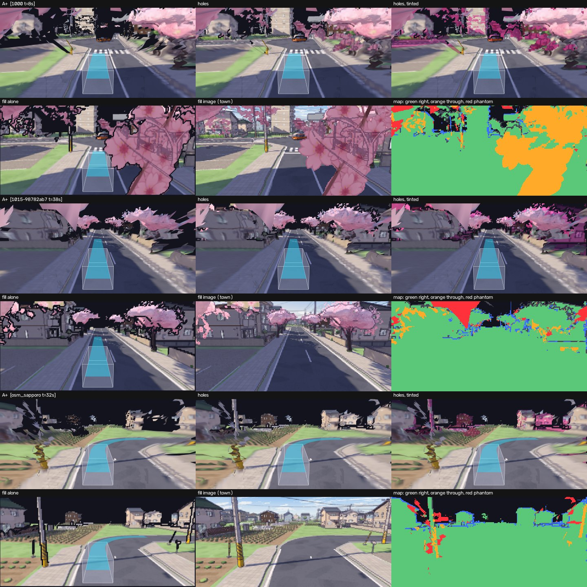

町ごとに 2 段です。上の段は左から、A+（補完なし）、穴だけ、穴だけ（補完に色を付けたもの）。下の段は、補完だけ（全部）、補完の画像そのもの（追跡カメラからの正解の色）、穴だけの計測の色分け（緑: 正しい、橙: 透け、赤: 実在しない面、青: カメラには見えたが描けていない、灰: 見えていない）です。

- 「穴だけ」の絵で、補完した所は鮮明で、見えた所はにじんでいます。境目は見て分かります。補完した面のまわりに、縁で捨てた細い暗い線が残ります。
- 色分けの赤（実在しない面）は、ほとんどが見えた面（キーフレームの木と建物）のものです。補完は足していません。
- 正解の色の画像で、影は欠けていませんでした（見た 6 場面で）。設計書が心配していた点です。
- **追跡カメラと車のあいだにある物は、正解の画では手前に大きく写ります**（絵 2 の 1 段目、道にかぶさる桜）。「全部」の表示では、それが道と車を隠します。「穴だけ」では、穴の所にだけ出ます。計測の「透け」にあたる所で、補完のモデルの正解にも入ります。

#### 書き出しとデータの検査

3 走行、各 150 秒、1 秒ごと（`data/recon_fill_trial/`、git には入りません）です。

| 走行 | 町 | 組 | 大きさ | 形と型 | 背景色と「面なし」が食い違う画素（入力 / 緩い規則 / 1 回前） | 地面の高さ: 0〜10 m / 10〜30 m / 30〜80 m（中央値、±10 mm に入る割合）|
|---|---|---:|---:|---|---|---|
| 1001 | 1001 | 72 | 74 MB | 合う | 0 / 0 / 0（3,686,400 画素のうち） | +0.0 mm、92 % / +0.0 mm、69 % / -0.1 mm、58 % |
| 1018-98782ab7_bikes | 1018-98782ab7 | 87 | 89 MB | 合う | 0 / 0 / 0（4,454,400 画素のうち） | +0.0 mm、91 % / +0.0 mm、62 % / +0.0 mm、56 % |
| osm_sapporo_n_s2000 | osm_sapporo_n_s2000 | 142 | 145 MB | 合う | 0 / 0 / 0（7,270,400 画素のうち） | -0.0 mm、83 % / -0.1 mm、61 % / -0.1 mm、54 % |

合計 301 組、0.31 GB。街の 80 m 以内の画素のうち、入力に面のない所（穴）: 13.2 %。穴のうち、緩い規則の画に面がある: 58.2 %、1 回前の正解のメッシュに面がある: 66.2 %。1 回前の正解のメッシュが覆う割合（80 m 以内の全部）: 86.4 %。

| 項目 | 実測 |
|---|---|
| 速さ | 1 組あたり 1.8〜2.8 秒（町の時間 1 秒あたり 1.2〜2.6 秒）。窓を小さくしても変わりませんでした |
| 大きさ | 1 組 1.024 MB（生の `.npy`）。配列ごとに gzip すると 0.54〜0.61 MB |
| 止まっていて保存しなかった回 | town 1001 で 150 回のうち 78 回、札幌で 8 回 |
| 2 万組の見積もり | Chrome 1 つで 10〜16 時間、20 GB。設計時の見当（一晩、5 GB）より大きい |

- 穴は、街の 80 m 以内の画素の 13.2 % です。穴のうち 58 % は、緩い規則の画に面があります。緩い規則の入力は、穴の半分以上で手がかりになります。
- 並べて走らせたときの速さは測っていません。

### 4.3 P1 の前に決めること

1. **書き出しの量と時間**。2 万組は Chrome 1 つで 10〜16 時間です。Chrome を 2〜3 つ並べるか、組を減らすか、間隔を 0.5 秒にするかを決めます。
2. **ディスクの形**。生の `.npy`（20 GB、メモリに載せずに読める）のままにするか、圧縮するか。
3. **`prev_*` の時刻**（3.4）。0.2 秒前のままでよいか。
4. **補完のメッシュの縁**。正解でも被覆率が 95.9 % で止まる原因です。補完のメッシュだけ縁の比を緩める手があります。緩めると、実在しない面が増えます。P1 の関門の数字は、今の規則での上限（穴・1 回前で「正しく描けた」87.6 %、足した画素のうち正しい 97.8 %）を踏まえて決めます。
5. **学習の町**。`web/towns/` の残り（計測の 5 町を除く）と `web/.towns/` から 20 町以上を選びます。

## 5. P1 回帰の補完モデル

### 5.1 作ったもの

- `keipilot/fillnet.py`: 小さな U-Net（4 段、幅 16・32・64・128、BatchNorm なし、いちばん粗い段に膨張した畳み込み 2 層）。入力は補完なしの画（色、深度、面があるか）と地面までの距離の表、それに緩い規則の画（あり・なしを選べる）。出力は色、log 深度、「80 m 以内に面があるか」です。網が出すのは最初の当て推量からの直しです。当て推量は、面のある所では入力の色と深度、ない所では地面の深度です。積和は 1.73 G です。
- `scripts/train_fill.py`、`tools/fill_eval.py`、`scripts/export_fill_onnx.py`: 学習、オフラインの評価、ONNX の書き出し。`scripts/export_onnx.py` と運転モデルには触れていません。
- `web/src/fill.js` の `&fill=model`: 補完の番に、補完なしの画（と緩い規則の画）を追跡カメラから描いて補完のモデルに渡し、答えが来たらメッシュにして表示します。答えを待つあいだに次の番が来たら、その番は飛ばします。WebGPU だけです。
- 推論の場所: 運転モデルと同じワーカーの 2 つ目のセッション（既定）。`&fillworker=own` で別のワーカーにできます。同じワーカーでは、2 つのモデルの推論を頼まれた順に 1 つずつ走らせます。
- `recon_check.mjs --fill model`: 計測のフレームでは、補完のモデルの答えを待ってから測ります。同じフレームの正解の補完も作り、`oracle` として並べます。

### 5.2 学習データ

`docs/recon_fill/p1_dump.sh` で書き出します。学習用は 40 走行（各 600 秒、Chrome 3 つを並べる）、評価用は計測の 3 町の 4 走行（各 300 秒）です。

- 学習の町: `web/towns/` の 6 町（1001、1002、1003、1018-98782ab7、2000-8c5d282b、2002-8c5d282b）、`web/.towns/` の街の様式 6 種から 28 町、札幌の学習用 3 区画から 6 町。計測の町（1000、1015-98782ab7、osm_sapporo）と osm_nishioi、1000-dae67d73 は入れていません。
- 走行の 4 つに 1 つずつ、自転車、路上駐車、その両方を混ぜます（札幌は周りの車だけ）。
- 道順は走行ごとに違います（交差点での曲がり方が乱数のため）。

2026-11-23 22:40 から 11-24 05:10 まで、6 時間半かけて書き出しました（`runs/fill_dump.log`、走行ごとの記録は `runs/eval/recon_fill/p1_dump/`）。

| | 走行 | 組 | 大きさ | 穴（80 m 以内の画素のうち） | 穴のうち、緩い規則の画に面がある | 検査（`tools/fill_data.py check`） |
|---|---:|---:|---:|---:|---:|---|
| 学習用 `data/recon_fill/train` | 40 | 15,815 | 16.2 GB | 12.7 % | 60.3 % | 通過 |
| 評価用 `data/recon_fill/eval` | 4 | 883 | 0.9 GB | 12.8 % | 59.5 % | 通過 |

- **組の数は、見込み（1.7〜2.2 万組）より少なくなりました。** 走行の 25,200 秒のうち 8,500 秒は、車が 1 m も動いていないので保存していません（信号と車列）。1 走行あたり 120〜571 組です。
- **時間は、見込み（4 時間半）より長くかかりました。** Chrome 3 つで 1 組あたり 3.3〜4.1 秒でした（1 つだけなら 1.8〜2.8 秒）。
- **検査の決まりを 1 つ緩めました。** 「背景色の画素」と「面なしの画素」が食い違う画素は、試しの 301 組では 0 でしたが、今回は 8 億 5 千万画素のうち 26 画素ありました（入力 1、緩い規則 6、1 回前 19）。暗い面の色が、たまたま背景色と同じ値になった所です。モデルは面のあるなしを深度で見るので、学習には響きません。検査は「走行の画素の 10 万分の 1 以下」で通すことにしました。

### 5.3 関門 G-P1 の基準（学習の前に決めたもの）

設計書の目安のままです。P0 の上限（穴・1 回前で、足した画素のうち正しい 97.8 %、実在しない面 0.4 %、「正しく描けた」87.6 %）を見ても、変える理由はありませんでした。

| 項目 | 基準 |
|---|---|
| 不変 | `--fill` なしの計測が main と同じ（G-P0 と同じ決め方。この枝と main を最大 6 回ずつ）。`--fill` なしのページは `fill.js` も `reconfill.onnx` も要求しない。補完ありの走行の要約値が、町ごとに、補完なしの走行のどれかと同じ（最大 6 回ずつ）。運転モデルの ONNX とシャードには触れていない |
| オフライン | 評価用のデータの穴の画素で、深度（25 % 以内の割合）が「穴を地面で埋める」を上回り、色の L1 が `cv2.inpaint` を下回る |
| 正しく描けた（全体）、穴・1 回前 | 同じフレームの A+ より高い（3 つの町、90 フレームの合計） |
| 補完が足した画素、穴・1 回前 | 正しい 70 % 以上、実在しない面 15 % 未満 |
| 速さ（WebGPU、実時間、5 回の中央値） | モデルの呼び出しが `recon=model` の 90 % 以上、主画面の fps が 85 % 以上。town 1000 と札幌のそれぞれで |

モデルの選び方も先に決めます。

- **幅**: 乱数の重みの ONNX で、実時間の速さを測ります。幅 16・32・64・128 で、モデルの呼び出しが `recon=model` の 90 % を下回ったら、幅 12・24・48・96 にします。
- **緩い規則の入力**: あり・なしの 2 本を学習し、オフラインの評価で比べます。穴の画素の「25 % 以内」が 1 ポイント以上高ければ「あり」を、そうでなければ「なし」（追跡カメラからの描画が 2 回少ない）を、ブラウザの関門に使います。
- **推論の場所**: 同じワーカーと別のワーカーを、乱数の重みで比べます。モデルの呼び出しが多いほうを使います。

### 5.4 結果

2026-11-24 に学習し、計測しました。手順は `docs/recon_fill/p1.sh`、表は `tools/recon_g3.py`、`tools/recon_table.py`、`tools/fill_eval.py` が `runs/eval/recon_fill/` から出します。

| 項目 | 結果 | 判定 |
|---|---|---|
| 不変（計測） | `--fill` なしの計測 12 本（この枝 6、main 6）。両方にある要約値 1 種類で、計測の行が全部同じ | 通過 |
| 不変（読み込み） | `--fill` なしの走行は `fill.js` も `reconfill.onnx` も要求していない（要求すると `recon_check.mjs` が止まる） | 通過 |
| 不変（走行） | 補完あり（`recon=model&fill=model`）の走行に、補完なしと同じ要約値の走行がある（town 1000 で 4 本のうち 3 本、札幌で 4 本のうち 3 本） | 通過 |
| 不変（運転モデル） | `scripts/export_onnx.py`、運転モデルの ONNX、シャードは変えていない（`git diff main` に出ない） | 通過 |
| オフライン | 穴の画素で、深度の「25 % 以内」74.6 %（地面で埋める 22.7 %）、色の L1 28.8（`cv2.inpaint` 32.4） | 通過 |
| 正しく描けた（全体）、穴・1 回前 | 85.0 %（同じフレームの A+ は 80.0 %） | 通過 |
| 補完が足した画素、穴・1 回前 | 正しい 81.7 %、実在しない面 9.7 % | 通過 |
| 速さ | モデルの呼び出しは `recon=model` の 98 %（town 1000）と 97 %（札幌）、主画面の fps は 96 % と 99 % | 通過 |

#### 幅と推論の場所（乱数の重み）

town 1000、実時間 30 秒、3 回ずつです。

| 町 | 設定 | 回数 | 主画面 [fps]、中央値 | 各回の fps | モデルの呼び出し [回/秒] | 推論 [ms] | モデルのフレーム（主スレッド）[ms] | メッシュ [ms] | 町の時間 | 各回の呼び出し | 補完 [回/秒] | 補完の入力 [ms] | 補完の推論 [ms] | 飛ばした番 |
|---|---|---:|---:|---|---:|---:|---:|---:|---:|---|---:|---:|---:|---:|
| town 1000 | `recon=model`（蓄積あり） | 3 | 44.2 | 45、32、44 | 9.1 | 70.4 | 13.6 | 3.0 | ×0.99 | 9.1、8.0、9.1 | – | – | – | – |
| town 1000 | 補完あり、乱数の重み、幅 16・32・64・128 | 3 | 41.5 | 42、29、42 | 8.5 | 70.6 | 13.7 | 8.3 | ×0.99 | 8.5、7.6、8.5 | 4.2 | 9.0 | 64.1 | 0 |
| town 1000 | 補完あり、乱数の重み、幅 24・48・96・192 | 3 | 29.4 | 29、29、30 | 7.6 | 70.1 | 22.2 | 16.2 | ×0.99 | 7.4、7.6、7.7 | 3.8 | 14.6 | 82.0 | 0 |
| town 1000 | 補完あり、乱数の重み、幅 12・24・48・96 | 3 | 29.6 | 30、30、29 | 7.4 | 72.2 | 21.9 | 14.7 | ×0.99 | 7.4、7.4、7.6 | 3.7 | 14.6 | 80.9 | 0 |
| town 1000 | 補完あり、乱数の重み、幅 16〜128、緩い規則の入力なし | 3 | 31.3 | 31、31、31 | 7.7 | 71.2 | 22.2 | 9.2 | ×0.99 | 7.7、7.7、7.8 | 3.9 | 6.1 | 63.0 | 0 |
| town 1000 | 補完あり、乱数の重み、幅 16〜128、別のワーカー | 3 | 30.0 | 30、30、30 | 7.5 | 70.6 | 22.0 | 18.7 | ×0.99 | 7.6、7.5、7.5 | 3.8 | 14.7 | 81.3 | 0 |

推論、モデルのフレーム、メッシュ、町の時間は各回の値の中央値。

- **幅は 16・32・64・128 のままにしました。** モデルの呼び出しは毎秒 8.5 回で、補完なし（9.1 回）の 93 % です。
- **推論の場所は、運転モデルと同じワーカーにしました。** 呼び出しは同じワーカー 8.5 回、別のワーカー 7.5 回でした。
- **ただし、この比べ方は弱いです。** ページの速さは、同じ設定でも 2 通りに分かれます（補完なしで 44〜45 fps と 32 fps。ReconView の記録にある現象です）。幅の広い網、狭い網、別のワーカーの回は、たまたま全部が遅いほうでした。遅いほうどうしで比べると、呼び出しは補完なし 8.0 回、どの網でも 7.4〜7.7 回で、幅による差は見えません。
- 補完の入力を作る時間は、緩い規則の画があると 9〜15 ms、ないと 6 ms です（追跡カメラからの描画が 4 回と 2 回）。

#### 学習とオフラインの評価

学習用 15,815 組、30 エポック、バッチ 32、RTX 3060 で 1 本 22〜24 分です（`runs/eval/recon_fill/p1_train_a.json`、`p1_train_b.json`）。評価は、計測の 3 町の 883 組です。

883 組（eval）。対象は、街に 80 m 以内の面がある画素

穴の画素（補完なしの画に何もない所）

| | 画素 | 面があるかの正答率 | 面を出した割合 | 深度の AbsRel | 25 % 以内（面あり） | 色の L1（0〜255） | 鮮明さ |
|---|---:|---:|---:|---:|---:|---:|---:|
| 緩い規則の入力あり | 5,137,801 | 90.7 % | 89.6 % | 46.0 % | 75.1 % | 28.4 | 0.18 |
| 緩い規則の入力なし | 5,137,801 | 90.2 % | 89.6 % | 46.9 % | 74.6 % | 28.8 | 0.17 |
| 基準: 穴を地面で埋める | 5,137,801 | 73.9 % | 54.8 % | 119.0 % | 22.7 % | – | – |
| 基準: `cv2.inpaint` | 5,137,801 | – | – | – | – | 32.4 | 0.34 |
| 基準: 緩い規則の画をそのまま | 5,137,801 | 76.8 % | 59.5 % | 66.6 % | 46.3 % | 61.9 | 0.57 |

見えた画素（補完なしの画に面がある所）

| | 画素 | 面を出した割合 | 深度の AbsRel | 25 % 以内（面あり） | 色の L1（0〜255） | 鮮明さ |
|---|---:|---:|---:|---:|---:|---:|
| 緩い規則の入力あり | 34,914,255 | 99.8 % | 15.7 % | 94.2 % | 13.4 | 0.48 |
| 緩い規則の入力なし | 34,914,255 | 99.9 % | 15.2 % | 94.4 % | 13.7 | 0.46 |
| 見えた面そのまま（入力） | 34,914,255 | 100.0 % | 16.2 % | 93.0 % | 15.2 | 0.74 |

鮮明さ: 隣の画素との色の差の平均を、正解の画のそれで割った値（1 が正解と同じ）。

- **深度は基準を大きく上回りました。** 穴の画素の「25 % 以内」は、地面で埋める 22.7 %、緩い規則の画をそのまま 46.3 % に対して、74.6〜75.1 % です。
- **色は `cv2.inpaint` より少し良いだけで、ぼけています。** L1 は 28.4〜28.8 対 32.4、鮮明さは 0.17〜0.18 です（正解が 1、`cv2.inpaint` でも 0.34）。回帰の網は、分からない所を平均の色で塗ります。P2（色の生成）が狙うのはここです。
- **見えた画素もぼかします。** 網の画は、入力に面がある所でも鮮明さ 0.46〜0.48 です（入力は 0.74）。既定の「穴だけ」では、見えた所はもとのメッシュが描くので響きません。「全部」では響きます。
- **緩い規則の画は、入力に入れても差が小さいです。** 「25 % 以内」は、あり 75.1 %、なし 74.6 % で、差は 0.5 ポイントです。先に決めた規則（1 ポイント以上）に届かないので、**「なし」をブラウザの関門に使いました**（`web/models/reconfill.onnx`、3.4 MB、69.8 万パラメータ、積和 1.69 G）。

列は左から、補完なしの画（入力）、緩い規則の画、モデル（緩い規則の入力あり）、モデル（なし）、正解。行は色と深度が交互です。

#### ブラウザでの忠実度

3 つの町、60 秒、2 秒ごとの 90 フレームです。モデルの補完と、同じフレームを正解で埋めた補完（上限）を並べます。

| 町、描くもの | フレーム | 被覆率（全体） | 被覆率（いま見える範囲） | 見える範囲の割合 | 誤差（中央値） | 誤描画率 | うち透け | うち実在しない面 | 正しく描けた（全体） | 正しく描けた（見える範囲） |
|---|---:|---:|---:|---:|---:|---:|---:|---:|---:|---:|
| town 1000、A | 30 | 51.5 % | 83.3 % | 52.2 % | 1.33 % | 16.3 % | 14.5 % | 1.8 % | 43.4 % | 79.2 % |
| town 1000、A+ | 30 | 87.1 % | 84.7 % | 52.2 % | 0.74 % | 9.7 % | 5.3 % | 4.4 % | 79.2 % | 79.6 % |
| town 1000、穴・できたて | 30 | 93.4 % | 93.0 % | 52.2 % | 0.87 % | 10.3 % | 5.6 % | 4.7 % | 84.7 % | 87.2 % |
| town 1000、穴・1 回前 | 30 | 92.8 % | 92.3 % | 52.2 % | 0.85 % | 10.3 % | 5.6 % | 4.7 % | 84.1 % | 86.4 % |
| town 1000、全部・できたて | 30 | 84.0 % | 83.9 % | 52.2 % | 0.59 % | 5.6 % | 4.0 % | 1.6 % | 79.9 % | 81.2 % |
| town 1000、全部・1 回前 | 30 | 84.0 % | 83.4 % | 52.2 % | 0.58 % | 5.6 % | 3.9 % | 1.7 % | 79.8 % | 80.6 % |
| town 1000、穴・できたて（正解の補完） | 30 | 95.8 % | 95.4 % | 52.2 % | 0.56 % | 8.4 % | 4.4 % | 4.0 % | 88.3 % | 90.6 % |
| town 1000、全部・できたて（正解の補完） | 30 | 86.4 % | 86.8 % | 52.2 % | 0.00 % | 0.1 % | 0.1 % | 0.0 % | 86.2 % | 86.7 % |
| town 1015（二段階の信号）、A | 30 | 51.4 % | 84.3 % | 50.1 % | 1.82 % | 16.3 % | 14.3 % | 2.0 % | 43.3 % | 80.6 % |
| town 1015（二段階の信号）、A+ | 30 | 87.4 % | 86.5 % | 50.1 % | 0.94 % | 9.0 % | 4.1 % | 4.9 % | 80.1 % | 81.1 % |
| town 1015（二段階の信号）、穴・できたて | 30 | 94.8 % | 94.3 % | 50.1 % | 1.16 % | 9.8 % | 4.4 % | 5.3 % | 86.6 % | 88.0 % |
| town 1015（二段階の信号）、穴・1 回前 | 30 | 93.3 % | 92.5 % | 50.1 % | 1.15 % | 9.6 % | 4.2 % | 5.4 % | 85.4 % | 86.6 % |
| town 1015（二段階の信号）、全部・できたて | 30 | 85.5 % | 85.2 % | 50.1 % | 0.84 % | 5.1 % | 3.1 % | 2.1 % | 81.8 % | 82.3 % |
| town 1015（二段階の信号）、全部・1 回前 | 30 | 84.1 % | 82.5 % | 50.1 % | 0.82 % | 4.8 % | 2.7 % | 2.1 % | 80.7 % | 80.0 % |
| town 1015（二段階の信号）、穴・できたて（正解の補完） | 30 | 95.6 % | 95.3 % | 50.1 % | 0.68 % | 8.0 % | 3.6 % | 4.5 % | 88.4 % | 90.1 % |
| town 1015（二段階の信号）、全部・できたて（正解の補完） | 30 | 85.9 % | 86.6 % | 50.1 % | 0.00 % | 0.1 % | 0.1 % | 0.1 % | 85.8 % | 86.5 % |
| 札幌（OSM）、A | 30 | 50.7 % | 84.7 % | 48.4 % | 2.15 % | 16.9 % | 14.9 % | 2.0 % | 42.4 % | 81.6 % |
| 札幌（OSM）、A+ | 30 | 88.0 % | 87.2 % | 48.4 % | 1.11 % | 8.6 % | 4.0 % | 4.6 % | 80.9 % | 82.2 % |
| 札幌（OSM）、穴・できたて | 30 | 94.6 % | 94.3 % | 48.4 % | 1.25 % | 9.3 % | 4.3 % | 5.0 % | 86.7 % | 88.8 % |
| 札幌（OSM）、穴・1 回前 | 30 | 93.0 % | 92.5 % | 48.4 % | 1.21 % | 9.0 % | 4.2 % | 4.8 % | 85.4 % | 87.1 % |
| 札幌（OSM）、全部・できたて | 30 | 85.4 % | 85.2 % | 48.4 % | 0.82 % | 5.1 % | 3.3 % | 1.9 % | 81.7 % | 83.1 % |
| 札幌（OSM）、全部・1 回前 | 30 | 83.9 % | 82.3 % | 48.4 % | 0.80 % | 4.5 % | 3.0 % | 1.5 % | 80.5 % | 80.2 % |
| 札幌（OSM）、穴・できたて（正解の補完） | 30 | 95.9 % | 95.6 % | 48.4 % | 0.82 % | 7.7 % | 3.4 % | 4.3 % | 89.0 % | 90.8 % |
| 札幌（OSM）、全部・できたて（正解の補完） | 30 | 86.7 % | 87.6 % | 48.4 % | 0.00 % | 0.1 % | 0.1 % | 0.1 % | 86.6 % | 87.5 % |
| **合計**、A | 90 | 51.2 % | 84.1 % | 50.2 % | 1.59 % | 16.5 % | 14.6 % | 1.9 % | 43.0 % | 80.4 % |
| **合計**、A+ | 90 | 87.5 % | 86.1 % | 50.2 % | 0.86 % | 9.1 % | 4.5 % | 4.6 % | 80.0 % | 80.9 % |
| **合計**、穴・できたて | 90 | 94.2 % | 93.9 % | 50.2 % | 1.05 % | 9.8 % | 4.8 % | 5.0 % | 86.0 % | 87.9 % |
| **合計**、穴・1 回前 | 90 | 93.0 % | 92.5 % | 50.2 % | 1.01 % | 9.6 % | 4.7 % | 5.0 % | 85.0 % | 86.7 % |
| **合計**、全部・できたて | 90 | 85.0 % | 84.7 % | 50.2 % | 0.75 % | 5.3 % | 3.4 % | 1.8 % | 81.1 % | 82.2 % |
| **合計**、全部・1 回前 | 90 | 84.0 % | 82.7 % | 50.2 % | 0.69 % | 5.0 % | 3.2 % | 1.8 % | 80.4 % | 80.3 % |
| **合計**、穴・できたて（正解の補完） | 90 | 95.7 % | 95.4 % | 50.2 % | 0.64 % | 8.1 % | 3.8 % | 4.2 % | 88.6 % | 90.5 % |
| **合計**、全部・できたて（正解の補完） | 90 | 86.3 % | 87.0 % | 50.2 % | 0.00 % | 0.1 % | 0.1 % | 0.1 % | 86.2 % | 86.9 % |

| 追跡カメラからの距離 | 画素 | 被覆率（全体）: 補完なし / 穴・できたて / 穴・1 回前 / 全部・できたて / 穴・できたて（正解の補完） |
|---|---:|---|
| 0〜10 m | 1,547,529 | 94.4 % / 96.5 % / 96.1 % / 87.1 % / 97.9 % |
| 10〜30 m | 2,039,502 | 89.8 % / 96.3 % / 94.7 % / 88.2 % / 96.9 % |
| 30〜80 m | 530,066 | 58.4 % / 79.7 % / 77.5 % / 66.3 % / 84.8 % |

| 町 | 描くもの | 補完が足した画素（補完なしでは何もない所） | うち正しい | うち透け | うち実在しない面 |
|---|---|---:|---:|---:|---:|
| town 1000 | 穴・できたて | 92,802 | 81.9 % | 10.3 % | 7.8 % |
| town 1000 | 穴・1 回前 | 84,747 | 80.4 % | 10.8 % | 8.9 % |
| town 1000 | 全部・できたて | 92,802 | 81.9 % | 10.3 % | 7.8 % |
| town 1000 | 全部・1 回前 | 92,363 | 81.2 % | 10.4 % | 8.3 % |
| town 1000 | 穴・できたて（正解の補完） | 121,506 | 99.5 % | 0.3 % | 0.2 % |
| town 1000 | 全部・できたて（正解の補完） | 121,506 | 99.5 % | 0.3 % | 0.2 % |
| town 1015（二段階の信号） | 穴・できたて | 109,162 | 81.5 % | 8.1 % | 10.4 % |
| town 1015（二段階の信号） | 穴・1 回前 | 88,231 | 81.5 % | 6.9 % | 11.6 % |
| town 1015（二段階の信号） | 全部・できたて | 109,162 | 81.5 % | 8.1 % | 10.4 % |
| town 1015（二段階の信号） | 全部・1 回前 | 106,000 | 82.6 % | 6.5 % | 10.9 % |
| town 1015（二段階の信号） | 穴・できたて（正解の補完） | 111,443 | 99.4 % | 0.2 % | 0.3 % |
| town 1015（二段階の信号） | 全部・できたて（正解の補完） | 111,443 | 99.4 % | 0.2 % | 0.3 % |
| 札幌（OSM） | 穴・できたて | 96,258 | 82.2 % | 7.9 % | 9.9 % |
| 札幌（OSM） | 穴・1 回前 | 71,936 | 83.6 % | 8.2 % | 8.3 % |
| 札幌（OSM） | 全部・できたて | 96,258 | 82.2 % | 7.9 % | 9.9 % |
| 札幌（OSM） | 全部・1 回前 | 87,734 | 84.9 % | 7.7 % | 7.4 % |
| 札幌（OSM） | 穴・できたて（正解の補完） | 107,208 | 99.5 % | 0.2 % | 0.3 % |
| 札幌（OSM） | 全部・できたて（正解の補完） | 107,208 | 99.5 % | 0.2 % | 0.3 % |
| **合計** | 穴・できたて | 298,222 | 81.8 % | 8.7 % | 9.4 % |
| **合計** | 穴・1 回前 | 244,914 | 81.7 % | 8.6 % | 9.7 % |
| **合計** | 全部・できたて | 298,222 | 81.8 % | 8.7 % | 9.4 % |
| **合計** | 全部・1 回前 | 286,097 | 82.9 % | 8.1 % | 9.0 % |
| **合計** | 穴・できたて（正解の補完） | 340,157 | 99.5 % | 0.2 % | 0.3 % |
| **合計** | 全部・できたて（正解の補完） | 340,157 | 99.5 % | 0.2 % | 0.3 % |

補完のメッシュ（90 フレームの平均）: 有効な頂点 11,390 / 12,800、三角形 19,583、縁で捨てた三角形 2,596、穴にかかるマス 3,279、作る時間 13.5 ms。「1 回前」の補完は、平均でモデルのフレーム 2.0 回前、1.17 m 手前のもの。補完のモデル: 入力を作る時間 21.3 ms、推論（往復）33.3 ms。

- **「正しく描けた（全体）」は、80.0 % から 85.0 % に上がりました**（穴・1 回前。訪れた人が見るのはこれです）。できたてでは 86.0 % で、同じフレームの上限は 88.6 % です。上限までの伸びしろの 7 割を取れています。
- **補完が足した画素は、8 割が正しい面です。** 穴・1 回前で、正しい 81.7 %、透け 8.6 %、実在しない面 9.7 % です（上限は 99.5 %）。
- **被覆率は 87.5 % から 93.0 % に上がりました**（できたて 94.2 %、上限 95.7 %）。遠く（30〜80 m）では 58.4 % から 77.5 % です。
- **そのかわり、全体の「実在しない面」は 4.6 % から 5.0 % に増えます。** 誤差の中央値も 0.86 % から 1.01 % に上がります。
- **動く車は消えます。** 穴にかかった車は、道路の色のぼけた面になります（下の絵の town 1015、30 秒）。網には 1 フレームの画しか渡していないためです。
- 補完のモデルの時間（計測の走行の中）: 入力を作る 21.3 ms、推論の往復 33.3 ms。メッシュを作る 13.5 ms。

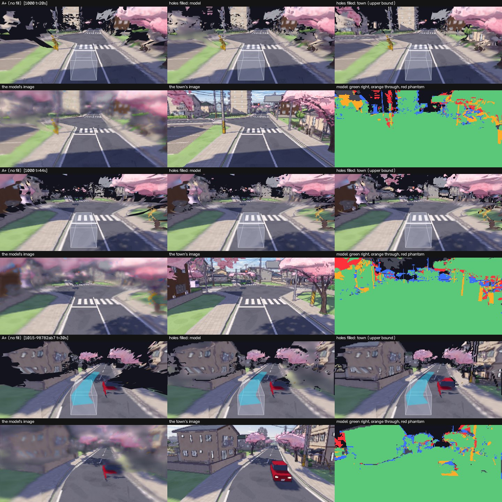

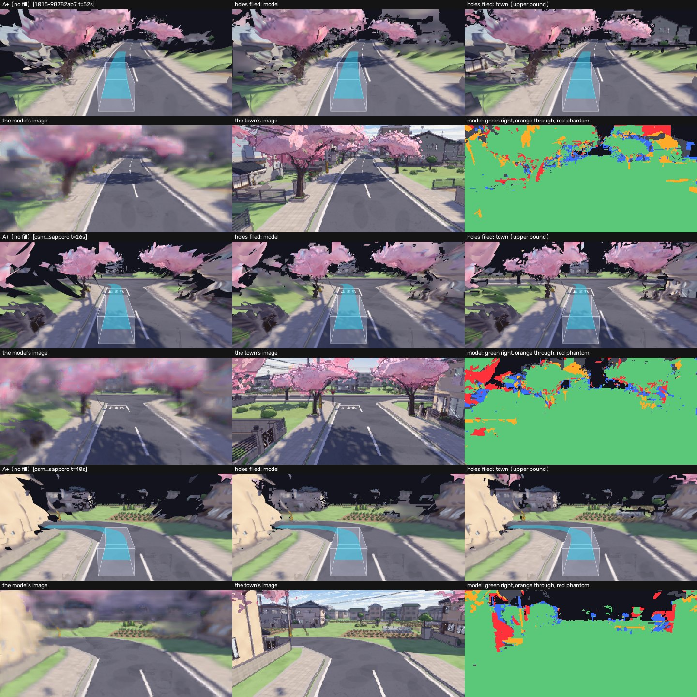

場面ごとに 2 段です。上の段は左から、補完なし（A+）、穴をモデルで埋めた画、穴を正解で埋めた画（上限）。下の段は、モデルの画そのもの、正解の画、モデルで埋めた画の内訳（緑: 正しい、橙: 透け、赤: 実在しない面）。

#### 不変

`--fill` なしの計測（town 1000、30 秒、この枝と main を 6 回ずつ）:

| 要約値（画像と姿勢、走行） | 走行 | 計測の行が全部同じか |
|---|---|---|
| `fd8afb088e1b62ad`、`097517239056be38` | here × 3、main × 1 | 同じ |
| `451547e425f91b0f`、`6d348efab8673b93` | here × 2 | –（片方だけ） |
| `75b77baf8e7cd335`、`fb929e7966a99c31` | here × 1 | –（片方だけ） |
| `b708ce639ccf1856`、`da89ba5e27755abf` | main × 4 | –（片方だけ） |
| `2ef7b43d0ecf3b7e`、`ff54bd8f3153db72` | main × 1 | –（片方だけ） |

走行 12 本、各 30 秒、計測 15 フレーム。両方にある要約値 1 種類のうち、行が全部同じもの 1 種類。

走行（60 秒、計測なし、4 回ずつ）:

| 町 | 設定 | 走行の要約値（回数） | recon なしと同じ要約値の走行 | 判定 |
|---|---|---|---:|---|
| town 1000 | recon なし、深度つきの ONNX | `e1b066aa6fe3ee41`（2 回）、`2f708ee9efefd0a4`（1 回）、`5a01ac7adc0049d5`（1 回） | – | – |
| town 1000 | `recon=model`（蓄積あり） | `95bbe61acc9a5fb5`（1 回）、`31b76671dd2fefdc`（1 回）、`649f4052aece583c`（1 回）、`e1b066aa6fe3ee41`（1 回） | 1 / 4 本 | 通過 |
| town 1000 | `recon=model&fill=model` | `2f708ee9efefd0a4`（3 回）、`efeb8bf52b4b315c`（1 回） | 3 / 4 本 | 通過 |
| 札幌（OSM） | recon なし、深度つきの ONNX | `685861a364826836`（3 回）、`6ff182c451d8b655`（1 回） | – | – |
| 札幌（OSM） | `recon=model`（蓄積あり） | `685861a364826836`（2 回）、`6ff182c451d8b655`（2 回） | 4 / 4 本 | 通過 |
| 札幌（OSM） | `recon=model&fill=model` | `7378f1edcac3769c`（1 回）、`685861a364826836`（2 回）、`6ff182c451d8b655`（1 回） | 3 / 4 本 | 通過 |

| 町 | 要約値 | 60 秒後の位置 | 60 秒後の速度 | その走行の設定 |
|---|---|---:|---:|---|
| town 1000 | `95bbe61acc9a5fb5` | 229.8 m | 0.0 km/h | `recon=model`（蓄積あり） × 1 |
| town 1000 | `31b76671dd2fefdc` | 276.5 m | 26.6 km/h | `recon=model`（蓄積あり） × 1 |
| town 1000 | `649f4052aece583c` | 156.8 m | 17.0 km/h | `recon=model`（蓄積あり） × 1 |
| town 1000 | `e1b066aa6fe3ee41` | 156.8 m | 17.0 km/h | `recon=model`（蓄積あり） × 1、recon なし、深度つきの ONNX × 2 |
| town 1000 | `2f708ee9efefd0a4` | 152.6 m | 0.0 km/h | `recon=model&fill=model` × 3、recon なし、深度つきの ONNX × 1 |
| town 1000 | `efeb8bf52b4b315c` | 229.8 m | 0.0 km/h | `recon=model&fill=model` × 1 |
| town 1000 | `5a01ac7adc0049d5` | 276.5 m | 26.6 km/h | recon なし、深度つきの ONNX × 1 |
| 札幌（OSM） | `685861a364826836` | 495.9 m | 14.8 km/h | `recon=model`（蓄積あり） × 2、`recon=model&fill=model` × 2、recon なし、深度つきの ONNX × 3 |
| 札幌（OSM） | `6ff182c451d8b655` | 506.1 m | 30.2 km/h | `recon=model`（蓄積あり） × 2、`recon=model&fill=model` × 1、recon なし、深度つきの ONNX × 1 |
| 札幌（OSM） | `7378f1edcac3769c` | 506.1 m | 30.2 km/h | `recon=model&fill=model` × 1 |

走行 24 本、各 60 秒、要約値は 60 点（1 秒ごと）から。

- 追加の走行は要りませんでした。要約値は town 1000 で 7 通り、札幌で 3 通りに分かれましたが、town 1000 の `31b76671dd2fefdc` のほかは、P0 の走行（4.2）でも出ていた値です。recon なしどうしでも分かれています。

#### 速さ

実時間 30 秒、5 回ずつ、補完なしと補完ありを交互に走らせました。

| 町 | 設定 | 回数 | 主画面 [fps]、中央値 | 各回の fps | モデルの呼び出し [回/秒] | 推論 [ms] | モデルのフレーム（主スレッド）[ms] | メッシュ [ms] | 町の時間 | 各回の呼び出し | 補完 [回/秒] | 補完の入力 [ms] | 補完の推論 [ms] | 飛ばした番 |
|---|---|---:|---:|---|---:|---:|---:|---:|---:|---|---:|---:|---:|---:|
| town 1000 | `recon=model`（蓄積あり） | 5 | 32.6 | 33、33、33、32、32 | 8.0 | 71.5 | 22.1 | 5.4 | ×0.99 | 8.0、8.0、8.1、8.2、8.0 | – | – | – | – |
| town 1000 | `recon=model&fill=model` | 5 | 31.4 | 32、31、31、32、31 | 7.8 | 71.3 | 22.0 | 9.4 | ×0.99 | 7.9、7.6、7.8、7.8、7.8 | 3.9 | 6.1 | 65.9 | 0 |
| 札幌（OSM） | `recon=model`（蓄積あり） | 5 | 12.8 | 13、13、13、13、13 | 3.1 | 131.8 | 36.8 | 13.7 | ×0.79 | 3.1、3.2、3.1、3.2、3.1 | – | – | – | – |
| 札幌（OSM） | `recon=model&fill=model` | 5 | 12.7 | 12、12、13、13、13 | 3.0 | 132.9 | 36.3 | 21.5 | ×0.77 | 3.0、3.0、3.1、3.1、3.0 | 1.5 | 10.7 | 178.6 | 0 |

推論、モデルのフレーム、メッシュ、町の時間は各回の値の中央値。

- **補完ありでも、速さはほとんど変わりません。** town 1000 で主画面 32.6 fps から 31.4 fps（96 %）、モデルの呼び出し 8.0 回から 7.8 回（98 %）。札幌で 12.8 fps から 12.7 fps（99 %）、3.1 回から 3.0 回（97 %）です。
- 今回の 20 回は、全部が遅いほうの回でした（town 1000 で 31〜33 fps。速いほうは 44〜45 fps）。速いほうでの比は、乱数の重みの計測（上）の 94 %（fps）と 93 %（呼び出し）が目安です。
- 補完は、運転モデルの呼び出し 2 回に 1 回で、town 1000 で毎秒 3.9 回、札幌で 1.5 回です。飛ばした番はありません。推論の往復は 66 ms と 179 ms で、運転モデルの推論の順番待ちを含みます。札幌では、補完の画は作ってから表示まで 0.2 秒ほど遅れます。

#### 「全部」を既定にするか

**しないほうがよい、という結果です。**

| 90 フレームの合計、できたて | 被覆率（全体） | 誤描画率 | 正しく描けた（全体） |
|---|---:|---:|---:|
| 補完なし（A+） | 87.5 % | 9.1 % | 80.0 % |
| 穴だけ（既定） | 94.2 % | 9.8 % | 86.0 % |
| 全部 | 85.0 % | 5.3 % | 81.1 % |

- 「全部」は誤描画が半分になりますが、被覆率と「正しく描けた」は「穴だけ」より低いです。補完のメッシュ自身が縁で三角形を捨てるためで、正解で埋めても同じです（4.2）。
- 「全部」では、画面全体がモデルのぼけた画になります。見えた所の鮮明さが 0.74 から 0.46 に落ちます。
- P2 で色が鮮明になれば、見直す価値があります。

## 6. P2 色の生成（2026-11-24。途中で止めました）

P1 の結果を見て決めた設計と、その結果です。6.1〜6.7 は、走らせる前に書いた設計です（関門の数字もそこで決めました）。6.8 からが結果と、途中で足した設計です。**まとめは 6.18 です。**

### 6.1 P1 から分かった前提

- **足りないのは色だけです。** 深度は上限の 7 割まで届きました。色は、鮮明さが正解の 0.17 倍です（5.4）。
- **ぼけは、分からない所を平均で塗るためです。** 見えた画素でも、網の画は入力よりぼけます（鮮明さ 0.74 → 0.46）。回帰の損失では直りません。
- **ブラウザの計測は、色を見ていません。** 被覆率、透け、実在しない面は、どれも深度の指標です。色の良し悪しは、オフラインの評価と絵で見ることになります。
- **推論の余裕はあります。** 積和が 2.2 倍の網（幅 24・48・96・192）でも、モデルの呼び出しは幅 16〜128 と同じでした（5.4。ただし遅いほうの回だけ）。
- **1 回前の補完が届くのは、穴の 65 % です**（学習データで、1 回前の正解のメッシュに面がある穴の割合。5.2）。

### 6.2 方式

**形は P1 のまま、色だけを 1 ステップで生成します。**

- P1 の網は凍結します。深度と「面があるか」は P1 の出力をそのまま使います。
- 色の網は、条件付き mean-flow の 1 ステップです（Geng ほか、2025）。式は論文で確かめました（下の「式」）。
- **生成するのは、P1 の色からの差です。** `x = (正解の色 − P1 の色) / s`（s は学習データの穴の画素での標準偏差）。表示する色は `P1 の色 + s·x` です。生成がうまく学べなければ差は 0 に近づき、P1 の画に戻ります。
- 条件は、P1 の入力（補完なしの色、深度、面があるか、地面までの距離）と、P1 の出力（色、深度、面があるか）です。
- 網は P1 と同じ形の U-Net（4 段、BatchNorm なし）です。時刻は、`t` と `t − r` の 2 枚の定数の面として入力に足します。正規化の層がないので、埋め込みで層を変調する形は取りません。
- 損失をかける画素と重みは P1 と同じです（街に 80 m 以内の面がある画素。穴 1、見えた所 0.5）。

式（論文の式 6、11、12 と Algorithm 1、2）:

- 経路 `z_t = (1 − t)·x + t·ε`、速度 `v = ε − x`。
- 網は平均速度 `u(z_t, r, t | 条件)` を出します。目標は `v − (t − r)·du/dt`、`du/dt = v·∂u/∂z + ∂u/∂t` で、勾配は止めます。網の入力が `(t, t − r)` なので、`torch.func.jvp` の接ベクトルは `(v, 1, 1)` です。
- 推論は 1 回: `x = ε − u(ε, r = 0, t = 1 | 条件)`。

設計書の理解は、論文と合っていました。読んだのは方式、学習の設定、切り分けの実験の節です。関連研究と結果の節は読んでいません。

学習の設定は、論文の画素空間の例（CIFAR-10）を出発点にします。

| | 1 本目 | 2 本目（1 本目が関門に届かないとき） | 3 本目 |
|---|---|---|---|
| `(r, t)` の取り方 | logit-normal(−2.0, 2.0) | logit-normal(−0.4, 1.0) | 良かったほう |
| `r ≠ t` の割合 | 75 % | 25 % | 良かったほう |
| 損失の重みの指数 p | 0.75 | 1.0 | 良かったほう |
| 幅 | 16・32・64・128 | 同じ | 32・64・128・256 |
| エポック | 100 | 100 | 100 |

重みの移動平均（EMA）を評価と書き出しに使います。**mean-flow は 3 本までです。** 3 本とも関門に届かなければ、設計書の代案（L1 と PatchGAN）に切り替え、その前に報告します。

### 6.3 ブラウザ

- **ページのコードは変えません。** P1 の網、色の網、固定の乱数を 1 つの ONNX にまとめます（入力と出力は P1 と同じ `in_rgb`、`in_dep` → `rgb`、`depth`）。`&fill=model&fillmodel=models/reconfill_gen.onnx` で切り替えます。既定の `reconfill.onnx` は P1 のままです。
- 乱数は ONNX の中の定数です。同じ入力なら同じ画になります。
- **ちらつきを測る計測を足します**（計測のときだけ動くコード）。続けて作った 2 枚の補完を今の追跡カメラから描き、どちらでも穴で、深度が 10 % 以内で合う画素の、色の差の平均（0〜255）です。P1、正解の補完、P2 を同じ決め方で比べます。

### 6.4 段階と関門

| 段階 | 中身 | 重い仕事 |
|---|---|---|
| P2-0 | 色の網、学習と評価のスクリプト、ONNX の書き出し、ちらつきの計測。P1 と正解の補完のちらつきを測る | ブラウザ 10 分 |
| P2a | 学習（1〜3 本）とオフラインの評価。**関門 G-P2a** | GPU 1 本 1.5〜2 時間（幅 2 倍は 3 時間） |
| P2b | ONNX をページで動かす。不変、忠実度、速さ、ちらつき、絵。**関門 G-P2b（見せて止まる）** | ブラウザ 1 時間 40 分 |
| P2c | 1 回前の補完を条件に足す（6.5）。G-P2b のあとに決める | 学習 1 本とブラウザ |

学習 1 本の時間は、1 ステップ（バッチ 32）を RTX 3060 で測った値からの見積もりです（mean-flow の 1 ステップは 101 ms で、ふつうの 1 ステップの 1.6 倍。幅 2 倍では 206 ms）。

**G-P2a（オフライン、評価用の 883 組、穴の画素）**

| 項目 | 基準 | 理由 |
|---|---|---|
| 鮮明さ | 0.5 以上、1.2 以下 | P1 は 0.17、`cv2.inpaint` は 0.34、緩い規則の画は 0.57。上の線は、乱数をそのまま出す網を落とすため |
| 色の L1 | 40 以下 | P1 は 28.8。鮮明な画は、当たっていても平均の画より L1 が大きくなります（正しい分布から 1 枚引くと、二乗誤差で √2 倍まで）。1.4 倍を線にします |
| 深度と「面があるか」 | P1 の出力と同じ（差 0） | 形は P1 のまま、の検査 |

**G-P2b（ブラウザ）**

| 項目 | 基準 |
|---|---|
| 不変 | G-P1 と同じ。加えて、既定の `&fill=model`（P1 の重み）の ONNX が変わっていない |
| 形 | 同じ要約値の走行で、補完の計測の行（被覆率、透け、実在しない面）が P1 と同じ |
| 速さ | G-P1 と同じ線（モデルの呼び出し 90 % 以上、fps 85 % 以上。town 1000 と札幌）。補完なしと交互に 5 回ずつ |
| ちらつき | **13.8 以下**（P1 の 9.19 の 1.5 倍。学習の前、2026-11-24 に決めました。下の「ちらつきの物差し」） |

**ちらつきの物差し**（P2-0、`docs/recon_fill/p2.sh base`、3 つの町、60 秒、90 フレーム）

| 補完 | town 1000 | town 1015 | 札幌 | 合計 |
|---|---:|---:|---:|---:|
| 正解（街そのもの、`fill=oracle`） | 3.98 | 7.69 | 8.08 | 6.32 |
| P1（回帰の網） | 6.26 | 10.41 | 12.09 | 9.19 |

- 値は、今の補完と 1 回前の補完を同じ追跡カメラから 1 枚ずつ描き、どちらも同じ面（深度が 10 % 以内）で埋めた穴の画素の、色の差の平均です（0〜255）。
- **正解の補完でも 0 にはなりません。** 320×160 の画を 1.2 m 離れた視点から描き直すので、模様の細かい所がずれます。動く車も入ります。これが床です。
- 2 つの行は別の走行です（要約値が違います）。同じフレームどうしの比べではありません。
- **線は P1 の 1.5 倍にしました。** 固定の乱数だけの生成は、これを超えるはずです（6.5）。超えたら、P2c（1 回前の補完を条件に足す）が要る、という判定になります。
- ブラウザの見積もりは 10 分でしたが、正解の補完の走行も要るので 20 分かかりました。

### 6.5 1 回前の補完を条件に足す（P2c）

- **固定の乱数だけでは、ちらつくはずです。** 車が進むと、同じ建物が画面の別の場所に来ます。画面に固定した乱数からは、別の模様が出ます。補完は毎秒 4 回作り直すので、穴の模様が動いて見えます。
- 直す手は、設計書のとおり、1 回前の補完を今の追跡カメラから描いた画を条件に足すことです。学習では、1 回前の正解の描き直し（`prev_rgb`、`prev_dep`。書き出し済み）にノイズを足して代わりにします。
- ページでは、追跡カメラからの描画が 2 回増えます（1 回前の補完の色と深度）。
- **心配は、間違いが巡ることです。** ページでは、1 回前の画は正解ではなく、モデル自身の出力です。色だけとはいえ、「補完は蓄積しない」（設計の決めごと 4）に、弱い形で反します。
- P2a と P2b で「小さな網の 1 ステップで鮮明な色が出るか」を先に確かめ、P2c はそのあとに決めます。

### 6.6 設計書（出発点）と違う所

- 色そのものではなく、P1 の色からの差を生成します。
- 時刻の条件は、埋め込みではなく入力の面です。
- 関門を、オフライン（G-P2a）とブラウザ（G-P2b）に分けました。ブラウザの計測は色を見ないためです。
- 「1 回前の補完を条件に足す」は、P2 の中の後の段（P2c）にしました。
- ちらつきは、ページの計測で測ります（オフラインのデータには、1 回前の入力がないため）。

### 6.7 心配な点

- **データと網が小さいです。** 論文の画素空間の例は、5,500 万パラメータの U-Net を 80 万ステップ学習しています。こちらは 70 万パラメータ、約 5 万ステップです。条件が強い（形と色の平均は与えられている）ので問題は易しいはずですが、鮮明な模様が出る保証はありません。
- **鮮明さの指標は、乱数でも上がります。** L1 の線と絵で見張りますが、「もっともらしさ」を直接測る指標はありません。
- **動く車は消えたままです。** 動く物体の予測は、設計の範囲の外です。
- 「全部」を既定にするかは、G-P2b で見直します。

### 6.8 結果: 学習の 1 本目（2026-11-24）

**関門 G-P2a に届きませんでした。** 1 ステップの画は、紙吹雪のような粒で覆われます。

| 項目 | 基準 | 1 本目 | 判定 |
|---|---|---|---|
| 鮮明さ（穴） | 0.5 以上、1.2 以下 | 1.58 | 届かない（粒で上がりすぎ） |
| 色の L1（穴） | 40 以下 | 40.1 | 届かない |
| 深度と「面があるか」 | P1 と同じ | 同じ（表の深度の列が P1 と一致。ONNX どうしでも差 0） | 通過 |

設定は 6.2 の 1 本目のとおりです（100 エポック、4.9 万ステップ、RTX 3060 で 1 時間 50 分。`runs/eval/recon_fill/p2_train_1.json`）。

883 組（eval）。対象は、街に 80 m 以内の面がある画素

穴の画素（補完なしの画に何もない所）

| | 画素 | 面があるかの正答率 | 面を出した割合 | 深度の AbsRel | 25 % 以内（面あり） | 色の L1（0〜255） | 鮮明さ |
|---|---:|---:|---:|---:|---:|---:|---:|
| P1（回帰） | 5,137,801 | 90.2 % | 89.6 % | 46.9 % | 74.6 % | 28.8 | 0.17 |
| P2（色を生成、1 本目） | 5,137,801 | 90.2 % | 89.6 % | 46.9 % | 74.6 % | 40.1 | 1.58 |
| 基準: 穴を地面で埋める | 5,137,801 | 73.9 % | 54.8 % | 119.0 % | 22.7 % | – | – |
| 基準: `cv2.inpaint` | 5,137,801 | – | – | – | – | 32.4 | 0.34 |
| 基準: 緩い規則の画をそのまま | 5,137,801 | 76.8 % | 59.5 % | 66.6 % | 46.3 % | 61.9 | 0.57 |

見えた画素（補完なしの画に面がある所）

| | 画素 | 面を出した割合 | 深度の AbsRel | 25 % 以内（面あり） | 色の L1（0〜255） | 鮮明さ |
|---|---:|---:|---:|---:|---:|---:|
| P1（回帰） | 34,914,255 | 99.9 % | 15.2 % | 94.4 % | 13.7 | 0.46 |
| P2（色を生成、1 本目） | 34,914,255 | 99.9 % | 15.2 % | 94.4 % | 22.6 | 2.07 |
| 見えた面そのまま（入力） | 34,914,255 | 100.0 % | 16.2 % | 93.0 % | 15.2 | 0.74 |

鮮明さ: 隣の画素との色の差の平均を、正解の画のそれで割った値（1 が正解と同じ）。

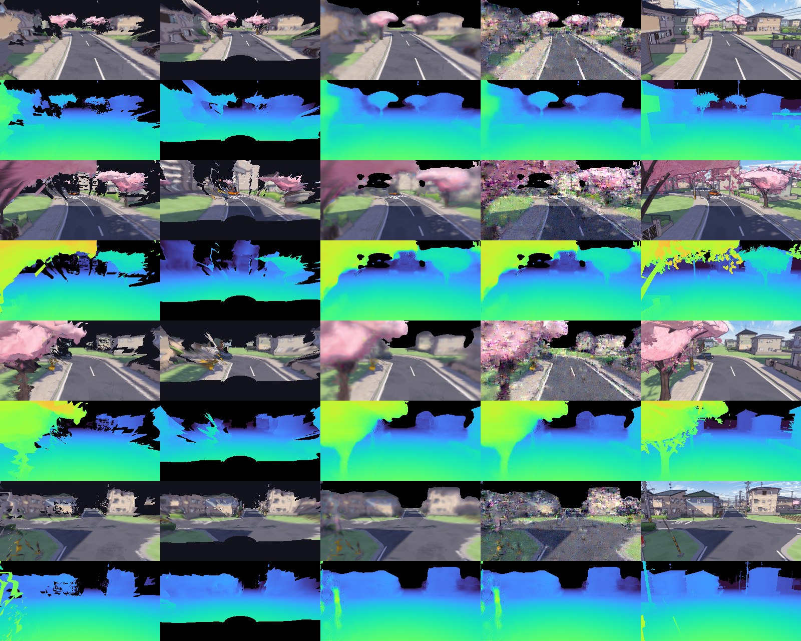

列は左から、補完なしの画、緩い規則の画、P1、P2 の 1 本目、正解。行は色と深度が交互です。

- 鮮明さは 15 エポックから 1.6〜1.8 のまま、ほとんど動きませんでした。学習を延ばしても直らない形です。
- 学習そのものは安定していました（損失は発散せず、`jvp` も 16 ビットの計算で通りました）。

**原因: 網が、乱数の画を引き切れていません。**（`tools/fill_gen_diag.py`）

（この診断は、次の試しで外れました。6.9 を見てください。下は、そのときの記録として残します。）

64 組（評価用の 14 組に 1 組）、穴の画素

| 作り方 | 色の L1（0〜255） | 鮮明さ |
|---|---:|---:|
| P1（回帰） | 28.6 | 0.17 |
| 1 ステップ | 39.8 | 1.60 |
| 2 ステップ（平均速度） | 38.6 | 1.26 |
| 4 ステップ（平均速度） | 37.7 | 1.20 |
| 瞬間の速度で 8 ステップ | 34.7 | 0.98 |
| 瞬間の速度で 32 ステップ | 38.1 | 1.25 |

1 ステップの答え（色の差 ÷ 尺度）と、出発点の乱数の画: 相関 0.44（細かい成分だけでは 0.46、乱数の細かい成分のうち答えに残った割合 31 %）。正解の色の差との相関: 0.01。分散: 答え 0.93、正解 1.05（細かい成分: 0.45、0.38）。

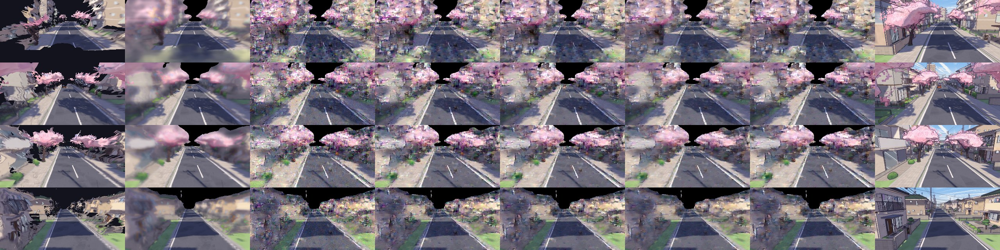

列は左から、補完なしの画、P1、1・2・4 ステップ（平均速度）、瞬間の速度で 8・32 ステップ、正解。

- 論文の形では、網は平均速度 `u` を出し、1 ステップの答えは `ε − u(ε)` です。きれいな画を出すには、網が入力の乱数 `ε` を画素ごとに正確に写して引く必要があります。
- 1 本目の答えには、乱数の細かい成分の 31 % が残っていました。粒は模様ではなく、引き残した乱数です。
- いちばん細かい段の幅は 16 チャンネルです。符号つきの乱数 3 枚を ReLU の層を通して正確に写すには、足りないようです。
- **ステップを増やしても粒は消えません。** 32 ステップでも鮮明さ 1.25 です。1 ステップ化の問題というより、この大きさの網で画素の速度を当てること自体が難しい、という結果です。

**次の案（6.2 の表からの変更なので、決める前に報告しました。走らせた結果は 6.9）**

- 網の出力を、速度 `u` ではなく、きれいな画 `f` にします。`u = (z − f) / t` と置きます。`r = t` のとき `f` の目標は正解そのもので、1 ステップの答えは `f(ε)` です。乱数を写して引く必要がなくなります。
- mean-flow の目標と `jvp` は、`u` に対してそのまま使えます。学習の時刻は 0.05 以上に切ります（`t` で割るため）。
- 学習前の網の答えは、P1 の色そのものになります（6.2 に書いた「うまく学べなければ P1 に戻る」が、構造として成り立ちます）。
- コードは `keipilot/fillgen.py` の `param="x"`、`scripts/train_fillgen.py --param x` として入れました。既定は今までの形（`u`）です。
- **心配**: 粒は消えても、本物らしい模様が出るとは限りません。32 ステップでも模様にならなかったので、網と学習量が足りない可能性が残ります。そのときは、平均の画（P1）に近い、少しだけ鮮明な画になります。

### 6.9 結果: 出力の形を変えた試し（2 本目、2026-11-24）

**これも関門 G-P2a に届きませんでした。粒は消えず、6.8 の診断は外れていました。**

| 項目 | 基準 | 1 本目（出力は速度） | 2 本目（出力はきれいな画、20 エポック） | 判定 |
|---|---|---|---|---|
| 鮮明さ（穴） | 0.5 以上、1.2 以下 | 1.58 | 1.64 | 届かない |
| 色の L1（穴） | 40 以下 | 40.1 | 39.4 | 線の内側だが、P1（28.8）より悪い |
| 深度と「面があるか」 | P1 と同じ | 同じ | 同じ | 通過 |

設定は 1 本目と同じで、網の出力だけを変えました（`--param x`。`RUN=2x EPOCHS=20 bash docs/recon_fill/p2.sh train`、9,880 ステップ、RTX 3060 で 22 分。`runs/eval/recon_fill/p2_train_2x.json`）。鮮明さは 5 エポックで 1.75、20 エポックで 1.64 で、1 本目と同じくほとんど動きません。mean-flow の 3 本のうちの 2 本目に数えます。

883 組（eval）。対象は、街に 80 m 以内の面がある画素

穴の画素（補完なしの画に何もない所）

| | 画素 | 面があるかの正答率 | 面を出した割合 | 深度の AbsRel | 25 % 以内（面あり） | 色の L1（0〜255） | 鮮明さ |
|---|---:|---:|---:|---:|---:|---:|---:|
| P1（回帰） | 5,137,801 | 90.2 % | 89.6 % | 46.9 % | 74.6 % | 28.8 | 0.17 |
| P2（色を生成、2x 本目） | 5,137,801 | 90.2 % | 89.6 % | 46.9 % | 74.6 % | 39.4 | 1.64 |
| 基準: 穴を地面で埋める | 5,137,801 | 73.9 % | 54.8 % | 119.0 % | 22.7 % | – | – |
| 基準: `cv2.inpaint` | 5,137,801 | – | – | – | – | 32.4 | 0.34 |
| 基準: 緩い規則の画をそのまま | 5,137,801 | 76.8 % | 59.5 % | 66.6 % | 46.3 % | 61.9 | 0.57 |

見えた画素（補完なしの画に面がある所）

| | 画素 | 面を出した割合 | 深度の AbsRel | 25 % 以内（面あり） | 色の L1（0〜255） | 鮮明さ |
|---|---:|---:|---:|---:|---:|---:|
| P1（回帰） | 34,914,255 | 99.9 % | 15.2 % | 94.4 % | 13.7 | 0.46 |
| P2（色を生成、2x 本目） | 34,914,255 | 99.9 % | 15.2 % | 94.4 % | 20.6 | 1.51 |
| 見えた面そのまま（入力） | 34,914,255 | 100.0 % | 16.2 % | 93.0 % | 15.2 | 0.74 |

鮮明さ: 隣の画素との色の差の平均を、正解の画のそれで割った値（1 が正解と同じ）。

64 組（評価用の 14 組に 1 組）、穴の画素

| 作り方 | 色の L1（0〜255） | 鮮明さ |
|---|---:|---:|
| P1（回帰） | 28.6 | 0.17 |
| 1 ステップ | 39.2 | 1.65 |
| 2 ステップ（平均速度） | 37.1 | 1.42 |
| 4 ステップ（平均速度） | 36.4 | 1.31 |
| 瞬間の速度で 8 ステップ | 33.3 | 0.89 |
| 瞬間の速度で 32 ステップ | 35.7 | 1.17 |

1 ステップの答え（色の差 ÷ 尺度）と、出発点の乱数の画: 相関 0.57（細かい成分だけでは 0.63、乱数の細かい成分のうち答えに残った割合 44 %）。正解の色の差との相関: 0.00。分散: 答え 0.85、正解 1.05（細かい成分: 0.47、0.38）。

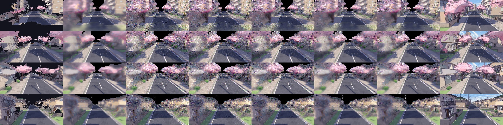

列は 6.8 の絵と同じです（補完なしの画、P1、1・2・4 ステップ、瞬間の速度で 8・32 ステップ、正解）。

**分かったこと**

- **粒は「引き残した乱数」ではありませんでした。** 2 本目の網は、乱数を写して引く必要がありません（1 ステップの答えは網の出力そのもので、学習前は P1 の色です）。それでも、答えには乱数の細かい成分の 44 % が入っていました（1 本目は 31 %）。網が自分で乱数を画に入れています。6.8 の「16 チャンネルでは乱数を正確に写せない」という説明は、この結果と合いません。
- **学んだのは「どれだけばらつくか」だけで、「どんな模様か」ではありません。** 答えの細かい成分の分散は 0.47 で、正解（0.38）と同じくらいです。ところが正解との相関は 0.00 で、隣の画素との差は正解の 1.6 倍あります。画素ごとのばらつきの大きさは合っていて、隣どうしのつながり（窓、枝、縁石の線）がありません。
- 画素が互いに独立にばらつく分布なら、乱数から画への写像は「平均 + ばらつき × 乱数」になります。出てきた画はこの形です。ここは結果からの解釈で、直接は確かめていません。
- ステップを増やしても同じです（32 ステップで鮮明さ 1.17）。1 ステップ化のせいでも、出力の形のせいでもなく、**この大きさの網とこの学習量では、町の模様の分布を学べていない**、という結果です。
- 論文の画素空間の例（32×32 の画像）は、5,500 万パラメータ、80 万ステップです。この網は 70 万パラメータ、1 本目で 4.9 万ステップです。

**次の候補（どれも走らせていません）**

- **3 本目（幅 32・64・128・256）**: 6.2 の表のとおりです。パラメータは 4 倍になりますが、上の差（80 倍）には遠く、推論の積和も 4 倍近くになるので、G-P2b の速さの線が危うくなります。
- **L1 + PatchGAN に切り替える**: 6.2 に書いた代わりの方式です。mean-flow の 3 本目を待たずに切り替えるのは、設計からの変更です。 → これに決まりました（6.10）。
- **P2 をここで止める**: P1 を ReconFill の結果とします。

### 6.10 方式の切り替え: L1 + PatchGAN（設計の案、2026-11-24）

6.9 の結果を受けて、設計書の代案に切り替えます。**学習はまだ走らせていません**（走らせたのは、単体テスト、400 ステップの試運転、下の「線らしさ」の計測だけです）。関門の数字は、ここで確定します。

**変えないもの**

- P1 の網は凍結し、深度と「面があるか」は P1 のままです。
- 色の網が出すのは、P1 の色からの差です（`表示する色 = P1 の色 + s·x`）。条件も同じです（P1 の入力と出力）。
- ONNX は 1 つで、入力と出力は P1 と同じです。ページのコードは変えません。既定の `reconfill.onnx` は P1 のままです。
- G-P2b（ブラウザ）の基準、ちらつきの線（13.8）、P2c を後で決めること。

**変えるもの**

- **色の網から、乱数と時刻の入力をなくします。** 入力は条件だけです。網の形と大きさは同じです（69.8 万パラメータ。`keipilot/fillgen.py` の `param="g"`）。同じ入力なら同じ画になるのは、乱数を固定したからではなく、乱数がないからです。
- **学習のときだけ、判別の網を使います**（`PatchDisc`）。画の 34×34 画素の一片ごとに、「街の画か、色の網の画か」を答えます。条件も見せます。17.3 万パラメータ、スペクトル正規化、正規化の層なし。ONNX には入りません。
- 色の網の損失は `λ × 色の L1 + 判別の網をだます項` です（色は 0〜1、hinge 損失）。**L1 が模様の置き場所を決め、判別の網が模様の形を決めます。** mean-flow の 2 本に欠けていたのは、後ろの役です。
- 判別の網に見せる画は、対象の画素（街に 80 m 以内の面がある所）だけを色の網の画にし、ほかは正解の画のままにします。一片ごとの重みは、P1 と同じ画素の重み（穴 1、見えた所 0.5）の平均です。
- Adam（学習率 2e-4、β = 0.5・0.999）、バッチ 32、重みの移動平均（EMA）を評価と書き出しに使います。`scripts/train_fillgan.py`。

**学習の回**（3 本まで。mean-flow のときと同じ決めごとです）

| | 1 本目 | 2 本目（1 本目が関門に届かないとき） | 3 本目 |
|---|---|---|---|
| λ（L1 の重み） | 100 | ぼけたまま（鮮明さ 0.5 未満）なら 30。L1 か「線らしさ」で落ちたら 300 | 良かったほう |
| 幅 | 16・32・64・128 | 同じ | 32・64・128・256 |
| エポック | 60 | 60 | 60 |

λ = 100 は、pix2pix の設定（色を −1〜1 で持って 100）の半分の強さです。網が小さいので、判別の網の側を強めに始めます。**ここは見当です。**

3 本とも届かなければ、P2 を止めて報告します。その先の案は、今は持っていません。

**関門 G-P2a に 1 項目を足します**

今の基準には穴がありました。mean-flow の「瞬間の速度で 8 ステップ」の画は、鮮明さ 0.89〜0.98、L1 33.3〜34.7 で、**粒だらけなのに 2 つの線の内側に入ります**。粒を数字で落とす指標を足します。

- **線らしさ**: 明るさの勾配が、5×5 画素の中でどれだけ同じ向きにそろっているか（構造テンソルの異方性の合計 ÷ 跡の合計。`tools/fill_eval.py` の `coherence`）。縁や線だけなら 1、画素がばらばらの乱数なら 0 に近い値です。ぼけた画は高く出ます。
- 今ある画で測りました（`bash docs/recon_fill/p2.sh lines`、`runs/eval/recon_fill/p2_lines.json`）。

穴の画素（補完なしの画に何もない所）

| | 画素 | 面があるかの正答率 | 面を出した割合 | 深度の AbsRel | 25 % 以内（面あり） | 色の L1（0〜255） | 鮮明さ | 線らしさ |
|---|---:|---:|---:|---:|---:|---:|---:|---:|
| P1（回帰） | 5,137,801 | 90.2 % | 89.6 % | 46.9 % | 74.6 % | 28.8 | 0.17 | 0.80 |
| mean-flow 1 本目（1 ステップ） | 5,137,801 | 90.2 % | 89.6 % | 46.9 % | 74.6 % | 40.1 | 1.58 | 0.41 |
| mean-flow 2 本目（1 ステップ） | 5,137,801 | 90.2 % | 89.6 % | 46.9 % | 74.6 % | 39.4 | 1.64 | 0.38 |
| 基準: 穴を地面で埋める | 5,137,801 | 73.9 % | 54.8 % | 119.0 % | 22.7 % | – | – | – |
| 基準: `cv2.inpaint` | 5,137,801 | – | – | – | – | 32.4 | 0.34 | 0.76 |
| 基準: 緩い規則の画をそのまま | 5,137,801 | 76.8 % | 59.5 % | 66.6 % | 46.3 % | 61.9 | 0.57 | 0.65 |
| 正解の画そのもの | | | | | | 0.0 | 1.00 | 0.56 |

mean-flow の 1 本目を、ステップ数を変えて（評価用の 14 組に 1 組）:

| 作り方 | 色の L1（0〜255） | 鮮明さ | 線らしさ |
|---|---:|---:|---:|
| P1（回帰） | 28.6 | 0.17 | 0.80 |
| 1 ステップ | 39.8 | 1.60 | 0.41 |
| 2 ステップ（平均速度） | 38.6 | 1.26 | 0.44 |
| 4 ステップ（平均速度） | 37.7 | 1.20 | 0.45 |
| 瞬間の速度で 8 ステップ | 34.7 | 0.98 | 0.46 |
| 瞬間の速度で 32 ステップ | 38.1 | 1.25 | 0.45 |
| 正解の画そのもの | 0.0 | 1.00 | 0.56 |

- 正解は 0.56、粒のある画は 0.38〜0.46（8 ステップの画も 0.42〜0.46）、ぼけた画は 0.76〜0.80 です。
- **線は 0.51 以上にします**（正解と、粒のある画のいちばん高い値との真ん中）。上の線は置きません。ぼけた画は、鮮明さの下の線（0.5）が落とします。
- **幅は狭いです**（0.46 と 0.56）。粒のある画を見たあとで作った指標でもあります。絵でも確かめます。

| G-P2a（オフライン、評価用の 883 組、穴の画素） | 基準 |
|---|---|
| 鮮明さ | 0.5 以上、1.2 以下（変えません） |
| 色の L1 | 40 以下（変えません） |
| 線らしさ | **0.51 以上（今回足しました）** |
| 深度と「面があるか」 | P1 の出力と同じ（変えません） |

**設計（6.2）と違う所**

- mean-flow の 3 本目（幅 2 倍）を走らせずに切り替えます。2 本が同じ粒になり、ステップを増やしても消えなかったので、幅を 4 倍にしても届かないと見たためです（ユーザーの判断、2026-11-24）。
- G-P2a に「線らしさ」を足しました。

**心配な点**

- **敵対的な学習は不安定になることがあります。** 判別の網が勝ちすぎると色の網の学習が止まり、逆だと模様が出ません。5 エポックごとに評価を見て、崩れたら止めて報告します。
- **模様は「それらしい作りもの」です。** 窓のない壁に窓を描くことがあります。色の L1 は P1 より悪くなるはずです（線は 40）。
- **ちらつきは分かりません。** 乱数がないので、模様は条件（P1 のぼけた色と深度）に付いて出ます。車が進めば条件も動くので、模様が画面の上で泳ぐかもしれません。G-P2b のちらつきの計測で見ます。
- 「線らしさ」は、粒は落とせますが、別の形の失敗（格子の模様、同じ模様のくり返し）は落とせません。絵で見ます。

**見積もり**

- 学習 1 本（60 エポック、2.96 万ステップ）: RTX 3060 で約 1 時間 15 分（試運転で毎秒 230 組。5 エポックごとの評価を含む）。GPU メモリは 12 GB のうち数 GB、CPU は読み込みの 6 プロセスです。
- G-P2a に届いたら、P2b（ブラウザ、約 1 時間 40 分）の前に、もう一度見積もりを出します。

### 6.11 結果: L1 + PatchGAN の 1 本目（2026-11-24）

**関門 G-P2a に、鮮明さだけがわずかに届きませんでした。** 粒は出ず、絵は P1 より目に見えて鮮明です。

| 項目 | 基準 | 1 本目（λ = 100） | 判定 |
|---|---|---|---|
| 鮮明さ（穴） | 0.5 以上、1.2 以下 | 0.46 | 届かない（P1 は 0.17） |
| 色の L1（穴） | 40 以下 | 29.5 | 通過（P1 は 28.8） |
| 線らしさ（穴） | 0.51 以上 | 0.64 | 通過（正解は 0.56） |
| 深度と「面があるか」 | P1 と同じ | 同じ（表の深度の列が P1 と一致） | 通過 |

設定は 6.10 の 1 本目のとおりです（`RUN=g1 bash docs/recon_fill/p2.sh train`、60 エポック、2.96 万ステップ、RTX 3060 で 69 分。`runs/eval/recon_fill/p2_train_g1.json`）。

883 組（eval）。対象は、街に 80 m 以内の面がある画素

穴の画素（補完なしの画に何もない所）

| | 画素 | 面があるかの正答率 | 面を出した割合 | 深度の AbsRel | 25 % 以内（面あり） | 色の L1（0〜255） | 鮮明さ | 線らしさ |
|---|---:|---:|---:|---:|---:|---:|---:|---:|
| P1（回帰） | 5,137,801 | 90.2 % | 89.6 % | 46.9 % | 74.6 % | 28.8 | 0.17 | 0.80 |
| P2（L1 + PatchGAN、1 本目） | 5,137,801 | 90.2 % | 89.6 % | 46.9 % | 74.6 % | 29.5 | 0.46 | 0.64 |
| 基準: 穴を地面で埋める | 5,137,801 | 73.9 % | 54.8 % | 119.0 % | 22.7 % | – | – | – |
| 基準: `cv2.inpaint` | 5,137,801 | – | – | – | – | 32.4 | 0.34 | 0.76 |
| 基準: 緩い規則の画をそのまま | 5,137,801 | 76.8 % | 59.5 % | 66.6 % | 46.3 % | 61.9 | 0.57 | 0.65 |
| 正解の画そのもの | | | | | | 0.0 | 1.00 | 0.56 |

見えた画素（補完なしの画に面がある所）

| | 画素 | 面を出した割合 | 深度の AbsRel | 25 % 以内（面あり） | 色の L1（0〜255） | 鮮明さ | 線らしさ |
|---|---:|---:|---:|---:|---:|---:|---:|
| P1（回帰） | 34,914,255 | 99.9 % | 15.2 % | 94.4 % | 13.7 | 0.46 | 0.81 |
| P2（L1 + PatchGAN、1 本目） | 34,914,255 | 99.9 % | 15.2 % | 94.4 % | 13.9 | 0.83 | 0.74 |
| 見えた面そのまま（入力） | 34,914,255 | 100.0 % | 16.2 % | 93.0 % | 15.2 | 0.74 | 0.67 |
| 正解の画そのもの | | | | | 0.0 | 1.00 | 0.70 |

鮮明さ: 隣の画素との色の差の平均を、正解の画のそれで割った値（1 が正解と同じ）。
線らしさ: 明るさの勾配が、5×5 画素の中でどれだけ同じ向きにそろっているか（縁や線だけなら 1、画素がばらばらの乱数なら 0 に近い。ぼけた画は高く出る）。

列は左から、補完なしの画、緩い規則の画、P1、P2（L1 + PatchGAN の 1 本目）、正解。行は色と深度が交互です。

学習の途中（5 エポックごと、重みの移動平均）:

| エポック | 5 | 10 | 15 | 20 | 25 | 30 | 35 | 40 | 45 | 50 | 55 | 60 |
|---|---:|---:|---:|---:|---:|---:|---:|---:|---:|---:|---:|---:|
| 鮮明さ（穴） | 0.28 | 0.36 | 0.39 | 0.42 | 0.45 | 0.47 | 0.48 | 0.49 | 0.50 | 0.49 | 0.46 | 0.46 |
| 線らしさ（穴） | 0.77 | 0.65 | 0.64 | 0.62 | 0.61 | 0.60 | 0.60 | 0.60 | 0.60 | 0.61 | 0.63 | 0.64 |
| 色の L1（穴） | 30.1 | 29.7 | 29.6 | 29.6 | 29.6 | 29.6 | 29.6 | 29.7 | 29.7 | 29.6 | 29.5 | 29.5 |
| 判別の網の損失 | 1.42 | 1.48 | 1.49 | 1.52 | 1.55 | 1.56 | 1.56 | 1.57 | 1.57 | 1.58 | 1.60 | 1.60 |

- **学習は崩れませんでした。** 損失は発散せず、粒も出ていません。
- **鮮明さは 45 エポックの 0.496 が山で、線の 0.5 には一度も届かず、そのあと少し下がりました。** 判別の網の損失は、学習の間ずっと上がり続けています（2 が「見分けがつかない」）。判別の網が押し負けて、色の網を鮮明なほうへ押す力が弱まった、と読んでいます（確かめてはいません）。
- **色の L1 は P1 とほとんど同じです**（29.5 対 28.8）。模様の置き場所は外していません。
- **見えた画素では、入力より鮮明になりました**（鮮明さ 0.83、入力は 0.74、P1 は 0.46）。L1 は P1 と同じ（13.9 対 13.7）です。
- **絵では、家の輪郭や窓、路面の線が出ています。** 一方で、桜の木の所に細かい格子の模様が見えます（絵の 2 段目と 3 段目の左）。6.10 で心配した形の失敗です。「線らしさ」では落ちません。

**次（まだ走らせていません）**: 6.10 の表のとおりなら、2 本目は λ = 30 です（ぼけたまま、の側）。格子の模様が強まるおそれがあります。

### 6.12 結果: L1 + PatchGAN の 2 本目（2026-11-24）

**関門 G-P2a の 4 項目を、全部満たしました。**

| 項目 | 基準 | 1 本目（λ = 100） | 2 本目（λ = 30） | 判定 |
|---|---|---|---|---|
| 鮮明さ（穴） | 0.5 以上、1.2 以下 | 0.46 | 0.74 | 通過（P1 は 0.17） |
| 色の L1（穴） | 40 以下 | 29.5 | 32.3 | 通過（P1 は 28.8、`cv2.inpaint` は 32.4） |
| 線らしさ（穴） | 0.51 以上 | 0.64 | 0.59 | 通過（正解は 0.56） |
| 深度と「面があるか」 | P1 と同じ | 同じ | 同じ（表の深度の列が P1 と一致） | 通過 |

設定は 6.10 の表のとおりです（1 本目が「ぼけたまま」の側だったので λ = 30。`RUN=g2 LAM2=30 bash docs/recon_fill/p2.sh train`、60 エポック、RTX 3060 で 69 分。`runs/eval/recon_fill/p2_train_g2.json`）。

883 組（eval）。対象は、街に 80 m 以内の面がある画素

穴の画素（補完なしの画に何もない所）

| | 画素 | 面があるかの正答率 | 面を出した割合 | 深度の AbsRel | 25 % 以内（面あり） | 色の L1（0〜255） | 鮮明さ | 線らしさ |
|---|---:|---:|---:|---:|---:|---:|---:|---:|
| P1（回帰） | 5,137,801 | 90.2 % | 89.6 % | 46.9 % | 74.6 % | 28.8 | 0.17 | 0.80 |
| P2（L1 + PatchGAN、2 本目） | 5,137,801 | 90.2 % | 89.6 % | 46.9 % | 74.6 % | 32.3 | 0.74 | 0.59 |
| 基準: 穴を地面で埋める | 5,137,801 | 73.9 % | 54.8 % | 119.0 % | 22.7 % | – | – | – |
| 基準: `cv2.inpaint` | 5,137,801 | – | – | – | – | 32.4 | 0.34 | 0.76 |
| 基準: 緩い規則の画をそのまま | 5,137,801 | 76.8 % | 59.5 % | 66.6 % | 46.3 % | 61.9 | 0.57 | 0.65 |
| 正解の画そのもの | | | | | | 0.0 | 1.00 | 0.56 |

見えた画素（補完なしの画に面がある所）

| | 画素 | 面を出した割合 | 深度の AbsRel | 25 % 以内（面あり） | 色の L1（0〜255） | 鮮明さ | 線らしさ |
|---|---:|---:|---:|---:|---:|---:|---:|
| P1（回帰） | 34,914,255 | 99.9 % | 15.2 % | 94.4 % | 13.7 | 0.46 | 0.81 |
| P2（L1 + PatchGAN、2 本目） | 34,914,255 | 99.9 % | 15.2 % | 94.4 % | 15.2 | 0.99 | 0.71 |
| 見えた面そのまま（入力） | 34,914,255 | 100.0 % | 16.2 % | 93.0 % | 15.2 | 0.74 | 0.67 |
| 正解の画そのもの | | | | | 0.0 | 1.00 | 0.70 |

鮮明さ: 隣の画素との色の差の平均を、正解の画のそれで割った値（1 が正解と同じ）。
線らしさ: 明るさの勾配が、5×5 画素の中でどれだけ同じ向きにそろっているか（縁や線だけなら 1、画素がばらばらの乱数なら 0 に近い。ぼけた画は高く出る）。

列は左から、補完なしの画、緩い規則の画、P1、P2（L1 + PatchGAN の 2 本目）、正解。行は色と深度が交互です。

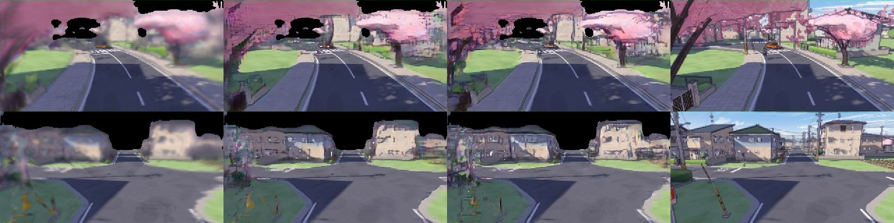

上の絵の 2 番目と 4 番目の場面を 1.5 倍に拡大したものです。列は左から、P1、1 本目、2 本目、正解。

学習の途中（5 エポックごと、重みの移動平均）:

| エポック | 5 | 10 | 15 | 20 | 25 | 30 | 35 | 40 | 45 | 50 | 55 | 60 |
|---|---:|---:|---:|---:|---:|---:|---:|---:|---:|---:|---:|---:|
| 鮮明さ（穴） | 0.50 | 0.58 | 0.60 | 0.65 | 0.67 | 0.69 | 0.73 | 0.72 | 0.74 | 0.74 | 0.77 | 0.74 |
| 線らしさ（穴） | 0.71 | 0.64 | 0.59 | 0.59 | 0.59 | 0.59 | 0.58 | 0.58 | 0.58 | 0.58 | 0.57 | 0.59 |
| 色の L1（穴） | 32.9 | 33.8 | 33.7 | 33.2 | 33.0 | 32.9 | 32.9 | 32.6 | 32.6 | 32.5 | 32.5 | 32.3 |
| 判別の網の損失 | 1.81 | 1.82 | 1.84 | 1.86 | 1.87 | 1.87 | 1.87 | 1.88 | 1.89 | 1.89 | 1.89 | 1.90 |

- **学習は崩れませんでした。** 鮮明さは終わりまでゆっくり上がり、線らしさは 15 エポックから 0.57〜0.59 で動きません。
- **色の L1 は P1 より 3.5 悪くなりました**（32.3 対 28.8）。`cv2.inpaint`（32.4）と同じくらいです。鮮明な画は、置き場所が少しずれるだけで L1 が増えます。線（40）の内側です。
- **見えた画素では、正解と同じ鮮明さになりました**（0.99。入力は 0.74）。L1 は入力と同じ 15.2 です（P1 は 13.7）。
- **絵では、家の輪郭、屋根と壁の境、窓、木の幹がはっきりします。** 1 本目で見えた桜の所の格子の模様は、目立たなくなりました。
- **作りものの跡もあります。** 壁に点や短い線が散り、画面の左端（穴が大きい所）には色の斑点が出ます。窓の並びは正解とは合っていません。
- **判別の網の損失は 1.9 前後です**（2 が「見分けがつかない」）。判別の網は、ほとんど見分けられていません。それでも画が鮮明になったのは、λ を下げたぶん、弱い押しでも効いたためと読んでいます（確かめてはいません）。

**次**: P2b（この網を ONNX にしてページで動かし、不変、形、速さ、ちらつきを測る。関門 G-P2b）です。まだ走らせていません。

### 6.13 結果: P2b、ブラウザの関門 G-P2b（2026-11-24）

**ちらつきだけが線を超えました。ほかの項目は全部通りました。** 設計（6.4）で決めたとおり、「1 回前の補完を条件に足す（P2c）が要る」という判定です。

| 項目 | 基準 | 結果 | 判定 |
|---|---|---|---|
| 不変（計測） | `--fill` なしの計測が main と同じ | 12 本（この枝 6、main 6）。両方にある要約値 1 種類で、行が全部同じ | 通過 |
| 不変（走行） | 補完ありの走行に、補完なしと同じ要約値がある | town 1000 で 4 本中 2 本、札幌で 4 本中 2 本 | 通過 |
| 不変（既定の重み） | `reconfill.onnx`（P1）が変わっていない | 書き出しの前後で SHA-256 が同じ（`2bb5ea8f…`、更新時刻は 11-24 06:13 のまま）。色を生成する重みは別のファイル（`reconfill_gen.onnx`、6.2 MB） | 通過 |
| 形 | 同じ要約値の走行で、補完の行が P1 と同じ | 比べられた 2 つの町（town 1015、札幌）で、差 0。town 1000 は同じ要約値の P1 の走行がなく、比べられない。ONNX どうしの深度の差は 0 | 通過（2 / 3 の町で確認） |
| 速さ | 呼び出し 90 % 以上、fps 85 % 以上 | town 1000: fps 100 %、呼び出し 100 %。札幌: fps 99 %、呼び出し 98 %（補完なしに対して） | 通過 |
| **ちらつき** | **13.8 以下** | **18.49**（P1 は 9.19、正解の補完は 6.32） | **届かない** |

手順は `RUN=g2 MAIN=… bash docs/recon_fill/p2.sh export fidelity same drive speed`、表は `bash docs/recon_fill/p2.sh tables` です。ヘッドレス Chrome で 1 時間 25 分かかりました（見積もりは約 2 時間）。

#### ちらつき

| 補完 | town 1000 | town 1015 | 札幌 | 合計 |
|---|---:|---:|---:|---:|
| 正解（街そのもの、`fill=oracle`） | 3.98 | 7.69 | 8.08 | 6.32 |
| P1（回帰の網） | 6.26 | 10.41 | 12.09 | 9.19 |
| **P2（L1 + PatchGAN の 2 本目）** | 11.53 | 21.61 | 23.83 | 18.49 |

- **P1 の 2 倍、線の 1.3 倍です。** 3 つの町のどれでも、P1 のほぼ 2 倍でした。札幌は P1 と同じ要約値の走行（同じフレーム）どうしの比べで、12.09 対 23.83 です。
- **乱数をなくしても、模様は泳ぎます。** 6.10 で心配したとおりです。模様は条件（P1 のぼけた色と深度）に付いて出るので、1.2 m 進んで条件が少し変わると、同じ壁に別の模様が描かれます。
- 色の網の画どうしの差には、鮮明な画ほど大きく出るという面もあります（同じ模様が 1 画素ずれるだけで差になります）。ただ、正解の補完（鮮明さ 1）は 6.32 なので、それだけでは説明できません。

#### 形と忠実度

3 つの町、60 秒、2 秒ごとの 90 フレームの合計です（町ごとの行は `tools/recon_table.py runs/eval/recon_fill/p2`）。

| 町、描くもの | フレーム | 被覆率（全体） | 被覆率（いま見える範囲） | 見える範囲の割合 | 誤差（中央値） | 誤描画率 | うち透け | うち実在しない面 | 正しく描けた（全体） | 正しく描けた（見える範囲） |
|---|---:|---:|---:|---:|---:|---:|---:|---:|---:|---:|
| **合計**、A | 90 | 49.8 % | 84.3 % | 48.4 % | 1.65 % | 16.8 % | 14.9 % | 1.8 % | 41.7 % | 80.7 % |
| **合計**、A+ | 90 | 88.0 % | 86.5 % | 48.4 % | 1.04 % | 8.5 % | 4.5 % | 4.0 % | 81.0 % | 81.4 % |
| **合計**、穴・できたて | 90 | 94.9 % | 94.4 % | 48.4 % | 1.26 % | 9.2 % | 4.8 % | 4.4 % | 87.1 % | 88.6 % |
| **合計**、穴・1 回前 | 90 | 93.6 % | 92.8 % | 48.4 % | 1.19 % | 9.0 % | 4.7 % | 4.4 % | 86.0 % | 87.2 % |
| **合計**、全部・できたて | 90 | 86.0 % | 85.4 % | 48.4 % | 0.85 % | 5.4 % | 3.7 % | 1.7 % | 82.0 % | 82.9 % |
| **合計**、全部・1 回前 | 90 | 85.1 % | 83.4 % | 48.4 % | 0.83 % | 5.1 % | 3.4 % | 1.7 % | 81.3 % | 81.1 % |
| **合計**、穴・できたて（正解の補完） | 90 | 95.9 % | 95.7 % | 48.4 % | 0.73 % | 7.6 % | 3.9 % | 3.7 % | 89.2 % | 90.8 % |
| **合計**、全部・できたて（正解の補完） | 90 | 85.9 % | 87.6 % | 48.4 % | 0.00 % | 0.1 % | 0.1 % | 0.1 % | 85.8 % | 87.5 % |

| 町 | 要約値（画像と姿勢、走行） | 同じ要約値の走行 | フレーム | 補完の行（穴、全部、できたて、1 回前）の差の最大 |
|---|---|---|---:|---|
| town 1000 | `cd45fbf754647521`、`632f152447918fb8` | なし | – | –（比べられない） |
| town 1015（二段階の信号） | `bafff36aa1792aff`、`d79cc7e4157a833f` | `runs/eval/recon_fill/p1` | 30 | 0（全部同じ） |
| 札幌（OSM） | `e7a299782499b560`、`06062d773a79efb9` | `runs/eval/recon_fill/p2_base_p1` | 30 | 0（全部同じ） |

- **形の数字は P1 のものです。** 同じ要約値の走行がある 2 つの町で、補完の行（穴、全部、できたて、1 回前）の 30 フレームが全部同じでした。
- 上の合計は、5.4 の合計と少し違います（town 1000 の走行の要約値が違うため）。「正しく描けた（全体）」は、補完なしの 81.0 % から、穴・1 回前で 86.0 % です。
- 補完のモデル: 入力を作る時間 14.8 ms、推論（往復）22.6 ms。

#### 不変

| 要約値（画像と姿勢、走行） | 走行 | 計測の行が全部同じか |
|---|---|---|
| `2ef7b43d0ecf3b7e`、`ff54bd8f3153db72` | here × 1 | –（片方だけ） |
| `fd8afb088e1b62ad`、`097517239056be38` | here × 1 | –（片方だけ） |
| `b708ce639ccf1856`、`da89ba5e27755abf` | here × 4、main × 2 | 同じ |
| `451547e425f91b0f`、`6d348efab8673b93` | main × 2 | –（片方だけ） |
| `75b77baf8e7cd335`、`fb929e7966a99c31` | main × 2 | –（片方だけ） |

走行 12 本、各 30 秒、計測 15 フレーム。両方にある要約値 1 種類のうち、行が全部同じもの 1 種類。

| 町 | 設定 | 走行の要約値（回数） | recon なしと同じ要約値の走行 | 判定 |
|---|---|---|---:|---|
| town 1000 | recon なし、深度つきの ONNX | `ce5be5b089284baa`（1 回）、`649f4052aece583c`（1 回）、`e1b066aa6fe3ee41`（1 回）、`31b76671dd2fefdc`（1 回） | – | – |
| town 1000 | `recon=model&fill=model`、色を生成する重み | `649f4052aece583c`（1 回）、`efeb8bf52b4b315c`（1 回）、`31b76671dd2fefdc`（1 回）、`5a01ac7adc0049d5`（1 回） | 2 / 4 本 | 通過 |
| 札幌（OSM） | recon なし、深度つきの ONNX | `384cdd46d45d8477`（1 回）、`685861a364826836`（1 回）、`9eafed378f606f19`（1 回）、`7378f1edcac3769c`（1 回） | – | – |
| 札幌（OSM） | `recon=model&fill=model`、色を生成する重み | `685861a364826836`（1 回）、`6ff182c451d8b655`（1 回）、`7378f1edcac3769c`（1 回）、`78de334b6782b819`（1 回） | 2 / 4 本 | 通過 |

#### 速さ

実時間 30 秒、5 回ずつ、補完なし、P1 の補完、色を生成する補完を順に走らせました。

| 町 | 設定 | 回数 | 主画面 [fps]、中央値 | 各回の fps | モデルの呼び出し [回/秒] | 推論 [ms] | モデルのフレーム（主スレッド）[ms] | メッシュ [ms] | 町の時間 | 各回の呼び出し | 補完 [回/秒] | 補完の入力 [ms] | 補完の推論 [ms] | 飛ばした番 |
|---|---|---:|---:|---|---:|---:|---:|---:|---:|---|---:|---:|---:|---:|
| town 1000 | `recon=model`（蓄積あり） | 5 | 53.3 | 53、54、53、53、54 | 9.5 | 42.1 | 16.5 | 3.7 | ×0.99 | 9.5、9.7、9.5、9.5、9.5 | – | – | – | – |
| town 1000 | `recon=model&fill=model` | 5 | 53.7 | 53、54、54、54、54 | 9.5 | 42.8 | 15.4 | 6.2 | ×0.99 | 9.5、9.5、9.6、9.5、9.5 | 4.8 | 4.1 | 29.1 | 0 |
| town 1000 | `recon=model&fill=model`、色を生成する重み | 5 | 53.4 | 54、53、53、54、53 | 9.5 | 41.7 | 15.3 | 6.2 | ×0.99 | 9.5、9.5、9.5、9.4、9.5 | 4.8 | 4.0 | 32.2 | 0 |
| 札幌（OSM） | `recon=model`（蓄積あり） | 5 | 18.2 | 19、17、18、18、18 | 5.6 | 77.8 | 28.7 | 9.6 | ×1.00 | 5.7、5.5、5.6、5.5、5.7 | – | – | – | – |
| 札幌（OSM） | `recon=model&fill=model` | 5 | 17.8 | 18、18、18、17、18 | 5.5 | 76.6 | 27.7 | 14.4 | ×0.98 | 5.5、5.5、5.5、5.3、5.5 | 2.7 | 8.8 | 89.9 | 0 |
| 札幌（OSM） | `recon=model&fill=model`、色を生成する重み | 5 | 18.0 | 18、18、18、17、18 | 5.5 | 75.1 | 27.3 | 14.8 | ×0.98 | 5.5、5.5、5.4、5.3、5.6 | 2.7 | 8.5 | 93.0 | 0 |

推論、モデルのフレーム、メッシュ、町の時間は各回の値の中央値。

- **色の網を足しても、ページの速さは変わりません。** 補完の推論は town 1000 で 29.1 ms から 32.2 ms、札幌で 89.9 ms から 93.0 ms に延びますが、fps とモデルの呼び出しは補完なしの 98〜100 % です。
- 今回は 30 本とも速いほうの回でした（town 1000 で 53 fps。5.4 の P1 の計測は全部遅いほうで 32 fps 前後）。同じ日のうちの比べとして見てください。

#### 絵

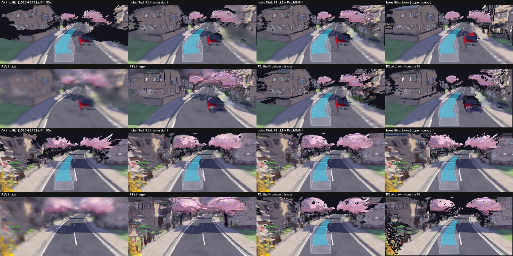

town 1015 の 30 秒と 50 秒です（P1 の計測と同じ要約値の走行なので、同じフレームです）。場面ごとに 2 段で、上の段は左から、補完なし（A+）、穴を P1 で埋めた画、穴を P2 で埋めた画、穴を正解で埋めた画（上限）。下の段は、P1 の画そのもの、P2 の画そのもの、P2 の 1 回前の補完で埋めた画、P2 の補完だけで全部を描いた画。

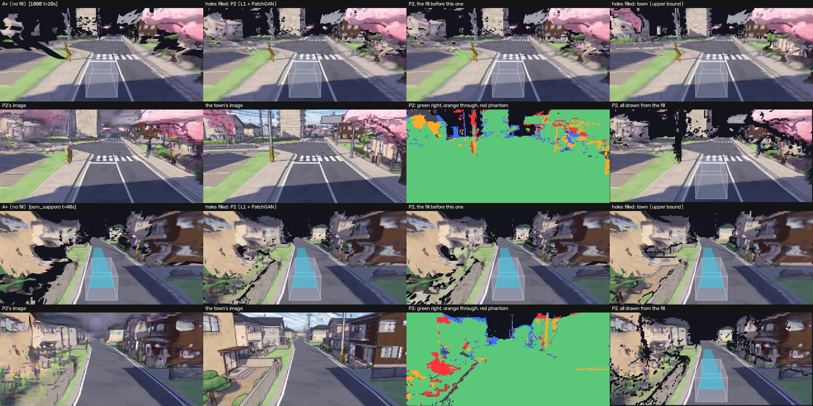

town 1000 の 20 秒と札幌の 40 秒です。上の段は左から、補完なし（A+）、穴を P2 で埋めた画、P2 の 1 回前の補完で埋めた画、穴を正解で埋めた画。下の段は、P2 の画そのもの、正解の画、P2 で埋めた画の内訳（緑: 正しい、橙: 透け、赤: 実在しない面）、P2 の補完だけで全部を描いた画。

- **P2 の画は、P1 より輪郭がはっきりします。** 建物の縁、路面の線、車の形が出ます。town 1015 の 30 秒では、P1 では道路の色に溶けていた前の車が、車の形で描かれています（1 フレームの例です。数えてはいません）。
- **穴が大きい所は、ざらついた模様になります。** 植え込みや木の陰で目立ちます。オフラインの絵（6.12）より粗く見えます。
- 「全部」を既定にするかは、変わりません。形が P1 のままなので、被覆率と「正しく描けた」は「穴だけ」より低いままです（合計で 86.0 % 対 94.9 %、82.0 % 対 87.1 %）。

#### ここまでのまとめと、次の候補

- **色を鮮明にすることは、小さな網の 1 回の推論でできました**（L1 + PatchGAN。形と速さは P1 のまま）。
- **そのかわり、補完を作り直すたびに模様が変わります。** 止まった絵では P1 より良く、動く画では P1 よりちらつく、という結果です。
- 次の候補は、(1) P2c: 1 回前の補完を条件に足す（6.5。学習 1 本とブラウザ。ページに追跡カメラからの描画が 2 回増える）、(2) P2 をここで止め、P1 を既定のまま、P2 の重みは選択肢（`&fillmodel=`）として残す、です。→ (1) に決まりました（6.14）。

### 6.14 P2c: 1 回前の補完を条件に足す（設計の案、2026-11-24）

G-P2b のちらつき（18.49、線は 13.8）を受けた、6.5 の具体化です。**まだ何も走らせていません**（確かめたのは、下の「前提」の数字 1 つだけです）。関門の数字は、ここで確定します。

**ねらい**

色の網に「1 回前の補完を、今の追跡カメラから描いた画」を見せます。1 回前に描いた模様がそこにあれば、それを写します。なければ、今までどおり新しく描きます。作り直すたびに模様が変わらなくなる、という見込みです。

**前提（学習データで確かめたこと）**

- 学習データには、1 回前の**正解**の補完を今の追跡カメラから描いた画が入っています（`prev_rgb`、`prev_dep`。P0 の書き出しで保存済み）。
- 評価用の 99 組（9 組に 1 組）で、穴の画素の 64.2 % にこの画が届きます。届いた所の 97.0 % は同じ面（深度が 10 % 以内）で、色は今の正解と L1 で 9.3 しか違いません。
- **つまり、学習では「1 回前の画」がほとんど答えです。** 網は「1 回前の画があれば写す」と覚えるはずです。ページでは、1 回前の画は正解ではなく、色の網自身の出力です。網はそれを写すことになります。ねらいどおりですが、学習とページで入力の性質が違います。下の「学習」の工夫と、関門の「巡り」の検査は、この違いのためのものです。

**方式（6.10 の L1 + PatchGAN に足すもの）**

- 色の網と判別の網の条件に、5 枚を足します: 1 回前の画の色（3）、深度（1）、「面があるか」（1）。1 回前の画がないときは全部 0 です。
- P1 の網（深度と「面があるか」）には渡しません。**形は P1 のままです。**
- 色の網は、6.12 の 2 本目の重みから始めます（足した入力の重みは 0 から）。λ = 30、60 エポックは同じです。判別の網は最初からです。
- ONNX は `web/models/reconfill_genp.onnx` で、入力が 2 つ増えます（`prev_rgb`、`prev_dep`）。

**学習の工夫（ページとの違いを埋める）**

| 工夫 | 中身 | 理由 |
|---|---|---|
| 1 回前の画を落とす | 4 組に 1 組は、1 回前の画なし（全部 0）で学習 | 最初の 1 枚と、リセットの直後。新しく描く力を残す |
| 1 回前の画を汚す | 色にぼかし（σ 0〜1 画素）と雑音（σ 0〜0.04）、四角い欠け（0〜3 個） | ページでは描き直しでぼけ、P1 の深度のずれで欠ける |
| 自分の出力を 1 回前の画にする | 3 組に 1 組は、色の網自身の出力（移動平均の重み、勾配なし）を 1 回前の画として渡す。目標は正解のまま | 自分の出力をくり返し写しても、色や鮮明さが少しずつずれていかないようにする |

**ページ**

- 入力に `prev_rgb` がある ONNX のときだけ、補完の入力を作るときに、いま表示している補完のメッシュを今の追跡カメラから 2 回描きます（色と深度）。学習データの書き出しと同じ描き方です（`web/src/fill.js`）。
- 既定の `reconfill.onnx`（P1）と 6.12 の重みには、この入力がありません。その道は今までと同じコードを通ります。不変の検査で確かめます。
- リセット（町の切り替えなど）で補完を消したあとの 1 枚目は、1 回前の画なしです。
- **「補完は蓄積しない」（設計の決めごと 4）に、色だけ、弱い形で反します。** 形（深度と「面があるか」）は毎回 P1 が作り直します。色の模様だけが、穴である間、前の回から引き継がれます。

**計測に足すもの（P2c-0）**

- **ページの中の色の指標**: 計測のとき、同じフレームの「モデルの補完」と「正解の補完」を 1 枚ずつ描き、穴で、同じ面（深度が 10 % 以内）の画素で、色の L1 と鮮明さ（隣の画素との差の比）を出します。今のブラウザの計測は深度しか見ていないので、色が時間とともに崩れても数字に出ません。そのための指標です。計測のときだけ動くコードです。
- 学習の前に、P1 と 6.12 の重みでこの指標を測ります（3 つの町、60 秒）。

**段階**

| 段階 | 中身 | 重い仕事 |
|---|---|---|
| P2c-0 | 学習とページのコード、単体テスト、ページの中の色の指標、P1 と 6.12 の重みでの基準の計測 | ブラウザ 約 25 分 |
| P2c-a | 学習（3 本まで）とオフラインの評価。**関門 G-P2c-a** | GPU 1 本 約 1 時間 20 分 |
| P2c-b | ページで動かす。不変、形、速さ、ちらつき、色の指標、絵。**関門 G-P2c-b（見せて止まる）** | ブラウザ 約 1 時間 40 分 |

2 本目以降の設定は、1 本目の落ち方で決めます（巡りで崩れたら、自分の出力を渡す割合を 2 組に 1 組へ。ちらつきが残ったら、1 回前の画を落とす割合を 8 組に 1 組へ）。3 本とも届かなければ、P2 を止めて報告します。

**G-P2c-a（オフライン、評価用の 883 組、穴の画素）**

| 項目 | 基準 |
|---|---|
| 1 回前の画なしで | G-P2a の 4 項目（鮮明さ 0.5〜1.2、色の L1 40 以下、線らしさ 0.51 以上、深度は P1 と同じ） |
| 巡り: 自分の出力を 1 回前の画として 8 回くり返したあとで | 同じ 4 項目。加えて、8 回目の鮮明さが 1 回目の 0.8〜1.25 倍 |

- 巡りの検査は、視点を動かさずに、出力を次の回の「1 回前の画」に入れ直します（面があるかの形は、データの 1 回前の画のものを使います）。くり返すたびに鮮明になりすぎる、色がずれていく、といった崩れを見ます。
- **正解の 1 回前の画を渡したときの数字は、関門にしません**（表には載せます）。答えがほとんど入っているので、良く出て当然だからです。
- **ちらつきは、オフラインでは測れません。** データに 1 回前の入力がないためです。ページで初めて分かります。

**G-P2c-b（ブラウザ）**

| 項目 | 基準 |
|---|---|
| 不変 | G-P2b と同じ。加えて、P1 の重みと 6.12 の重みでの計測の行が、同じ要約値の走行で今までと同じ |
| 形 | 同じ要約値の走行で、補完の行が P1 と同じ |
| 速さ | 呼び出し 90 % 以上、fps 85 % 以上（town 1000 と札幌、補完なしと交互に 5 回） |
| ちらつき | **13.8 以下**（変えません。P1 は 9.19、6.12 の重みは 18.49） |
| 色が崩れない | 走行の最後の 20 秒で、ページの中の鮮明さが 6.12 の重みの 0.7〜1.3 倍、色の L1 が 6.12 の重みの 1.25 倍以下（P2c-0 で測りました。6.15: 鮮明さ 0.66〜1.22、色の L1 37.6 以下） |

**心配な点**

- **間違いが残ります。** 1 回描いた作りものの模様（窓のない壁の窓）は、そこが穴である間、写され続けます。ちらつきを減らすことと表裏です。
- **学習とページの違いが、工夫で埋まるとは限りません。** 学習の「1 回前の画」は正解に近く、ページのそれは網の作りものです。写し方が変わって、ちらつきが思ったほど減らないかもしれません。
- **巡りの検査は、動かない視点でのものです。** ページでは毎回 1.2 m 動いて描き直します。オフラインで通っても、ページで崩れることはありえます。そのために、ページの中の色の指標を足します。
- **描き直しのたびに模様が少しずつぼけるかもしれません。** 320×160 の画を別の視点から描き直すためです。汚した画から正解を出す学習で、戻す力がつく見込みです。
- ページの描画が 1 回の補完につき 2 回増えます。P1 の計測では、描画 2 回で入力を作る時間が 3〜9 ms 増えました（5.4）。速さの線は超えない見込みです。

**見積もり**

- P2c-0: コードとテストのあと、ブラウザの基準の計測に約 25 分。
- 学習 1 本目: RTX 3060 で約 1 時間 20 分（6.12 は 69 分。自分の出力を作るぶんが増えます）。
- G-P2c-a に届いたら、P2c-b（ブラウザ、約 1 時間 40 分）の前に、もう一度見積もりを出します。

### 6.15 P2c-0: コードと、ページの中の色の基準（2026-11-24）

- 色の網と判別の網に「1 回前の画」の条件を足しました（`keipilot/fillgen.py` の `prev=True`、`degrade_prev`、`training_prev`。`scripts/train_fillgan.py --prev --init …`）。
- 巡りの評価（`tools/fill_prev_eval.py`）、ONNX の入力 `prev_rgb`・`prev_dep`（`scripts/export_fill_onnx.py`）、ページの入力（`web/src/fill.js`。この入力を持つ ONNX のときだけ動きます）を足しました。
- ページの計測に色の指標を足しました（`web/src/fill.js` の `measure`、`web/tools/recon_check.mjs`、`tools/recon_table.py`）。
- **設計（6.14）に足したこと**: 学習の最初の 500 ステップは、判別の網だけを学習します（`--d_warm 500`）。色の網は 6.12 の重みから始めますが、判別の網は最初からです。試運転で、色の網が 300 ステップでぼけた画に戻るのを見たためです。

**ページの中の色の基準**（`bash docs/recon_fill/p2.sh basec`、3 つの町、60 秒、90 フレーム）

| 補完 | 色の L1 | 鮮明さ | 最後の 20 秒の L1 | 最後の 20 秒の鮮明さ | ちらつき（この走行） |
|---|---:|---:|---:|---:|---:|
| P1（回帰） | 25.95 | 0.23 | 25.40 | 0.25 | 8.49 |
| 6.12 の重み（L1 + PatchGAN の 2 本目） | 28.25 | 0.91 | 30.07 | 0.94 | 19.07 |

- 値は、モデルの補完と、同じフレームの正解の補完を 1 枚ずつ描き、どちらも同じ面で埋めた穴の画素で比べたものです。オフラインの値（P1: 28.8 と 0.17、6.12 の重み: 32.3 と 0.74）と同じ向きです。
- **G-P2c-b の「色が崩れない」の線が、これで決まります**: 最後の 20 秒で、鮮明さ 0.66〜1.22（0.94 の 0.7〜1.3 倍）、色の L1 37.6 以下（30.07 の 1.25 倍）。
- ちらつきは、走行ごとに少し動きます（P1 は 6.4 の計測で 9.19、今回 8.49。6.12 の重みは 6.13 で 18.49、今回 19.07）。線の 13.8 は変えません。

**ページのコードを変えても、今までの重みの計測は同じです**（同じ要約値の走行どうし。補完の行とちらつきの値）。

P1 の重み:

| 町 | 要約値（画像と姿勢、走行） | 同じ要約値の走行 | フレーム | 補完の行（穴、全部、できたて、1 回前、ちらつき）の差の最大 |
|---|---|---|---:|---|
| town 1000 | `d91345577bfa5211`、`8f90bdbdbe3bebb3` | なし | – | –（比べられない） |
| town 1015（二段階の信号） | `45ca343b2dc97d59`、`3ccc115d61b143b1` | `runs/eval/recon_fill/p2_base_p1` | 30 | 0（全部同じ） |
| 札幌（OSM） | `e7a299782499b560`、`06062d773a79efb9` | `runs/eval/recon_fill/p2_base_p1` | 30 | 0（全部同じ） |

6.12 の重み:

| 町 | 要約値（画像と姿勢、走行） | 同じ要約値の走行 | フレーム | 補完の行（穴、全部、できたて、1 回前、ちらつき）の差の最大 |
|---|---|---|---:|---|
| town 1000 | `3d8786cc034bf652`、`9feb3ba96987f729` | なし | – | –（比べられない） |
| town 1015（二段階の信号） | `bafff36aa1792aff`、`d79cc7e4157a833f` | `runs/eval/recon_fill/p2` | 30 | 0（全部同じ） |
| 札幌（OSM） | `499ab0a72f93bcd1`、`d89f67449094bb70` | なし | – | –（比べられない） |

同じ要約値の走行がある町では、30 フレームの行が全部同じでした。町ごとに要約値が合うかどうかは、その回しだいです。

### 6.16 結果: P2c の学習 1 本目（2026-11-24）

**関門 G-P2c-a の項目は、全部満たしました。ただし、巡りを 8 回より長く続けると、色がずれ続けます。** 関門の「8 回」は短すぎました。

| 項目 | 基準 | 1 回前の画なし | 自分の出力を 8 回 | 判定 |
|---|---|---|---|---|
| 鮮明さ（穴） | 0.5 以上、1.2 以下 | 0.79 | 0.90 | 通過 |
| 色の L1（穴） | 40 以下 | 31.8 | 35.5 | 通過 |
| 線らしさ（穴） | 0.51 以上 | 0.53 | 0.60 | 通過（1 回前の画なしでは、線のすぐ上） |
| 深度と「面があるか」 | P1 と同じ | 同じ（差 0） | 同じ | 通過 |
| 8 回目の鮮明さ ÷ 1 回目 | 0.8〜1.25 | – | 1.16 | 通過 |

設定は 6.14、6.15 のとおりです（`RUN=p1 bash docs/recon_fill/p2.sh train`、60 エポック、RTX 3060 で 87 分。見積もりは 80 分。途中、基準の計測と同時に走らせました）。

883 組（評価用）、穴の画素。深度と「面があるか」の P1 との差の最大: 0

| 1 回前の画 | 色の L1（0〜255） | 鮮明さ | 線らしさ | 前の回からの色の変化 |
|---|---:|---:|---:|---:|
| なし（最初の 1 枚） | 31.8 | 0.79 | 0.53 | – |
| 正解の 1 回前の画（学習データのもの） | 17.7 | 0.83 | 0.61 | – |
| 自分の出力を 1 回 | 31.5 | 0.78 | 0.54 | 9.6 |
| 自分の出力を 2 回 | 32.2 | 0.80 | 0.57 | 7.6 |
| 自分の出力を 4 回 | 33.3 | 0.84 | 0.59 | 6.7 |
| 自分の出力を 8 回 | 35.5 | 0.90 | 0.60 | 6.2 |
| 正解の画そのもの | 0.0 | 1.00 | 0.56 | – |

前の回からの色の変化: 1 回前の画に面がある穴の画素で、その回の色と前の回の色の差の平均。

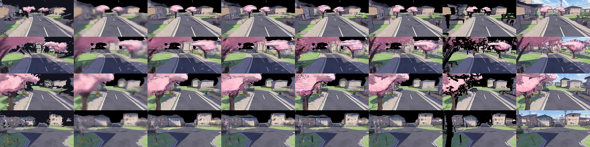

列は左から、補完なしの画、P1、1 回前の画なし、自分の出力を 1 回、8 回、正解の 1 回前の画つき、その正解の 1 回前の画、正解。

- **1 回前の画なしでは、6.12 の重みとほぼ同じ画です**（鮮明さ 0.79、L1 31.8。6.12 は 0.74、32.3）。線らしさは 0.53 で、線（0.51）のすぐ上です。
- **正解の 1 回前の画を渡すと、L1 は 17.7 まで下がります。** 網は 1 回前の画を使っています。ただし、これは答えがほとんど入った条件での値です（6.14）。
- **自分の出力を入れ直しても、画は止まりません。** 視点を動かしていないのに、1 回ごとに色が 6.2 変わります（8 回目。0〜255）。写しているだけなら 0 に近づくはずの値です。

**関門の外で分かったこと: 巡りを長くすると、ずれ続けます**（`tools/fill_prev_eval.py --rounds 1 8 16 32`、`runs/eval/recon_fill/p2c_offline_p1_long.json`）

| 1 回前の画 | 色の L1（0〜255） | 鮮明さ | 線らしさ | 前の回からの色の変化 |
|---|---:|---:|---:|---:|
| 自分の出力を 1 回 | 31.5 | 0.78 | 0.54 | 9.6 |
| 自分の出力を 8 回 | 35.5 | 0.90 | 0.60 | 6.2 |
| 自分の出力を 16 回 | 39.4 | 0.97 | 0.63 | 5.9 |
| 自分の出力を 32 回 | 45.4 | 1.05 | 0.65 | 5.6 |

- L1 は 8 回で 35.5、16 回で 39.4、32 回で 45.4 です。32 回では線（40）を超えます。鮮明さも 1.05 まで上がり続けます。落ち着く気配がありません。
- 絵の「8 回」の列でも、桜や植え込みに、もとの画にない鮮やかな色の点が出はじめています。
- **ページでは、補完は毎秒 3〜5 回作り直されます。** 8 回は 2 秒ほどです。穴がそれより長く穴のままなら、この先の領域に入ります。関門の「8 回」は、ページの長さに対して短すぎました。
- ただし、この検査は動かない視点でのものです。ページでは、毎回の描き直しでぼけが入り、穴の場所も入れ替わります。ページでどうなるかは、まだ分かりません。

**次（まだ走らせていません）**

- 関門の文面どおりなら、次は P2c-b（ブラウザ、約 1 時間 40 分）です。上のずれがあるので、**全部を走らせる前に、忠実度の計測だけ（3 つの町、約 15 分）を先に走らせる**のがよい、と考えています。ちらつきと「色が崩れない」の 2 項目は、それで分かります。
- そこで届かなければ、残り（不変、走行、速さ）は走らせず、学習の 2 本目に進みます。2 本目の設定は 6.14 のとおり、自分の出力を渡す割合を 2 組に 1 組に上げます。

### 6.17 結果: P2c をページで先に測る（2026-11-24）

6.16 の「次」のとおり、忠実度の計測だけを先に走らせました（`RUN=p1 bash docs/recon_fill/p2.sh export fidelity`、3 つの町、60 秒、90 フレーム、約 13 分）。**ちらつきは線の内側に入りましたが、色が壊れます。** G-P2c-b の「色が崩れない」に届きません。残り（不変、走行、速さ）は走らせていません。

| 項目 | 基準 | 結果 | 判定 |
|---|---|---|---|
| ちらつき | 13.8 以下 | **7.57**（P1 は 8.49〜9.19、6.12 の重みは 18.49〜19.07） | 通過 |
| 色が崩れない: 最後の 20 秒の鮮明さ | 0.66〜1.22 | 0.96 | 通過 |
| 色が崩れない: 最後の 20 秒の色の L1 | 37.6 以下 | **42.2**（6.12 の重みは 30.1） | **届かない** |
| 形 | 補完の行が P1 と同じ | 同じ要約値の走行がある 2 つの町で差 0 | 通過（2 / 3 の町で確認） |

| 町 | ちらつき: 6.12 の重み | ちらつき: P2c | 最後の 20 秒の色の L1: 6.12 の重み | P2c | 最後の 20 秒の鮮明さ: 6.12 の重み | P2c |
|---|---:|---:|---:|---:|---:|---:|
| town 1000 | 13.97 | 6.86 | 28.6 | 56.6 | 1.00 | 1.32 |
| town 1015 | 21.61 | 8.30 | 29.0 | 36.2 | 0.84 | 0.73 |
| 札幌 | 24.46 | 7.69 | 32.2 | 40.6 | 0.95 | 1.01 |
| **合計** | 19.07 | 7.57 | 30.1 | 42.2 | 0.94 | 0.96 |

6.12 の重みの値は、6.15 の基準の計測のものです（別の走行です）。

| 町 | 要約値（画像と姿勢、走行） | 同じ要約値の走行 | フレーム | 補完の行（穴、全部、できたて、1 回前）の差の最大 |
|---|---|---|---:|---|
| town 1000 | `cd45fbf754647521`、`632f152447918fb8` | `runs/eval/recon_fill/p2` | 30 | 0（全部同じ） |
| town 1015（二段階の信号） | `bafff36aa1792aff`、`d79cc7e4157a833f` | `runs/eval/recon_fill/p1` | 30 | 0（全部同じ） |
| 札幌（OSM） | `406ca00abaca8db4`、`19dc4e185663256d` | なし | – | –（比べられない） |

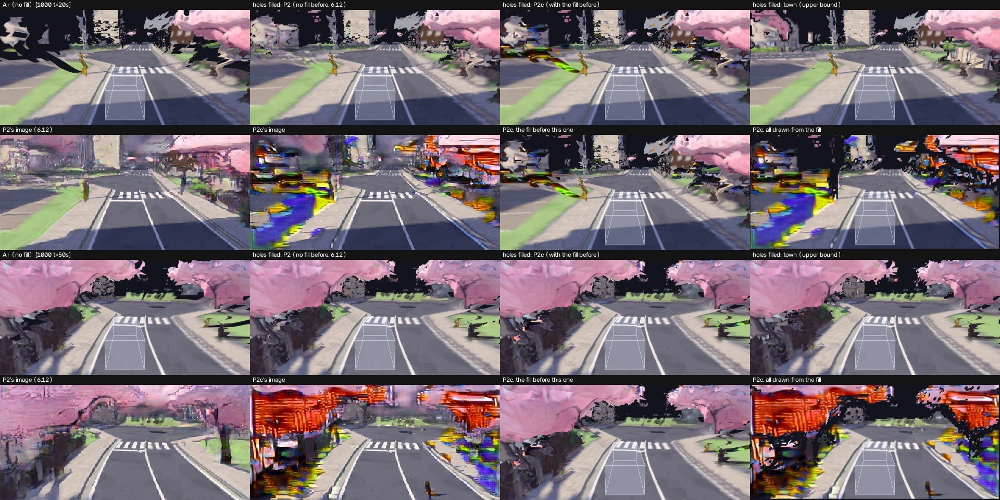

town 1000 の 20 秒と 50 秒です。場面ごとに 2 段で、上の段は左から、補完なし（A+）、穴を 6.12 の重み（1 回前の画なし）で埋めた画、穴を P2c で埋めた画、穴を正解で埋めた画。下の段は、6.12 の重みの画そのもの、P2c の画そのもの、P2c の 1 回前の補完で埋めた画、P2c の補完だけで全部を描いた画。

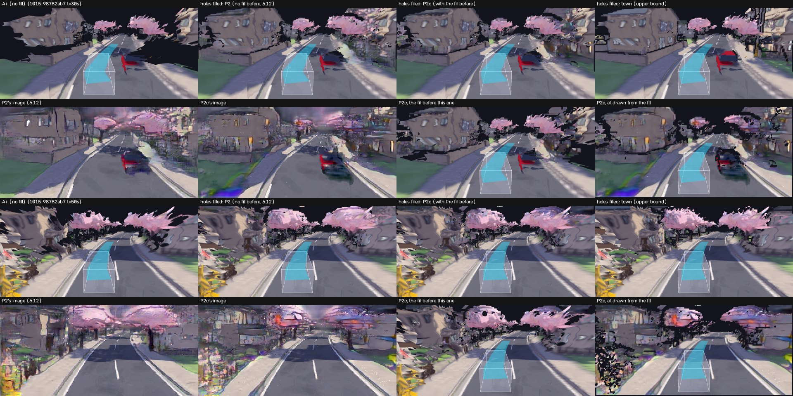

town 1015 の 30 秒と 50 秒です（並びは同じ）。

- **ちらつきは、P1 より小さくなりました**（7.57）。1 回前の画を写すことは、ページでも働いています。
- **そのかわり、色が壊れます。** P2c の画そのもの（下の段の左から 2 番目）に、橙、青、黄の、もとの画にない鮮やかな色の面が広がります。town 1000 がいちばんひどく、最後の 20 秒の L1 は 56.6 です（6.12 の重みは 28.6）。
- **壊れ方は、6.16 のオフラインの巡りで見たずれと同じ向きです。** 自分の出力を写すたびに色が少しずつ強まり、戻す力がありません。ページでは、それが数秒で目に見える大きさになります。
- **見えている所でも壊れます。** 既定の「穴だけ」の表示では、見えている所はもとのメッシュが描くので、壊れた色はそこには出ません。しかし、色の網の画そのものは見えている所でも巡り続け、そこが穴になったときに出てきます（上の絵の 20 秒、左の植え込み）。
- 鮮明さの数字（0.96）は線の内側ですが、これは壊れた色の縁も「鮮明」に数えているためです。

**途中で見つけた、ページでの実行の不具合（直しました）**

- 最初に走らせた計測では、P2c の画が P1 と同じくらいぼけて出ました（鮮明さ 0.25）。原因はモデルではなく、ONNX の中の結合（Concat）でした。条件を 1 つにまとめると、onnxruntime が結合を 10 入力の 1 つにまとめ、WebGPU の上限（1 つの計算で 8 個のバッファ）を超えて、その計算が無効になっていました。ページは止まらず、コンソールにエラーが出るだけでした。
- 書き出しのとき、色の網の最初の畳み込みを 2 つに分けました（`keipilot/fillgen.py` の `split`。同じ計算で、結果は同じです。単体テストあり）。エラーは消えました。
- **この不具合のあった 3 本の計測は捨て、上の数字は直したあとの計測です。**
- 今までの計測（P1、6.12 の重み、基準、走行、速さ）のログに、このエラーはありません（全部確かめました）。6.12 の重みの結合は 7 入力で、上限ちょうどです。
- `web/tools/recon_check.mjs` を、WebGPU の検証エラーが出たら FAIL にするよう直しました。

**まとめと、次の候補（まだ決めていません）**

- 1 回前の画を条件に足すと、ちらつきは止まります。しかし、今の学習のしかたでは、写すたびに色がずれていくのを止められません。
- 6.14 で決めた 2 本目（自分の出力を渡す割合を 2 組に 1 組へ）では、直らないと見ています。学習で網が見る「自分の出力」は、正解の 1 回前の画を写したもので、ほとんど正解です。ページで起きる、何回も巡って壊れた画は、学習に出てきません。
- 直すには、学習のしかたを変える必要があります（何回も巡らせた自分の出力を見せ、「前と同じに描く」ことと「もとの色に戻す」ことを別々の損失で教える、など）。設計からやり直しで、うまくいく見込みは五分より低いと見ています。
- もう 1 つの道は、P2 をここで止めることです。P1 を既定のままにし、6.12 の重み（鮮明だがちらつく）は選択肢として残します。P2c は「ちらつきは止まるが色が壊れる」という結果として記録に残します。

### 6.18 P2 のまとめ（2026-11-24、ここで止めました）

**P2 は、ここで止めました**（ユーザーの判断）。P1 を既定のままにします。色を生成する重みは、選択肢として残します（2）。

| 色の作り方 | 鮮明さ | 色の L1 | 線らしさ | ページのちらつき | ページの中の色の L1 | ページの中の鮮明さ | 結果 |
|---|---:|---:|---:|---:|---:|---:|---|
| P1（回帰） | 0.17 | 28.8 | 0.80 | 8.49 | 25.9 | 0.23 | **既定**。ぼけるが、ちらつきは小さい |
| mean-flow、出力は速度（6.8） | 1.58 | 40.1 | 0.41 | – | – | – | 乱数の粒。関門 G-P2a に届かない |
| mean-flow、出力はきれいな画（6.9） | 1.64 | 39.4 | 0.38 | – | – | – | 同じ粒 |
| L1 + PatchGAN、λ = 100（6.11） | 0.46 | 29.5 | 0.64 | – | – | – | 粒なし。鮮明さがわずかに足りない |
| L1 + PatchGAN、λ = 30（6.12、6.13） | 0.74 | 32.3 | 0.59 | 19.07 | 28.2 | 0.91 | G-P2a 通過。**鮮明だが、ちらつく**（G-P2b に届かない）。選択肢として残す |
| 1 回前の画つき（6.16、6.17。オフラインの値は 1 回前の画なしで） | 0.79 | 31.8 | 0.53 | 7.57 | 42.0 | 0.97 | ちらつきは止まるが、**色が壊れる**（G-P2c-b に届かない） |
| 正解（街そのもの） | 1.00 | 0.0 | 0.56 | 6.32 | 0.0 | 1.00 | 上限 |

左の 3 列はオフライン（評価用の 883 組、穴の画素）、次の 3 列はページ（3 つの町、60 秒、90 フレーム。P1 と λ = 30 は 6.15 の基準の計測、1 回前の画つきは 6.17）です。正解の行のちらつきは 6.4 の計測です。

- **小さな網の 1 回の推論で、穴の色を鮮明にすることはできました**（L1 + PatchGAN、λ = 30）。形（深度と「面があるか」）とページの速さは P1 のままです。
- **mean-flow は、この大きさの網と学習量では、模様を学べませんでした。** 画素ごとのばらつきの大きさだけを学び、乱数の粒になりました。
- **鮮明な色は、動く画ではちらつきます。** 補完を作り直すたびに、同じ壁に別の模様が描かれます。P1 のぼけた画は、ぼけているぶん、ちらつきません。
- **1 回前の画を条件に足すと、ちらつきは止まりますが、色が壊れます。** 自分の出力を写すたびに色が少しずつ強まり、戻す力がありません。直すには学習のしかたを変える必要があり、試していません（6.17 の「次の候補」）。
- **関門は 2 回、足しました。** 「線らしさ」（6.10。粒のある画が鮮明さと L1 の線の内側に入ったため）と、ページの中の色の指標（6.14。ブラウザの計測が深度しか見ていなかったため）です。どちらも、次の学習を走らせる前に決めました。
- **関門の「巡り 8 回」は短すぎました**（6.16）。項目は満たしたのに、ページでは色が壊れました。
- **WebGPU では、ONNX の結合（Concat）の入力は 7 個までです**（6.17。onnxruntime が結合をまとめるので、書き出した ONNX の見た目より多くなります）。超えると、ページは止まらずに、その計算だけが無効になります。`web/tools/recon_check.mjs` は、このエラーで FAIL になります。

## 7. 確かめていないこと

- 実機のブラウザでの見え方（計測と絵はヘッドレスの Chrome）。
- `fill=oracle` の実時間の速さは、短い 1 回だけです（town 1000 で主画面 31 fps、補完なしは 37 fps、モデルの呼び出しは同じ程度）。開発用のモードなので、関門には入れていません。
- `recon=oracle&fill=oracle`、`layout=split` との組み合わせは、画面を 1 度見ただけです。
- WASM では試していません。
- **P1 のモデルは 1 本ずつ（種 1 つ）です。** 「緩い規則の入力あり・なし」の差 0.5 ポイントが種のゆらぎより大きいかは、分かりません。
- **速さの関門は、遅いほうの回だけで測りました。** 20 回とも、ページが遅いほうの回でした（5.4）。速いほうの回での比は、乱数の重みの 3 回だけです。
- 補完ありの画面のちらつきは、計測の数字にしました（6.4）。動画では見ていません。
- 評価用の 883 組は、計測の 3 町だけです。西大井など、学習にも評価にもない様式の町では試していません。
- 幅を変えた網、エポックを増やした学習、データを増やした学習は試していません。
- **P2 の学習は、どれも 1 本ずつ（種 1 つ）です。** L1 + PatchGAN の λ = 100 と 30 の差、1 回前の画つきの結果が、種のゆらぎでどれだけ動くかは分かりません。
- **「線らしさ」の線（0.51）は、幅が狭いです**（正解 0.56、粒のある画 0.46 まで）。1 回前の画つきの網は 0.53 でした。
- 色を生成する重みで「形が P1 と同じ」を確かめたのは、同じ要約値の走行があった町だけです（3 つの町のうち 2 つ）。ONNX どうしの深度の差は 0 です。
- 色を生成する重みの速さは、速いほうの回だけで測りました（6.13）。
- 1 回前の画つきの重みは、不変、走行、速さを測っていません（色の関門に届かなかったため）。
- mean-flow の幅 2 倍の網（6.2 の 3 本目）、L1 + PatchGAN の 3 本目、1 回前の画つきの 2 本目は、走らせていません。
