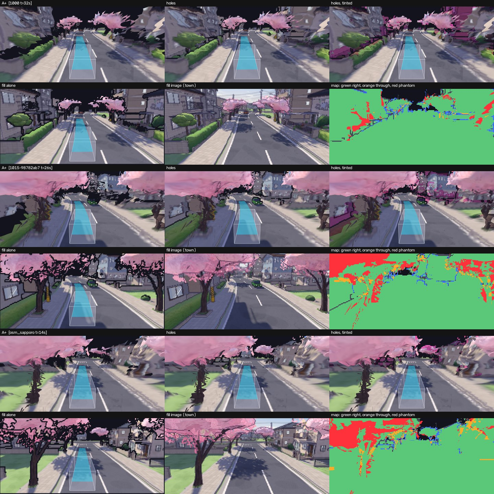

# ReconFill: ReconView の欠けた所を埋める（派生の実験）

ReconView（[recon_view.md](recon_view.md)）の続きです。ReconView は、見えた所だけを描き、見えない所を暗いまま残します。ReconFill は、その暗い所を埋めます。ReconFill は仮称です。

本線（KeiPilot Mc の学習の回）とは別の実験です。README の数字、公開の重み、Pages の既定の表示は変えません。新しい選択肢は既定でオフで、`&fill` のないページは今までと同じです。

状態（2026-11-23）: P0（正解で埋める）は終わり、関門 G-P0 を通りました（4.2）。**P1（補完のモデル）の途中**で、学習データを書き出しています（5 章）。

## 1. 考え方

補完を「3 台目のカメラ画像」として扱います。

- 補完は、追跡カメラ（自車の後ろ 8 m、高さ 4 m、320×160）から見た色と深度です。深度は半分の解像度（80×160、メートル、0 は面なし）で、運転モデルの `depth` 出力と同じ約束です。
- ページはそれを、モデルのカメラ画像と同じ作り方でメッシュにします。頂点は深度の画素ごとに 1 つ、色はテクスチャ、三角形の規則は同じ関数です（`web/src/recon.js` の `meshTriangles`）。
- 補完の面は、見えた面とは別のメッシュです。画素ごとに「見えた面か、補完した面か」を区別でき、補完がどれだけ嘘をつくかを、ReconView と同じ指標（透け、実在しない面）で測れます。
- 補完は蓄積しません。運転モデルの呼び出し 2 回に 1 回作り、作るたびに前のものと置き換えます。

P0 の補完は、街そのもの（正解）です。モデルが届きうる上限を測り、同じ器で学習データを書き出します。

## 2. 使い方

| URL の指定 | 中身 |
|---|---|
| `?pilot=mc&recon=model&fill=oracle` | 正解で埋める。開発と計測のためのモードで、描画が増えます |
| `&fillshow=holes`（既定） | 補完のメッシュのうち、補完なしの画に何もなかった所にかかる三角形だけを描く。見えた面はそのまま |
| `&fillshow=all` | 補完のメッシュを全部描き、今のフレームとキーフレームのメッシュは隠す |
| `&filltint=1` | 補完した面に色を付けて区別する |

`&fill` がなければ、`web/src/fill.js` は読み込まれません。

## 3. P0 で作ったもの

### 3.1 ページ

- `web/src/fill.js`（新規）: 補完のメッシュ 2 枚（今のものと 1 回前のもの）、描く三角形の選び方、補完の番の数え方、計測、学習用の標本。
- `web/src/recon.js`: 補完の番には、街の深度を追跡カメラから描きます（計測のときに描いていたものと同じ）。三角形の規則を 1 枚のメッシュの関数にして、補完のメッシュにも使います。
- `web/src/pilot.js`: 補完の番には、モデルのフレームと同じ場面の状態（周りの車は学習時の見た目）で、追跡カメラからの 1 枚を足します。モデルのフレームと同じパイプラインで描き、周辺減光と光の漏れは付けません（円筒カメラの面と同じ扱い。どちらも画面に付く効果で、追跡カメラの画には要らないため）。

穴の決め方は次のとおりです。補完を作るフレームで、補完なしの画（今のフレームとキーフレーム）の深度を追跡カメラから描きます。補完のメッシュのマス（頂点 4 つの間、3×3 画素）のうち、その深度が 1 画素でも「面なし」のマスを、穴にかかるマスとします。「穴だけ」の表示は、そのマスの三角形だけを描きます。観測の面を優先するために、補完のメッシュはキーフレームより大きい `polygonOffset` で奥に置きます。

### 3.2 計測

`web/tools/recon_check.mjs --fill oracle` は、同じフレームで次を測ります。A と A+ は今までどおりです。

| 名前 | 描くもの |
|---|---|
| A、A+ | 補完なし（今のフレームだけ、キーフレームあり） |
| 穴・できたて | A+ と、このフレームで作った補完（穴だけ） |
| 穴・1 回前 | A+ と、前の番に作った補完（穴だけ）。次の補完が来る直前に、訪れた人が見ているもの |
| 全部・できたて | このフレームで作った補完だけ |
| 全部・1 回前 | 前の番に作った補完だけ（設計書にない行。`fillshow=all` で訪れた人が見るもの） |

補完が足した画素（補完なしでは何もなく、補完ありでは面がある画素）の内訳（正しい、透け、実在しない面）も出します。キーフレームの `added` と同じ数え方です。表は `tools/recon_table.py` が出します。

### 3.3 学習データの書き出し

`web/tools/fill_dump.mjs` は、`?pilot=mc&recon=model&fill=oracle` のページを走らせ、決まった間隔で 1 組を保存します。どれも追跡カメラからの 320×160 で、深度は 16 bit の符号のままです。

| 配列 | 中身 |
|---|---|
| `in_rgb`、`in_dep` | 補完なしの画（A+）。補完のモデルの入力 |
| `loose_rgb`、`loose_dep` | 今のフレームだけを、縁の比 2.0（2 台とも）で描いたもの |
| `gt_rgb`、`gt_dep` | 正解。色はモデルのフレームと同じ描き方、深度は深度パス |
| `prev_rgb`、`prev_dep` | 1 回前の補完の番（モデルのフレーム 2 回前）の正解をメッシュにして、今の追跡カメラから描いたもの |

- 走行ごとに `DIR/名前/配列.npy`（`numpy.load(..., mmap_mode='r')` でそのまま開ける形）と `meta.json`（町の時刻、自車の姿勢と速度、キーフレームの枚数、1 回前の姿勢）を書きます。
- 車が前の組から 1 m 動いていないあいだは保存しません（10 秒たてば保存します）。赤信号で同じ画が並ぶのを避けるためです。
- Python 側は `keipilot/filldata.py`（追跡カメラ、背景色、地面までの距離の表、読み込み）と `tools/fill_data.py check`（検査）です。

### 3.4 設計書と違う所

設計書（`ReconFill_Handoff.md`）と違う所、設計書になかった判断は次のとおりです。

| 項目 | 設計書 | 実装 | 理由 |
|---|---|---|---|
| `prev_*` の時刻 | 1 つ前に保存した時刻 | 1 回前の補完の番（モデルのフレーム 2 回前、0.2 秒前） | P2 で条件にするのは「直前の補完を今のカメラから描いた画」です。ページでは 0.2 秒前後の古さになります。保存の間隔（1 秒）ぶん古い画では、重なり方が実際と違います |
| 横断歩道の人 | 走行に混ぜる | 混ぜていない | ブラウザの運転のページには歩行者がいません。周りの車、自転車、路上駐車は混ぜられます |
| 学習の町 | 新しく書き出す | 書き出し済みのものを使う | `web/.towns/` に 620 町あり、札幌の学習用の 3 区画も入っています |
| 緩い規則 | 縁の比 2.0 | 比 2.0 を 2 台とも（画素の細かさで縮めない） | 「カメラには見えているのに規則で切られた所」を広く拾うため |
| 正解の色 | `shoot` と同じパイプライン | 同じパイプラインで、周辺減光と光の漏れなし | 3.1 のとおり |
| 計測の行 | 5 通り | 6 通り（全部・1 回前を追加） | 3.2 のとおり |
| ディスク | 2 万組で 5 GB 前後（未計測） | 1 組 1.02 MB（生の `.npy`）。2 万組で約 20 GB | メモリに載せずに読める形を優先しました。試走の 7 組では、gzip で 0.6 MB でした |

## 4. 関門 G-P0

### 4.1 基準（計測の前に決めたもの）

| 項目 | 基準 |
|---|---|
| 不変（計測） | `--fill` なしの計測を、この枝と main で 3 回ずつ走らせる。要約値（画像と姿勢、走行）が両方にある組が 1 つ以上あり、その組では計測の行が全部同じ |
| 不変（読み込み） | `--fill` なしのページは `fill.js` を要求しない（`recon_check.mjs` が毎回確かめる） |
| 不変（走行） | 補完あり（穴だけ、全部）の走行の要約値が、町ごとに、補完なしの走行（recon なし、recon あり）のどれかと同じ |
| 上限の目安 | 「穴・できたて」の被覆率（全体）が 95 % 以上。補完が足した画素のうち、実在しない面が 2 % 未満（3 つの町、90 フレームの合計） |
| データ | 形と型が合う。入力、緩い規則、1 回前の 3 つの画で、深度が「面なし」の画素と背景色の画素が完全に一致する。正解の深度を Python（`keisim/render/rays.py`）で街に戻すと、地面の高さの中央値が、距離帯ごとに 0 から 5 mm 以内 |

届かなかった項目は、基準を変えずにそのまま報告します。

### 4.2 結果

2026-11-23 に計測しました。手順は `docs/recon_fill/p0.sh`、表は `tools/recon_g3.py`、`tools/recon_table.py`、`tools/fill_data.py` が `runs/eval/recon_fill/` から出します。

| 項目 | 結果 | 判定 |
|---|---|---|
| 不変（計測） | 両方にある要約値 4 種類で、計測の行が全部同じ（追加の走行のあと。下記） | 通過 |
| 不変（読み込み） | `--fill` なしの走行 29 本のどれも `fill.js` を要求していない | 通過 |
| 不変（走行） | 補完あり（穴だけ、全部）の走行に、2 つの町とも、補完なしと同じ要約値の走行がある（追加の走行のあと。下記） | 通過 |
| 上限の目安 | 「穴・できたて」の被覆率（全体）95.9 %、補完が足した画素のうち実在しない面 0.3 % | 通過 |
| データ | 301 組で、形と型が合い、食い違う画素は 0、地面の高さの中央値は 0.1 mm 以内 | 通過 |

#### 不変（計測）

town 1000、30 秒、`--recon model`、`--fill` なしの計測です。`here` はこの枝、`main` は main（`7239249`）の `web/` を別の場所に取り出したもの、`copy` はこの枝のファイルを main の取り出しと同じ形で置いたものです。

| 要約値（画像と姿勢、走行） | 走行 | 計測の行が全部同じか |
|---|---|---|
| `2ef7b43d0ecf3b7e`、`ff54bd8f3153db72` | copy × 1 | –（片方だけ） |
| `75b77baf8e7cd335`、`fb929e7966a99c31` | copy × 1、main × 1 | 同じ |
| `b708ce639ccf1856`、`da89ba5e27755abf` | copy × 1、main × 2 | 同じ |
| `fd8afb088e1b62ad`、`097517239056be38` | here × 3、main × 1 | 同じ |
| `bac52de42239f835`、`f139b5a3005a483c` | here × 1 | –（片方だけ） |
| `451547e425f91b0f`、`6d348efab8673b93` | here × 2、main × 2 | 同じ |

走行 15 本、各 30 秒、計測 15 フレーム。両方にある要約値 4 種類のうち、行が全部同じもの 4 種類。

- **最初の 3 回ずつでは、共通の要約値が 1 つも出ませんでした。** 基準に届かなかったので、3 回ずつ追加しました（ReconView の G3 で決めた手順と同じ。最大で各 6 回）。置き場所の違いを疑って `copy` も 3 回走らせましたが、追加ぶんで `here` と `main` に共通の値が出たので、置き場所のせいではありませんでした。
- 走行は 15 本で 6 通りに分かれました。分かれ方は main どうしでも同じで、ReconView の記録（4.4、6.5、7.3）にある再現性の問題です。

#### 不変（走行）

60 秒、計測なし（訪れた人のページと同じ描き方）です。要約値は、車の状態、モデルの計画、モデルの入力画像から作ります。

| 町 | 設定 | 走行の要約値（回数） | recon なしと同じ要約値の走行 | 判定 |
|---|---|---|---:|---|
| town 1000 | recon なし、深度つきの ONNX | `5a01ac7adc0049d5`（1 回）、`e1b066aa6fe3ee41`（1 回）、`efeb8bf52b4b315c`（1 回）、`2f708ee9efefd0a4`（1 回） | – | – |
| town 1000 | `recon=model`（蓄積あり） | `efeb8bf52b4b315c`（1 回）、`2f708ee9efefd0a4`（1 回）、`ce5be5b089284baa`（1 回）、`e1b066aa6fe3ee41`（1 回） | 3 / 4 本 | 通過 |
| town 1000 | `recon=model&fill=oracle` | `95bbe61acc9a5fb5`（1 回）、`649f4052aece583c`（1 回）、`cf7d6fd88924398c`（1 回）、`e1b066aa6fe3ee41`（1 回） | 1 / 4 本 | 通過 |
| town 1000 | `recon=model&fill=oracle&fillshow=all` | `95bbe61acc9a5fb5`（1 回）、`e1b066aa6fe3ee41`（1 回） | 1 / 2 本 | 通過 |
| 札幌（OSM） | recon なし、深度つきの ONNX | `7378f1edcac3769c`（1 回）、`6ff182c451d8b655`（2 回）、`685861a364826836`（1 回） | – | – |
| 札幌（OSM） | `recon=model`（蓄積あり） | `6ff182c451d8b655`（2 回） | 2 / 2 本 | 通過 |
| 札幌（OSM） | `recon=model&fill=oracle` | `6ff182c451d8b655`（2 回） | 2 / 2 本 | 通過 |
| 札幌（OSM） | `recon=model&fill=oracle&fillshow=all` | `78de334b6782b819`（1 回）、`685861a364826836`（2 回）、`b696f6c17a766615`（1 回） | 2 / 4 本 | 通過 |

- 最初の 2 回ずつでは、town 1000 の「穴だけ」と札幌の「全部」に共通の値がありませんでした。その設定と recon なしを 2 回ずつ追加して、共通の値が出ました。
- 要約値は、town 1000 で 8 通り、札幌で 5 通りに分かれました。recon なしどうしでも分かれています。

#### 上限（正解で埋めたとき）

3 つの町、60 秒、2 秒ごとの 90 フレームです。深度はモデルのもの、キーフレームは 10 m まで（既定）です。

| 町、描くもの | フレーム | 被覆率（全体） | 被覆率（いま見える範囲） | 見える範囲の割合 | 誤差（中央値） | 誤描画率 | うち透け | うち実在しない面 | 正しく描けた（全体） | 正しく描けた（見える範囲） |
|---|---:|---:|---:|---:|---:|---:|---:|---:|---:|---:|
| town 1000、A | 30 | 47.0 % | 84.0 % | 43.6 % | 1.68 % | 20.7 % | 19.3 % | 1.4 % | 37.4 % | 80.3 % |
| town 1000、A+ | 30 | 89.0 % | 86.4 % | 43.6 % | 1.46 % | 8.8 % | 5.8 % | 3.0 % | 81.6 % | 81.3 % |
| town 1000、穴・できたて | 30 | 96.3 % | 96.2 % | 43.6 % | 1.11 % | 7.8 % | 5.0 % | 2.8 % | 89.2 % | 91.3 % |
| town 1000、穴・1 回前 | 30 | 95.5 % | 95.0 % | 43.6 % | 1.05 % | 7.4 % | 4.5 % | 2.8 % | 88.8 % | 90.0 % |
| town 1000、全部・できたて | 30 | 84.0 % | 87.8 % | 43.6 % | 0.00 % | 0.2 % | 0.1 % | 0.1 % | 83.9 % | 87.7 % |
| town 1000、全部・1 回前 | 30 | 83.3 % | 86.4 % | 43.6 % | 0.00 % | 0.5 % | 0.4 % | 0.1 % | 83.0 % | 86.2 % |
| town 1015（二段階の信号）、A | 30 | 51.4 % | 84.2 % | 50.0 % | 1.81 % | 16.4 % | 14.4 % | 2.0 % | 43.2 % | 80.4 % |
| town 1015（二段階の信号）、A+ | 30 | 87.4 % | 86.3 % | 50.0 % | 0.94 % | 9.0 % | 4.2 % | 4.7 % | 80.1 % | 81.0 % |
| town 1015（二段階の信号）、穴・できたて | 30 | 95.6 % | 95.3 % | 50.0 % | 0.66 % | 8.0 % | 3.6 % | 4.3 % | 88.5 % | 90.1 % |
| town 1015（二段階の信号）、穴・1 回前 | 30 | 93.7 % | 93.1 % | 50.0 % | 0.73 % | 8.2 % | 3.7 % | 4.4 % | 86.6 % | 87.9 % |
| town 1015（二段階の信号）、全部・できたて | 30 | 85.9 % | 86.6 % | 50.0 % | 0.00 % | 0.1 % | 0.1 % | 0.1 % | 85.8 % | 86.5 % |
| town 1015（二段階の信号）、全部・1 回前 | 30 | 83.5 % | 82.8 % | 50.0 % | 0.01 % | 1.2 % | 0.9 % | 0.3 % | 82.6 % | 82.2 % |
| 札幌（OSM）、A | 30 | 51.1 % | 84.3 % | 51.7 % | 1.77 % | 13.4 % | 11.4 % | 2.0 % | 44.5 % | 81.2 % |
| 札幌（OSM）、A+ | 30 | 87.2 % | 86.4 % | 51.7 % | 1.06 % | 7.9 % | 3.9 % | 4.0 % | 80.8 % | 81.8 % |
| 札幌（OSM）、穴・できたて | 30 | 95.8 % | 95.5 % | 51.7 % | 0.73 % | 7.0 % | 3.3 % | 3.7 % | 89.5 % | 91.1 % |
| 札幌（OSM）、穴・1 回前 | 30 | 93.5 % | 93.1 % | 51.7 % | 0.76 % | 7.1 % | 3.3 % | 3.8 % | 87.3 % | 88.7 % |
| 札幌（OSM）、全部・できたて | 30 | 87.9 % | 88.5 % | 51.7 % | 0.00 % | 0.1 % | 0.1 % | 0.1 % | 87.8 % | 88.4 % |
| 札幌（OSM）、全部・1 回前 | 30 | 84.9 % | 84.7 % | 51.7 % | 0.00 % | 0.9 % | 0.8 % | 0.1 % | 84.2 % | 84.4 % |
| **合計**、A | 90 | 49.8 % | 84.2 % | 48.4 % | 1.69 % | 16.8 % | 15.0 % | 1.8 % | 41.6 % | 80.6 % |
| **合計**、A+ | 90 | 87.9 % | 86.4 % | 48.4 % | 1.05 % | 8.6 % | 4.7 % | 3.9 % | 80.8 % | 81.3 % |
| **合計**、穴・できたて | 90 | 95.9 % | 95.6 % | 48.4 % | 0.72 % | 7.6 % | 4.0 % | 3.6 % | 89.1 % | 90.8 % |
| **合計**、穴・1 回前 | 90 | 94.3 % | 93.7 % | 48.4 % | 0.76 % | 7.6 % | 3.9 % | 3.7 % | 87.6 % | 88.9 % |
| **合計**、全部・できたて | 90 | 85.9 % | 87.6 % | 48.4 % | 0.00 % | 0.1 % | 0.1 % | 0.1 % | 85.8 % | 87.5 % |
| **合計**、全部・1 回前 | 90 | 83.9 % | 84.6 % | 48.4 % | 0.00 % | 0.8 % | 0.7 % | 0.2 % | 83.2 % | 84.2 % |

| 追跡カメラからの距離 | 画素 | 被覆率（全体）: 補完なし / 穴・できたて / 穴・1 回前 / 全部・できたて |
|---|---:|---|
| 0〜10 m | 1,624,998 | 95.2 % / 98.1 % / 97.7 % / 85.8 % |
| 10〜30 m | 2,002,244 | 89.0 % / 96.6 % / 94.6 % / 88.5 % |
| 30〜80 m | 486,580 | 58.9 % / 85.2 % / 81.4 % / 75.2 % |

| 町 | 描くもの | 補完が足した画素（補完なしでは何もない所） | うち正しい | うち透け | うち実在しない面 |
|---|---|---:|---:|---:|---:|
| town 1000 | 穴・できたて | 103,306 | 99.5 % | 0.2 % | 0.3 % |
| town 1000 | 穴・1 回前 | 91,299 | 98.6 % | 1.1 % | 0.3 % |
| town 1000 | 全部・できたて | 103,306 | 99.5 % | 0.2 % | 0.3 % |
| town 1000 | 全部・1 回前 | 100,924 | 98.7 % | 0.9 % | 0.3 % |
| town 1015（二段階の信号） | 穴・できたて | 111,964 | 99.4 % | 0.2 % | 0.3 % |
| town 1015（二段階の信号） | 穴・1 回前 | 86,909 | 97.1 % | 2.4 % | 0.5 % |
| town 1015（二段階の信号） | 全部・できたて | 111,964 | 99.4 % | 0.2 % | 0.3 % |
| town 1015（二段階の信号） | 全部・1 回前 | 105,639 | 97.5 % | 2.1 % | 0.4 % |
| 札幌（OSM） | 穴・できたて | 114,272 | 99.6 % | 0.2 % | 0.3 % |
| 札幌（OSM） | 穴・1 回前 | 84,287 | 97.5 % | 2.1 % | 0.4 % |
| 札幌（OSM） | 全部・できたて | 114,272 | 99.6 % | 0.2 % | 0.3 % |
| 札幌（OSM） | 全部・1 回前 | 104,578 | 97.8 % | 1.8 % | 0.4 % |
| **合計** | 穴・できたて | 329,542 | 99.5 % | 0.2 % | 0.3 % |
| **合計** | 穴・1 回前 | 262,495 | 97.8 % | 1.8 % | 0.4 % |
| **合計** | 全部・できたて | 329,542 | 99.5 % | 0.2 % | 0.3 % |
| **合計** | 全部・1 回前 | 311,141 | 98.0 % | 1.6 % | 0.4 % |

補完のメッシュ（90 フレームの平均）: 有効な頂点 11,403 / 12,800、三角形 19,614、縁で捨てた三角形 2,462、穴にかかるマス 3,229、作る時間 6.7 ms。「1 回前」の補完は、平均でモデルのフレーム 2.0 回前、1.16 m 手前のもの。

- **補完で増やせるのは、「正しく描けた（全体）」で 80.8 % から 89.1 % まで**です（穴・できたて）。訪れた人が見る「1 回前」では 87.6 % です。これが P1 の上限です。
- **正解で埋めても、被覆率は 95.9 % で止まります。** 残りの 4 % は、補完のメッシュ自身の縁です。補完のメッシュも同じ縁の規則で三角形を捨てるので、正解の深度でも「全部」の被覆率は 85.9 % です。捨てているのは、木の枝のまわりと、建物や車の輪郭です。
- **「全部」は、間違いがほぼなくなります**（誤描画率 8.6 % → 0.1 %）。ただし「正しく描けた（全体）」は 85.8 % で、「穴だけ」の 89.1 % より低くなります。縁で捨てる画素が、見えた面の崩れより多いためです。
- **1 回前の補完**は、平均で 1.16 m 手前のものです。足した画素のうち透けが 0.2 % から 1.8 % に増えます。実在しない面は 0.3 % から 0.4 % で、ほぼ変わりません。
- 遠く（30〜80 m）の被覆率は、58.9 % から 85.2 % に上がります。穴の半分近くが遠くにある、という設計の見立てどおりです。

#### 絵

町ごとに 2 段です。上の段は左から、A+（補完なし）、穴だけ、穴だけ（補完に色を付けたもの）。下の段は、補完だけ（全部）、補完の画像そのもの（追跡カメラからの正解の色）、穴だけの計測の色分け（緑: 正しい、橙: 透け、赤: 実在しない面、青: カメラには見えたが描けていない、灰: 見えていない）です。

- 「穴だけ」の絵で、補完した所は鮮明で、見えた所はにじんでいます。境目は見て分かります。補完した面のまわりに、縁で捨てた細い暗い線が残ります。
- 色分けの赤（実在しない面）は、ほとんどが見えた面（キーフレームの木と建物）のものです。補完は足していません。
- 正解の色の画像で、影は欠けていませんでした（見た 6 場面で）。設計書が心配していた点です。
- **追跡カメラと車のあいだにある物は、正解の画では手前に大きく写ります**（絵 2 の 1 段目、道にかぶさる桜）。「全部」の表示では、それが道と車を隠します。「穴だけ」では、穴の所にだけ出ます。計測の「透け」にあたる所で、補完のモデルの正解にも入ります。

#### 書き出しとデータの検査

3 走行、各 150 秒、1 秒ごと（`data/recon_fill_trial/`、git には入りません）です。

| 走行 | 町 | 組 | 大きさ | 形と型 | 背景色と「面なし」が食い違う画素（入力 / 緩い規則 / 1 回前） | 地面の高さ: 0〜10 m / 10〜30 m / 30〜80 m（中央値、±10 mm に入る割合）|
|---|---|---:|---:|---|---|---|
| 1001 | 1001 | 72 | 74 MB | 合う | 0 / 0 / 0（3,686,400 画素のうち） | +0.0 mm、92 % / +0.0 mm、69 % / -0.1 mm、58 % |
| 1018-98782ab7_bikes | 1018-98782ab7 | 87 | 89 MB | 合う | 0 / 0 / 0（4,454,400 画素のうち） | +0.0 mm、91 % / +0.0 mm、62 % / +0.0 mm、56 % |
| osm_sapporo_n_s2000 | osm_sapporo_n_s2000 | 142 | 145 MB | 合う | 0 / 0 / 0（7,270,400 画素のうち） | -0.0 mm、83 % / -0.1 mm、61 % / -0.1 mm、54 % |

合計 301 組、0.31 GB。街の 80 m 以内の画素のうち、入力に面のない所（穴）: 13.2 %。穴のうち、緩い規則の画に面がある: 58.2 %、1 回前の正解のメッシュに面がある: 66.2 %。1 回前の正解のメッシュが覆う割合（80 m 以内の全部）: 86.4 %。

| 項目 | 実測 |
|---|---|
| 速さ | 1 組あたり 1.8〜2.8 秒（町の時間 1 秒あたり 1.2〜2.6 秒）。窓を小さくしても変わりませんでした |
| 大きさ | 1 組 1.024 MB（生の `.npy`）。配列ごとに gzip すると 0.54〜0.61 MB |
| 止まっていて保存しなかった回 | town 1001 で 150 回のうち 78 回、札幌で 8 回 |
| 2 万組の見積もり | Chrome 1 つで 10〜16 時間、20 GB。設計時の見当（一晩、5 GB）より大きい |

- 穴は、街の 80 m 以内の画素の 13.2 % です。穴のうち 58 % は、緩い規則の画に面があります。緩い規則の入力は、穴の半分以上で手がかりになります。
- 並べて走らせたときの速さは測っていません。

### 4.3 P1 の前に決めること

1. **書き出しの量と時間**。2 万組は Chrome 1 つで 10〜16 時間です。Chrome を 2〜3 つ並べるか、組を減らすか、間隔を 0.5 秒にするかを決めます。
2. **ディスクの形**。生の `.npy`（20 GB、メモリに載せずに読める）のままにするか、圧縮するか。
3. **`prev_*` の時刻**（3.4）。0.2 秒前のままでよいか。
4. **補完のメッシュの縁**。正解でも被覆率が 95.9 % で止まる原因です。補完のメッシュだけ縁の比を緩める手があります。緩めると、実在しない面が増えます。P1 の関門の数字は、今の規則での上限（穴・1 回前で「正しく描けた」87.6 %、足した画素のうち正しい 97.8 %）を踏まえて決めます。
5. **学習の町**。`web/towns/` の残り（計測の 5 町を除く）と `web/.towns/` から 20 町以上を選びます。

## 5. P1 回帰の補完モデル

### 5.1 作ったもの

- `keipilot/fillnet.py`: 小さな U-Net（4 段、幅 16・32・64・128、BatchNorm なし、いちばん粗い段に膨張した畳み込み 2 層）。入力は補完なしの画（色、深度、面があるか）と地面までの距離の表、それに緩い規則の画（あり・なしを選べる）。出力は色、log 深度、「80 m 以内に面があるか」です。網が出すのは最初の当て推量からの直しです。当て推量は、面のある所では入力の色と深度、ない所では地面の深度です。積和は 1.73 G です。
- `scripts/train_fill.py`、`tools/fill_eval.py`、`scripts/export_fill_onnx.py`: 学習、オフラインの評価、ONNX の書き出し。`scripts/export_onnx.py` と運転モデルには触れていません。
- `web/src/fill.js` の `&fill=model`: 補完の番に、補完なしの画（と緩い規則の画）を追跡カメラから描いて補完のモデルに渡し、答えが来たらメッシュにして表示します。答えを待つあいだに次の番が来たら、その番は飛ばします。WebGPU だけです。
- 推論の場所: 運転モデルと同じワーカーの 2 つ目のセッション（既定）。`&fillworker=own` で別のワーカーにできます。同じワーカーでは、2 つのモデルの推論を頼まれた順に 1 つずつ走らせます。
- `recon_check.mjs --fill model`: 計測のフレームでは、補完のモデルの答えを待ってから測ります。同じフレームの正解の補完も作り、`oracle` として並べます。

### 5.2 学習データ

`docs/recon_fill/p1_dump.sh` で書き出します。学習用は 40 走行（各 600 秒、Chrome 3 つを並べる）、評価用は計測の 3 町の 4 走行（各 300 秒）です。

- 学習の町: `web/towns/` の 6 町（1001、1002、1003、1018-98782ab7、2000-8c5d282b、2002-8c5d282b）、`web/.towns/` の街の様式 6 種から 28 町、札幌の学習用 3 区画から 6 町。計測の町（1000、1015-98782ab7、osm_sapporo）と osm_nishioi、1000-dae67d73 は入れていません。
- 走行の 4 つに 1 つずつ、自転車、路上駐車、その両方を混ぜます（札幌は周りの車だけ）。
- 道順は走行ごとに違います（交差点での曲がり方が乱数のため）。

### 5.3 関門 G-P1 の基準（学習の前に決めたもの）

設計書の目安のままです。P0 の上限（穴・1 回前で、足した画素のうち正しい 97.8 %、実在しない面 0.4 %、「正しく描けた」87.6 %）を見ても、変える理由はありませんでした。

| 項目 | 基準 |
|---|---|
| 不変 | `--fill` なしの計測が main と同じ（G-P0 と同じ決め方。この枝と main を最大 6 回ずつ）。`--fill` なしのページは `fill.js` も `reconfill.onnx` も要求しない。補完ありの走行の要約値が、町ごとに、補完なしの走行のどれかと同じ（最大 6 回ずつ）。運転モデルの ONNX とシャードには触れていない |
| オフライン | 評価用のデータの穴の画素で、深度（25 % 以内の割合）が「穴を地面で埋める」を上回り、色の L1 が `cv2.inpaint` を下回る |
| 正しく描けた（全体）、穴・1 回前 | 同じフレームの A+ より高い（3 つの町、90 フレームの合計） |
| 補完が足した画素、穴・1 回前 | 正しい 70 % 以上、実在しない面 15 % 未満 |
| 速さ（WebGPU、実時間、5 回の中央値） | モデルの呼び出しが `recon=model` の 90 % 以上、主画面の fps が 85 % 以上。town 1000 と札幌のそれぞれで |

モデルの選び方も先に決めます。

- **幅**: 乱数の重みの ONNX で、実時間の速さを測ります。幅 16・32・64・128 で、モデルの呼び出しが `recon=model` の 90 % を下回ったら、幅 12・24・48・96 にします。
- **緩い規則の入力**: あり・なしの 2 本を学習し、オフラインの評価で比べます。穴の画素の「25 % 以内」が 1 ポイント以上高ければ「あり」を、そうでなければ「なし」（追跡カメラからの描画が 2 回少ない）を、ブラウザの関門に使います。
- **推論の場所**: 同じワーカーと別のワーカーを、乱数の重みで比べます。モデルの呼び出しが多いほうを使います。

### 5.4 結果

（学習と評価のあとに書きます。手順は `docs/recon_fill/p1.sh`。）

## 6. 確かめていないこと

- 実機のブラウザでの見え方（計測と絵はヘッドレスの Chrome）。
- `fill=oracle` の実時間の速さは、短い 1 回だけです（town 1000 で主画面 31 fps、補完なしは 37 fps、モデルの呼び出しは同じ程度）。開発用のモードなので、関門には入れていません。
- `recon=oracle&fill=oracle`、`layout=split` との組み合わせは、画面を 1 度見ただけです。
- WASM では試していません。
