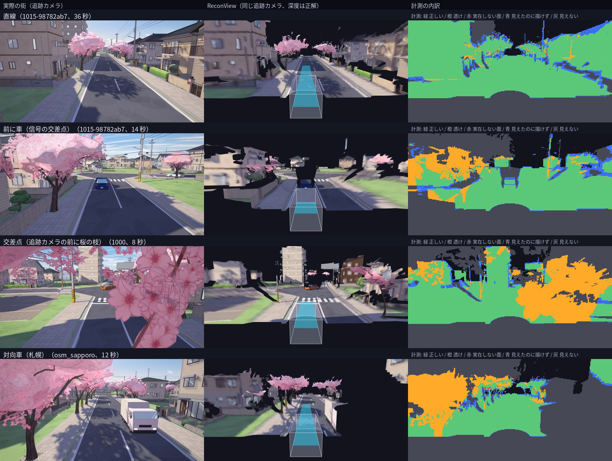
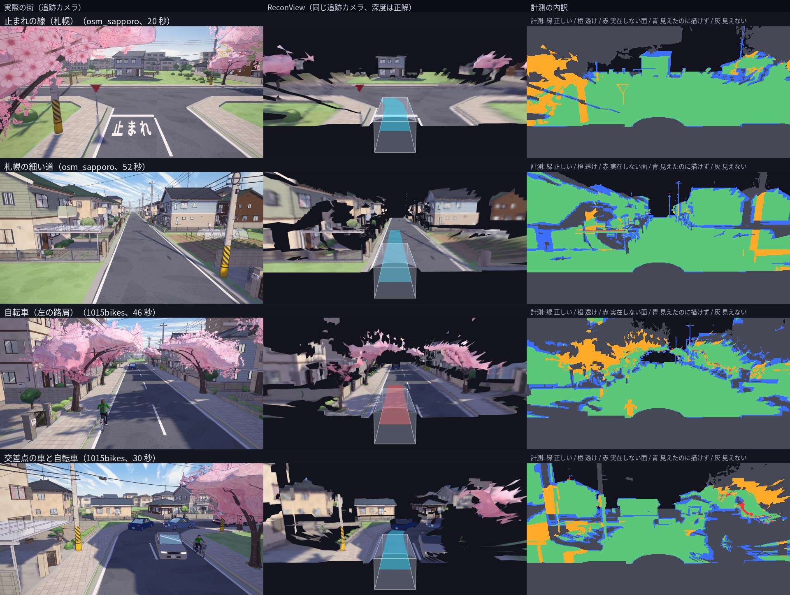

# ReconView（仮称）の記録

ブラウザ版 KeiPilot Mc（`?pilot=mc`）に、モデルの入力画像 2 枚と深度から街を 3D に組み立て、自車の後ろ上から描く画面を足す実験の記録です。2026-11-22 に始めました。

**いまの状態: S0 と S1 が終わり、関門 G1 で止まっています。** 続けるか（S2: 深度つきデータの収集と深度ヘッドの学習）は、まだ決めていません。

- これは派生の実験です。本線（KeiPilot Mc の学習の回）、README の数字、公開の重み、Pages の既定の表示は変えていません。
- 新しい選択肢はすべて既定でオフです。`?recon` のないページは ReconView のファイルを 1 つも読み込まず、深度を頼まない KeiView の応答とラベルは main と同じです（2.4 節、4.4 節）。
- 段階と関門は次のとおりです。

| 段階 | 中身 | 関門 | 状態 |
|---|---|---|---|
| S0 | 幾何の土台（深度パス、視線、逆投影、検査） | G0: 検査 4 つが通る | 済み |
| S1 | ReconView を正解の深度で描く。忠実度の計測ツール | **G1: 画と数字を見せて止まる** | 済み（ここで停止） |
| S2 | 深度つきデータの収集、深度ヘッドの学習、ONNX | G2: 不変の検査と深度の精度 | 未着手 |
| S3 | モデルの深度に差し替える。比較表示 | G3: 忠実度の表、走行が変わらないこと | 未着手 |
| S4 | 静的な面の蓄積 | G4: 被覆率が上がり、誤描画率が悪化しない | 未着手 |

## 1. 作ったもの

| ファイル | 中身 |
|---|---|
| [keisim/render/rays.py](../keisim/render/rays.py) | 深度の符号化、カメラごとの視線、逆投影と投影、円筒カメラの深度の貼り合わせ |
| [web/src/unproject.js](../web/src/unproject.js) | 同じものの JavaScript 版。ブラウザなしで動く関数だけです |
| [web/src/depth.js](../web/src/depth.js) | KeiView の深度パス。頼まれたときだけ読み込まれます |
| [web/src/ego.js](../web/src/ego.js) | `window.__ego` が `q.depth` のときだけ `dep` を返します。ラベルのパスと深度パスが共有する規則もここにあります |
| [keisim/render/keiview.py](../keisim/render/keiview.py)、[keisim/env.py](../keisim/env.py) | `KeiViewRenderer.render_rig_depth`、`KeiEnv.render_cameras_depth` |
| [keisim/render/depth_check.py](../keisim/render/depth_check.py)、[tools/recon_g0.py](../tools/recon_g0.py) | G0 の検査と、その数字を出すスクリプト |
| [web/src/recon.js](../web/src/recon.js) | ReconView の画面と、忠実度の計測 |
| [web/tools/recon_check.mjs](../web/tools/recon_check.mjs)、[tools/recon_table.py](../tools/recon_table.py) | 計測を走らせるツールと、この文書の表を出すスクリプト |
| [web/tools/unproject_check.mjs](../web/tools/unproject_check.mjs)、[tests/test_recon.py](../tests/test_recon.py) | Python と JavaScript の突き合わせ、テスト |
| [tools/keiview_hash.py](../tools/keiview_hash.py) | KeiView の画像とラベルのハッシュ（変更の前後で比べる） |

## 2. S0 幾何の土台

### 2.1 深度の定義

- 深度は、カメラ中心から面までの直線距離 r [m] です。前向き軸に沿った z ではありません。円筒カメラは 60° のピンホール 3 面を貼り合わせるので、z は継ぎ目で不連続になります。
- 16 bit の符号: `q = round(65535 · ln(r / 0.25) / ln(1600))`。`q = 0` は面なし（空、または 400 m より遠い）、0.25 m より近い面は `q = 1` です。1 刻みは r の 0.011 % です。
- 視線は、カメラの水平フレーム（x 右、y 下、z 前）の単位ベクトルです。世界座標は `P = C + r · (d.x · right + d.y · down + d.z · fwd)` です。
- 画素中心の約束は、設計書の読みどおりでした。KeiView のピンホール画像は半整数が画素中心（望遠は u と v に 0.5 を足す）、円筒は貼り合わせの表を 0.5 ずらしてあるので整数が画素中心です。検査 a が判定しました。
- **半解像度の画素の位置**: `cv2.resize(..., INTER_NEAREST)` で半分にした画像の画素 (i, j) は、元の画像の画素 (2i, 2j) です。2×2 の中心ではありません（テストで確認）。半解像度の深度の視線は `camera_rays(cfg, step=2)`、つまり元の画像の偶数番の画素の視線です。2×2 の中心の視線を使うと、広角の地面は 12 m 先で深度が 3.7 % ずれます。

### 2.2 深度パス

`web/src/depth.js` は、ラベルのパス（`ego.js` の `renderLabels`）と同じ規則で街をもう一度描き、色の代わりに距離の符号を書きます（上位バイトを R、下位バイトを G）。

- 隠す物体（空、`labelSkip`、メッシュでないもの、ガラス以外の `ShaderMaterial`）、切り抜き、`polygonOffset`、`side`、`depthWrite` はラベルと同じです。物体の選び方（`passObjects`）とマテリアルの鍵（`flatKey`、`flatLike`）を 2 つのパスで共有しています。
- マテリアルは `MeshBasicMaterial` で、`onBeforeCompile` でビュー空間の位置を渡し、フラグメントシェーダの最後で符号を書きます。`scene.overrideMaterial` は使いません。
- 信号の灯器（`labelColors`）は、ほかの物体と同じに描きます。
- クラスの番号は使わないので、パイロットモードでも動きます。

### 2.3 設計と違った点

1. **円筒カメラの深度の貼り合わせ（平面補正）**。設計は、面ごとの深度を最近傍で貼り合わせる、でした。最近傍で拾った面の画素は、円筒の画素の視線から最大 0.22° ずれた方向を見ています。平らな地面だけの場面を計算すると、相対誤差の 95 % 点は 3.4 % で、検査 a の関門（2 % 未満）を超えます。再構成では、地面の高さが 12 m 先で ±5 cm、30 m 先で ±12 cm 波打ちます。
   - 直し方: 拾う画素はラベルと同じ最近傍のままにします。その画素の周りが 1 枚の平面のとき（面の画像の中で、上下と左右の隣の 1/z がそれぞれ直線に乗るとき。許容は相対 0.1 %）、円筒の画素自身の視線とその平面の交点までの距離に直します。ピンホール画像では平面の 1/z が画素座標の 1 次式なので、平面なら 16 bit の刻みまで正確です。縁と曲面は最近傍のままです。
   - 2026-11-22 にユーザーが「平面補正つき」を選びました。`rays.DepthStitcher(mode="planar")` と `unproject.js` の `makeDepthStitch` です。`mode="nearest"` も残してあります。
2. **検査 b（再投影）の測り方**。設計は「A の画素を世界に戻して B に投影し、B の深度と比べる」でした。B の最近傍の 1 画素と比べると、平らな地面だけで関門を超えます（広角の 1 行は、30 m 先の地面で距離の 19 % にあたります）。そこで、A の 1 画素が B の画像で占める範囲（少なくとも周りの 2×2 画素）の中で、B のいちばん近い面と比べます。関門の数字（2 % より遠い画素が 3 % 未満）は変えていません。下の表に、最近傍の 1 画素と比べた場合の数字も載せています。
3. **白線と歩道の高さ**。KeiView の路面は Y = 0、歩道は 0.15 m で、設計書の読みどおりでした。ただし、白線は路面の 8 mm 上のデカールです（`roads.js`）。歩道のクラスには縁石の側面（高さ −2〜15 cm）も入ります。検査 a は、道路を z = 0、白線を z = 0.008 m の平面と比べます。歩道は、中央値だけを z = 0.15 m の平面と比べ、あわせて高さが −4〜19 cm に収まることを見ます。

### 2.4 深度を頼まないとき、何も変わらないこと

- `q.depth` のない `__ego` の応答は、今までと同じ経路で作られます。深度のモジュールは、最初に深度を頼まれたときに読み込みます。
- ラベルのパスの一部を共有の関数に切り出したので、ラベルが変わっていないことをハッシュで確かめました（`tools/keiview_hash.py`: リグ 6 フレームと単眼 6 フレーム）。main（2fcbac2）の `web/` と、変更後の `web/`（深度なし、深度あり）で、ラベル 18 枚のハッシュはすべて一致しました。
- RGB は、18 枚のうち 1〜2 枚が、main どうしを比べても走らせるたびに変わります（同じ 2 枚が 2 通りの値を取ります）。この実験より前からある KeiView の揺れです。1 つのプロセスの中では、深度を頼む前、頼んだとき、頼んだあとの RGB とラベルが一致します（`tests/test_recon.py::test_keiview_depth`）。

### 2.5 G0 の検査

| | 検査 | 通る条件 | 結果 |
|---|---|---|---|
| a | 平面: 道路と白線の深度を、視線と平らな地面の交点までの距離と比べる | 相対誤差の中央値 0.5 % 未満、95 % 点 2 % 未満。広角と望遠、元の解像度と半解像度 | 通過 |
| b | 再投影: 同じ場面で自車を 3 m 進めた 2 枚、および同じ位置の 2 台 | B が素通しする画素が 3 % 未満 | 通過（測り方は 2.3 の 2） |
| c | 深度が有効な画素と、ラベルが sky でない画素 | 一致率 99.5 % 以上 | 通過 |
| d | Python と JavaScript の逆投影 | 世界座標の差 1 mm 未満 | 通過 |

- a の幾何だけの部分と d は、GPU なしで動くテストです。KeiView を使う部分は、node や Chrome がなければスキップします。
- d は、符号、世界座標（2 台 × 2 解像度、最大の差 1e-10 mm の桁）、投影、貼り合わせた円筒の深度を、`web/src/rig.js` が持つリグの設定で比べます。

町 5, 23, 41、各 4 フレーム

| カメラ | 貼り合わせ | 解像度 | クラス | 画素 | 中央値 | 95 % 点 |
|---|---|---|---|---:|---:|---:|
| narrow | - | 元 | 白線 | 9,201 | 0.003 % | 0.008 % |
| narrow | - | 元 | 道路 | 185,981 | 0.003 % | 0.255 % |
| narrow | - | 元 | 歩道 | 73,103 | 0.005 % | 8.667 % |
| narrow | - | 半分 | 白線 | 2,280 | 0.003 % | 0.007 % |
| narrow | - | 半分 | 道路 | 46,002 | 0.003 % | 0.255 % |
| narrow | - | 半分 | 歩道 | 18,254 | 0.005 % | 8.697 % |
| wide | nearest | 元 | 白線 | 17,189 | 0.206 % | 0.914 % |
| wide | nearest | 元 | 道路 | 208,923 | 0.255 % | 1.145 % |
| wide | nearest | 元 | 歩道 | 66,840 | 0.627 % | 9.216 % |
| wide | nearest | 半分 | 白線 | 4,210 | 0.211 % | 0.806 % |
| wide | nearest | 半分 | 道路 | 51,747 | 0.255 % | 1.156 % |
| wide | nearest | 半分 | 歩道 | 16,765 | 0.623 % | 9.159 % |
| wide | planar | 元 | 白線 | 17,189 | 0.005 % | 0.827 % |
| wide | planar | 元 | 道路 | 208,923 | 0.004 % | 0.261 % |
| wide | planar | 元 | 歩道 | 66,840 | 0.008 % | 9.233 % |
| wide | planar | 半分 | 白線 | 4,210 | 0.004 % | 0.734 % |
| wide | planar | 半分 | 道路 | 51,747 | 0.004 % | 0.259 % |
| wide | planar | 半分 | 歩道 | 16,765 | 0.008 % | 9.119 % |

歩道のクラスの高さ: 中央値 15.00 cm、1 % 点 -1.11 cm、99 % 点 16.96 cm、−4〜19 cm に 99.8 %（137,957 画素）

| A | B | B の位置 | 点 | 素通し | 最悪のフレーム | (B の最近傍 1 画素と比べた場合) | なめらかな面での差の中央値 |
|---|---|---|---:|---:|---:|---:|---:|
| wide | wide | 3 m 先 | 209,837 | 1.14 % | 2.79 % | 7.62 % | 0.017 % |
| narrow | narrow | 3 m 先 | 331,339 | 0.15 % | 0.29 % | 2.93 % | 0.006 % |
| wide | narrow | 3 m 先 | 26,959 | 0.07 % | 0.27 % | 7.98 % | 0.038 % |
| wide | narrow | 同じ | 43,900 | 0.01 % | 0.03 % | 6.16 % | 0.014 % |
| narrow | wide | 同じ | 552,001 | 1.85 % | 2.87 % | 15.92 % | 0.067 % |

深度が有効な画素とラベルが sky でない画素の一致率（最小のフレーム）: 99.996 %

- 広角の「nearest」は、設計どおりの最近傍の貼り合わせです。実際のフレームでは近くの路面の画素が多いので、95 % 点は 1.1 % に収まりますが、中央値は平面補正の 60 倍です。
- 歩道の 95 % 点が 9 % なのは、縁石の側面のためです（2.3 の 3）。深度の誤りではありません。
- 「なめらかな面での差」は、B の周りの 4 画素が 3 % 以内でそろう場所で、B の深度を補間して比べたものです。カメラの間で画素の位置がずれていれば、ここに出ます。

走らせ方:

```bash
python -m pytest tests/test_recon.py -q                 # 7 件。KeiView の 1 件は GPU で約 30 秒
python tools/recon_g0.py                                # runs/eval/recon/g0.json と上の表
python tools/keiview_hash.py > after.txt                # 変更の前後で比べる
```

## 3. S1 ReconView（オラクル）

### 3.1 画面

`?pilot=mc&recon=oracle` で、主画面の左下に ReconView が出ます（幅は主画面の 40 %、縦横比は主画面と同じ 2:1）。

- 別の canvas と別の `THREE.WebGLRenderer` を使います。主画面のレンダラが持つ GL の状態（モデル用のフレームを描いて読み戻す側）には触れません。メッシュ、テクスチャ、マテリアルは ReconView のレンダラ専用です。
- オラクルでは、モデルのフレームを描くたびに、同じ場面の状態（モデル用の車の見た目のまま）で、同じショットの深度パスも描きます。広角は 3 面の深度を平面補正つきで貼り合わせます（2.3 の 1）。描画が 4 回増え、読み戻しで GPU を待つので、開発と計測のためのモードです。
- 追跡カメラは、自車の中心の後ろ 8 m、高さ 4 m から、12 m 前の路面を見ます。縦の画角は 50° です。ドラッグで回せます（`OrbitControls`）。ダブルクリックで元に戻ります。
- 描くのは、モデルの入力画像と深度から作った面、自車を示す箱（4.5 × 1.85 × 1.5 m）、計画の帯（主画面の帯と同じ縁を `pilot.js` から受け取ります）、暗い無地の背景だけです。見えていない場所は埋めません。

### 3.2 メッシュ

- カメラごとに格子メッシュを 1 枚持ちます。頂点は半解像度の深度画像の画素（80×160、元の画像の画素 (2i, 2j)）、UV は入力画像（320×160）のその画素の中心です。
- 頂点の位置は、CPU で `unproject.js` を使って計算します。姿勢は、そのフレームを描いたときの自車の姿勢（`capture` の `at.pose`）です。メッシュは町の座標のまま持ち、表示のときに今の自車の下へ動かします。
- テクスチャは、モデルに入れた RGB（`views[k].rgb`）です。sRGB として扱います。
- 1 フレームの組み立て（2 台で 25,600 頂点、三角形 約 3.5 万枚）は、CPU で 5〜8 ms でした。

三角形を捨てる規則は、次のとおりです（4.2 の数字で決めました。設計の出発点との違いは 4.5）。

1. 頂点のどれかが無効（面なし、または 80 m より遠い）なら捨てる。
2. 広角の三角形で、3 頂点とも望遠の画角の内側（縁から 4 画素の余裕）にあるものは捨てる。重なりは望遠を優先します。
3. 3 頂点とも地面なら捨てない。地面は、**頂点の高さ**が −0.3〜0.35 m にあることで決めます（KeiSim の町は平らで、歩道は 0.15 m）。
4. それ以外は、3 頂点の深度の最大と最小の比が 1.15 を超えたら捨てる（物体の縁）。望遠は画素が細かいので、同じ傾きの面まで描くように、比を 1 + 0.15 × (望遠の画素の角度 / 広角の画素の角度) = 1.04 にします。

### 3.3 忠実度の計測

`web/tools/recon_check.mjs` が、`window.__pilotRun` で決まった秒数を走らせ、2 秒ごとに測ります。

- 計測を頼むと、次のモデルフレームで、追跡カメラ（そのフレームの自車の姿勢から。320×160）の深度画像を 2 枚作ります。G は実際の街（主レンダラの深度パス。モデルのフレームと同じ場面の状態）、R は再構成（ReconView のレンダラ。自車の箱と帯は隠す）です。G と R は同じ瞬間、同じ姿勢なので、動く物体のずれは入りません。
- Ω は、G が有効で 80 m 以内の画素です。

| 指標 | 定義 |
|---|---|
| 被覆率（全体） | Ω のうち、R が有効な画素の割合 |
| 被覆率（いま見える範囲） | Ω のうち、リグのどれかのカメラからいま見える画素に限った被覆率 |
| 誤差 | Ω かつ R が有効な画素での、\|R − G\| / G の中央値（表は、フレームごとの中央値の中央値） |
| 誤描画率 | R が有効な画素のうち、G が無効か、\|R − G\| / G が 0.25 を超える割合 |
| うち透け | 誤描画のうち、G のほうが近いもの。カメラから見えなかった物が、追跡カメラからはその場所を隠している |
| うち実在しない面 | 誤描画のうち、G のほうが遠いか、G に面がないもの。離れた物のあいだに張られた三角形です |
| 正しく描けた | Ω のうち、R が有効で誤描画でない画素の割合（全体と、いま見える範囲） |

- 「いま見える」の判定: G の点をカメラに投影し、その位置の周りの 4 画素の正解の深度（元の解像度）の最小と最大のあいだ（±3 %）に、点までの距離が入るかで決めます。設計の「3 % 以内で合うか」を最近傍の 1 画素でやると、遠くの地面が見えていないことになります（2.3 の 2 と同じ理由）。
- 「透け」と「実在しない面」の内訳と、「正しく描けた」は、設計にはなかった指標です。誤描画率だけでは、再構成の誤りと、見えない物のせいとが分けられなかったので足しました（4.3）。
- 1 回の計測で、表示の規則のほかに、候補の規則 7 通りでも三角形を張り直して同じ G と比べます。規則の比較に、走行の違いが入りません。

## 4. G1 の結果（オラクル）

計測の組は、設計のとおり町 3 つ（`1000`、`1015-98782ab7`、`osm_sapporo`）を 60 秒ずつ、2 秒ごとの 90 フレームです。周りの車はページの既定のとおり出ています。

### 4.1 忠実度の表

規則: 地面 = height、比 1.15（カメラの画素の細かさで縮める）

| 町 | フレーム | 被覆率（全体） | 被覆率（いま見える範囲） | 見える範囲の割合 | 誤差（中央値） | 誤描画率 | うち透け | うち実在しない面 | 正しく描けた（全体） | 正しく描けた（見える範囲） |
|---|---:|---:|---:|---:|---:|---:|---:|---:|---:|---:|
| town 1000 | 30 | 50.3 % | 90.8 % | 43.6 % | 0.16 % | 20.4 % | 20.0 % | 0.4 % | 40.1 % | 88.5 % |
| town 1015（二段階の信号） | 30 | 52.1 % | 88.2 % | 50.0 % | 0.07 % | 14.6 % | 14.3 % | 0.3 % | 44.5 % | 85.9 % |
| 札幌（OSM） | 30 | 50.9 % | 88.6 % | 48.4 % | 0.06 % | 15.1 % | 14.9 % | 0.3 % | 43.2 % | 86.7 % |
| **合計** | 90 | 51.1 % | 89.1 % | 47.3 % | 0.08 % | 16.7 % | 16.4 % | 0.3 % | 42.5 % | 87.0 % |
| うち動いているフレーム（0.5 m/s 以上） | 72 | 51.8 % | 88.6 % | 49.2 % | 0.08 % | 15.1 % | 14.8 % | 0.3 % | 44.0 % | 86.6 % |

| 追跡カメラからの距離 | 画素 | 被覆率（全体） | 被覆率（いま見える範囲） | 見える範囲の割合 |
|---|---:|---:|---:|---:|
| 0〜10 m | 1,670,669 | 17.8 % | 79.4 % | 0.8 % |
| 10〜30 m | 1,982,546 | 74.6 % | 91.9 % | 77.0 % |
| 30〜80 m | 477,022 | 69.9 % | 79.2 % | 86.7 % |

| 三角形の規則（地面の判定、縁の比） | フレーム | 被覆率（全体） | 被覆率（いま見える範囲） | 見える範囲の割合 | 誤差（中央値） | 誤描画率 | うち透け | うち実在しない面 | 正しく描けた（全体） | 正しく描けた（見える範囲） |
|---|---:|---:|---:|---:|---:|---:|---:|---:|---:|---:|
| 設計の出発点: クラス、比 1.15（2 台とも） | 90 | 49.9 % | 87.0 % | 47.3 % | 0.07 % | 16.8 % | 16.4 % | 0.4 % | 41.5 % | 85.0 % |
| クラス、比 1.15（望遠は 1.04） | 90 | 49.4 % | 86.0 % | 47.3 % | 0.07 % | 16.9 % | 16.5 % | 0.4 % | 41.0 % | 84.0 % |
| クラスかつ高さ、比 1.15（望遠は 1.04） | 90 | 49.1 % | 85.7 % | 47.3 % | 0.07 % | 16.9 % | 16.6 % | 0.3 % | 40.8 % | 83.7 % |
| 高さ、比 1.15（2 台とも） | 90 | 51.4 % | 89.7 % | 47.3 % | 0.08 % | 16.7 % | 16.3 % | 0.4 % | 42.8 % | 87.5 % |
| 高さ、比 1.15（望遠は 1.04） | 90 | 51.1 % | 89.1 % | 47.3 % | 0.08 % | 16.7 % | 16.4 % | 0.3 % | 42.5 % | 87.0 % |
| 高さ、比 1.10（望遠は 1.03） | 90 | 49.7 % | 87.4 % | 47.3 % | 0.07 % | 16.6 % | 16.4 % | 0.2 % | 41.5 % | 85.1 % |
| 高さ、比 1.25（望遠は 1.07） | 90 | 52.5 % | 90.8 % | 47.3 % | 0.09 % | 16.7 % | 16.2 % | 0.5 % | 43.7 % | 88.8 % |

| カメラ | 頂点 | 有効な頂点 | 描いた三角形 | 捨てた: 面なし・80 m 超 | 捨てた: 縁 | 捨てた: 望遠と重なる |
|---|---:|---:|---:|---:|---:|---:|
| wide | 12,800 | 10,051 | 17,009 | 5,798 | 989 | 1,326 |
| narrow | 12,800 | 10,265 | 17,954 | 5,413 | 1,755 | 0 |

読み方:

- **カメラから見えた範囲の 89 % を面にでき、その 87 % ぶんが正しい位置にあります**（「正しく描けた（見える範囲）」）。誤差の中央値は 0.1 % で、深度が正解なら位置は合います。
- **追跡カメラの画の半分（53 %）は、そもそもカメラから見えていません**（「見える範囲の割合」47 %）。自車の周り、物の裏、屋根や樹冠の上面です。被覆率（全体）が 51 % なのは、このためです。距離の表で 0〜10 m の「見える範囲」が 1 % なのは、追跡カメラから 10 m 以内がほぼ全部、自車の後ろと横だからです。
- **誤描画（17 %）は、ほぼ全部が「透け」です**。実在しない面は 0.3 % です。「透け」は再構成した面の位置の誤りではありません。カメラから見えなかった手前の物（追跡カメラの前の枝、樹冠の上面、屋根）が再構成にないので、その奥の正しい面が見えている画素です。
- 動いているフレームだけに限っても、数字はほぼ同じです。town 1000 は 30 フレームのうち 18 フレームが信号待ちで止まっています。

### 4.2 三角形の規則

1 回の計測で、同じフレームの同じ G に対して、候補の規則でも三角形を張り直して比べました（3.3）。4.1 の 3 つ目の表です。

- **地面を頂点の高さで決めると、モデルのクラスで決めるより、見える範囲の被覆率が 2〜3 ポイント上がります**（87.0 % → 89.7 %。比は同じ 1.15）。実在しない面は 0.4 % のままです。モデルのセグメンテーションは 40×80 と粗く、遠くの地面で外れるので、クラスに頼ると遠くの路面が切れます。高さなら、深度だけで決まります。
- 比を望遠で小さくする（1.04）と、被覆率が 0.6 ポイント下がり、実在しない面が 0.1 ポイント減ります。比 1.10 と 1.25 も同じ向きの小さな交換です。
- 表示の規則は「高さ、比 1.15（望遠は 1.04）」にしました。**設計の出発点（クラス、比 1.15）からの変更です**。S3 でモデルの深度に替えると、高さの判定は深度の誤差を受けます。そのときに同じ表を取り直して、決め直します。

### 4.3 絵と、欠け方の一覧

左が実際の街、中央が ReconView（どちらも同じ追跡カメラ）、右が計測の内訳です（緑: 正しく描けた、橙: 透け、赤: 実在しない面、青: 見えたのに描けなかった、灰: カメラから見えない）。





ページの中では、左下に出ます。


- ブラウザ版には歩行者がいません（`pilot.js` は周りの車と自転車だけを出します）。設計の「歩行者」の絵は、自転車（`?bikes=8`。乗っている人は歩行者のクラス）に替えました。

見て分かった欠け方です。

1. **自車の周りは何もない**。カメラより後ろ（車の横と後ろ）と、前方 1.7 m までの路面は、どのカメラにも映りません。追跡カメラの画の下 1/4 は暗いままです。
2. **真横より後ろの物は出ない**。2 枚目の「自転車（左の路肩）」では、自車の左後ろを走る自転車が、再構成にありません（内訳の橙の人影）。広角は前向きの 180° です。
3. **物の裏に、影のような穴が開く**。木の幹、電柱、前の車、塀の後ろの地面です。前の車の後ろには、車の幅のくさび形の穴が伸びます。
4. **物は、見えた面だけの殻になる**。前の車は後ろの面だけ、対向車は前の面だけ、桜の樹冠は下から見た膜、建物は道路側の壁だけで、屋根はありません。追跡カメラは上から見るので、近くの車は、殻の内側や欠けた形に見えます（2 枚目の 4 段目）。
5. **見えない手前の物を透かして描く（透け）**。追跡カメラ（高さ 4 m）の前に枝があるとき、実際の画では枝に隠れる場所を、再構成は描きます（1 枚目の 3 段目）。見ている人には害のない違いですが、誤描画率には数えられます。
6. **広角の端と遠くは、絵が引き伸ばされる**。広角の半解像度は 1 画素が 1.1° で、真横の壁や 20 m より先の地面では、1 画素が数十 cm から数 m にあたります。望遠の画角（中央の 50°）の中は細かく出ます。
7. **細い物は切れる**。電柱、標識の柱、信号の腕は、半解像度の 1〜2 画素で、縁の規則にかかって途切れます。電線は、ラベルと同じく深度にも出ません。
8. **縁がぎざぎざになる**。樹冠や建物の縁は、三角形の単位で切るので、のこぎりの歯のようになります。
9. **実在しない面がまれに出る**（0.3 %）。奥行きの比が 1.15 以内の 2 つの物のあいだに、膜が張られます（2 枚目の 4 段目の赤）。
10. **80 m より遠くと空は描かない**。背景は暗い無地です。

### 4.4 再現性と、recon の有無

- **走行の始め方**。ページは、準備ができてから試験が引き取るまで、実時間で先に走っています（`pilot_check.mjs` の最初の画像の時刻は 0 でなく 1.2 秒でした）。`recon_check.mjs` は、引き取ったあとにモデルの呼び出しを 1 回済ませ、時刻を 0 に、車を出発点に戻してから測ります。
- **同じ引数の走行は、2 通りのどちらかになります**。同じ要約値（`digest`）の走行どうしは、車の姿勢もモデルの入力画像もビット単位で同じです。2 通りのあいだでは、最初の 2 秒で入力画像が違い、車の位置が 1〜3 mm 違います。
  - 原因は KeiView の RGB の揺れで、この実験より前からあります（2.4）。ウェブフォントの読み込みを止めても 2 通りのままだったので、フォントではありません。読み込み直したページは 3 つ目の要約値になるので、資源の読み込みの順序が関わっていそうですが、特定していません。
  - **この小さな違いが、あとで大きく開くことがあります**。下の表のとおり、town 1000 と札幌では、2 回の走行が 26 秒あたりから別の走りになりました（周りの車とのやりとりが変わる）。town 1015 は 14 cm の違いのままでした。
  - したがって、設計の「同じ引数なら同じ数字になる」は、同じ要約値の走行どうしに限って成り立ちます。合計の数字は、2 回で次のように動きました。被覆率（いま見える範囲）89.1 % と 88.9 %、実在しない面 0.3 % と 0.3 %、正しく描けた（見える範囲）87.0 % と 86.8 %、誤描画率 16.7 % と 13.7 %。「透け」は、どのフレームに当たるかで動きます。

| 町 | 1 回目の要約値 | 2 回目の要約値 | 車の位置の差（最大） | 被覆率（全体）の差（最大のフレーム） | 合計の被覆率 1 回目 / 2 回目 |
|---|---|---|---:|---:|---|
| town 1000 | `615322397c9f55c7` | `a0aab037ae89f96c` | 192363.8 mm | 15.25 ポイント | 50.3 % / 54.3 % |
| town 1015（二段階の信号） | `51d8e0b8fdb6198f` | `bafff36aa1792aff` | 135.5 mm | 0.38 ポイント | 52.1 % / 52.0 % |
| 札幌（OSM） | `4c9df61401b24e4d` | `e7a299782499b560` | 249433.2 mm | 19.30 ポイント | 50.9 % / 51.8 % |

- **`?recon` のないページ**は、`recon.js`、`depth.js`、`unproject.js`、`OrbitControls` のどれも読み込みません（`recon_check.mjs --recon off` が、ページの要求を見て確かめます）。走行の要約値は、recon ありと同じ 2 通りでした（town 1000 の 20 秒: `62c3930838d0c9c6` と `02005cd0f2be5793`。recon なし 9 回、recon あり 6 回）。オラクルの深度パスは、モデルの入力画像と走行を変えていません。G3 の正式な検査は S3 で行います。
- ドラッグで視点が回ること、ダブルクリックで追跡カメラに戻ることは、`recon_check.mjs --drag 1` で確かめました。
- **実時間の速さ**（ヘッドレスの Chrome、RTX 3060、12 秒の平均。`--realtime 12`）:

| 町 | | 主画面 | モデルの呼び出し | モデルのフレーム（主スレッド） | メッシュ | 町の時間 |
|---|---|---:|---:|---:|---:|---:|
| town 1000 | recon なし | 52.7 fps | 9.3 回/秒 | 18.5 ms | – | ×0.98 |
| town 1000 | recon=oracle | 24.3 fps | 7.0 回/秒 | 51.0 ms | 5.0 ms | ×1.00 |
| 札幌 | recon なし | 15.6 fps | 4.1 回/秒 | 36.4 ms | – | ×0.88 |
| 札幌 | recon=oracle | 13.7 fps | 3.4 回/秒 | 139.5 ms | 8.4 ms | ×0.76 |

  オラクルは、深度の描画 4 回と、GPU を待つ読み戻しのぶん重くなります。S3 のモデルの深度では深度パスを描かないので、足されるのはメッシュの組み立てと ReconView の描画だけです。この表は 1 回ずつの値です。

### 4.5 設計と違った点（S1）

1. **地面の判定**を、モデルのクラスから頂点の高さに替えました（4.2）。
2. **縁の比**を、望遠では画素の細かさに合わせて 1.04 にしました（4.2）。
3. **2 台の重なり**。設計は、望遠の画角に入る広角の頂点を無効にする、でした。頂点を無効にすると、望遠の縁と広角の残りのあいだに、広角の 1 画素ぶんの輪の穴が開きます。3 頂点とも望遠の画角の内側にある三角形だけを捨てる形にしました。
4. **「いま見える」の判定**を、最近傍の 1 画素ではなく周りの 4 画素の範囲にしました（3.3）。
5. **誤描画の内訳**（透け、実在しない面）と「正しく描けた」を足しました（3.3）。
6. **計測は、同じモデルフレームの G と R を比べます**。設計は、走らせたあとの追跡カメラから 2 枚を描く、でした。それだと、再構成のフレームと今の街のあいだに 1 歩（0.05 秒）ぶんの動きが入ることがあります。
7. **追跡カメラの画の縦横比**は、主画面と同じ 2:1（縦 50°）にしました。設計は決めていませんでした。
8. **走行の再現性**は、2 通りのうちのどちらかまでです（4.4）。
9. **「歩行者」の絵**は、自転車に替えました（4.3）。

## 5. 次の段階に向けて分かったこと

続けると決めた場合の注意です。S2 以降は、ユーザーが続けると言うまで始めません。

- **深度ヘッドの視線の表**（`aux_depth_rays`）と、シャードに入れる半解像度の深度は、`camera_rays(cfg, step=2)` の約束（元の画像の画素 (2i, 2j)）にそろえます。円筒の深度は平面補正つきで貼り合わせます。
- **深度ヘッドの正規化層**。モデル全体を `eval()` のまま学習するので、ヘッドに BatchNorm を入れると統計が動きません。ヘッドは BatchNorm なし（または GroupNorm）にするか、`aux_depth_` のモジュールだけ `train()` にします。
- **推論時間の関門（20 % 以内）** は、見積もりではぎりぎりです。学習の前に、重みが乱数のままのヘッドで ONNX を書き出し、WASM と WebGPU で時間を測って幅を決めます。
- **深度つきの ONNX のビット単位の一致**（G2 の 3）は、グラフに枝が増えるので、onnxruntime の最適化で崩れるかもしれません。崩れたら、基準を緩める前に差の大きさと原因を報告します。
- **G3（recon の有無で走行が同じ）** は、走行が 2 通りに分かれること（4.4）を踏まえて比べます。同じ要約値どうしを比べるか、ページのフォントの読み込みを先に直します。
- **データ収集**（KeiView の 10 万フレーム、深度つき）は、数百フレームで速さを測って時間とディスクを見積もってから、ユーザーの OK をもらいます。深度のパスは、リグ 1 フレームあたり描画 4 回と読み戻し 4 回が増えます。
- **G2 と G4 の関門の数字** は、走らせる前に決めます。G4 の「誤描画率が悪化しない」は、「透け」ではなく「実在しない面」で見るのがよさそうです（4.3）。蓄積は、見えなかった物を増やさないので「透け」を減らしません。
- オラクルは上限です。モデルの深度は、これより良くはなりません。4.1 の「正しく描けた（いま見える範囲）」が、S3 で比べる相手です。

## 6. 走らせ方

```bash
# 見る: web/ で node tools/serve.mjs を起動し、ブラウザで開く（WebGL が要ります）
#   node tools/serve.mjs 5176   →   http://localhost:5176/index.html?pilot=mc&recon=oracle&town=1000
#   ドラッグで視点を回す、ダブルクリックで追跡カメラに戻す

# 測る（web/ で。ヘッドレスの Chrome と GPU。60 秒ぶんで 5〜6 分）
node tools/recon_check.mjs --town 1000 --sec 60 --every 2 --out ../runs/eval/recon/g1 --shotdir ../runs/recon/g1/shots --shots all
node tools/recon_check.mjs --town 1000 --sec 20 --recon off      # ?recon なし: 何も読み込まないこと、走行の要約値

# 表と絵
python tools/recon_table.py runs/eval/recon/g1 --repeat runs/eval/recon/g1_repeat
python tools/recon_sheet.py docs/recon/g1_scenes.jpg runs/recon/g1/shots 1000:8:交差点 ...
```

- `web/models/keipilot_mc.onnx`（公開の v0.12.0）と、onnxruntime-web と three.js を CDN から読むためのネットワークが要ります。
- 表示の規則は `?reconground=class|height|both`、`?reconratio=1.15`、`?reconscaled=0` で変えられます（計測ツールでは `--ground`、`--ratio`、`--scaled`）。
