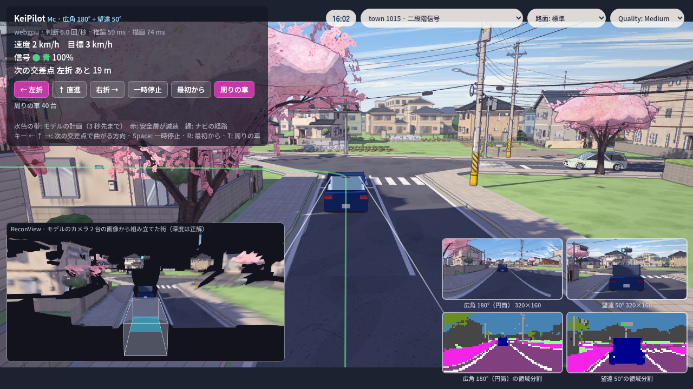
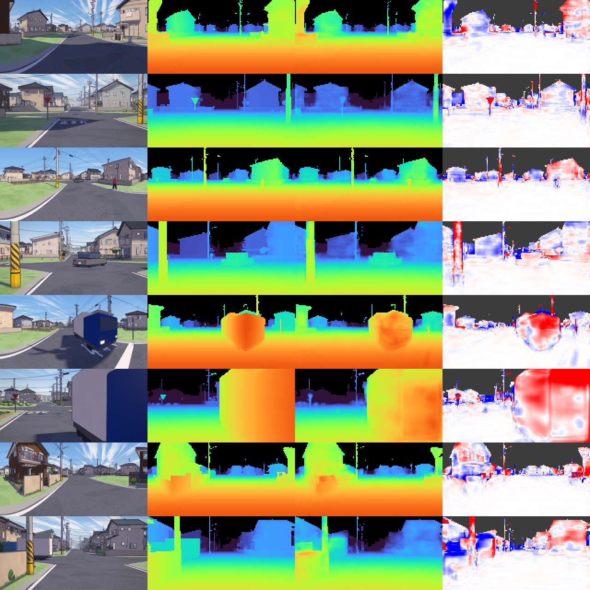
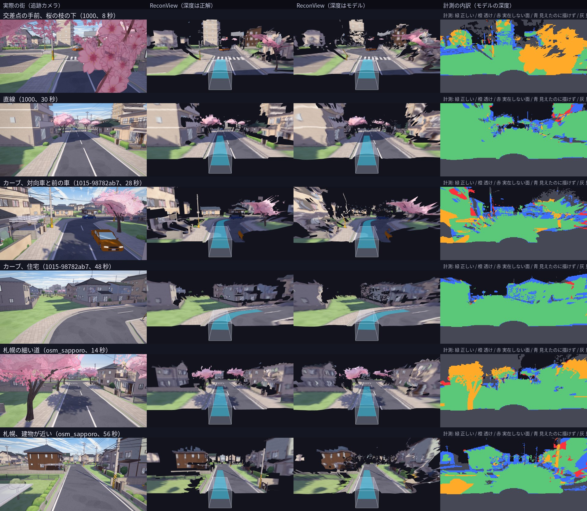
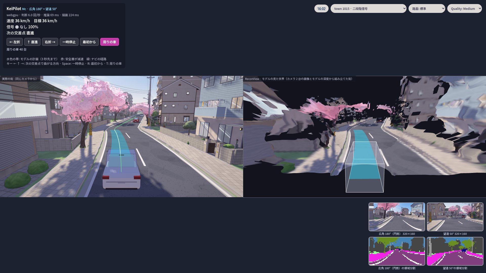
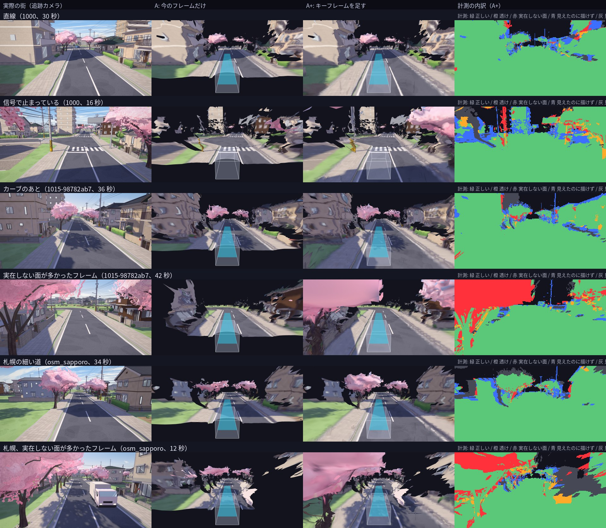
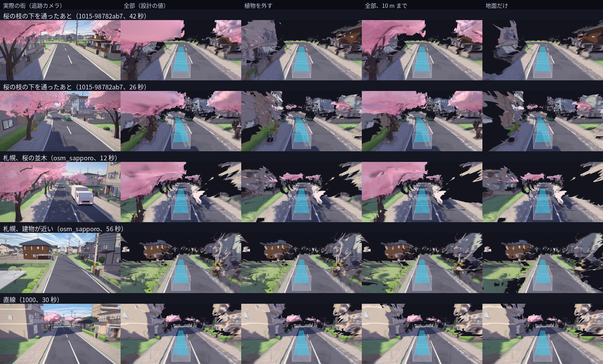

# ReconView（仮称）の記録

ブラウザ版 KeiPilot Mc（`?pilot=mc`）に、モデルの入力画像 2 枚と深度から街を 3D に組み立て、自車の後ろ上から描く画面を足す実験の記録です。2026-11-22 に始めました。

**いまの状態: S0〜S4 が終わりました。設計書の段階はここまでです。** G2 は、不変の検査と速さが通り、深度の精度は道路と車が通って建物と人が届いていません（6 章）。ユーザーの判断で、このヘッドのまま S3 に進みました。G3 は、走行が変わらないことが通り、忠実度は「正しく描けた（いま見える範囲）」がオラクルの 86.2 % に対して 80.1 % でした（7 章）。S4（蓄積）は、関門 G4 の 2 項目を通りました。被覆率（全体）は 51.1 % から 89.1 % に上がり、誤描画率は 16.8 % から 9.7 % に下がりましたが、実在しない面は 1.9 % から 5.9 % に増えています（8 章）。どれも手元のコミットで、公開はしていません。

- これは派生の実験です。本線（KeiPilot Mc の学習の回）、README の数字、公開の重み、Pages の既定の表示は変えていません。深度つきの ONNX だけは、Pages の `?recon=model` のために、v0.12.0 とは別の pre-release で配っています（8.7）。
- 新しい選択肢はすべて既定でオフです。`?recon` のないページは ReconView のファイルを 1 つも読み込まず、深度を頼まない KeiView の応答とラベルは main と同じです（2.4 節、4.4 節）。
- 段階と関門は次のとおりです。

| 段階 | 中身 | 関門 | 状態 |
|---|---|---|---|
| S0 | 幾何の土台（深度パス、視線、逆投影、検査） | G0: 検査 4 つが通る | 済み |
| S1 | ReconView を正解の深度で描く。忠実度の計測ツール | **G1: 画と数字を見せて止まる** | 済み |
| S2 | 深度つきデータの収集、深度ヘッドの学習、ONNX | G2: 不変の検査と深度の精度 | 済み。精度の関門は建物と人が未達（ここで停止） |
| S3 | モデルの深度に差し替える。比較表示 | G3: 忠実度の表、走行が変わらないこと | 済み（ここで停止） |
| S4 | 静的な面の蓄積 | G4: 被覆率が上がり、誤描画率が悪化しない | 済み（関門は通過） |

## 1. 作ったもの

| ファイル | 中身 |
|---|---|
| [keisim/render/rays.py](../keisim/render/rays.py) | 深度の符号化、カメラごとの視線、逆投影と投影、円筒カメラの深度の貼り合わせ |
| [web/src/unproject.js](../web/src/unproject.js) | 同じものの JavaScript 版。ブラウザなしで動く関数だけです |
| [web/src/depth.js](../web/src/depth.js) | KeiView の深度パス。頼まれたときだけ読み込まれます |
| [web/src/ego.js](../web/src/ego.js) | `window.__ego` が `q.depth` のときだけ `dep` を返します。ラベルのパスと深度パスが共有する規則もここにあります |
| [keisim/render/keiview.py](../keisim/render/keiview.py)、[keisim/env.py](../keisim/env.py) | `KeiViewRenderer.render_rig_depth`、`KeiEnv.render_cameras_depth` |
| [keisim/render/depth_check.py](../keisim/render/depth_check.py)、[tools/recon_g0.py](../tools/recon_g0.py) | G0 の検査と、その数字を出すスクリプト |
| [web/src/recon.js](../web/src/recon.js) | ReconView の画面と、忠実度の計測 |
| [web/tools/recon_check.mjs](../web/tools/recon_check.mjs)、[tools/recon_table.py](../tools/recon_table.py) | 計測を走らせるツールと、この文書の表を出すスクリプト |
| [web/tools/unproject_check.mjs](../web/tools/unproject_check.mjs)、[tests/test_recon.py](../tests/test_recon.py) | Python と JavaScript の突き合わせ、テスト |
| [tools/keiview_hash.py](../tools/keiview_hash.py) | KeiView の画像とラベルのハッシュ（変更の前後で比べる） |
| [keipilot/model.py](../keipilot/model.py) | `KeiPilot(aux_depth=True)`: 深度ヘッド（`aux_depth_`）、`forward(..., with_depth=True)`、`depth_loss` |
| [keipilot/data.py](../keipilot/data.py)、[scripts/collect.py](../scripts/collect.py) | シャードの深度（`dep`、`dep_c1`）、`collect.py --depth 1` |
| [scripts/train_depth.py](../scripts/train_depth.py) | 運転モデルを凍結して、深度ヘッドだけを学習する |
| [keipilot/depthstats.py](../keipilot/depthstats.py)、[tools/depth_eval.py](../tools/depth_eval.py)、[tools/depth_detail.py](../tools/depth_detail.py) | 深度の精度（クラス別、距離帯別、カメラ別）、基準「全部が地面」、誤差の内訳と絵 |
| [scripts/export_onnx.py](../scripts/export_onnx.py) | 深度ヘッドのあるモデルでは、ONNX の最後に `depth` を足す |
| [tools/recon_time.py](../tools/recon_time.py)、[web/tools/onnx_same.mjs](../web/tools/onnx_same.mjs) | ブラウザの推論時間の表、ブラウザで 2 つの ONNX の出力をビット単位で比べるツール |
| [recon/s2.sh](recon/s2.sh)、[tests/test_depth.py](../tests/test_depth.py) | S2 の手順（収集、学習、評価、ONNX）、テスト |
| [recon/g3.sh](recon/g3.sh)、[recon/g4.sh](recon/g4.sh)、[tools/recon_g3.py](../tools/recon_g3.py) | G3 と G4 の計測の手順と、走行と速さの表を出すスクリプト |

## 2. S0 幾何の土台

### 2.1 深度の定義

- 深度は、カメラ中心から面までの直線距離 r [m] です。前向き軸に沿った z ではありません。円筒カメラは 60° のピンホール 3 面を貼り合わせるので、z は継ぎ目で不連続になります。
- 16 bit の符号: `q = round(65535 · ln(r / 0.25) / ln(1600))`。`q = 0` は面なし（空、または 400 m より遠い）、0.25 m より近い面は `q = 1` です。1 刻みは r の 0.011 % です。
- 視線は、カメラの水平フレーム（x 右、y 下、z 前）の単位ベクトルです。世界座標は `P = C + r · (d.x · right + d.y · down + d.z · fwd)` です。
- 画素中心の約束は、設計書の読みどおりでした。KeiView のピンホール画像は半整数が画素中心（望遠は u と v に 0.5 を足す）、円筒は貼り合わせの表を 0.5 ずらしてあるので整数が画素中心です。検査 a が判定しました。
- **半解像度の画素の位置**: `cv2.resize(..., INTER_NEAREST)` で半分にした画像の画素 (i, j) は、元の画像の画素 (2i, 2j) です。2×2 の中心ではありません（テストで確認）。半解像度の深度の視線は `camera_rays(cfg, step=2)`、つまり元の画像の偶数番の画素の視線です。2×2 の中心の視線を使うと、広角の地面は 12 m 先で深度が 3.7 % ずれます。

### 2.2 深度パス

`web/src/depth.js` は、ラベルのパス（`ego.js` の `renderLabels`）と同じ規則で街をもう一度描き、色の代わりに距離の符号を書きます（上位バイトを R、下位バイトを G）。

- 隠す物体（空、`labelSkip`、メッシュでないもの、ガラス以外の `ShaderMaterial`）、切り抜き、`polygonOffset`、`side`、`depthWrite` はラベルと同じです。物体の選び方（`passObjects`）とマテリアルの鍵（`flatKey`、`flatLike`）を 2 つのパスで共有しています。
- マテリアルは `MeshBasicMaterial` で、`onBeforeCompile` でビュー空間の位置を渡し、フラグメントシェーダの最後で符号を書きます。`scene.overrideMaterial` は使いません。
- 信号の灯器（`labelColors`）は、ほかの物体と同じに描きます。
- クラスの番号は使わないので、パイロットモードでも動きます。

### 2.3 設計と違った点

1. **円筒カメラの深度の貼り合わせ（平面補正）**。設計は、面ごとの深度を最近傍で貼り合わせる、でした。最近傍で拾った面の画素は、円筒の画素の視線から最大 0.22° ずれた方向を見ています。平らな地面だけの場面を計算すると、相対誤差の 95 % 点は 3.4 % で、検査 a の関門（2 % 未満）を超えます。再構成では、地面の高さが 12 m 先で ±5 cm、30 m 先で ±12 cm 波打ちます。
   - 直し方: 拾う画素はラベルと同じ最近傍のままにします。その画素の周りが 1 枚の平面のとき（面の画像の中で、上下と左右の隣の 1/z がそれぞれ直線に乗るとき。許容は相対 0.1 %）、円筒の画素自身の視線とその平面の交点までの距離に直します。ピンホール画像では平面の 1/z が画素座標の 1 次式なので、平面なら 16 bit の刻みまで正確です。縁と曲面は最近傍のままです。
   - 2026-11-22 にユーザーが「平面補正つき」を選びました。`rays.DepthStitcher(mode="planar")` と `unproject.js` の `makeDepthStitch` です。`mode="nearest"` も残してあります。
2. **検査 b（再投影）の測り方**。設計は「A の画素を世界に戻して B に投影し、B の深度と比べる」でした。B の最近傍の 1 画素と比べると、平らな地面だけで関門を超えます（広角の 1 行は、30 m 先の地面で距離の 19 % にあたります）。そこで、A の 1 画素が B の画像で占める範囲（少なくとも周りの 2×2 画素）の中で、B のいちばん近い面と比べます。関門の数字（2 % より遠い画素が 3 % 未満）は変えていません。下の表に、最近傍の 1 画素と比べた場合の数字も載せています。
3. **白線と歩道の高さ**。KeiView の路面は Y = 0、歩道は 0.15 m で、設計書の読みどおりでした。ただし、白線は路面の 8 mm 上のデカールです（`roads.js`）。歩道のクラスには縁石の側面（高さ −2〜15 cm）も入ります。検査 a は、道路を z = 0、白線を z = 0.008 m の平面と比べます。歩道は、中央値だけを z = 0.15 m の平面と比べ、あわせて高さが −4〜19 cm に収まることを見ます。

### 2.4 深度を頼まないとき、何も変わらないこと

- `q.depth` のない `__ego` の応答は、今までと同じ経路で作られます。深度のモジュールは、最初に深度を頼まれたときに読み込みます。
- ラベルのパスの一部を共有の関数に切り出したので、ラベルが変わっていないことをハッシュで確かめました（`tools/keiview_hash.py`: リグ 6 フレームと単眼 6 フレーム）。main（2fcbac2）の `web/` と、変更後の `web/`（深度なし、深度あり）で、ラベル 18 枚のハッシュはすべて一致しました。
- RGB は、18 枚のうち 1〜2 枚が、main どうしを比べても走らせるたびに変わります（同じ 2 枚が 2 通りの値を取ります）。この実験より前からある KeiView の揺れです。1 つのプロセスの中では、深度を頼む前、頼んだとき、頼んだあとの RGB とラベルが一致します（`tests/test_recon.py::test_keiview_depth`）。

### 2.5 G0 の検査

| | 検査 | 通る条件 | 結果 |
|---|---|---|---|
| a | 平面: 道路と白線の深度を、視線と平らな地面の交点までの距離と比べる | 相対誤差の中央値 0.5 % 未満、95 % 点 2 % 未満。広角と望遠、元の解像度と半解像度 | 通過 |
| b | 再投影: 同じ場面で自車を 3 m 進めた 2 枚、および同じ位置の 2 台 | B が素通しする画素が 3 % 未満 | 通過（測り方は 2.3 の 2） |
| c | 深度が有効な画素と、ラベルが sky でない画素 | 一致率 99.5 % 以上 | 通過 |
| d | Python と JavaScript の逆投影 | 世界座標の差 1 mm 未満 | 通過 |

- a の幾何だけの部分と d は、GPU なしで動くテストです。KeiView を使う部分は、node や Chrome がなければスキップします。
- d は、符号、世界座標（2 台 × 2 解像度、最大の差 1e-10 mm の桁）、投影、貼り合わせた円筒の深度を、`web/src/rig.js` が持つリグの設定で比べます。

町 5, 23, 41、各 4 フレーム

| カメラ | 貼り合わせ | 解像度 | クラス | 画素 | 中央値 | 95 % 点 |
|---|---|---|---|---:|---:|---:|
| narrow | - | 元 | 白線 | 9,201 | 0.003 % | 0.008 % |
| narrow | - | 元 | 道路 | 185,981 | 0.003 % | 0.255 % |
| narrow | - | 元 | 歩道 | 73,103 | 0.005 % | 8.667 % |
| narrow | - | 半分 | 白線 | 2,280 | 0.003 % | 0.007 % |
| narrow | - | 半分 | 道路 | 46,002 | 0.003 % | 0.255 % |
| narrow | - | 半分 | 歩道 | 18,254 | 0.005 % | 8.697 % |
| wide | nearest | 元 | 白線 | 17,189 | 0.206 % | 0.914 % |
| wide | nearest | 元 | 道路 | 208,923 | 0.255 % | 1.145 % |
| wide | nearest | 元 | 歩道 | 66,840 | 0.627 % | 9.216 % |
| wide | nearest | 半分 | 白線 | 4,210 | 0.211 % | 0.806 % |
| wide | nearest | 半分 | 道路 | 51,747 | 0.255 % | 1.156 % |
| wide | nearest | 半分 | 歩道 | 16,765 | 0.623 % | 9.159 % |
| wide | planar | 元 | 白線 | 17,189 | 0.005 % | 0.827 % |
| wide | planar | 元 | 道路 | 208,923 | 0.004 % | 0.261 % |
| wide | planar | 元 | 歩道 | 66,840 | 0.008 % | 9.233 % |
| wide | planar | 半分 | 白線 | 4,210 | 0.004 % | 0.734 % |
| wide | planar | 半分 | 道路 | 51,747 | 0.004 % | 0.259 % |
| wide | planar | 半分 | 歩道 | 16,765 | 0.008 % | 9.119 % |

歩道のクラスの高さ: 中央値 15.00 cm、1 % 点 -1.11 cm、99 % 点 16.96 cm、−4〜19 cm に 99.8 %（137,957 画素）

| A | B | B の位置 | 点 | 素通し | 最悪のフレーム | (B の最近傍 1 画素と比べた場合) | なめらかな面での差の中央値 |
|---|---|---|---:|---:|---:|---:|---:|
| wide | wide | 3 m 先 | 209,837 | 1.14 % | 2.79 % | 7.62 % | 0.017 % |
| narrow | narrow | 3 m 先 | 331,339 | 0.15 % | 0.29 % | 2.93 % | 0.006 % |
| wide | narrow | 3 m 先 | 26,959 | 0.07 % | 0.27 % | 7.98 % | 0.038 % |
| wide | narrow | 同じ | 43,900 | 0.01 % | 0.03 % | 6.16 % | 0.014 % |
| narrow | wide | 同じ | 552,001 | 1.85 % | 2.87 % | 15.92 % | 0.067 % |

深度が有効な画素とラベルが sky でない画素の一致率（最小のフレーム）: 99.996 %

- 広角の「nearest」は、設計どおりの最近傍の貼り合わせです。実際のフレームでは近くの路面の画素が多いので、95 % 点は 1.1 % に収まりますが、中央値は平面補正の 60 倍です。
- 歩道の 95 % 点が 9 % なのは、縁石の側面のためです（2.3 の 3）。深度の誤りではありません。
- 「なめらかな面での差」は、B の周りの 4 画素が 3 % 以内でそろう場所で、B の深度を補間して比べたものです。カメラの間で画素の位置がずれていれば、ここに出ます。

走らせ方:

```bash
python -m pytest tests/test_recon.py -q                 # 7 件。KeiView の 1 件は GPU で約 30 秒
python tools/recon_g0.py                                # runs/eval/recon/g0.json と上の表
python tools/keiview_hash.py > after.txt                # 変更の前後で比べる
```

## 3. S1 ReconView（オラクル）

### 3.1 画面

`?pilot=mc&recon=oracle` で、主画面の左下に ReconView が出ます（幅は主画面の 40 %、縦横比は主画面と同じ 2:1）。

- 別の canvas と別の `THREE.WebGLRenderer` を使います。主画面のレンダラが持つ GL の状態（モデル用のフレームを描いて読み戻す側）には触れません。メッシュ、テクスチャ、マテリアルは ReconView のレンダラ専用です。
- オラクルでは、モデルのフレームを描くたびに、同じ場面の状態（モデル用の車の見た目のまま）で、同じショットの深度パスも描きます。広角は 3 面の深度を平面補正つきで貼り合わせます（2.3 の 1）。描画が 4 回増え、読み戻しで GPU を待つので、開発と計測のためのモードです。
- 追跡カメラは、自車の中心の後ろ 8 m、高さ 4 m から、12 m 前の路面を見ます。縦の画角は 50° です。ドラッグで回せます（`OrbitControls`）。ダブルクリックで元に戻ります。
- 描くのは、モデルの入力画像と深度から作った面、自車を示す箱（4.5 × 1.85 × 1.5 m）、計画の帯（主画面の帯と同じ縁を `pilot.js` から受け取ります）、暗い無地の背景だけです。見えていない場所は埋めません。

### 3.2 メッシュ

- カメラごとに格子メッシュを 1 枚持ちます。頂点は半解像度の深度画像の画素（80×160、元の画像の画素 (2i, 2j)）、UV は入力画像（320×160）のその画素の中心です。
- 頂点の位置は、CPU で `unproject.js` を使って計算します。姿勢は、そのフレームを描いたときの自車の姿勢（`capture` の `at.pose`）です。メッシュは町の座標のまま持ち、表示のときに今の自車の下へ動かします。
- テクスチャは、モデルに入れた RGB（`views[k].rgb`）です。sRGB として扱います。
- 1 フレームの組み立て（2 台で 25,600 頂点、三角形 約 3.5 万枚）は、CPU で 5〜8 ms でした。

三角形を捨てる規則は、次のとおりです（4.2 の数字で決めました。設計の出発点との違いは 4.5）。

1. 頂点のどれかが無効（面なし、または 80 m より遠い）なら捨てる。
2. 広角の三角形で、3 頂点とも望遠の画角の内側（縁から 4 画素の余裕）にあるものは捨てる。重なりは望遠を優先します。
3. 3 頂点とも地面なら捨てない。地面は、**頂点の高さ**が −0.3〜0.35 m にあることで決めます（KeiSim の町は平らで、歩道は 0.15 m）。
4. それ以外は、3 頂点の深度の最大と最小の比が 1.15 を超えたら捨てる（物体の縁）。望遠は画素が細かいので、同じ傾きの面まで描くように、比を 1 + 0.15 × (望遠の画素の角度 / 広角の画素の角度) = 1.04 にします。

### 3.3 忠実度の計測

`web/tools/recon_check.mjs` が、`window.__pilotRun` で決まった秒数を走らせ、2 秒ごとに測ります。

- 計測を頼むと、次のモデルフレームで、追跡カメラ（そのフレームの自車の姿勢から。320×160）の深度画像を 2 枚作ります。G は実際の街（主レンダラの深度パス。モデルのフレームと同じ場面の状態）、R は再構成（ReconView のレンダラ。自車の箱と帯は隠す）です。G と R は同じ瞬間、同じ姿勢なので、動く物体のずれは入りません。
- Ω は、G が有効で 80 m 以内の画素です。

| 指標 | 定義 |
|---|---|
| 被覆率（全体） | Ω のうち、R が有効な画素の割合 |
| 被覆率（いま見える範囲） | Ω のうち、リグのどれかのカメラからいま見える画素に限った被覆率 |
| 誤差 | Ω かつ R が有効な画素での、\|R − G\| / G の中央値（表は、フレームごとの中央値の中央値） |
| 誤描画率 | R が有効な画素のうち、G が無効か、\|R − G\| / G が 0.25 を超える割合 |
| うち透け | 誤描画のうち、G のほうが近いもの。カメラから見えなかった物が、追跡カメラからはその場所を隠している |
| うち実在しない面 | 誤描画のうち、G のほうが遠いか、G に面がないもの。離れた物のあいだに張られた三角形です |
| 正しく描けた | Ω のうち、R が有効で誤描画でない画素の割合（全体と、いま見える範囲） |

- 「いま見える」の判定: G の点をカメラに投影し、その位置の周りの 4 画素の正解の深度（元の解像度）の最小と最大のあいだ（±3 %）に、点までの距離が入るかで決めます。設計の「3 % 以内で合うか」を最近傍の 1 画素でやると、遠くの地面が見えていないことになります（2.3 の 2 と同じ理由）。
- 「透け」と「実在しない面」の内訳と、「正しく描けた」は、設計にはなかった指標です。誤描画率だけでは、再構成の誤りと、見えない物のせいとが分けられなかったので足しました（4.3）。
- 1 回の計測で、表示の規則のほかに、候補の規則 7 通りでも三角形を張り直して同じ G と比べます。規則の比較に、走行の違いが入りません。

## 4. G1 の結果（オラクル）

計測の組は、設計のとおり町 3 つ（`1000`、`1015-98782ab7`、`osm_sapporo`）を 60 秒ずつ、2 秒ごとの 90 フレームです。周りの車はページの既定のとおり出ています。

### 4.1 忠実度の表

規則: 地面 = height、比 1.15（カメラの画素の細かさで縮める）

| 町 | フレーム | 被覆率（全体） | 被覆率（いま見える範囲） | 見える範囲の割合 | 誤差（中央値） | 誤描画率 | うち透け | うち実在しない面 | 正しく描けた（全体） | 正しく描けた（見える範囲） |
|---|---:|---:|---:|---:|---:|---:|---:|---:|---:|---:|
| town 1000 | 30 | 50.3 % | 90.8 % | 43.6 % | 0.16 % | 20.4 % | 20.0 % | 0.4 % | 40.1 % | 88.5 % |
| town 1015（二段階の信号） | 30 | 52.1 % | 88.2 % | 50.0 % | 0.07 % | 14.6 % | 14.3 % | 0.3 % | 44.5 % | 85.9 % |
| 札幌（OSM） | 30 | 50.9 % | 88.6 % | 48.4 % | 0.06 % | 15.1 % | 14.9 % | 0.3 % | 43.2 % | 86.7 % |
| **合計** | 90 | 51.1 % | 89.1 % | 47.3 % | 0.08 % | 16.7 % | 16.4 % | 0.3 % | 42.5 % | 87.0 % |
| うち動いているフレーム（0.5 m/s 以上） | 72 | 51.8 % | 88.6 % | 49.2 % | 0.08 % | 15.1 % | 14.8 % | 0.3 % | 44.0 % | 86.6 % |

| 追跡カメラからの距離 | 画素 | 被覆率（全体） | 被覆率（いま見える範囲） | 見える範囲の割合 |
|---|---:|---:|---:|---:|
| 0〜10 m | 1,670,669 | 17.8 % | 79.4 % | 0.8 % |
| 10〜30 m | 1,982,546 | 74.6 % | 91.9 % | 77.0 % |
| 30〜80 m | 477,022 | 69.9 % | 79.2 % | 86.7 % |

| 三角形の規則（地面の判定、縁の比） | フレーム | 被覆率（全体） | 被覆率（いま見える範囲） | 見える範囲の割合 | 誤差（中央値） | 誤描画率 | うち透け | うち実在しない面 | 正しく描けた（全体） | 正しく描けた（見える範囲） |
|---|---:|---:|---:|---:|---:|---:|---:|---:|---:|---:|
| 設計の出発点: クラス、比 1.15（2 台とも） | 90 | 49.9 % | 87.0 % | 47.3 % | 0.07 % | 16.8 % | 16.4 % | 0.4 % | 41.5 % | 85.0 % |
| クラス、比 1.15（望遠は 1.04） | 90 | 49.4 % | 86.0 % | 47.3 % | 0.07 % | 16.9 % | 16.5 % | 0.4 % | 41.0 % | 84.0 % |
| クラスかつ高さ、比 1.15（望遠は 1.04） | 90 | 49.1 % | 85.7 % | 47.3 % | 0.07 % | 16.9 % | 16.6 % | 0.3 % | 40.8 % | 83.7 % |
| 高さ、比 1.15（2 台とも） | 90 | 51.4 % | 89.7 % | 47.3 % | 0.08 % | 16.7 % | 16.3 % | 0.4 % | 42.8 % | 87.5 % |
| 高さ、比 1.15（望遠は 1.04） | 90 | 51.1 % | 89.1 % | 47.3 % | 0.08 % | 16.7 % | 16.4 % | 0.3 % | 42.5 % | 87.0 % |
| 高さ、比 1.10（望遠は 1.03） | 90 | 49.7 % | 87.4 % | 47.3 % | 0.07 % | 16.6 % | 16.4 % | 0.2 % | 41.5 % | 85.1 % |
| 高さ、比 1.25（望遠は 1.07） | 90 | 52.5 % | 90.8 % | 47.3 % | 0.09 % | 16.7 % | 16.2 % | 0.5 % | 43.7 % | 88.8 % |

| カメラ | 頂点 | 有効な頂点 | 描いた三角形 | 捨てた: 面なし・80 m 超 | 捨てた: 縁 | 捨てた: 望遠と重なる |
|---|---:|---:|---:|---:|---:|---:|
| wide | 12,800 | 10,051 | 17,009 | 5,798 | 989 | 1,326 |
| narrow | 12,800 | 10,265 | 17,954 | 5,413 | 1,755 | 0 |

読み方:

- **カメラから見えた範囲の 89 % を面にでき、その 87 % ぶんが正しい位置にあります**（「正しく描けた（見える範囲）」）。誤差の中央値は 0.1 % で、深度が正解なら位置は合います。
- **追跡カメラの画の半分（53 %）は、そもそもカメラから見えていません**（「見える範囲の割合」47 %）。自車の周り、物の裏、屋根や樹冠の上面です。被覆率（全体）が 51 % なのは、このためです。距離の表で 0〜10 m の「見える範囲」が 1 % なのは、追跡カメラから 10 m 以内がほぼ全部、自車の後ろと横だからです。
- **誤描画（17 %）は、ほぼ全部が「透け」です**。実在しない面は 0.3 % です。「透け」は再構成した面の位置の誤りではありません。カメラから見えなかった手前の物（追跡カメラの前の枝、樹冠の上面、屋根）が再構成にないので、その奥の正しい面が見えている画素です。
- 動いているフレームだけに限っても、数字はほぼ同じです。town 1000 は 30 フレームのうち 18 フレームが信号待ちで止まっています。

### 4.2 三角形の規則

1 回の計測で、同じフレームの同じ G に対して、候補の規則でも三角形を張り直して比べました（3.3）。4.1 の 3 つ目の表です。

- **地面を頂点の高さで決めると、モデルのクラスで決めるより、見える範囲の被覆率が 2〜3 ポイント上がります**（87.0 % → 89.7 %。比は同じ 1.15）。実在しない面は 0.4 % のままです。モデルのセグメンテーションは 40×80 と粗く、遠くの地面で外れるので、クラスに頼ると遠くの路面が切れます。高さなら、深度だけで決まります。
- 比を望遠で小さくする（1.04）と、被覆率が 0.6 ポイント下がり、実在しない面が 0.1 ポイント減ります。比 1.10 と 1.25 も同じ向きの小さな交換です。
- 表示の規則は「高さ、比 1.15（望遠は 1.04）」にしました。**設計の出発点（クラス、比 1.15）からの変更です**。S3 でモデルの深度に替えると、高さの判定は深度の誤差を受けます。そのときに同じ表を取り直して、決め直します。

### 4.3 絵と、欠け方の一覧

左が実際の街、中央が ReconView（どちらも同じ追跡カメラ）、右が計測の内訳です（緑: 正しく描けた、橙: 透け、赤: 実在しない面、青: 見えたのに描けなかった、灰: カメラから見えない）。


ページの中では、左下に出ます。



- ブラウザ版には歩行者がいません（`pilot.js` は周りの車と自転車だけを出します）。設計の「歩行者」の絵は、自転車（`?bikes=8`。乗っている人は歩行者のクラス）に替えました。

見て分かった欠け方です。

1. **自車の周りは何もない**。カメラより後ろ（車の横と後ろ）と、前方 1.7 m までの路面は、どのカメラにも映りません。追跡カメラの画の下 1/4 は暗いままです。
2. **真横より後ろの物は出ない**。2 枚目の「自転車（左の路肩）」では、自車の左後ろを走る自転車が、再構成にありません（内訳の橙の人影）。広角は前向きの 180° です。
3. **物の裏に、影のような穴が開く**。木の幹、電柱、前の車、塀の後ろの地面です。前の車の後ろには、車の幅のくさび形の穴が伸びます。
4. **物は、見えた面だけの殻になる**。前の車は後ろの面だけ、対向車は前の面だけ、桜の樹冠は下から見た膜、建物は道路側の壁だけで、屋根はありません。追跡カメラは上から見るので、近くの車は、殻の内側や欠けた形に見えます（2 枚目の 4 段目）。
5. **見えない手前の物を透かして描く（透け）**。追跡カメラ（高さ 4 m）の前に枝があるとき、実際の画では枝に隠れる場所を、再構成は描きます（1 枚目の 3 段目）。見ている人には害のない違いですが、誤描画率には数えられます。
6. **広角の端と遠くは、絵が引き伸ばされる**。広角の半解像度は 1 画素が 1.1° で、真横の壁や 20 m より先の地面では、1 画素が数十 cm から数 m にあたります。望遠の画角（中央の 50°）の中は細かく出ます。
7. **細い物は切れる**。電柱、標識の柱、信号の腕は、半解像度の 1〜2 画素で、縁の規則にかかって途切れます。電線は、ラベルと同じく深度にも出ません。
8. **縁がぎざぎざになる**。樹冠や建物の縁は、三角形の単位で切るので、のこぎりの歯のようになります。
9. **実在しない面がまれに出る**（0.3 %）。奥行きの比が 1.15 以内の 2 つの物のあいだに、膜が張られます（2 枚目の 4 段目の赤）。
10. **80 m より遠くと空は描かない**。背景は暗い無地です。

### 4.4 再現性と、recon の有無

- **走行の始め方**。ページは、準備ができてから試験が引き取るまで、実時間で先に走っています（`pilot_check.mjs` の最初の画像の時刻は 0 でなく 1.2 秒でした）。`recon_check.mjs` は、引き取ったあとにモデルの呼び出しを 1 回済ませ、時刻を 0 に、車を出発点に戻してから測ります。
- **同じ引数の走行は、2 通りのどちらかになります**。同じ要約値（`digest`）の走行どうしは、車の姿勢もモデルの入力画像もビット単位で同じです。2 通りのあいだでは、最初の 2 秒で入力画像が違い、車の位置が 1〜3 mm 違います。
  - 原因は KeiView の RGB の揺れで、この実験より前からあります（2.4）。ウェブフォントの読み込みを止めても 2 通りのままだったので、フォントではありません。読み込み直したページは 3 つ目の要約値になるので、資源の読み込みの順序が関わっていそうですが、特定していません。
  - **この小さな違いが、あとで大きく開くことがあります**。下の表のとおり、town 1000 と札幌では、2 回の走行が 26 秒あたりから別の走りになりました（周りの車とのやりとりが変わる）。town 1015 は 14 cm の違いのままでした。
  - したがって、設計の「同じ引数なら同じ数字になる」は、同じ要約値の走行どうしに限って成り立ちます。合計の数字は、2 回で次のように動きました。被覆率（いま見える範囲）89.1 % と 88.9 %、実在しない面 0.3 % と 0.3 %、正しく描けた（見える範囲）87.0 % と 86.8 %、誤描画率 16.7 % と 13.7 %。「透け」は、どのフレームに当たるかで動きます。

| 町 | 1 回目の要約値 | 2 回目の要約値 | 車の位置の差（最大） | 被覆率（全体）の差（最大のフレーム） | 合計の被覆率 1 回目 / 2 回目 |
|---|---|---|---:|---:|---|
| town 1000 | `615322397c9f55c7` | `a0aab037ae89f96c` | 192363.8 mm | 15.25 ポイント | 50.3 % / 54.3 % |
| town 1015（二段階の信号） | `51d8e0b8fdb6198f` | `bafff36aa1792aff` | 135.5 mm | 0.38 ポイント | 52.1 % / 52.0 % |
| 札幌（OSM） | `4c9df61401b24e4d` | `e7a299782499b560` | 249433.2 mm | 19.30 ポイント | 50.9 % / 51.8 % |

- **`?recon` のないページ**は、`recon.js`、`depth.js`、`unproject.js`、`OrbitControls` のどれも読み込みません（`recon_check.mjs --recon off` が、ページの要求を見て確かめます）。走行の要約値は、recon ありと同じ 2 通りでした（town 1000 の 20 秒: `62c3930838d0c9c6` と `02005cd0f2be5793`。recon なし 9 回、recon あり 6 回）。オラクルの深度パスは、モデルの入力画像と走行を変えていません。G3 の正式な検査は S3 で行います。
- ドラッグで視点が回ること、ダブルクリックで追跡カメラに戻ることは、`recon_check.mjs --drag 1` で確かめました。
- **実時間の速さ**（ヘッドレスの Chrome、RTX 3060、12 秒の平均。`--realtime 12`）:

| 町 | | 主画面 | モデルの呼び出し | モデルのフレーム（主スレッド） | メッシュ | 町の時間 |
|---|---|---:|---:|---:|---:|---:|
| town 1000 | recon なし | 52.7 fps | 9.3 回/秒 | 18.5 ms | – | ×0.98 |
| town 1000 | recon=oracle | 24.3 fps | 7.0 回/秒 | 51.0 ms | 5.0 ms | ×1.00 |
| 札幌 | recon なし | 15.6 fps | 4.1 回/秒 | 36.4 ms | – | ×0.88 |
| 札幌 | recon=oracle | 13.7 fps | 3.4 回/秒 | 139.5 ms | 8.4 ms | ×0.76 |

  オラクルは、深度の描画 4 回と、GPU を待つ読み戻しのぶん重くなります。S3 のモデルの深度では深度パスを描かないので、足されるのはメッシュの組み立てと ReconView の描画だけです。この表は 1 回ずつの値です。

### 4.5 設計と違った点（S1）

1. **地面の判定**を、モデルのクラスから頂点の高さに替えました（4.2）。
2. **縁の比**を、望遠では画素の細かさに合わせて 1.04 にしました（4.2）。
3. **2 台の重なり**。設計は、望遠の画角に入る広角の頂点を無効にする、でした。頂点を無効にすると、望遠の縁と広角の残りのあいだに、広角の 1 画素ぶんの輪の穴が開きます。3 頂点とも望遠の画角の内側にある三角形だけを捨てる形にしました。
4. **「いま見える」の判定**を、最近傍の 1 画素ではなく周りの 4 画素の範囲にしました（3.3）。
5. **誤描画の内訳**（透け、実在しない面）と「正しく描けた」を足しました（3.3）。
6. **計測は、同じモデルフレームの G と R を比べます**。設計は、走らせたあとの追跡カメラから 2 枚を描く、でした。それだと、再構成のフレームと今の街のあいだに 1 歩（0.05 秒）ぶんの動きが入ることがあります。
7. **追跡カメラの画の縦横比**は、主画面と同じ 2:1（縦 50°）にしました。設計は決めていませんでした。
8. **走行の再現性**は、2 通りのうちのどちらかまでです（4.4）。
9. **「歩行者」の絵**は、自転車に替えました（4.3）。

## 5. 次の段階に向けて分かったこと

続けると決めた場合の注意です。S2 以降は、ユーザーが続けると言うまで始めません。

- **深度ヘッドの視線の表**（`aux_depth_rays`）と、シャードに入れる半解像度の深度は、`camera_rays(cfg, step=2)` の約束（元の画像の画素 (2i, 2j)）にそろえます。円筒の深度は平面補正つきで貼り合わせます。
- **深度ヘッドの正規化層**。モデル全体を `eval()` のまま学習するので、ヘッドに BatchNorm を入れると統計が動きません。ヘッドは BatchNorm なし（または GroupNorm）にするか、`aux_depth_` のモジュールだけ `train()` にします。
- **推論時間の関門（20 % 以内）** は、見積もりではぎりぎりです。学習の前に、重みが乱数のままのヘッドで ONNX を書き出し、WASM と WebGPU で時間を測って幅を決めます。
- **深度つきの ONNX のビット単位の一致**（G2 の 3）は、グラフに枝が増えるので、onnxruntime の最適化で崩れるかもしれません。崩れたら、基準を緩める前に差の大きさと原因を報告します。
- **G3（recon の有無で走行が同じ）** は、走行が 2 通りに分かれること（4.4）を踏まえて比べます。同じ要約値どうしを比べるか、ページのフォントの読み込みを先に直します。
- **データ収集**（KeiView の 10 万フレーム、深度つき）は、数百フレームで速さを測って時間とディスクを見積もってから、ユーザーの OK をもらいます。深度のパスは、リグ 1 フレームあたり描画 4 回と読み戻し 4 回が増えます。
- **G2 と G4 の関門の数字** は、走らせる前に決めます。G4 の「誤描画率が悪化しない」は、「透け」ではなく「実在しない面」で見るのがよさそうです（4.3）。蓄積は、見えなかった物を増やさないので「透け」を減らしません。
- オラクルは上限です。モデルの深度は、これより良くはなりません。4.1 の「正しく描けた（いま見える範囲）」が、S3 で比べる相手です。

### 5.1 S2 の見積もり（2026-11-22 に測った値）

始める前の見積もりのために、短い計測をしました。どれも一時のスクリプトで、リポジトリのコードは変えていません。

| 項目 | 測った値 | 見積もり |
|---|---|---|
| リグ 1 フレームの描画（KeiView、RTX 3060） | RGB とラベル 66 ms、深度つき 101 ms（210 フレームの中央値） | 深度で 1 フレーム 35 ms 増える |
| 収集の速さ（`collect.py --mode expert --renderer keiview --rig wide_narrow --virtual_prob 0`、深度なし） | 1 ワーカーで 300 フレームが 56 秒（起動と町の読み込みを含む）。3 ワーカーで 900 フレームが 61 秒 | 深度つきで 1 ワーカー 4〜6 フレーム/秒。3 ワーカーで 10 万フレームが **2〜4 時間**（横断歩道・自転車・路上駐車の組は遅い側） |
| 収集中の資源 | 3 ワーカーで GPU の使用率 12 %、RAM は全体で 6 GB | GPU はほかの仕事と共有できる程度。RAM 4 GB、VRAM 2 GB 以下 |
| ディスク | いまのシャードは 1 フレーム 41 KB。深度の PNG（80×160、16 bit、2 台）が 22 KB | 10 万フレームで **6.3 GB**、評価の 2,000 フレームで 0.13 GB（空きは 142 GB） |
| 学習の速さ（凍結した幹 + 設計の幅のヘッド、乱数のデータ、バッチ 64、AMP） | GPU だけなら 602 フレーム/秒、VRAM 1.5 GB | 読み込みを入れて 300〜600 フレーム/秒。1 エポック（10 万フレーム）3〜6 分、15 エポックで **45〜90 分**。読み込み時の RAM はデータの 2 倍（約 13 GB）か、`--mmap` |

推論時間は、mc14 に乱数の重みのヘッドを付けて ONNX を書き出し、`pilot_check.mjs --model` で測りました（ヘッドレスの Chrome、town 1000、周りの車なし、2 回ずつの中央値）。

| ヘッドの幅（1/4 の段 2 層、足す 1/2 の特徴、1/2 の段） | パラメータ | 積和（1 台） | WASM | WebGPU |
|---|---:|---:|---:|---:|
| なし（公開の v0.12.0） | – | – | 379、401 ms | 28、25 ms |
| A: 48、32、16、24（設計の出発点） | 68,538 | 0.33 G | 440、435 ms（+12 %） | 31、29 ms（+13 %） |
| B: 32、24、8、16 | 40,914 | 0.18 G | 424、409 ms（+7 %） | 30、29 ms（+11 %） |
| C: 24、16、8、8 | 27,282 | 0.11 G | 400、398 ms（+2 %） | 27、28 ms（+4 %） |

- **設計の出発点の幅（A）で、20 % 以内の関門に収まります**。公開版どうしでも 2 回で 6 % 違うので、差は ±3 % ほどの幅で見てください。WebGPU は 1 ms 刻みの値です。
- **運転の出力は、3 通りとも公開の ONNX とビット単位で一致しました**（Python の onnxruntime で `path`、`speed_probs`、`tl_probs`、`seg`、`yield_tta` が `np.array_equal`）。G2 の 3 は通りそうです。ブラウザの onnxruntime-web では、まだ確かめていません。
- GPU を使うのは、収集 2〜4 時間、評価用の札幌 2,000 フレームが約 10 分、学習 45〜90 分（幅を変えてやり直すなら、その回数ぶん）、評価と ONNX の計測が合わせて 30 分ほどで、**全部で 4〜7 時間**の見込みです。コードとテスト（収集、シャード、データセット、ヘッド、学習と評価のスクリプト、ONNX）は、GPU を使わずに先に書けます。

### 5.2 S2 の関門 G2（走らせる前に確定、2026-11-22）

収集と学習を走らせる前に、G2 の数字を設計の目安のまま確定しました。

不変の検査（[tests/test_depth.py](../tests/test_depth.py)）:

1. mc14 を深度ヘッドつきのモデルに読んだとき、`path`、`speed_logits`、`tl_logits`、`seg`、`yield_tta` が `torch.equal`。
2. `train_depth.py` を回したあと、`aux_depth_` 以外の全テンソル（BatchNorm の統計とカウンタを含む）が元のチェックポイントと `torch.equal`。スクリプト自身も、学習の最後に毎回これを確かめます。
3. 深度つきの ONNX の `path`、`speed_probs`、`tl_probs`、`seg`、`yield_tta` が、公開の `keipilot_mc.onnx` と `np.array_equal`。
4. `--depth 0` の収集が main と同じ（`tools/episode_hash.py` と、シャードの全配列のバイト列）。

精度（評価の町 `osm_sapporo` の KeiView 2,000 フレーム。学習には使わない。0〜30 m の AbsRel）:

| クラス | 関門 |
|---|---|
| 道路・白線・歩道 | 3 % 未満 |
| 建物 | 8 % 未満 |
| 車 | 10 % 未満 |
| 人 | 15 % 未満 |
| 建物、車、人 | 基準（全部の画素が地面）を上回る |

速さ: ブラウザの推論時間の増加が 20 % 以内。WASM と WebGPU のそれぞれで、公開の ONNX と交互に測って比べます。

収集と学習の手順は [recon/s2.sh](recon/s2.sh) です。10 万フレームを 8 組（classic、twophase、roadtypes、suburban、bigjunction と横断歩道、自転車、路上駐車、札幌の学習用の 3 区画）に分け、仮想カメラなし（`--virtual_prob 0`）、深度つきで集めます。評価用は `osm_sapporo` の 2,000 フレームです。

## 6. S2 深度ヘッドと、G2 の結果

2026-11-22 に、深度つきのデータを集め、mc14 を凍結したまま深度ヘッドを学習しました。**不変の検査 4 つと推論時間の関門は通りました。深度の精度は、道路と車が関門を通り、建物（14.9 %、関門 8 %）と人（15.8 %、関門 15 %）が届いていません。** 関門は変えていません。

### 6.1 データ

手順は [recon/s2.sh](recon/s2.sh) です。KeiView、リグ `wide_narrow`、手本の運転、仮想カメラなし、3 ワーカーで集めました。

| 組 | 町と選択肢 | フレーム | 時間 | 大きさ |
|---|---|---:|---:|---:|
| `recon_depth_classic` | classic | 16,000 | 13 分 | 951 MB |
| `recon_depth_twophase` | twophase | 16,000 | 17 分 | 973 MB |
| `recon_depth_roadtypes` | roadtypes | 14,000 | 13 分 | 795 MB |
| `recon_depth_suburban` | suburban（片側 2 車線） | 10,000 | 13 分 | 571 MB |
| `recon_depth_bigjunction` | bigjunction、横断歩道 0.7 | 10,000 | 12 分 | 567 MB |
| `recon_depth_bicycles` | twophase、自転車 8 | 11,000 | 13 分 | 672 MB |
| `recon_depth_parked` | twophase、路上駐車 4、飛び出し 0.6 | 11,000 | 11 分 | 674 MB |
| `recon_depth_osm` | 札幌の学習用の 3 区画（n、e、s） | 12,000 | 25 分 | 637 MB |
| **学習用の合計** | | **100,000** | **1 時間 56 分** | **5.8 GB** |
| `recon_depth_eval_sapporo` | 評価の町 `osm_sapporo`（学習に使わない） | 2,000 | 5 分 | 105 MB |

- 見積もり（2〜4 時間、6.3 GB）の速い側で済みました。1 フレームは 58 KB です。この表の数字は `runs/recon/s2.log` と `du` から手で写しました。
- `--depth 0` の収集は main と同じです。シャード 2 つ（160 フレーム）の全配列のバイト列と `meta.json` が一致し、`tools/episode_hash.py` も classic、二段階の信号と横断歩道と自転車、suburban の 3 通りで一致しました（G2 の 4）。

### 6.2 学習

`scripts/train_depth.py --init runs/keipilot_mc14/last.pt --epochs 15`（バッチ 64、学習率 2e-3 の cosine、AMP）。ヘッドは設計の出発点の幅（48、32、16、24、68,538 パラメータ）で、正規化層はありません。運転モデル（15,098,496 パラメータ）は凍結し、`eval()` のままです。学習 95,125 フレーム、検証 4,875 フレーム、607 フレーム/秒で **39 分**でした（見積もりは 45〜90 分）。

学習の最後に、`aux_depth_` 以外の 235 テンソルが mc14 と同じであることを、スクリプトが確かめています（G2 の 2）。

検証（学習と同じ町の 5 %）の 0〜30 m の AbsRel です（`python tools/depth_eval.py --log runs/eval/recon/g2_train_log.json` から 5 行）。

| エポック | 学習の損失（ln の L1） | 道路・白線・歩道 | 建物 | 車 | 人 |
|---:|---:|---:|---:|---:|---:|
| 1 | 0.1876 | 2.9 % | 19.6 % | 19.9 % | 27.8 % |
| 3 | 0.1067 | 2.2 % | 18.0 % | 17.3 % | 26.8 % |
| 6 | 0.0925 | 1.7 % | 15.3 % | 14.2 % | 20.6 % |
| 10 | 0.0820 | 1.1 % | 14.9 % | 12.6 % | 18.8 % |
| 15 | 0.0761 | 0.8 % | 14.4 % | 11.9 % | 17.9 % |

**建物は 6 エポック目から 14〜15 % のまま動きません。** 学習の損失は下がり続けているので、下がっているのは道路と車です。検証の町は学習と同じ町なので、これは町の違いではなく、ヘッドが建物の距離を出し切れていないことを示します。本番の前に 3,000 フレームで試したとき、ヘッドの幅を 1.6 倍（107,690 パラメータ）にしても建物は 17 % のままでした。

### 6.3 精度（評価の町、札幌）

`python tools/depth_eval.py --table runs/eval/recon/g2_depth_sapporo.json` の出力です。

2,000 フレーム（recon_depth_eval_sapporo）、「面がある」の正答率 99.49 %

| クラス | 画素（0〜30 m） | AbsRel 0〜30 m | 基準（全部が地面） | 0〜10 m | 10〜30 m | 30〜80 m | δ < 1.25（0〜80 m） | log の RMSE |
|---|---:|---:|---:|---:|---:|---:|---:|---:|
| 道路・白線・歩道 | 18,937,674 | 0.6 % | 0.4 % | 0.5 % | 1.3 % | 5.7 % | 99.9 % | 0.024 |
| 地面（その他） | 3,529,836 | 2.5 % | 2.0 % | 2.0 % | 3.0 % | 7.6 % | 98.0 % | 0.077 |
| 建物 | 10,452,119 | 14.9 % | 654.2 % | 18.3 % | 13.3 % | 12.6 % | 83.8 % | 0.209 |
| 植物 | 372,209 | 13.7 % | 1275.1 % | 13.1 % | 14.0 % | 13.2 % | 85.5 % | 0.184 |
| 柱・信号 | 600,273 | 36.4 % | 1087.5 % | 47.3 % | 28.1 % | 23.0 % | 60.1 % | 0.376 |
| 車 | 487,205 | 9.3 % | 760.8 % | 10.0 % | 8.2 % | 13.2 % | 91.3 % | 0.146 |
| 人 | 42,418 | 15.8 % | 360.0 % | 16.6 % | 13.7 % | 18.0 % | 82.8 % | 0.214 |
| **全部** | 34,421,734 | 6.1 % | 243.0 % | 4.2 % | 9.0 % | 12.3 % | 92.5 % | 0.144 |
| カメラ wide | 17,951,125 | 5.4 % | 284.6 % | 3.9 % | 11.7 % | 17.5 % | 93.4 % | 0.140 |
| カメラ narrow | 16,470,609 | 6.8 % | 197.7 % | 5.0 % | 8.0 % | 11.2 % | 91.7 % | 0.148 |

関門（5.2）との照らし合わせです。

| 項目 | 関門 | 結果 | 判定 |
|---|---|---:|---|
| 道路・白線・歩道 | 3 % 未満 | 0.6 % | 通過 |
| 建物 | 8 % 未満 | 14.9 % | **未達** |
| 車 | 10 % 未満 | 9.3 % | 通過 |
| 人 | 15 % 未満 | 15.8 % | **未達**（差は 0.8 ポイント） |
| 建物、車、人が基準を上回る | – | 14.9 / 9.3 / 15.8 % 対 654 / 761 / 360 % | 通過 |

- 道路は、基準（全部が地面）の 0.4 % に対して 0.6 % で、基準より少し悪いです。道路の深度は幾何だけで決まるので、ヘッドが足せるものはなく、学習の誤差が残っています。
- 学習の町の検証（建物 14.4 %、車 11.9 %、人 17.9 %）と札幌（14.9 %、9.3 %、15.8 %）はほぼ同じで、初めての町で悪くなってはいません。

誤差がどこにあるかを分けました（`python tools/depth_detail.py --table runs/eval/recon/g2_depth_detail.json`）。「深度の段差のそば」は、半解像度で 2 画素以内に、正解の深度が 1.15 倍より大きく違う画素（または面のない画素）がある所です。

2,000 フレーム（recon_depth_eval_sapporo）、0〜30 m の画素

| クラス | 画素の場所 | 画素 | AbsRel（平均） | 誤差の中央値 | 1.25 倍より近すぎ | 1.25 倍より遠すぎ | 偏り（ln の中央値） |
|---|---|---:|---:|---:|---:|---:|---:|
| 道路・白線・歩道 | 全部 | 18,937,674 | 0.6 % | 0.4 % | 0.1 % | 0.0 % | +0.1 % |
| 道路・白線・歩道 | 面の内側 | 11,381,971 | 0.4 % | 0.3 % | 0.0 % | 0.0 % | +0.0 % |
| 道路・白線・歩道 | 深度の段差のそば | 7,555,703 | 1.0 % | 0.5 % | 0.1 % | 0.0 % | +0.1 % |
| 地面（その他） | 全部 | 3,529,836 | 2.5 % | 1.3 % | 1.5 % | 0.0 % | -0.3 % |
| 地面（その他） | 面の内側 | 802,349 | 1.5 % | 1.0 % | 0.3 % | 0.0 % | -0.5 % |
| 地面（その他） | 深度の段差のそば | 2,727,487 | 2.8 % | 1.4 % | 1.8 % | 0.0 % | -0.2 % |
| 建物 | 全部 | 10,452,119 | 14.9 % | 7.6 % | 4.0 % | 11.9 % | +1.7 % |
| 建物 | 面の内側 | 6,063,347 | 10.9 % | 6.3 % | 2.1 % | 8.1 % | +1.0 % |
| 建物 | 深度の段差のそば | 4,388,772 | 20.4 % | 10.2 % | 6.6 % | 17.1 % | +3.0 % |
| 植物 | 全部 | 372,209 | 13.7 % | 8.3 % | 2.6 % | 11.3 % | +2.6 % |
| 植物 | 面の内側 | 111,164 | 9.0 % | 6.8 % | 2.1 % | 4.0 % | +1.5 % |
| 植物 | 深度の段差のそば | 261,045 | 15.7 % | 9.2 % | 2.8 % | 14.4 % | +3.2 % |
| 柱・信号 | 全部 | 600,273 | 36.4 % | 16.7 % | 6.4 % | 33.3 % | +9.0 % |
| 柱・信号 | 面の内側 | 96,587 | 23.8 % | 11.4 % | 4.0 % | 23.6 % | +3.7 % |
| 柱・信号 | 深度の段差のそば | 503,686 | 38.8 % | 18.0 % | 6.9 % | 35.2 % | +10.3 % |
| 車 | 全部 | 487,205 | 9.3 % | 5.3 % | 2.5 % | 5.6 % | +0.4 % |
| 車 | 面の内側 | 344,223 | 8.3 % | 5.1 % | 2.3 % | 4.3 % | +0.2 % |
| 車 | 深度の段差のそば | 142,982 | 11.9 % | 5.9 % | 3.0 % | 8.7 % | +1.0 % |
| 人 | 全部 | 42,418 | 15.8 % | 8.4 % | 2.3 % | 14.0 % | +2.7 % |
| 人 | 面の内側 | 10,436 | 12.5 % | 8.5 % | 2.1 % | 10.6 % | +2.6 % |
| 人 | 深度の段差のそば | 31,982 | 16.9 % | 8.3 % | 2.4 % | 15.1 % | +2.7 % |

| クラス | カメラ | 画素（面の内側） | AbsRel（面の内側） | 誤差の中央値 | 遠すぎ |
|---|---|---:|---:|---:|---:|
| 建物 | wide | 2,047,963 | 8.9 % | 5.7 % | 5.1 % |
| 建物 | narrow | 4,015,384 | 12.0 % | 6.7 % | 9.6 % |
| 車 | wide | 50,987 | 8.9 % | 5.5 % | 7.1 % |
| 車 | narrow | 293,236 | 8.1 % | 5.1 % | 3.8 % |
| 人 | wide | 1,219 | 9.2 % | 7.3 % | 3.6 % |
| 人 | narrow | 9,217 | 12.9 % | 8.6 % | 11.5 % |

- **建物の誤差は、縁だけのものではありません。** 面の内側だけでも平均 10.9 % で、関門の 8 % に届きません。段差のそばは 20.4 % です。
- **平均は、大きく外した画素に引かれています。** 建物の誤差の中央値は 7.6 %（内側 6.3 %）ですが、16 % の画素が 1.25 倍より外れ、その 4 分の 3 は「遠すぎ」です。車と人も、外れは「遠すぎ」が多いです。
- カメラ別では、建物は望遠（内側 12.0 %）が広角（内側 8.9 %）より悪いです。
- 柱と信号（36 %）は細くて、半解像度の 1〜2 画素しかないものが多く、後ろの面の深度が出ます。関門には入っていません。



札幌の 4 フレーム（上から広角、望遠の順に 2 行ずつ）。左から、モデルの入力、正解の深度、ヘッドの深度、誤差（青は近すぎ、赤は遠すぎ、1.5 倍で濃さが最大）。配置と遠近の順は合っています。建物は面ごとにまだらに外れ、画面いっぱいの近いトラック（3 組目）は遠すぎに出ています。

### 6.4 速さ

ヘッドレスの Chrome、town 1000、周りの車なし、`pilot_check.mjs --sec 30 --every 0.5` を、公開の ONNX と深度つきの ONNX で交互に 3 回ずつ（`python tools/recon_time.py runs/eval/recon/g2_time`）。

| 実行の方法 | モデル | 走行ごとの中央値 [ms] | 走行ごとの平均（中央の 80 %）[ms] | 全部の平均（中央の 80 %）[ms] | 公開版との比 |
|---|---|---|---|---:|---:|
| WebGPU | 公開の ONNX（v0.12.0） | 31、27、30 | 30.8、26.6、30.8 | 29.3 | – |
| WebGPU | 深度つきの ONNX | 31、35、34 | 31.5、35.0、33.7 | 33.4 | +13.7 % |
| WASM | 公開の ONNX（v0.12.0） | 376、377、377 | 376.2、377.8、377.9 | 377.2 | – |
| WASM | 深度つきの ONNX | 440、440、438 | 439.4、439.6、438.7 | 439.3 | +16.5 % |

走行 12 本、1 本あたりモデルの呼び出し 60〜60 回ぶんの時間。

**どちらも関門の 20 % 以内です。** WASM は見積もり（+12 %、5.1）より大きく、残りの余裕は 3 ポイントほどです。ヘッドをこれ以上大きくすると、WASM で関門を超えます。

### 6.5 不変の検査

| 検査 | 結果 |
|---|---|
| 1. mc14 に深度ヘッドを付けても、運転の出力が `torch.equal` | 通過（`tests/test_depth.py`） |
| 2. 学習のあと、`aux_depth_` 以外の全テンソルが元と同じ | 通過（テストと、本番の学習の最後の確認） |
| 3. 深度つきの ONNX の運転の出力が、公開の ONNX と `np.array_equal` | 通過（テストの乱数の入力 3 つと、札幌の実フレーム 100 枚。Python の onnxruntime） |
| 4. `--depth 0` の収集が main と同じ | 通過（6.1） |
| 3 のブラウザ版: onnxruntime-web で、同じ入力に対する運転の出力が公開の ONNX と同じ | 通過。WebGPU と WASM のそれぞれで、入力 9 通りの `path`、`speed_probs`、`tl_probs`、`seg`、`yield_tta` がビット単位で一致（`node tools/onnx_same.mjs`、記録は `runs/eval/recon/g2_same/`） |
| ブラウザで、深度つきの ONNX に替えても走行が同じ | 下の表。4 回のうち 1 回が公開版の走行とビット単位で一致。残る 3 回は別の要約値 |

走行は、`recon_check.mjs --town 1000 --sec 30 --recon off` を、公開の ONNX と深度つきの ONNX（`--model models/keipilot_mc_depth.onnx`）で交互に 4 回ずつ走らせて比べました（記録は `runs/eval/recon/g2_drive/`）。要約値は、2 秒ごとの車の位置とモデルの入力画像から作ります。

| モデル | 要約値（回数） | 30 秒後の位置、速度 |
|---|---|---|
| 公開の ONNX | `fd8afb088e1b62ad`（2 回）、`75b77baf8e7cd335`（2 回） | どちらも 119 m、37 km/h |
| 深度つきの ONNX | `75b77baf8e7cd335`（1 回）、`451547e425f91b0f`（3 回） | 119 m、37 km/h / 101 m、20 km/h |

- 深度つきの 1 回は、公開版の 2 回と要約値が同じでした。30 秒のあいだ、位置も入力画像もビット単位で同じ走行です。
- **深度つきの 3 回は、公開版の 4 回には出なかった 3 つ目の要約値でした。** 24 秒までは表示の桁で同じで、26 秒から走行が分かれます。モデルの出力は同じ入力に対してビット単位で同じなので（上の行）、分かれる原因はモデルではなく、4.4 の再現性の問題（KeiView の絵が実行ごとに 2〜3 通りになる）です。ただし、深度つきのときにこの要約値が多く出た理由は分かっていません。試験が始まる前にページが実時間で走る間の、推論の時間の違いが効いているかもしれません。
- G3 で recon の有無を比べるときは、この 3 通りを踏まえて、同じ要約値どうしを比べる必要があります。

ONNX の `depth` は、重みを float16 で持つため、PyTorch（float32）と少し違います。札幌の 100 フレームで、相対の差は中央値 0.005 %、99 % 点 0.05 % で、精度の表は変わりません（全クラスの AbsRel はどちらも 6.15 %）。書き出しのときの「最大 18 m の差」は、乱数の画像で 200 m 以上の深度が出た画素の値です。

### 6.6 設計と違った点、分かったこと（S2）

1. **精度の関門に、建物と人が届きませんでした**（6.3）。設計の目安のまま確定した数字で、変えていません。
2. **ヘッドに正規化層を入れていません。** 運転モデルを `eval()` のまま学習するためです。設計は決めていませんでした。
3. 不変の検査の 1 に、`yield_tta` も入れました。
4. 損失の「面があるか」の重みは 0.2 にしました。設計は決めていませんでした。
5. 推論時間は、設計の出発点の幅でぎりぎりです（6.4）。**凍結した幹の特徴と、20 % の時間の枠の中では、建物の 8 % は難しそうです。** 幅を広げても試しでは変わらず、枠の残りも小さいためです。試していない手は、受容野を広げること（FPN の 1/8 と 1/16 の段をヘッドに足す）と、損失を変えること（大きく外した画素を強く罰する）です。どちらも 1 回の学習が約 40 分です。
6. **走行の要約値が 3 通りになりました**（6.5）。モデルの出力は同じですが、深度つきの ONNX では 3 つ目の要約値が多く出ました。
7. GPU を使った時間は、収集 2 時間、学習 39 分、評価と ONNX と計測で約 1 時間、試しの収集と学習で約 15 分の、**合計 4 時間ほど**でした（見積もりは 4〜7 時間）。

## 7. S3 モデルの深度で描く

### 7.1 作ったもの

- **`?pilot=mc&recon=model`**: 深度に、モデル自身の出力（ONNX の `depth`、2 台ぶん 80×160、メートル）を使います。このとき既定のモデルは `models/keipilot_mc_depth.onnx` です（`?model=` で替えられます）。`depth` の出力がないモデルでは、ReconView は出ません。深度パスは描きません。メッシュの作り方と三角形の規則は、オラクルと同じです。
- **`&layout=split`**: 主画面を ReconView と同じ追跡カメラに切り替え、左に実際の街、右にモデルの見た世界を並べます。主画面には自車の車体（`actors.js` の細かい車）を出します。
  - モデルのフレームは今までどおりです。車体は、モデルのフレームを描き終えてから主画面を描くあいだだけ見せます。カメラも、そのあいだだけ追跡カメラに置き、フレームの終わりに運転席の位置へ戻します。空と影の箱（`sky.update`）は、今までどおり運転席のカメラに合わせたままです。
  - 主画面のキャンバスは、描画の大きさを変えずに、表示だけを半分の幅にしています（モデルのフレームを同じキャンバスに描いているため）。
- **計測**（`recon_check.mjs --recon model`）: 計測するフレームでだけ、町の深度も描きます。同じフレームを、モデルの深度とオラクル（町の深度）の両方で組み立てて測るので、2 つの数字は同じ走行の同じフレームのものです。`--measure 0` は計測をせず、訪れた人のページと同じものを描きます。

### 7.2 関門 G3（走らせる前に確定、2026-11-22）

実装の途中の短い試し（town 1000 の 12 秒、3 フレーム）では、「正しく描けた（いま見える範囲）」がオラクル 90.5 %、モデル 80.0 % でした。この値を見たあとで、次のとおり確定しました。

1. **走行が変わらないこと。** town 1000 と札幌で、`__pilotRun` の 60 秒を、(a) recon なし（`?model=models/keipilot_mc_depth.onnx`）、(b) `recon=model`、(c) `recon=model&layout=split` の 3 通りで走らせます（b と c は `--measure 0`）。1 秒ごとに、車の状態（位置、向き、速度、舵角）、モデルの計画（経路、目標の速度、信号の確率）、モデルの入力画像を要約値（`drive`）にまとめます。
   - 走行は実行ごとに 2〜3 通りに分かれるので（4.4、6.5）、各設定を 2 回ずつ走らせます。**b と c のそれぞれに、a のどれかと要約値が同じ走行が 1 本以上あれば通過**です（その走行どうしは、60 秒のあいだビット単位で同じ）。
   - 共通の要約値が出ない設定があれば、その町の 3 通りを 2 回ずつ追加します（最大で各 6 回）。それでも出なければ未達です。
   - `?recon` のないページが ReconView のファイルを 1 つも読み込まないことも、a で確かめます。
2. **忠実度の表。** 設計どおり合否の線は置きません。G1 と同じ 3 つの町（town 1000、town 1015、札幌）の 60 秒、2 秒ごとの 90 フレームで、オラクルとモデルを並べます。
3. **速さ。** 設計どおり合否の線は置きません。town 1000 と札幌で、実時間の 12 秒の主画面の fps、モデルの呼び出しの回数、推論時間を、recon なし（公開の ONNX と深度つきの ONNX）、`recon=model`、`recon=model&layout=split` で比べます。

### 7.3 G3 の結果: 走行が変わらないこと

**2 つの町とも通過です。** `python tools/recon_g3.py drive runs/eval/recon/g3_drive` の出力です。

| 町 | 設定 | 走行の要約値（回数） | recon なしと同じ要約値の走行 | 判定 |
|---|---|---|---:|---|
| town 1000 | recon なし、深度つきの ONNX | `2f708ee9efefd0a4`（1 回）、`5a01ac7adc0049d5`（1 回） | – | – |
| town 1000 | `recon=model` | `2f708ee9efefd0a4`（1 回）、`e1b066aa6fe3ee41`（1 回） | 1 / 2 本 | 通過 |
| town 1000 | `recon=model&layout=split` | `ad415927d0a7d51d`（1 回）、`2f708ee9efefd0a4`（1 回） | 1 / 2 本 | 通過 |
| 札幌（OSM） | recon なし、深度つきの ONNX | `685861a364826836`（1 回）、`7378f1edcac3769c`（1 回） | – | – |
| 札幌（OSM） | `recon=model` | `7378f1edcac3769c`（1 回）、`78de334b6782b819`（1 回） | 1 / 2 本 | 通過 |
| 札幌（OSM） | `recon=model&layout=split` | `7378f1edcac3769c`（1 回）、`685861a364826836`（1 回） | 2 / 2 本 | 通過 |

| 町 | 要約値 | 60 秒後の位置 | 60 秒後の速度 | その走行の設定 |
|---|---|---:|---:|---|
| town 1000 | `2f708ee9efefd0a4` | 152.6 m | 0.0 km/h | `recon=model` × 1、recon なし、深度つきの ONNX × 1、`recon=model&layout=split` × 1 |
| town 1000 | `e1b066aa6fe3ee41` | 156.8 m | 17.0 km/h | `recon=model` × 1 |
| town 1000 | `5a01ac7adc0049d5` | 276.5 m | 26.6 km/h | recon なし、深度つきの ONNX × 1 |
| town 1000 | `ad415927d0a7d51d` | 276.7 m | 23.0 km/h | `recon=model&layout=split` × 1 |
| 札幌（OSM） | `7378f1edcac3769c` | 506.1 m | 30.2 km/h | `recon=model` × 1、recon なし、深度つきの ONNX × 1、`recon=model&layout=split` × 1 |
| 札幌（OSM） | `78de334b6782b819` | 495.7 m | 15.5 km/h | `recon=model` × 1 |
| 札幌（OSM） | `685861a364826836` | 495.9 m | 14.8 km/h | recon なし、深度つきの ONNX × 1、`recon=model&layout=split` × 1 |

走行 12 本、各 60 秒、要約値は 60 点（1 秒ごと）から。

- `recon=model` と `recon=model&layout=split` のどちらにも、recon なしの走行と要約値が同じ走行がありました。その走行どうしは、60 秒のあいだ、車の状態、モデルの計画、モデルの入力画像がビット単位で同じです。追加の走行は要りませんでした。
- 要約値は、town 1000 で 4 通り、札幌で 3 通りに分かれました（4.4、6.5 の再現性の問題）。分かれ方は設定によらず、recon なしどうしでも分かれています。
- recon なしの 4 本はどれも、ReconView のファイルを 1 つも読み込んでいません。
- 計測つきの走行（7.4）でも、モデルの入力は変わっていません。実装の途中に 6 秒の走行で確かめました（recon なし、`recon=model` の計測つき、`layout=split` の計測つきが、同じ 2 通りの要約値）。

### 7.4 G3 の結果: 忠実度（オラクルとモデル）

`python tools/recon_table.py runs/eval/recon/g3` の出力です。3 つの町の 60 秒、2 秒ごとの 90 フレームで、同じフレームを町の深度（オラクル）とモデルの深度で組み立てて測りました。三角形の規則は G1 と同じです。

規則: 地面 = height、比 1.15（カメラの画素の細かさで縮める）。同じフレームを、町の深度（オラクル）とモデルの深度で測った値

| 町、深度 | フレーム | 被覆率（全体） | 被覆率（いま見える範囲） | 見える範囲の割合 | 誤差（中央値） | 誤描画率 | うち透け | うち実在しない面 | 正しく描けた（全体） | 正しく描けた（見える範囲） |
|---|---:|---:|---:|---:|---:|---:|---:|---:|---:|---:|
| town 1000、オラクル | 30 | 53.1 % | 88.7 % | 50.7 % | 0.06 % | 15.2 % | 14.9 % | 0.3 % | 45.1 % | 86.4 % |
| town 1000、モデル | 30 | 50.7 % | 83.1 % | 50.7 % | 1.81 % | 15.4 % | 13.9 % | 1.5 % | 43.1 % | 79.6 % |
| town 1015（二段階の信号）、オラクル | 30 | 51.5 % | 87.2 % | 51.1 % | 0.05 % | 12.9 % | 12.6 % | 0.3 % | 44.9 % | 84.8 % |
| town 1015（二段階の信号）、モデル | 30 | 51.4 % | 83.6 % | 51.1 % | 2.23 % | 14.9 % | 12.4 % | 2.6 % | 43.9 % | 79.4 % |
| 札幌（OSM）、オラクル | 30 | 51.8 % | 88.9 % | 51.7 % | 0.03 % | 10.7 % | 10.5 % | 0.2 % | 46.3 % | 87.3 % |
| 札幌（OSM）、モデル | 30 | 51.1 % | 84.3 % | 51.7 % | 1.77 % | 13.4 % | 11.4 % | 2.0 % | 44.5 % | 81.2 % |
| **合計、オラクル** | 90 | 52.2 % | 88.3 % | 51.2 % | 0.06 % | 13.0 % | 12.7 % | 0.3 % | 45.4 % | 86.2 % |
| **合計、モデル** | 90 | 51.1 % | 83.6 % | 51.2 % | 1.83 % | 14.6 % | 12.6 % | 2.0 % | 43.8 % | 80.1 % |
| 動いているフレーム、オラクル | 73 | 52.3 % | 88.1 % | 51.6 % | 0.05 % | 12.5 % | 12.2 % | 0.3 % | 45.8 % | 86.2 % |
| 動いているフレーム、モデル | 73 | 51.7 % | 83.9 % | 51.6 % | 1.89 % | 14.7 % | 12.6 % | 2.1 % | 44.3 % | 80.3 % |

| 追跡カメラからの距離 | 画素 | 被覆率（全体）オラクル / モデル | 被覆率（いま見える範囲）オラクル / モデル | 見える範囲の割合 |
|---|---:|---:|---:|---:|
| 0〜10 m | 1,443,363 | 14.9 % / 14.7 % | 80.9 % / 80.5 % | 1.1 % |
| 10〜30 m | 2,168,762 | 73.5 % / 74.4 % | 91.0 % / 89.4 % | 76.8 % |
| 30〜80 m | 480,483 | 67.9 % / 54.9 % | 77.7 % / 60.6 % | 86.0 % |

| モデルの深度での三角形の規則（地面の判定、縁の比） | フレーム | 被覆率（全体） | 被覆率（いま見える範囲） | 見える範囲の割合 | 誤差（中央値） | 誤描画率 | うち透け | うち実在しない面 | 正しく描けた（全体） | 正しく描けた（見える範囲） |
|---|---:|---:|---:|---:|---:|---:|---:|---:|---:|---:|
| 設計の出発点: クラス、比 1.15（2 台とも） | 90 | 51.9 % | 85.0 % | 51.2 % | 1.95 % | 14.9 % | 12.6 % | 2.3 % | 44.4 % | 81.2 % |
| クラス、比 1.15（望遠は 1.04） | 90 | 50.0 % | 81.6 % | 51.2 % | 1.87 % | 14.8 % | 12.7 % | 2.1 % | 42.8 % | 78.2 % |
| クラスかつ高さ、比 1.15（望遠は 1.04） | 90 | 49.6 % | 81.2 % | 51.2 % | 1.83 % | 14.8 % | 12.7 % | 2.1 % | 42.5 % | 77.8 % |
| 高さ、比 1.15（2 台とも） | 90 | 52.7 % | 86.5 % | 51.2 % | 1.90 % | 14.8 % | 12.5 % | 2.2 % | 45.2 % | 82.6 % |
| 高さ、比 1.15（望遠は 1.04） | 90 | 51.1 % | 83.6 % | 51.2 % | 1.83 % | 14.6 % | 12.6 % | 2.0 % | 43.8 % | 80.1 % |
| 高さ、比 1.10（望遠は 1.03） | 90 | 47.0 % | 78.0 % | 51.2 % | 1.56 % | 13.7 % | 12.1 % | 1.5 % | 40.7 % | 75.0 % |
| 高さ、比 1.25（望遠は 1.07） | 90 | 55.0 % | 88.9 % | 51.2 % | 2.09 % | 15.4 % | 12.7 % | 2.7 % | 46.8 % | 84.7 % |

| 深度 | カメラ | 頂点 | 有効な頂点 | 描いた三角形 | 捨てた: 面なし・80 m 超 | 捨てた: 縁 | 捨てた: 望遠と重なる |
|---|---|---:|---:|---:|---:|---:|---:|
| オラクル | wide | 12,800 | 10,223 | 17,323 | 5,428 | 1,024 | 1,347 |
| オラクル | narrow | 12,800 | 10,415 | 18,322 | 5,083 | 1,717 | 0 |
| モデル | wide | 12,800 | 10,283 | 17,294 | 5,273 | 1,165 | 1,390 |
| モデル | narrow | 12,800 | 10,577 | 15,475 | 4,738 | 4,909 | 0 |

- **「正しく描けた（いま見える範囲）」は、オラクルの 86.2 % に対して 80.1 % です。** 差の 6 ポイントは、被覆率の低下（88.3 % → 83.6 %）と、実在しない面の増加（0.3 % → 2.0 %）です。
- **地面はほぼそのままです。** 10〜30 m の被覆率はオラクルと同じ水準です（73.5 % と 74.4 %）。道路の深度の誤差が 0.6 % だったこと（6.3）と合っています。
- **遠くが欠けます。** 30〜80 m の被覆率は 67.9 % から 54.9 % に下がります。望遠カメラで「縁」として捨てる三角形が、オラクルの 1,717 個に対して 4,909 個あります。望遠の規則（比 1.04）が、モデルの深度の揺れには厳しすぎます。
  - 規則の表のとおり、2 台とも比 1.15 にすると「正しく描けた（見える範囲）」は 82.6 % に上がり、実在しない面は 2.2 % です。比 1.25 では 84.7 % と 2.7 % です。**表示の規則は変えていません**（G1 と同じ規則で比べるため）。モデルの深度のときの既定を替えるかどうかは、相談して決めます。
- **建物の面は波打ちます。** 誤差の中央値は 1.8 % ですが、建物の深度の誤差（6.3 の 14.9 %）が、面のうねりと穴として見えます。
- 「透け」（12.6 %）はオラクルと同じです。見えなかった物が隠すはずの場所なので、深度の良し悪しでは変わりません。





`?pilot=mc&recon=model&layout=split&town=1015-98782ab7`（1920×1080）。左が実際の街、右がモデルの見た世界です。

### 7.5 G3 の結果: 速さ

実時間の 12 秒を、設定ごとに 5 回ずつ測りました（`python tools/recon_g3.py speed runs/eval/recon/g3_speed`。ヘッドレスの Chrome、RTX 3060、WebGPU）。

| 町 | 設定 | 回数 | 主画面 [fps]、中央値 | 各回の fps | モデルの呼び出し [回/秒] | 推論 [ms] | モデルのフレーム（主スレッド）[ms] | メッシュ [ms] | 町の時間 |
|---|---|---:|---:|---|---:|---:|---:|---:|---:|
| town 1000 | recon なし、公開の ONNX | 5 | 38.3 | 39、38、41、38、37 | 8.6 | 68.3 | 21.6 | – | ×0.98 |
| town 1000 | recon なし、深度つきの ONNX | 5 | 40.9 | 53、53、41、40、40 | 8.4 | 75.4 | 21.1 | – | ×0.98 |
| town 1000 | `recon=model` | 5 | 30.4 | 30、31、30、30、30 | 7.7 | 75.5 | 23.9 | 4.9 | ×0.98 |
| town 1000 | `recon=model&layout=split` | 5 | 31.2 | 50、31、31、31、31 | 7.7 | 75.9 | 24.7 | 5.0 | ×0.98 |
| 札幌（OSM） | recon なし、公開の ONNX | 5 | 13.2 | 18、13、13、13、13 | 3.4 | 118.1 | 40.6 | – | ×0.84 |
| 札幌（OSM） | recon なし、深度つきの ONNX | 5 | 13.4 | 13、13、14、13、14 | 3.2 | 139.3 | 43.1 | – | ×0.84 |
| 札幌（OSM） | `recon=model` | 5 | 12.0 | 16、12、12、12、12 | 3.1 | 131.7 | 44.1 | 9.2 | ×0.80 |
| 札幌（OSM） | `recon=model&layout=split` | 5 | 12.3 | 12、12、12、12、12 | 3.2 | 125.7 | 42.2 | 9.5 | ×0.80 |

推論、モデルのフレーム、メッシュ、町の時間は各回の値の中央値。

- **town 1000 では、主画面が約 40 fps から約 30 fps に下がります**（モデルの呼び出しは 8.4 回/秒から 7.7 回/秒）。札幌では約 13 fps から約 12 fps です。足されるのは、メッシュの組み立て（5〜9 ms）と ReconView の描画です。オラクル（4.4 の 24.3 fps）より軽いのは、深度パスを描かないためです。なお、4.4 の「recon なし 52.7 fps」は 1 回だけの値で、下に書く「速い回」だったようです。
- `layout=split` の有無では、速さは変わりません。
- **40 回のうち 5 回は、設定によらず速い回でした**（town 1000 で 50〜53 fps、推論 45 ms。札幌で 16〜18 fps）。実時間では、推論（WebGPU）と描画（WebGL）が同じ GPU を取り合うので、推論は 70〜140 ms かかります（6.4 の 33 ms は、描画を止めて待つ `__pilotRun` での値です）。速い回と遅い回が何で決まるかは分かっていません。表の fps は中央値で、各回の値も並べました。
- 公開の ONNX と深度つきの ONNX の差は、この測り方では読み取れません（town 1000 で 38.3 と 40.9 fps）。推論時間の比較は 6.4 が正しい値です。

### 7.6 設計と違った点、分かったこと（S3）

1. **計測は、同じフレームをオラクルとモデルの両方で測ります。** 設計は「同じ組で走らせて並べる」でしたが、走行が実行ごとに分かれるので、別々の走行では同じフレームになりません。`recon=model` の計測のときだけ、町の深度も描きます。
2. **比較表示の主画面は、キャンバスの表示だけを縮めています。** 設計は決めていませんでした。モデルのフレームを同じキャンバスに描くので、描画の大きさは変えていません。
3. **比較表示は、窓が小さいと HUD とモデルの画像に重なります。** 1280×720 では、左の画面の上 70 ピクセルに HUD が、右の画面の下 80 ピクセルにモデルの画像が重なります。1920×1080 では重なりません。スマートフォンの縦長の画面では確かめていません。
4. **走行の比較は、要約値が同じ走行どうしで行いました**（7.2 の 1）。設計は「ビット単位で同じ」とだけ書いていました。
5. **三角形の規則は、モデルの深度では緩いほうが数字がよくなります**（7.4）。表示の既定は変えていません。
6. **実時間の速さは、回によって 2 通りになります**（7.5）。
7. ヘッドレスの Chrome を使った時間は、忠実度 7 分、走行 23 分、速さ 41 分、試しと絵で約 15 分の、合計 1 時間 25 分ほどでした（見積もりは 2〜2.5 時間）。学習はしていません。

## 8. S4 蓄積

### 8.1 作ったもの

通り過ぎた場所の静的な面を残して、自車の横と後ろを埋めます。`?recon=model` では既定でオン、`&accum=0` で切れます（`?recon=oracle` では `&accum=1` でオン）。設計の最初の版のとおり、キーフレームのメッシュを輪にして持つだけで、融合はしません。

| 項目 | 値（描く距離のほかは、設計の出発点のまま） |
|---|---|
| キーフレームを取る条件 | 前のキーフレームから 2 m 進んだか、10° 向きが変わったとき。止まっているあいだは増えません |
| 残すクラス（モデルのセグメンテーション） | road、marking、sidewalk、terrain、building、vegetation、pole |
| 残さないクラス | sky、vehicle、pedestrian、信号の灯火 |
| 残す深度の帯 | 3〜14 m |
| そのうち描く距離 | キーフレームのカメラから 10 m まで（8.6 で 14 m から替えました。`&accumfar=14` で全部） |
| 持つ枚数 | 40。古いものから捨てます。`reset` で全部消します |

- キーフレームは、そのフレームのメッシュの三角形のうち、3 つの頂点がどれも「残すクラス」で「3〜14 m」のものです。三角形の規則（縁、地面、望遠との重なり）は、今のフレームと同じものを通ったあとです。
- 描く順は、今のフレームが手前、キーフレームはその奥で、新しいものほど手前です（同じ面が重なる所では、深度のバッファに小さな差を付けて決めます）。
- **姿勢は、車両モデルの値（位置と向き）をそのまま使います。** シミュレータなので自己位置の誤差はありません。実車では、ここにオドメトリの誤差が乗り、キーフレームどうしがずれます。
- 蓄積ありのとき、計画の帯は、ほかの面に隠れないように描きます。モデルの深度では、キーフレームの地面の高さが数 cm ずれて、帯を隠すためです。

### 8.2 関門 G4（走らせる前に確定、2026-11-22）

実装の途中の短い試し（town 1000 の 30 秒、6 フレーム）では、被覆率（全体）が 53.7 % から 88.3 % に上がり、誤描画率は 11.6 % から 5.5 % に下がりました。この値を見たあとで、設計の目安のまま、次のとおり確定しました。

計測は、G1 と同じ 3 つの町の 60 秒、2 秒ごとの 90 フレームです。同じフレームを、今のフレームだけ（A）と、それまでのキーフレームを足したもの（A+）で測ります。深度はモデルの出力です。

| 項目 | 関門 |
|---|---|
| 被覆率（全体）、90 フレームの合計 | A+ が A より高い |
| 誤描画率（描いた画素のうち、町に面がないか 25 % より外れた割合）、90 フレームの合計 | A+ が A より 2 ポイントを超えて悪くならない |

合否の線を置かずに報告するもの:

- 誤描画率の内訳（透け、実在しない面）と、キーフレームが足した画素（今のフレームが何も描かない所）の正しさ。
- **動く物体の残像の数。** キーフレームを取るときに、残した頂点のうち、その瞬間の車や自転車の箱（高さ 0.25 m より上）に入っているものを数えます。そういう頂点が 10 個以上あるキーフレームを「残像つき」と数えます。自転車ありの走行（town 1015、`bikes=8`）も 1 本足します。
- 町の深度（オラクル）で蓄積したときの数字（別の走行）。
- 走行が変わらないこと。town 1000 と札幌の 60 秒で、recon なしと `recon=model`（蓄積あり、計測なし）を 2 回ずつ走らせ、要約値が同じ走行が 1 本以上あること（G3 と同じ決め方。出なければ 2 回ずつ追加）。
- 実時間の速さ。蓄積のありなしを、2 つの町で 5 回ずつ。

### 8.3 G4 の結果

**関門の 2 項目は、どちらも通過です。** `python tools/recon_table.py runs/eval/recon/g4` の出力のうち、蓄積の部分です（モデルの深度、3 つの町の 90 フレーム）。

| 町、描くもの | フレーム | 被覆率（全体） | 被覆率（いま見える範囲） | 見える範囲の割合 | 誤差（中央値） | 誤描画率 | うち透け | うち実在しない面 | 正しく描けた（全体） | 正しく描けた（見える範囲） |
|---|---:|---:|---:|---:|---:|---:|---:|---:|---:|---:|
| town 1000、A | 30 | 51.1 % | 82.2 % | 51.3 % | 1.64 % | 17.1 % | 15.3 % | 1.9 % | 42.6 % | 77.9 % |
| town 1000、A+ | 30 | 87.7 % | 85.7 % | 51.3 % | 1.09 % | 8.5 % | 4.5 % | 4.0 % | 80.9 % | 80.4 % |
| town 1015（二段階の信号）、A | 30 | 51.4 % | 84.3 % | 50.1 % | 1.82 % | 16.3 % | 14.3 % | 2.0 % | 43.3 % | 80.6 % |
| town 1015（二段階の信号）、A+ | 30 | 89.7 % | 88.3 % | 50.1 % | 1.19 % | 10.8 % | 3.5 % | 7.3 % | 80.6 % | 81.9 % |
| 札幌（OSM）、A | 30 | 50.7 % | 84.7 % | 48.4 % | 2.15 % | 16.9 % | 14.9 % | 2.0 % | 42.4 % | 81.6 % |
| 札幌（OSM）、A+ | 30 | 89.9 % | 88.9 % | 48.4 % | 1.41 % | 9.8 % | 3.4 % | 6.4 % | 81.7 % | 83.3 % |
| **合計、A** | 90 | 51.1 % | 83.7 % | 49.9 % | 1.95 % | 16.8 % | 14.8 % | 1.9 % | 42.8 % | 80.0 % |
| **合計、A+** | 90 | 89.1 % | 87.6 % | 49.9 % | 1.27 % | 9.7 % | 3.8 % | 5.9 % | 81.1 % | 81.8 % |

| 項目 | 関門 | 結果 | 判定 |
|---|---|---|---|
| 被覆率（全体） | A+ が A より高い | 51.1 % → 89.1 % | 通過 |
| 誤描画率 | A+ が A より 2 ポイントを超えて悪くならない | 16.8 % → 9.7 %（7.1 ポイント下がった） | 通過 |

| 追跡カメラからの距離 | 画素 | 被覆率（全体）A / A+ | 被覆率（いま見える範囲）A / A+ |
|---|---:|---:|---:|
| 0〜10 m | 1,514,242 | 16.5 % / 96.0 % | 77.2 % / 99.0 % |
| 10〜30 m | 2,085,520 | 75.2 % / 91.8 % | 89.6 % / 94.1 % |
| 30〜80 m | 503,640 | 55.1 % / 56.8 % | 61.7 % / 62.9 % |

- **自車の周りが埋まります。** 追跡カメラから 0〜10 m の被覆率は 16.5 % から 96.0 % です。「正しく描けた（全体）」は 42.8 % から 81.1 % になりました。30 m より先は変わりません（キーフレームは 14 m までしか残さないため）。
- **誤描画率が下がるのは、「透け」が減るためです**（14.8 % → 3.8 %）。今のフレームだけでは、近くの見えていない地面の向こうに遠くの面が透けて見えていました。キーフレームの地面がそこを埋めます。
- **「実在しない面」は増えます**（1.9 % → 5.9 %）。蓄積の害はこの数字に出ます。関門の誤描画率は合計なので、透けの減りに隠れます。5 章では「蓄積は透けを減らさない」と見込んでいましたが、これは外れました。

キーフレームが足したものの内訳と、残像の数です。

| 町 | キーフレームが足した画素 | うち正しい | うち透け | うち実在しない面 | 今のフレームの面より手前に出た画素（うち正しい） | 作ったキーフレーム | 残した頂点 | うち車や自転車の箱の中 | そういう頂点が 10 個以上のキーフレーム |
|---|---:|---:|---:|---:|---:|---:|---:|---:|---:|
| town 1000 | 512,348 | 94.6 % | 1.7 % | 3.7 % | 132,563（78.4 %） | 116 | 1,099,306 | 41（0.0 %） | 1 |
| town 1015（二段階の信号） | 528,230 | 90.7 % | 1.6 % | 7.6 % | 163,463（71.3 %） | 214 | 2,144,445 | 144（0.0 %） | 3 |
| 札幌（OSM） | 534,746 | 90.9 % | 2.6 % | 6.5 % | 177,418（77.6 %） | 206 | 2,021,641 | 154（0.0 %） | 4 |
| **合計** | 1,575,324 | 92.0 % | 2.0 % | 6.0 % | 473,444（75.7 %） | 536 | 5,265,392 | 339（0.0 %） | 8 |

- キーフレームが足した画素（今のフレームが何も描かない所）の 92.0 % は正しく、6.0 % が実在しない面です。
- **実在しない面の多くは、頭上や脇を通り過ぎた木の枝と、近い建物の壁です**（下の絵の 4 行目と 6 行目）。どちらも「残すクラス」で、モデルの深度の誤差が大きい物です（6.3 の植物 13.7 %、建物 14.9 %）。追跡カメラのすぐ近くに残るので、画面の中で大きくなります。クラスごとの数字は取っていないので、これは絵からの判断です。
- **動く物体の残像は少数です。** 車の箱の中に入った「残した頂点」は 5,265,392 個のうち 339 個、そういう頂点が 10 個以上のキーフレームは 536 枚のうち 8 枚でした。自転車 8 台の走行（town 1015、`runs/eval/recon/g4_bikes`）では、1,948,720 個のうち 458 個、196 枚のうち 10 枚です。モデルのセグメンテーション（40×80）の縁で、車の端の画素が道路のクラスになった分です。
- 「手前に出た画素」は、キーフレームの面が今のフレームの面より 3 % を超えて手前にある画素です。75.7 % は正しく（透けていた所を埋めた）、残りが二重の面や実在しない面です。

**オラクルの深度で蓄積したとき**（別の走行、`runs/eval/recon/g4_oracle`）:

| 町、描くもの | フレーム | 被覆率（全体） | 被覆率（いま見える範囲） | 見える範囲の割合 | 誤差（中央値） | 誤描画率 | うち透け | うち実在しない面 | 正しく描けた（全体） | 正しく描けた（見える範囲） |
|---|---:|---:|---:|---:|---:|---:|---:|---:|---:|---:|
| **合計、A** | 90 | 51.1 % | 89.2 % | 47.3 % | 0.08 % | 16.7 % | 16.4 % | 0.3 % | 42.6 % | 87.0 % |
| **合計、A+** | 90 | 90.0 % | 91.8 % | 47.3 % | 0.07 % | 4.2 % | 3.0 % | 1.2 % | 86.5 % | 89.8 % |

深度が正しければ、蓄積で「正しく描けた（全体）」は 86.5 % まで上がり、実在しない面は 1.2 % です。モデルの深度との差（81.1 % と 5.9 %）が、深度の誤差の分です。



- 1〜3、5 行目: 自車の横と後ろの地面と歩道が埋まります。
- 2 行目（信号で止まっている）: 止まっているあいだキーフレームは増えず、通ってきた所が残ります。
- 4、6 行目: 通り過ぎた桜の枝が、大きな板のように残っています（計測の内訳の赤）。
- **地面の模様はにじみます。** キーフレームは 3〜14 m の帯を残すので、遠くで粗く写った地面も残ります。曲がったあとの横断歩道の縞などが、ぼやけて重なります。数字には出ません（深度は合っているため）。

### 8.4 走行と速さ

`python tools/recon_g3.py drive runs/eval/recon/g4_drive`:

| 町 | 設定 | 走行の要約値（回数） | recon なしと同じ要約値の走行 | 判定 |
|---|---|---|---:|---|
| town 1000 | recon なし、深度つきの ONNX | `e1b066aa6fe3ee41`（1 回）、`649f4052aece583c`（1 回） | – | – |
| town 1000 | `recon=model`（蓄積あり） | `e1b066aa6fe3ee41`（2 回） | 2 / 2 本 | 通過 |
| 札幌（OSM） | recon なし、深度つきの ONNX | `685861a364826836`（1 回）、`6ff182c451d8b655`（1 回） | – | – |
| 札幌（OSM） | `recon=model`（蓄積あり） | `685861a364826836`（2 回） | 2 / 2 本 | 通過 |

蓄積ありの 4 本はどれも、recon なしの走行と要約値が同じでした（60 秒のあいだ、車の状態、計画、入力画像がビット単位で同じ）。

`python tools/recon_g3.py speed runs/eval/recon/g4_speed`（実時間の 12 秒、5 回ずつ）:

| 町 | 設定 | 回数 | 主画面 [fps]、中央値 | 各回の fps | モデルの呼び出し [回/秒] | 推論 [ms] | モデルのフレーム（主スレッド）[ms] | メッシュ [ms] | 町の時間 |
|---|---|---:|---:|---|---:|---:|---:|---:|---:|
| town 1000 | `recon=model`（蓄積なし） | 5 | 30.8 | 30、31、32、30、31 | 7.7 | 75.5 | 23.8 | 5.1 | ×0.98 |
| town 1000 | `recon=model`（蓄積あり） | 5 | 31.9 | 32、32、31、32、33 | 7.9 | 71.7 | 22.6 | 6.2 | ×0.98 |
| 札幌（OSM） | `recon=model`（蓄積なし） | 5 | 12.2 | 12、12、12、12、12 | 3.2 | 126.5 | 44.0 | 9.5 | ×0.80 |
| 札幌（OSM） | `recon=model`（蓄積あり） | 5 | 12.2 | 12、12、12、12、12 | 3.1 | 126.7 | 39.0 | 16.5 | ×0.79 |

**蓄積で主画面の fps は変わりません**（town 1000 で 30.8 と 31.9、札幌で 12.2 と 12.2）。メッシュの時間（キーフレームを取る時間を含む）は、town 1000 で 5.1 ms から 6.2 ms、札幌で 9.5 ms から 16.5 ms です。

### 8.5 設計と違った点、分かったこと（S4）

1. **関門の誤描画率は、蓄積の害を見ません。** 透けが大きく減るので、合計は下がります。害は「実在しない面」（1.9 % → 5.9 %）に出ます。関門は設計のままにし、内訳を並べて報告しています。
2. **残像の数え方を決めました。** 設計は「件数を数えて報告」とだけ書いていました。キーフレームを取る瞬間の車と自転車の箱に入った「残した頂点」を数えています。ブラウザのページには正解のクラスがないので、箱で代えました。
3. **計測は、同じフレームを A と A+ で測ります**（S3 と同じ理由）。オラクルの蓄積は別の走行です。
4. **蓄積ありのとき、計画の帯はほかの面に隠れないように描きます**（8.1）。
5. **`?recon=oracle` では、蓄積は既定でオフです**（`&accum=1` でオン）。G1 の数字と絵を変えないためです。設計は `recon=model` のことだけを書いていました。
6. **描く順は「新しいキーフレームほど手前」です。** 設計は決めていませんでした。まっすぐ走るあいだは、新しいキーフレームほどその場所を近くで見ていますが、曲がったあとは逆になることがあり、模様のにじみの一因です。
7. 次の手の候補です。どれも試していません。
   - 植物（と建物）をキーフレームから外す、または残す帯を短くする（14 m → 10 m など）。実在しない面とにじみが減るはずですが、被覆率も下がります。
   - 設計書の「次の手」: 地面だけを上から見た 1 枚の地図にし、近くで見た色を優先して上書きする。にじみに効きます。設計書の範囲の外です。
   - 深度ヘッドの改良（6.6 の 5）。建物と植物の誤差が下がれば、S3 と S4 の両方に効きます。
8. ヘッドレスの Chrome を使った時間は、計測が 57 分、試しが約 5 分でした（見積もりは 1 時間 10 分）。

### 8.6 キーフレームから描くものを替える（2026-11-23）

8.5 の 7 の最初の候補を試します。キーフレームには今までどおり全部の静的なクラスを 14 m まで持たせ、**描くときに**クラスと距離で選びます（`&accumkeep=noveg|nobuild|flat|ground`、`&accumfar=10`。既定は今までどおり全部）。計測は、同じフレームと同じキーフレームで、次の 7 通りを並べます。

| 名前 | 描くもの |
|---|---|
| `all` | 全部（設計の値）: 地面、建物、植物、柱、14 m まで |
| `noveg` | 植物を外す |
| `nobuild` | 建物を外す |
| `flat` | 植物と建物を外す（地面と柱） |
| `ground` | 地面だけ（道路、白線、歩道、その他の地面） |
| `all10` | 全部、10 m まで |
| `flat10` | 植物と建物を外す、10 m まで |

走らせる前に決めたこと: 合否の線は置きません。G4 と同じ 3 つの町の 60 秒、90 フレームで、被覆率（全体）、実在しない面の割合、「正しく描けた（全体）」を比べます。既定を替えるかどうかは、数字と絵を見て相談します。

**結果**（`bash docs/recon/g4.sh keep`、`python tools/recon_table.py runs/eval/recon/g4_keep` の最後の表。G4 とは別の走行なので、A と「全部」の数字は 8.3 と少し違います）:

| キーフレームから描くもの（同じフレーム、同じキーフレーム） | フレーム | 被覆率（全体） | 被覆率（いま見える範囲） | 見える範囲の割合 | 誤差（中央値） | 誤描画率 | うち透け | うち実在しない面 | 正しく描けた（全体） | 正しく描けた（見える範囲） |
|---|---:|---:|---:|---:|---:|---:|---:|---:|---:|---:|
| （キーフレームなし: A） | 90 | 51.1 % | 83.9 % | 50.8 % | 1.79 % | 15.0 % | 13.2 % | 1.8 % | 43.6 % | 80.4 % |
| 全部（設計の値）: 地面、建物、植物、柱、14 m まで | 90 | 89.5 % | 88.0 % | 50.8 % | 1.27 % | 9.3 % | 3.8 % | 5.5 % | 81.7 % | 82.6 % |
| 植物を外す | 90 | 84.2 % | 87.4 % | 50.8 % | 1.08 % | 10.4 % | 7.9 % | 2.5 % | 75.9 % | 83.0 % |
| 建物を外す | 90 | 84.9 % | 85.5 % | 50.8 % | 1.04 % | 9.9 % | 4.9 % | 5.0 % | 77.1 % | 80.6 % |
| 植物と建物を外す（地面と柱） | 90 | 79.0 % | 84.8 % | 50.8 % | 0.80 % | 10.7 % | 8.9 % | 1.8 % | 70.9 % | 81.0 % |
| 地面だけ | 90 | 78.6 % | 84.6 % | 50.8 % | 0.77 % | 10.3 % | 9.1 % | 1.2 % | 70.8 % | 81.1 % |
| 全部、10 m まで | 90 | 87.1 % | 86.2 % | 50.8 % | 0.97 % | 8.2 % | 4.4 % | 3.8 % | 80.4 % | 81.5 % |
| 植物と建物を外す、10 m まで | 90 | 78.6 % | 84.6 % | 50.8 % | 0.75 % | 10.5 % | 9.0 % | 1.6 % | 70.6 % | 80.9 % |

- **実在しない面の主な原因は植物です。** 植物を外すと 5.5 % から 2.5 % に下がります。建物を外しても 5.0 % で、ほとんど変わりません。8.3 で「木の枝と近い建物の壁」と書いたうち、建物のほうは数字では小さい原因でした。
- **外すと、被覆率と「正しく描けた」が下がり、透けが増えます。** 植物を外すと「正しく描けた（全体）」は 81.7 % から 75.9 %、透けは 3.8 % から 7.9 % です。木や壁がなくなると、その向こうが見えてしまうためです。
- **帯を 10 m に短くすると、失うものが少なく済みます。** 実在しない面は 3.8 %、「正しく描けた（全体）」は 80.4 %（1.3 ポイント減）で、誤描画率は 7 通りの中でいちばん低い 8.2 % です。
- 地面だけにすると実在しない面は 1.2 % まで下がりますが、「正しく描けた（全体）」は 70.8 % です。柱を残すかどうかでは、ほとんど変わりません。
- 「植物を外して 10 m まで」は測っていません。



上の 3 行は、桜の枝の下を通ったあとです。全部を描くと枝が大きな板になって残り、植物を外すと消えますが、木のあった所の向こうが見えます。10 m までにすると、板は小さくなります。

**表示の既定を「全部、10 m まで」に替えました**（2026-11-23、ユーザーと相談して決定）。

- 替えたのは描く距離だけです。キーフレームは今までどおり 3〜14 m を持ち、`&accumfar=14` で設計の値の表示に戻せます。クラスの既定は全部のままです（`&accumkeep=` で替えられます）。
- 新しい既定の数字は、上の表の「全部、10 m まで」の行です。G4 の関門（8.2）に当てると、被覆率（全体）は A の 51.1 % から 87.1 %、誤描画率は 15.0 % から 8.2 % で、どちらも通ります。
- 8.3 と 8.4 の G4 の数字と絵は、14 m まで描いて測ったものです。`docs/recon/g4.sh` は `--far 14` を付けて、測ったときの表示のまま走らせます。
- 走行は変わりません。キーフレームはモデルの入力に関わらず、8.4 で蓄積の有無による違いがないことを確かめています。速さは測り直していません（描く三角形は減ります）。
- 確認: town 1000 の 20 秒（10 フレーム）で、既定の表示の数字が `all10` と、`--far 14` の表示の数字が `all` と、全部の項目で一致しました。2 本の走行の要約値も同じでした。

### 8.7 Pages で `?recon=model`（2026-11-23）

S0〜S4 を main に入れたあと、公開のページでは `?recon=oracle` だけが動き、`?recon=model` は深度つきの ONNX がなくて読み込みに失敗していました（HTTP 404）。次のようにして、公開のページでも動くようにしました。

- **深度つきの ONNX を pre-release `mc14d` に置きました**（`keipilot_mc_depth.onnx`、30.6 MB、SHA-256 の先頭 `20c607015e12`）。G2〜G4 で測ったファイルそのものです。運転の重みは v0.12.0 の mc14 のままで、運転の出力は公開の `keipilot_mc.onnx` とビット単位で同じです（6.5）。
- **v0.12.0（Latest）は変えていません。** README の数字と、`?recon` のないページもそのままです。pre-release にしたのは、これが実験のモデルで、本線の公開版ではないためです。
- **`.github/workflows/pages.yml`** が、`keipilot_mc_depth.onnx` を、それを持ついちばん新しい Release（pre-release を含む）から取ります。なければ警告を出して、今までどおりのサイトを配信します。ほかの 2 つのモデルは、今までどおり pre-release を除いて探します。
- サイトの大きさは 66 MB から約 95 MB になります。`?recon=model` を開いたときだけ、`keipilot_mc.onnx` の代わりにこのファイルを読みます。

## 9. 走らせ方

```bash
# 見る: web/ で node tools/serve.mjs を起動し、ブラウザで開く（WebGL が要ります）
#   node tools/serve.mjs 5176   →   http://localhost:5176/index.html?pilot=mc&recon=oracle&town=1000
#   モデルの深度: ...?pilot=mc&recon=model&town=1000     左右に並べる: ...?pilot=mc&recon=model&layout=split&town=1000
#   蓄積を切る: &accum=0（recon=model では既定でオン。recon=oracle では &accum=1 でオン）
#   キーフレームから描くもの: 既定は全部のクラスを 10 m まで。&accumfar=14（持っている全部）、&accumkeep=noveg|nobuild|flat|ground
#   ドラッグで視点を回す、ダブルクリックで追跡カメラに戻す

# 測る（web/ で。ヘッドレスの Chrome と GPU。60 秒ぶんで 5〜6 分）
node tools/recon_check.mjs --town 1000 --sec 60 --every 2 --out ../runs/eval/recon/g1 --shotdir ../runs/recon/g1/shots --shots all
node tools/recon_check.mjs --town 1000 --sec 20 --recon off      # ?recon なし: 何も読み込まないこと、走行の要約値

# 表と絵
python tools/recon_table.py runs/eval/recon/g1 --repeat runs/eval/recon/g1_repeat
python tools/recon_sheet.py docs/recon/g1_scenes.jpg runs/recon/g1/shots 1000:8:交差点 ...

# S2: 収集、学習、評価、ONNX（GPU で約 3 時間。済んだ段は飛ばします）
bash docs/recon/s2.sh
python tools/depth_eval.py --table runs/eval/recon/g2_depth_sapporo.json
python tools/depth_detail.py runs/keipilot_mc14d/last.pt --data data/recon_depth_eval_sapporo --out runs/eval/recon/g2_depth_detail.json \
    --sheet docs/recon/g2_depth.jpg --frames 150 700 1250 1800
python tools/recon_time.py runs/eval/recon/g2_time          # web/tools/pilot_check.mjs --pilot mc --ep wasm|webgpu [--model ...] の記録から
(cd web && node tools/onnx_same.mjs --ep webgpu)             # 公開の ONNX と深度つきの ONNX の運転の出力が同じこと

# S3 / G3: 忠実度（オラクルとモデル）、走行が変わらないこと、速さ（ヘッドレスの Chrome で約 1 時間 10 分）
bash docs/recon/g3.sh
python tools/recon_table.py runs/eval/recon/g3
python tools/recon_g3.py drive runs/eval/recon/g3_drive
python tools/recon_g3.py speed runs/eval/recon/g3_speed
python tools/recon_sheet.py docs/recon/g3_scenes.jpg runs/recon/g3/shots 1000:8:交差点の手前 ... --model

# S4 / G4: 蓄積のありなし、オラクルでの蓄積、走行、速さ（ヘッドレスの Chrome で約 1 時間）
bash docs/recon/g4.sh
bash docs/recon/g4.sh keep                                  # キーフレームから描くものの 7 通り（約 10 分）
python tools/recon_table.py runs/eval/recon/g4              # g4_oracle、g4_bikes も同じ
python tools/recon_g3.py drive runs/eval/recon/g4_drive
python tools/recon_g3.py speed runs/eval/recon/g4_speed
python tools/recon_sheet.py docs/recon/g4_scenes.jpg runs/recon/g4/shots 1000:30:直線 ... --accum
```

- `web/models/keipilot_mc.onnx`（公開の v0.12.0）と、onnxruntime-web と three.js を CDN から読むためのネットワークが要ります。
- 表示の規則は `?reconground=class|height|both`、`?reconratio=1.15`、`?reconscaled=0` で変えられます（計測ツールでは `--ground`、`--ratio`、`--scaled`）。
