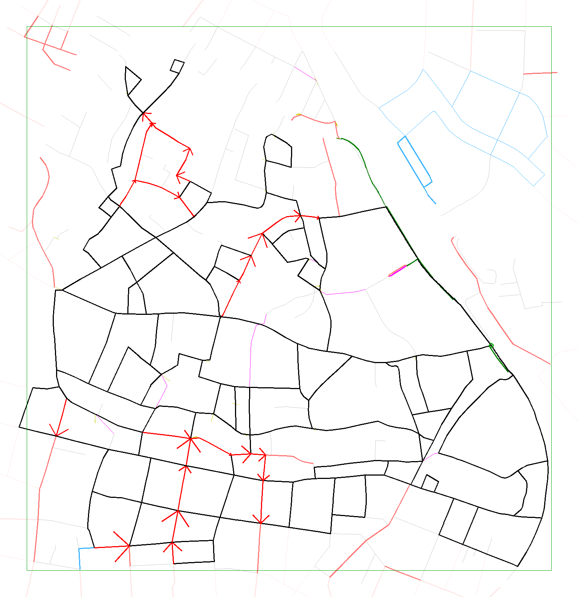
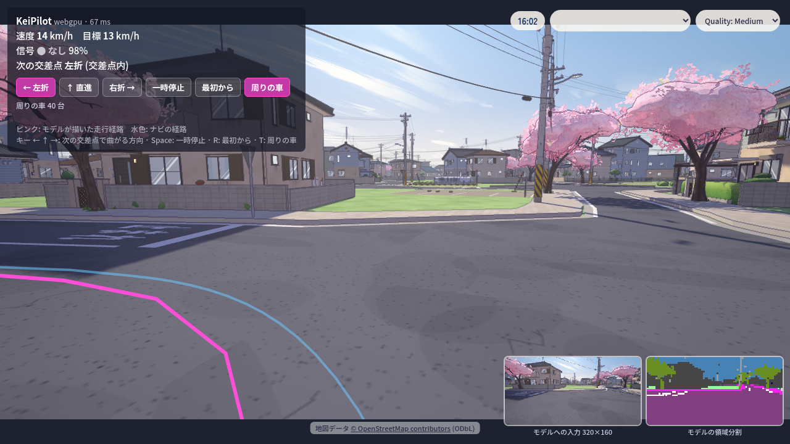

# 一方通行の対応と 西大井 の町 (2026-10-25)

ブランチ `claude/oneway-roads` (main 1ac6367 = v0.10 から)。計画は [oneway-road-plan.md](oneway-road-plan.md)、候補地の調査は [tokyo-lod3-site-survey.md](tokyo-lod3-site-survey.md)。

## できたこと

- 読み込み器 (`keisim/realworld.py`) が一方通行を向きつきの辺として残す。`oneway=-1` は反転、片側 2 車線以上の一方通行 (幹線の上下線) は落とす。
- 整形パスの向き対応: `merge_straight` は進行方向が揃うときだけ結合、`drop_duplicates` は逆向きの一方通行同士を二車線に、行き止まりの刈り込みは「入ってきた車が別の道で出られない辺」を落とす規則に、最大連結成分は最大強連結成分 (Kosaraju) に。
- **計画になかった追加: `Graph.merge_carriageways`**。中央分離帯のある道路は OSM では上下線が別々の一方通行の way で、合流点で V 字 (15° 前後) になる。そのままだと「鋭角の腕」として片側が落ち、道路網が切れた。並んで走る逆向きの一方通行の対 (16 m 以内、向きが逆) を 1 本の二車線道路に畳む。両側の脇道が別の場所で合流していても、合流点ごとに少しずつ畳んで最後は 1 本になる。
- 町 (`keisim/roadnet.py`): `RoadSpec.oneway` で車線 1 本を中心線上に、腕の `in` / `out` に -1 を許し、接続レーン・信号・停止線・標示・優先道路の判定・止まれ・信号機をそれに合わせた。
- 書き出し `roads[].oneway`、ブラウザ側 (`nav.js` 1 車線、`traffic.js` の優先道路の対に出るだけの腕も入れる、`roaddeco.js` 片方向)、`pilot_check.mjs --tdir`。
- 札幌は `TWO_WAY_TOWNS` で一方通行なしのまま固定 (同梱の町と v0.9 / v0.10 の評価の基準を変えない)。
- テスト: `tests/test_realworld.py` 11 本 (fixture の一方通行リンクは落とさず残す形に変更、グラフの規則、上下線の畳み込み)、`tests/test_keisim.py` もすべて通過。

## 候補地の見直し: 箱 A → 箱 C

調査の箱 A (35.616〜35.625 N、139.723〜139.734 E) は山手通り (片側 2〜3 車線、KeiSim で表現できない) が斜めに横切っていて、両側をつなぐのは山手通りの交差部だけでした。一方通行を入れても残る道路は 3.5 km (信号 4 → 1) で、調査で見込んだ 6.8 km は二車線の袋小路を数えた過大評価でした (強連結成分は袋小路を落とさない)。

周辺 1.8 km 四方を描いて、山手通りの南西側 (西大井・二葉) がひとつながりの網であることを確かめ、町をそこに移しました。

| | 箱 | 道路 (交差点の円を除く) | 交差点 | 信号 | 一方通行 |
|---|---|---|---|---|---|
| 箱 A (調査の候補) | 35.616〜35.625, 139.723〜139.734 | 3.5 km | 32 | 1 | 0.7 km |
| **箱 C (採用)** `osm_nishioi` | **35.612〜35.623, 139.719〜139.732** | **12.5 km** | **156** (3 本以上の腕 107) | 1 | 25 本 1.4 km |
| (参考) 札幌 | 43.088〜43.097, 141.360〜141.372 | 18.1 km | 240 | 11 | — |

黒が残った二車線、赤矢印が一方通行、緑が畳んだ上下線、灰色が落とした行き止まり、水色が別の成分 (山手通りの向こう側)。

信号は 1 か所だけです。調査で数えた 42 か所の信号の大半は山手通りと駅前の道路のものでした。信号を増やしたければ、別の町を足すか、山手通りの多車線化が要ります。

## 結果

### ゼロショット評価 (2026-10-26、札幌と同じ手順)

600 m × 20 ルート × 3 組 (エピソード 100〜 / 200〜 / 300〜) の 60 ルート、安全層 (`--brake_hold --red_hold`) つき、v0.9 = `runs/keipilot_v18/last.pt`、v0.10 = `runs/keipilot_v24/last.pt`。東京のデータは学習に使っていない。結果は `runs/eval/osm_nishioi/{expert,keipilot_v18_hold_red,keipilot_v24_hold_red}[_ep200|_ep300][_keiview].json`。

| 西大井 (60 ルート) | エキスパート | v0.9 | v0.10 | (札幌 v0.10) |
|---|---|---|---|---|
| KeiSim: DS / 完走 / 衝突 (車 + 人) | 0.972 / 57 / 1 | 0.863 / 47 / 5 (4 + 1) | 0.833 / 46 / 10 (9 + 1) | 0.928 / 54 / 6 |
| KeiView: DS / 完走 / 衝突 | — | 0.742 / 38 / 7 (5 + 2) | 0.786 / 40 / 10 (9 + 1) | 0.977 / 57 / 2 |
| 迷いで動けず KeiSim / KeiView | 0 / — | 6 / 13 | 0 / 8 | 0 / 1 |
| 止まれで完全停止 (91 か所) KeiSim / KeiView | 100 % | 25 % / 28 % | 100 % / 97 % | 100 % / 100 % |
| KeiView 描画 | | | 47〜52 ms/フレーム、町の読み込み 100 s | 23〜31 ms |

- v0.10 の衝突はほぼすべて優先道路の交差点で、止まれで止まったあとに出て優先道路の車とぶつかる札幌と同じ型。信号 (4 回通過) と一方通行そのものの違反はない。
- KeiView で v0.10 が 8 回「迷いで動けず」(札幌は 1): 中央線のない 4.5 m の一方通行や家の密度 (札幌の 2 倍) が学習に無い見え方。経路逸脱は KeiSim 2、KeiView 1 (ほかに脱輪 1)。
- v0.9 が KeiSim で v0.10 より衝突が少ないのは札幌と同じ理由 (止まれを 7 割通過、迷いで止まる) で、KeiView では v0.10 のほうが上。

### エキスパートの失敗 3 件 = シミュレーターの弱点

再現: `scripts/evaluate.py` と同じ設定 (`cfg.traffic.max_vehicles *= 2`、`max_peds *= 2`、`blocked_timeout 180`) で同じエピソードを走らせる。

1. **短い路側帯を往復する歩行者で立ち往生** (ep 216、ep 309、v0.10 の ep 309 も同じ)。歩行者は自分の路側帯 (`Town.walkways`、道路ごと) の端 1 m で折り返す。交差点の間が短い道では路側帯が 7.5 m / 10.5 m しかなく、歩行者は交差点の口でエゴの進路内を往復し続け、エキスパートは 5 m 手前 (`GAP0_PED`) で待ち続ける。`walking_in_road()` の端 6 m の除外も 12 m 未満の路側帯では効かない。
   対処案: 長さ 20 m 未満の路側帯には歩行者を置かない (`Pedestrians.__init__` の `p`)。乱数の引き方が変わるので札幌の評価も変わる。
2. **右折する周りの車が対向直進のエゴに譲らず衝突** (ep 205、交差点 96、street 同士の T 字路)。`Traffic._yield_gaps` は今の車線 (連結路) と次の車線の `yields` しか見ない。NPC は手前の交差点 98 の連結路 (17 m) にいる間は判定されず (d=None)、9.1 m の接続道路に入った時点で待ち位置まで 6.8 m < 制動距離 v²/8 = 10.4 m で「もう止まれない」と判断して進む。エゴ側の `min_arrival` の lookback は 49.2 s から must_yield=True を返していた。
   対処案: 次の車線が `LOOKBACK_LANE` より短いときは、その次の車線の `yields` も見る (エゴ側 lookback の鏡像)。札幌でも 25 m の街区で起こり得る。

どちらも直すと札幌の数値 (README の v0.9 / v0.10 の表) が再現しなくなるので、学習が一巡してからの判断にしている。

### 最初の確認 (2026-10-25)

- エキスパート: 600 m × 8 本、8/8 完走、DS 1.000、違反なし。
- KeiPilot v0.10 (安全層なし、20 ルート): DS 0.869、完走 16、車との衝突 3、経路逸脱 1 (`runs/eval/osm_nishioi/keipilot_v10_zero_shot.json`)。
- ブラウザ版 (headless Chrome、GPU、同梱の v0.9 ONNX): 読み込み 116 s、150 s 走って経路逸脱 1 回、周りの車 40 台で接触 1 (`web/.towns/town_osm_nishioi.json`、`node tools/pilot_check.mjs --town osm_nishioi --tdir .towns`)。家が 3,409 軒 (札幌の 2 倍、3,400 万三角形) あるので読み込みが重い。

### ブラウザ公開版 (2026-10-26)

`web/towns/town_osm_nishioi.json` (1.65 MB、`import_osm.py --name osm_nishioi --out web/towns`) を同梱し、右上のメニューに「西大井」を足した: <https://southern-star.github.io/keisim/?pilot=1&town=osm_nishioi>。説明板の文は町ごと (`main.js` の `about`)。

## 残していること

- 上の 2 つのシミュレーターの弱点 (短い路側帯の歩行者、周りの車の右折の譲り判定)。

- 二車線で `lanes=1` の 4 m 道路 (A で 1.6 km) はまだ 6 m の residential のまま。
- 上下線の畳み込みで動かした交差点は中央線から 2 m 以内にずれることがある (合流点ごとに畳むため)。
- PLATEAU 道路 LOD3 の幅員の取り込みは次の段階。
