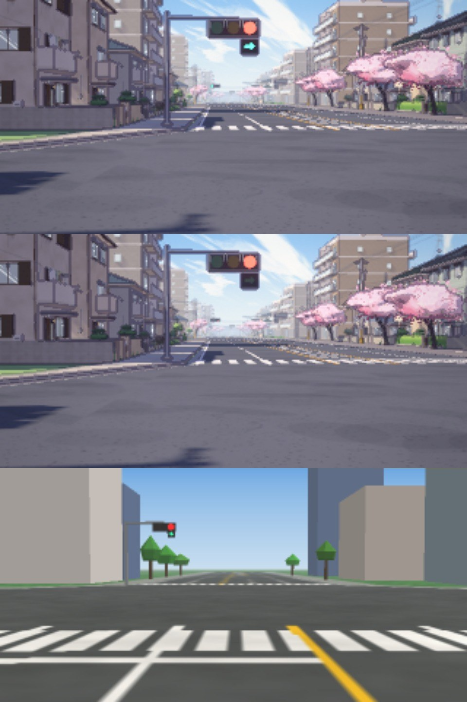

# 右折矢印の信号 (`TownConfig.right_arrow`)

2026-11-26 に足した、シミュレーターの要素です ([roadmap.md](roadmap.md) の 3 章)。
大きな交差点の右折専用車線に、右折の矢印の現示を付けます。

既定はオフです。オフのとき、街 (名前のタグ、信号の時刻のずれ) は今までと同じです。

上の 2 枚は KeiView の望遠カメラです (`arrows` の街 3000、信号機から 28 m)。上が矢印の時間で、赤の下に緑の右矢印が点いています。中が、その後の赤だけの時間です。
下は KeiSim の望遠カメラ (右折専用車線の停止線の 14 m 手前、矢印の時間) です。

## 1. 信号の時間

- **どの交差点か**: 2 現示の信号で、スクランブルでなく、進入路に右折専用車線 (`Lane` の kind が `pocket`) がある交差点です。`right_arrow` はその割合で、乱数は専用の流れから引きます。
- **1 つの現示**: 青 → 黄 → **矢印 (`right_arrow_s`、既定 6 秒)** → 全赤。
  - 矢印のあいだ、その現示の右折専用車線 (`Lane.arrow`) は青と同じ扱いです (`Junction.signal_state(phase, t, arrow=True)`)。直進と左折の車線は赤です。
  - 対向車は赤なので、右折は誰にも譲りません (`Traffic.min_arrival` の「赤で止まる車は来ない」がそのまま効きます)。
  - 歩行者用の信号は、矢印のあいだも赤です。
  - 1 周は、矢印の分だけ長くなります (`Junction.per`、`Junction.cycle`)。時刻のずれ (`Junction.offset`) は矢印なしと同じ値です。
- **街の型 `arrows`**: 大きな交差点の街 (`bigjunction`) からスクランブルを外し、右折専用車線のある信号交差点すべてに矢印を付けた型です。道路の配置と街並みは `bigjunction` と同じです。
  - `bigjunction` のままだと、右折専用車線のある交差点の多くがスクランブルになり、矢印はほとんど付きません (街 3000 で 16 の信号交差点のうち 1 つ)。

## 2. 描き方

- **信号機**: 矢印のある進入路の信号機 (`Town.signal_heads` の `arrow`) は、赤の灯の下に小さな箱があり、運転者の右を指す緑の矢印が付きます。
- **点灯**: 矢印の時間だけ点きます (`Junction.arrow_on`)。向きによる明るさとセグメンテーションのラベル (点いている間は `tl_green`) は、ほかの灯と同じ決まりです。
- **KeiSim**: `keisim/render/meshes.py` (矢印の灯の番号は `3 × 信号機の数 + 信号機`)、`camera.py`、`SceneState.arrow_state`、`World.arrow_states` です。
- **KeiView**: `web/src/world/signals.js` (`arrowOn`、`signal-arrows` のインスタンス)、街の書き出し (`scripts/export_town.py`: 交差点の `arrow`、信号機の `arrow`) です。
  - ブラウザ版の周りの車の信号 (`web/src/traffic.js`) も、1 周の長さに矢印を入れました。ブラウザ版のメニューの街には、矢印はありません。
- Python と JavaScript の信号と矢印の時刻は、`arrows` の街 3000 の全交差点・全現示の 25,952 時刻で一致しました。

## 3. エキスパートと評価

- エキスパートと周りの車は、矢印を青として右折します。エキスパートの計画には、自分の車線の矢印が点いているかの印 (`plan["arrow"]`) を足しました。
  - 信号の読み (`tl_state`) は、矢印のあいだも「青」です。今のモデルの信号の出力は 4 つの読み (赤、黄、青、なし) なので、矢印の読みを足すのは学習のときです。
- **評価のスイート `arrows`**: `arrows` の街 (右折専用車線のない 3002 を除く 9 つ) で、信号のある右折の手前から始まる 600 m × 27 ルート (`hidden_right` と同じ選び方、横断歩道 0.7) です。
- **エキスパート** (同じ 27 ルート、矢印あり / なし):

  | | 完走 | 最初の右折の前後で止まっていた時間 | 右折を抜けるまでの平均 | 矢印で右折した歩 |
  |---|---|---|---|---|
  | 矢印あり | 25 | 379 秒 | 34.8 秒 | 238 |
  | 矢印なし | 24 | 286 秒 | 29.9 秒 | 0 |

  矢印の 6 秒の分だけ 1 周が長くなり、待ち時間はかえって延びます。完走しなかったルートは、どちらも詰まりです。

## 4. まだしていないこと

- 信号を読む出力に、矢印の読みを足すこと (モデルの変更と学習)。
- ブラウザ版のメニューに、矢印のある街を入れること。
- 青のあとに矢印が出る形だけです。矢印が先に出る形や、直進・左折の矢印はありません。
