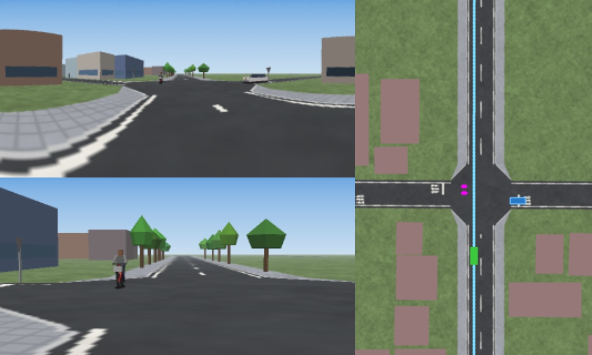

# 歩道を走る自転車 (`TrafficConfig.sidewalk_bikes`)

2026-11-23〜26 に足した、シミュレーターの要素です ([roadmap.md](roadmap.md) の 3 章)。
今までの自転車 ([bicycles](bicycles), `TrafficConfig.bicycles`) は、車道の左端を走ります。
この要素は、歩道を走る自転車です。
交差点の角から道路に出てきて横断歩道や道路の口を渡るので、曲がる車との巻き込みや、角の陰からの出会い頭が起きます。

既定はオフです (`--sidewalk_bikes 0`)。オフのとき、乱数を 1 つも引かないので、今までのエピソードは変わりません。



札幌 (`osm_sapporo`、エピソード 104) の 62.8 秒目です。左上が Mc の円筒カメラ (180°)、左下が望遠 (50°)、右が真上からの図 (自転車は紫) です。
信号のない交差点で、自転車が脇道の口を渡っています。

## 1. 動き方 (`keisim/sidewalk_bikes.py`)

- **どこを走るか**: 歩道 (`Town.walkways` のうち、路側帯でないもの) の車道寄り (道路交通法 63 条の 4) を、どちら向きにも、時速 10〜16 km で走ります。
  - 前を歩く人と、向かってくる自転車とは、左右に 0.5 m よけてゆっくりすれ違います。同じ向きの遅い自転車には後ろに付きます。
  - 2 割は遅い型の自転車です。描き方は、今までの自転車 (`Bicycles.scene` と同じ形) を使います。
- **交差点の角で** (`sidewalk_links`): 歩道は交差点の縁で切れているので、同じ交差点の歩道の端どうしをリンクでつなぎます。
  - **角を曲がる**: となりの道路の歩道へ。2 本の歩道の端を結ぶ弦を、交差点の外側へ少しふくらませた線です。交差点の路面にかかるものは作りません。
  - **まっすぐ渡る**: 前にある道路の口を渡って、向こう側の歩道へ。2 現示の信号では、その道路の横断歩道の上を、歩行者用の信号で渡ります。それ以外の信号では渡りません。信号のない交差点では、自分で確かめてから渡ります。
  - **引き返す**: 行き先がないときと、1 割ほど。
- **渡る前の確かめ方**:
  - 信号: 歩行者用の青で、渡り切る時間があるときだけ渡ります。止まり切れない距離まで来ていれば、そのまま渡ります。
  - 信号のない交差点: 6 割は慎重で、縁石の手前で時速 5 km まで落とし、車が 3.5 秒以内に来るなら待ちます。残りは速度を落とさず、2 秒以内に来る車があるときだけ止まります (出会い頭)。
  - 1.5 割は、歩行者用の信号が赤でも、信号のない交差点と同じ確かめ方で渡ります (信号無視)。
- **縁石の位置**: 車が走れる所 (渡る道路の車道、交差点の路面、曲がる車の通り道) に入る点です。左折する車は交差点の角を回り込むので、渡る道路の車道より手前から車が来ます。
- **車をよける**: 進む先 6 m に車の車体があれば、その手前で止まります。止まっている車に 3 秒以上ふさがれ、自分も車の前にいるときは、来た縁石の方へ自転車を押して下がります。

## 2. 周りの車とエキスパートからの見え方

- **車道の自転車**: 横断リンクの車道の上にいる自転車と、時速 3.6 km より速く車道に入ろうとしている自転車は、周りの車にもエキスパートにも障害物です (人と同じ通り道の判定)。縁石で待っている自転車は障害物ではありません。
- **横断歩道**: 横断歩道を渡っている自転車と、信号が青で横断歩道に向かっている自転車は、歩行者と同じ横断歩道の規則 (`Pedestrians.crosswalk_people`) に入ります。曲がる車とエキスパートは、歩行者と同じように譲ります。
  - 向かっている自転車は、縁石までの距離の分だけ横断歩道の手前にいるものとして数えます。着く時間で判断されます。
  - 縁石で止まっていて、目の前に車がいるため渡れない自転車は数えません。数えると、車は自転車を、自転車は車を待ち続けます。
- **信号のない道路の口** (`Expert.rider_crossings`): エキスパートは、自転車の横断の線が自車の通り道に入る点に、自車が通り過ぎる前に自転車が着くなら、その線の 1 m 手前で止まります。左折での巻き込みと、角からの出会い頭の両方です。
  - 通り道は、自車の幅に両側 0.5 m を足して見ます。斜めに交わる線では、車体の角が先に線にかかるためです。
- **自転車の予測**: 車道にいる自転車と車道に入ろうとしている自転車は、0.8、1.6、2.4 秒先の位置もエキスパートの障害物になります。
- `--bike_visible 1` (`EnvConfig.expert_bike_visible`) のとき、エキスパートは組の最初のカメラに映っている自転車だけを見ます。
- 歩行者は、動いている自転車を車と同じように避けます。
- 自車との衝突は `collision_bicycle` です。

## 3. エキスパートで測った結果

1 km あたり 12 台 (上限 30 台) です。数字は完走したルートの数です。

| スイート | なし | あり |
|---|---|---|
| `crosswalks` (2.5 km × 20) | 20 | 19 (時間切れ 1) |
| `bigjunction` (2.5 km × 20) | 20 | 16 (周りの車との衝突 3、行き詰まり 1) |
| `suburban` (2.5 km × 20) | 19 (周りの車との衝突 1) | 19 (周りの車との衝突 1) |
| 札幌 (600 m × 30) | 30 | 29 (周りの車との衝突 1) |

- **自転車との衝突は 0 件です。**
- 走っている途中で見つけて直したこと:
  - 縁石で待つ自転車を横断歩道の上の人として数え、車と自転車が互いを待ち続けていました。
  - 自転車の待つ位置と曲がり角の線が、交差点の車が通る部分にかかっていました。左折する自車の車体が、そこで待つ自転車に当たっていました。
  - 左の歩道を同じ向きに走る自転車を追い越して左折し、巻き込んでいました (札幌 101)。今の `Expert.rider_crossings` で譲ります。
- 見つけた自転車の横断リンクの数 (街 1 つ):

  | 街 | 角を曲がる | 信号で渡る | 信号のない口を渡る |
  |---|---|---|---|
  | twophase 1010 | 62 | 18 | 0 |
  | bigjunction 3000 | 52 | 36 | 0 |
  | suburban 2000 | 26 | 14 | 0 |
  | 札幌 | 106 | 56 | 162 |

  手続き的に作る街では、3 本以上の道路が集まる交差点はすべて信号付きです。信号のない口での出会い頭は、札幌のような実在の街でだけ起きます。グリッドの街の出会い頭は、信号無視の自転車と、青で角の陰から速く出てくる自転車です。

## 4. 未解決

- **周りの車との衝突が増えました**: 自転車ありで 60 ルート中 4 件、なしでは天気の乱数を変えた 2 回で 1 件と 0 件です。
  - 再生した 2 件 (`bigjunction` 3008・9800、3005・9800) は、どちらも自転車が直接関わっていません。右の車線からの割り込みと、交差点の中での車どうしの交差でした。
  - 自転車が車道に出て周りの車がブレーキをかけ、その影響で車線変更や交差点での動きが変わっている可能性があります。まだ確かめていません。
- 時間切れ 1 件と行き詰まり 1 件の原因は、まだ見ていません。
- KeiView では描いて確かめていません。自転車の描き方は今までと同じなので、そのまま描かれるはずです。
- ブラウザ版には、まだありません。
- KeiPilot Mc の学習には、まだ使っていません。

## 5. 使い方

```bash
uv run python scripts/evaluate.py --agent expert --suite crosswalks --sidewalk_bikes 12
uv run python scripts/collect.py --sidewalk_bikes 12 --town_style twophase ...
```

評価の結果の名前には `_sw12` が付きます。
